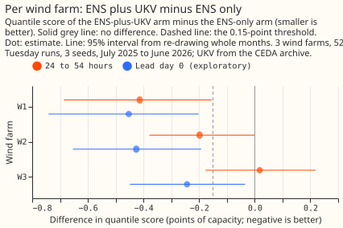

# Experiment 54: does UKV, learned from its own history, help the wind-farm forecast?

**UKV, the Met Office's 2 km forecast, adds real information to an ENS-based wind-farm forecast at
1 to 2 days ahead, worth about 0.2 points of capacity, and the experiment rules out a gain larger
than about 0.3.** We asked whether giving three metered wind farms' forecast model the Met Office's
UKV wind forecast, as extra inputs beside the European Centre's ensemble forecast (ENS), lowers the
forecast error. Every model learned from its own history of forecasts and metered power, with the
same training window and settings. The error fell by 0.198 points of capacity (95% interval -0.316
to -0.069) at 24 to 54 hours after the ENS run's 00 UTC start. That gain is resolved, and its upper
end is too small to clear the 0.15-point bar we set before the run, so the verdict is `small
gain`. The UKV data come from a research archive, not the live feed, so the result is a ceiling,
and no deployable UKV history exists for lead days 1 and 2. The next step is to find or build a
live UKV history for the farms, and to test UKV at lead day 0, where a live history exists.

**What it narrows.** UKV's own forecast alone is much worse than ENS (+0.881, +0.460 to +1.308),
so UKV helps as an addition and not as a replacement. A placebo that shuffles the UKV values scores
the same as ENS alone (+0.013, -0.012 to +0.040), so the gain comes from UKV's information. Two of
three farms gain and one does not. The ENS-only model scored level with the ERA5-trained best
guess here, which experiment 1 had not led us to expect.

## Results

**The primary contrast C1 is the ENS-plus-UKV arm minus the ENS-only arm, for cases 24 to 54 hours
after the 00 UTC start of the ENS run's date.** UKV's leads stop at 54 hours, so these cases are
lead day 1 and the first 6 hours of lead day 2. C1 is -0.198 (95% interval -0.316 to -0.069; 28,230
cases, three farms, three seeds, whole months re-drawn), and the pre-registered threshold was
-0.15 for the interval's upper end. The CEDA archive is not the live product (its licence is
non-commercial and it differs statistically from the live feed), so the page reports the result as a
ceiling: a gain a matched UKV might add, not one a service could now deliver. The prediction was
-0.2 to -0.5, and the estimate lies at the low end of that range.

## Absolute scores

**The quantile score (twice the mean pinball loss over nine quantile levels, in points of capacity;
smaller is better) of every arm.** Coverage is the share of cases inside the 5% to 95% band
(nominally 0.90), and the 0.95 column is the share above the 0.95 quantile. Arm A is the ENS-only
XGBoost model, B adds UKV, C is UKV alone, and the placebo is B with the UKV values shuffled. The
reference rows are experiment 33's ERA5-trained best guess and its ENS-trained model on the same
cases, which are the 52 Tuesday runs that have a complete UKV run.

| Arm | Lead day 0 (0 to 24 h) | 24 to 54 h | All cases | Coverage, 24 to 54 h | Above 0.95, 24 to 54 h |
|---|---|---|---|---|---|
| A, ENS only | 6.337 | 6.119 | 6.189 | 0.924 | 0.031 |
| B, ENS plus UKV | 5.963 | 5.921 | 5.935 | 0.900 | 0.042 |
| C, UKV only | 6.666 | 7.000 | 6.892 | 0.858 | 0.062 |
| Placebo | 6.334 | 6.133 | 6.198 | 0.925 | 0.030 |
| Reference, ERA5-trained best guess | 6.789 | 6.337 | 6.483 | 0.915 | 0.050 |
| Reference, ENS-trained (experiment 33) | 6.312 | 6.137 | 6.193 | 0.947 | 0.019 |

At 24 to 54 hours, arm B's band is slightly narrower than arm A's (coverage 0.900 against 0.924, and
0.042 above the 0.95 quantile against 0.031), as expected when the trees lean on UKV and no spread
factor corrects it. Per farm at 24 to 54 hours, the scores are A 5.871, 6.382, 6.109 and B 5.458,
6.184, 6.127 at W1, W2, and W3.

## What else the numbers show

All reads in this section are exploratory.

- **Two farms gain and one does not.** B minus A at 24 to 54 hours is -0.413 (-0.686 to -0.155) at
  W1, -0.198 (-0.378 to -0.000) at W2, and +0.018 (-0.177 to +0.219) at W3.

  

- **The gain holds across the UKV upgrade and without July.** B minus A is -0.189 (-0.342 to
  -0.025) before UKV's upgrade of 2026-01-21, -0.210 (-0.387 to -0.006) after it, and -0.180
  (-0.309 to -0.045) without July 2025.
- **Lead day 0 gains more.** B minus A at 0 to 24 hours is -0.374 (-0.526 to -0.203), and over all
  cases it is -0.255 (-0.348 to -0.145). Lead day 0 lies outside the contrast.
- **The placebo scores the same as arm A.** The placebo minus A is +0.013 (-0.012 to +0.040) at 24 to
  54 hours, and B minus the placebo is -0.211 (-0.334 to -0.076).
- **UKV alone is far worse than ENS alone.** C minus A is +0.881 (+0.460 to +1.308) at 24 to 54
  hours and +0.329 (-0.113 to +0.795) at lead day 0.
- **ENS plus UKV beats the ERA5-trained best guess.** B minus the best guess is -0.416 (-0.693 to
  -0.136) at 24 to 54 hours and -0.826 (-1.586 to -0.103) at lead day 0.
- **The ENS-only model is level with the best guess.** A minus the best guess is -0.218 (-0.472 to
  +0.069) at 24 to 54 hours, and the experiment 33 ENS-trained model minus A is +0.018 (-0.026 to
  +0.064). Experiment 1 had the ERA5-trained model ahead by 1.70 points; this contrast covers only
  the first 54 hours.
- **UKV is slower than ENS at the farms.** Over the scored cases, UKV's mean 10 m wind speed is
  4.46 m/s against 5.00 m/s for the ENS control member.

## How the experiment was run

- **Arms:** every arm is an XGBoost model with nine quantile levels, trained per farm and per seed
  (0, 1, and 2) with experiment 33's recipe for its ENS-trained model: the ENS control member of the
  daily 00 UTC runs from 2024-04-01 to 2025-06-30, recency weights with a half-life of 2 years,
  `lead_hours`, and three lags of power from the 09:00 UTC origin. The three farms have 40,864,
  40,876, and 40,846 training rows (W1, W2, W3), identical for every arm. Arm B runs once per ENS
  member with the UKV columns fixed, and the 51 member quantile sets are pooled.
- **UKV:** the CEDA archive's 00 UTC run of the ENS run's date, at each farm's nearest 2 km cell
  (0.9 to 1.1 km away). The four columns are 10 m speed, the sine and cosine of the 10 m direction,
  and the speed at 925 hPa, because the archive holds no 100 m wind. The store lacks hourly steps
  49, 50, 52, and 53, which are interpolated linearly, and a valid time at :30 averages the east-west
  and north-south components of the hours either side. All 455 of the 456 training runs and 52 of
  the 53 validation Tuesday runs have a complete UKV wind set at each farm; the run of 2026-06-30 is
  missing and its cases are dropped from every arm.
- **Latency:** the experiment assumes the 00 UTC UKV run is available within 8 hours of its start,
  from the Met Office's published schedule, and did not measure it. The service reads ENS at 09:00
  UTC.
- **No matched live history:** Open-Meteo's UKV history at the farms holds only `previous_day1`
  (lead day 0), starting on 2024-08-06 and covering 71% of the training window at one farm.
- **Departures from the plan:** none in the contrast or the decision rule. The plan's four-column UKV
  set and the 24 to 54 hour range are as planned; the exploratory splits were added as planned.
- **Code:** `ml-experiments/00054-product-trained-xgboost-wind-farms/`. One Sonnet plan review and
  one Sonnet code review found no leakage; the code review noted that the UKV run coverage is
  counted per run in the fit script, so a separate check script counts it per farm (455 and 52 at
  every farm) and finds no placebo group of one row.

## What the next experiment should answer

**Whether a live UKV feed gives the same gain.** The Met Office's live UKV forecast is the product a
service would receive, and the CEDA archive differs from it statistically. The next experiment
should build a matched history of the live UKV for the three farms, which needs a source that holds
live UKV at lead days 1 and 2 (Open-Meteo's history stops at lead day 0), and rerun arms A and B on
it. A second option is a lead day 0 test on Open-Meteo's live UKV, where the CEDA arm already gains
-0.374.
