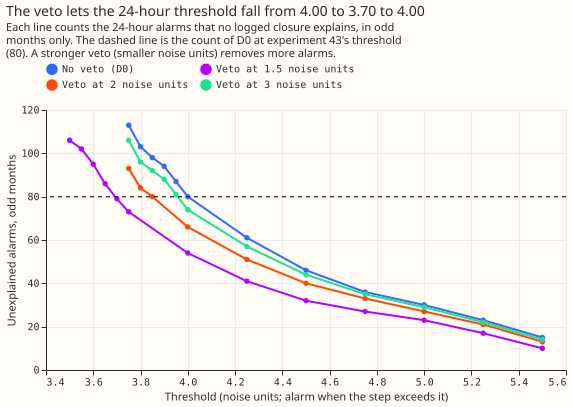
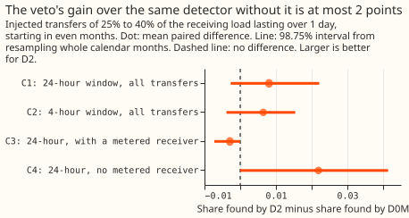
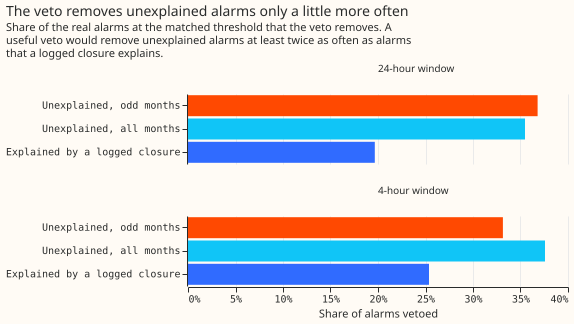
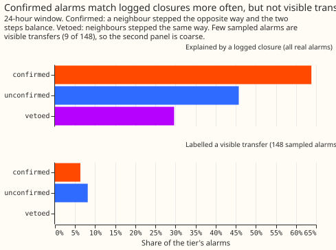

# Experiment 55: does a neighbour veto help the single-series switching detector?

**A neighbour veto makes the single-series detector slightly more precise, and at the strengths
tried it finds only about 1 point more of the injected transfers.** We kept every alarm of the
single-series detector D0, which raises an alarm when the 24-hour mean of one Primary substation's
residual (measured minus predicted power) steps up or down. We then removed the alarms that look
like a weather or calendar miss, because at least two neighbouring Primary substations stepped the
same way and none stepped the opposite way. With those alarms gone the threshold could fall from
4.00 to 3.70 noise units at the same rate of unexplained alarms, and the detector found 0.363 of 620
injected transfers against 0.355 without the veto (+0.008, 98.75% interval -0.003 to +0.022). The
verdict is inconclusive. We tried veto strengths of 1.5, 2.0, and 3.0 noise units, and a stronger
veto was not tried. D2 denotes D0 with the veto. The small gain came through the lower threshold,
mostly in the transfers with no metered receiver, which are 44% of the headline band. D0 finds 0.17
of those and D2 finds 0.19, against 0.50 for the others. The gap may come from step size, because
the injection gives those transfers a smaller donor step (limits).

## Verdict

**C1, D2 minus D0M in the share of transfers found, is +0.008 (98.75% interval -0.003 to +0.022).**
D0M is D0 with its threshold chosen by the same search as D2's and no veto, so that neither
detector gets a threshold step the other was not offered. The search returned D0's own thresholds
(4.00 and 6.00), so D0M and D0 at experiment 43's thresholds are the same detector. The population
is the 620 injected transfers that move 25% to 40% of the receiving load for over 1 day and start in
even months: 89 of experiment 43's 160 and 531 of the 1,000 new ones. The rule asked for an
interval wholly above zero and a point value of at least +0.01. The rule called the hypothesis
refuted only if the upper end fell below +0.01. The verdict is therefore inconclusive. Of the 620
transfers, D2 finds 7 that D0M misses
and misses 2 that D0M finds.

| Contrast | Window, transfers | D2 | D0M | D2 minus D0M | 98.75% interval |
|---|---|---|---|---|---|
| C1 | 24 h, all (620) | 0.363 | 0.355 | +0.008 | -0.003 to +0.022 |
| C2 | 4 h, all (620) | 0.237 | 0.231 | +0.007 | -0.004 to +0.015 |
| C3 | 24 h, metered receiver (346) | 0.500 | 0.503 | -0.003 | -0.007 to +0.000 |
| C4 | 24 h, no metered receiver (274) | 0.190 | 0.168 | +0.022 | +0.000 to +0.041 |

**The gain sits in the transfers that have no metered receiver.** For those, the lower threshold
finds 6 more of 274. For transfers with a metered receiver, the veto changes nothing (-0.003). The
lower end of C4 and the upper end of C3 sit at exactly zero because every changed transfer moved
the same way, so read C4 as "at least 0". C1 rests on 9 changed transfers (7 gained, 2 lost).

## What held in the prediction and what did not

- **Held: C1 lay in the predicted 0.00 to 0.02** (+0.008, point value just under the +0.01 bar).
- **Held: the veto cost few found transfers.** It removed 2 of the 220 transfers D0M finds, under
  the predicted 10%.
- **Partly held: the veto separates unexplained alarms from logged ones weakly.** The prediction
  gave 18% of the unexplained odd-month alarms and 12% of the logged ones at a veto of 2.0 on the
  original thresholds. At the matched threshold of the chosen veto (1.5) it removes 37% of the
  unexplained 24-hour alarms in odd months, 35% of those in all months, and 20% of the alarms a
  logged closure explains, a ratio of 1.8. At 4 hours the ratio is 1.5 (38% to 25%). The 35 vetoed
  24-hour alarms that a logged closure explains are spread over 12 of the 16 series.
- **Held: the confirmed tier is explained by a logged closure more often.** At 24 hours 64% of
  confirmed alarms, 46% of unconfirmed ones, and 30% of vetoed ones lie within 24 hours of a logged
  closure.
- **Held at veto 2.0, exceeded at the chosen strength: the matched threshold fell by 0.15 at 2.0
  (predicted 0.05 to 0.20) and by 0.30 at the chosen 1.5.** Odd months chose the strongest
  veto, 1.5 noise units (odd-month share found 0.304, against 0.287 at 2.0 and 0.274 at 3.0). The
  threshold fell by 0.15 at 2.0 and 0.00 at 3.0. The strongest veto was the edge of the grid, so a
  stronger one was not tried.

## Precision, and what the confirmed tier tells us

**The veto raises the precision of the real alarms by about 3 points at 24 hours and 6 to 7 points
at 4 hours.** In even months, the lower
precision bound (alarms within 24 hours of a logged closure over all alarms) of the 24-hour detector
rises from 0.441 to 0.474 and event F1 (the harmonic mean of the share found and the precision) from
0.393 to 0.411. At 4 hours the bounds rise from 0.471 and 0.528 to 0.538 and 0.588, and F1 from
0.310 and 0.321 to 0.329 and 0.338. D2 raises 137 24-hour alarms in even months against 143 for D0M,
and 72 unexplained ones against 80, so D2 sits at a slightly stricter operating point, which biases
the comparison against D2.

**The confirmed tier is not more often a visible transfer.** Of experiment 41's 148 labelled alarms,
5 of the 79 confirmed, 4 of the 49 unconfirmed, and 0 of the 20 vetoed were labelled visible
transfers. The sample is too coarse to separate the tiers, so the 148 labelled alarms do not support
using the confirmed tier as a training mask for the normal-running-arrangement forecast.

**D2 finds 88% of the transfers with a metered receiver through an alarm that names the donor or a
receiver.** Of the 360 such transfers that D2 finds at 24 hours, over all months, 316 are found by
such an alarm.

## Near bank holidays

**The veto loses transfers near bank holidays: of 300 transfers that start within 1 day of one,
D0M finds 94 and D2 finds 90.** D2 loses 6 and gains 2. The holiday set is drawn with logged
closures only, and 206 of its 300 onsets lie within 2 days of an alarm of experiment 43's four
settings. Under experiment 43's full quiet mask, only 94 of the 300 would have been kept (a separate
count from the 94 that D0M finds). Experiment 43's 160 transfers are found at 47 (D0M) and 53 (D2),
and the new 1,000 at 321 and 336.

## Real transfers

D2 finds 2 of the 14 labelled real transfers of 25% or more of the receiving load that last over 1
day, against 1 for D0M, and 3 of the 35 labelled transfers over 1 day against 2. At 4 hours the
counts are 0 of 14 and 1 of 35 for both detectors. The real-transfer counts carry no verdict.

## Limits

- **The 0.17 against 0.50 gap mostly reflects the injection.** A transfer with no metered receiver
  moves 25% to 40% of half the donor's load, a median step of 16% of the donor's load, while a
  transfer with a metered receiver has a median step of 55% (interquartile range 26% to 80%). The
  44% share of the band is a property of the sampler, and not a measure of the real electricity
  network.
- **The veto strength sits at the edge of the grid.** The strongest value, 1.5 noise units, won on
  odd months, where its gain over no veto was +0.030 (22 transfers gained, 6 lost) against +0.013 at
  2.0 and 0.000 at 3.0. The even-month gain was +0.008, so the interval's upper end of +0.022 is not
  a ceiling for a stronger veto.
- **The pre-registered veto rate was checked on the alarms, not on the scored run.** The prediction
  of 14 of 80 unexplained odd-month alarms vetoed at 2.0 noise units and threshold 4.00 comes from
  `e00055_prerun.py`; the scored run reports the rates at the chosen strength and matched threshold.
- **The 24-hour precision is a point value.** The sample of 148 labelled alarms had no visible
  transfer among its 24-hour alarms, so the upper precision bound equals the lower. The 4-hour
  bounds reuse D0's sampled visible rate for D2, although the veto changes which alarms survive.
- **The injected transfers sit away from alarms.** Experiment 43's quiet mask keeps the original and
  new sets at least 2 days from an alarm of its four settings on every series, which understates how
  often a wrong veto happens. The holiday set drops that condition.
- **Transfers injected in one batch could interact.** A batch keeps events apart only when they
  share no series, so simultaneous transfers on adjacent substations could trigger or block a veto,
  which affects D2 and not D0M. We did not measure this.
- **D0M equals D0.** The matching search returned D0's thresholds, so comparing with D0M adds
  nothing beyond comparing with D0.
- **The residual needs ERA5.** ERA5 (the ECMWF Reanalysis, version 5) arrives about 5 days after the
  event, so the detectors run retrospectively.

## What the next experiment should answer

**The next experiment should show whether the missed transfers are steps too small to detect or
detectable steps that the detector misses.** It re-cuts recall by the donor's step in noise units,
split by metered receiver, and extends the veto grid to 1.0 and 1.25 noise units. Small missed steps
would argue against a better step statistic. Detectable missed steps would argue for the
shape-aware switching detector planned as SW2-7. SW2-7 models the moved load as a share of the
donor's expected daily profile, which is also how the injection builds transfers, so its recall on
injected transfers would flatter it. The plan for SW2-7 should therefore score transfers injected
with a different shape, and the 14 and 35 labelled real transfers.

Code: `ml-experiments/00055-sw2-8-neighbour-veto-single-series-detector/`, with every number
printed by `e00055_report.py`.
