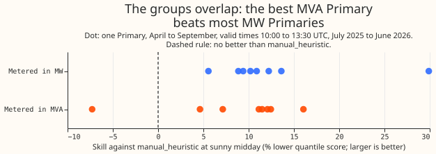
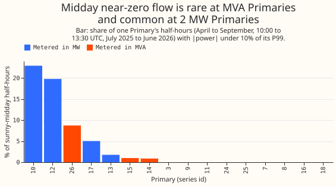

# Experiment 56: does Flexpectation v1 need special handling at MVA-only Primaries?

**At sunny middays the best-guess forecast has 5.6 percentage points less skill at the 8 Primary
substations metered only in MVA than at the 8 metered in MW, but the 95% interval (-5.0 to 14.6)
includes zero, so 8 time series against 8 cannot say whether MVA metering hurts the forecast.** The
experiment found no evidence that Flexpectation v1 needs special handling, and could not rule out a
loss of up to about 15 percentage points. A Primary substation steps the voltage down to 11 kV or
33 kV. Eight of the 16 trial-area Primaries have a meter that records signed real power in megawatts
(MW). The other 8 record only the magnitude of apparent power in megavolt-amperes (MVA), with no
sign. When embedded solar pushes a substation's net flow through zero, an MVA reading no longer
shows which way the power went. We took the forecasts that experiment 33 stored for every
half-hour from July 2025 to June 2026. They come from its best-guess forecast of Primary-substation
demand (an XGBoost model with a 14-day error correction and a 1.15 spread factor) and from a simple
rule-based forecast, `manual_heuristic`. Skill is the percentage by which the best guess's
quantile score, the standard error measure for a probabilistic forecast, is lower than
`manual_heuristic`'s. At sunny middays (April to September, 10:00 to 13:30 UTC) the skill is 15.9%
at the MW substations and 10.3% at the MVA substations. Nothing was fitted.

## Result

**The verdict is `inconclusive`, by the rule fixed before the run.** The rule called MVA clearly
worse when the interval's lower end was above zero and the gap was 5 percentage points or more, and
called Flexpectation v1 safe to ignore when the upper end was under 5. The gap is 5.6, but the
lower end is below zero and the upper end is above 5. Each interval resamples whole months.

**Skill is lower at the MVA substations all year, not specifically at sunny middays.** Skill is
pooled over a group's cases (figure 1). In all hours the MW group's skill is 15.0% and the MVA
group's 4.5%, a gap of 10.5 percentage points (2.1 to 17.5). Outside sunny middays the gap is 11.2
(2.7 to 18.3). At sunny middays it is 5.6 (-5.0 to 14.6), and the MVA group's skill is higher (10.3%)
than in other hours (3.7%).

| Hours | Best guess, MW group | `manual_heuristic`, MW group | Best guess, MVA group | `manual_heuristic`, MVA group |
|---|---|---|---|---|
| All hours | 5.22 | 6.13 | 5.41 | 5.67 |
| Sunny midday | 7.23 | 8.60 | 7.47 | 8.34 |
| Other hours | 5.03 | 5.90 | 5.22 | 5.42 |

*Pooled mean quantile score in points of capacity, July 2025 to June 2026, 16 Primary substations.*

**The substations are too few to separate the groups.** Resampling the time series within each
group, instead of the months, gives a sunny-midday gap of 5.6 percentage points with an interval of
-2.8 to 14.0 (figure 2 shows each substation). The all-hours gap's interval then runs from -2.0 to
20.2, and includes zero.

**Half-hours near zero flow are few, and the best guess's skill there is lower in the MVA group.**
Of the 403,712 half-hours scored across the 8 MVA time series, 5,904 (1.5%) have the magnitude of
the power within 10% of capacity of zero, and 500 of those are at sunny middays (1.5% of 34,176).
For the 8 MW time series the figures are 8,954 of 364,361 (2.5%) and 2,167 of 31,044 (7.0%). On
those half-hours the best guess's skill is 18.8% in the MVA group (4.1 to 30.2) and 46.1% in the MW
group (25.2 to 58.7), a gap of 27.4 percentage points (-0.3 to 48.2). Away from zero flow the gap
is 7.8 (1.0 to 13.8). At sunny middays, leaving out the near-zero half-hours cuts the gap from 5.6
to 2.0 percentage points (-4.6 to 8.0). So the near-zero half-hours account for part of the
sunny-midday gap, but every interval on them includes values near zero or is wide, so the data do
not settle it. A second measure is the share of a substation's sunny-midday half-hours in which the
magnitude of the power is under 10% of its own 99th percentile. It is 0% at 5 of the 8 MVA
substations, at most 1.5% at 7 of them, and 9.0% at the highest (series 26), against 26.1% and
23.7% at 2 MW substations, series 10 and 12 (figure 3).

## Check added after seeing the results: one MW substation

**One MW substation (series 12, with 31% skill over all hours and 29.9% at sunny middays) accounts
for most of the MW group's advantage.** Leaving series 12 out of the MW group, and changing nothing
else, moves the sunny-midday gap from 5.6 percentage points to -0.3 and the all-hours gap from 10.5
to 3.8. Leaving out any other single substation moves the sunny-midday gap by no more than 1.4. The
verdict does not use this check.

## Failures and caveats

- Eight time series against 8 cannot exclude a skill gap of up to about 15 percentage points at
  sunny middays, and the groups differ in more than meter unit, such as the substations' size and
  solar capacity.
- Skill is measured against `manual_heuristic`, which also forecasts the magnitude at the MVA
  substations, so the result measures a relative disadvantage.
- Experiment 41's labeller (the tool that finds switching events in the telemetry) was to be scored
  on how often it found events at MVA-side against MW-side substation pairs. That optional
  comparison was not run.
- Time series 7, 12, 13, and 18 have shorter histories than the other 12, so the counts of
  low-magnitude half-hours over each time series' whole history, which sit in the experiment's
  private folder, cover different periods. The figure counts only the scored year.

## Lessons for later experiments

**The experiment found no case for special handling of the MVA-only Primaries in Flexpectation v1,
and no strong evidence against one; the half-hours near zero flow are the place to look next.**
PVDIS-7 is the planned work to recover signed MW at the MVA-only Primaries. The case for it rests
on separating solar from demand, which the PVDIS series tests, and not on forecast skill. A later
comparison of unit groups should use more than 8 time series or show each series, and should say
which series account for the gap.
