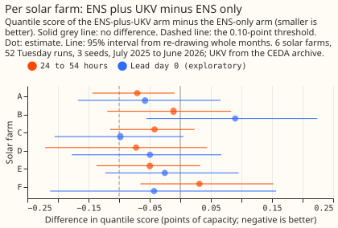

# Experiment 57: does UKV, learned from its own history, help the solar-farm forecast?

**Giving the Met Office's UKV forecast of sunshine, cloud, and temperature to a solar-farm forecast
that already uses the European Centre's ensemble (ENS) lowered the error by only about 0.03 points
of the farms' capacity at 1 to 2 days ahead, a difference the data cannot tell from zero, so the
verdict is `inconclusive`.** The error is the quantile score, a measure of how well a forecast's
range of likely power fits what happened, and 1 point is 1% of a farm's capacity. The 95% interval
is -0.12 to +0.04 points, so a gain larger than 0.12 points is ruled out, but the 0.10-point gain we
decided in advance would justify a new weather feed is not. UKV is much less useful for the six
solar farms than for the three wind farms, where it lowered the error by 0.2 points
([experiment 54](../00054-product-trained-xgboost-wind-farms/result.md)). UKV alone scores 0.40
points worse than ENS alone. We tested it by training XGBoost models, each on its own forecast
history, for six metered solar farms, with the same training window and settings, at 24 to 54 hours
after the ENS run's 00 UTC start (UKV's forecasts stop at 54 hours). The next step, if solar is
worth more work, is a source of a different kind, since a second numerical forecast of sunshine
adds little at these leads.

## Results

**The primary contrast C1 is the ENS-plus-UKV arm minus the ENS-only arm, for cases 24 to 54 hours
after the 00 UTC start of the ENS run's date.** C1 is -0.035 (95% interval -0.117 to +0.037;
48,048 cases, six farms, three seeds, whole months re-drawn). The pre-registered threshold was a
gain of 0.10, so the verdict is `inconclusive`: the interval includes zero and includes -0.10. The
prediction was -0.03 to -0.12, and -0.035 is at the weak end of that range. The CEDA archive is not
the live UKV product (its licence is non-commercial, and the [UKV-CEDA blends
study](../../studies/forecasts/ukv-ceda-blends.md) found it statistically different from the live
feed), so any gain would be a ceiling and not one a service could now deliver.

## Absolute scores

**Arm B scores best at 24 to 54 hours (3.105), and arm C, UKV alone, scores worst (3.544).** The
quantile score is twice the mean pinball loss over nine quantile levels, in points of capacity
(smaller is better), pooled over day and night cases; night cases score near zero for every arm.
Coverage is the share of cases inside the 5% to 95% band (nominally 0.90), and the 0.95 column is
the share above the 0.95 quantile (nominally 0.05). Arm A is the ENS-only XGBoost model, B adds UKV,
C is UKV alone, the placebo is B with the UKV values shuffled, and B3h is B with UKV rebuilt from
its 3-hourly steps. The reference rows are experiment 33's ERA5-trained best guess and its
ENS-trained model on the same cases, which are the 52 Tuesday runs that have a complete UKV run.

| Arm | Lead day 0 (0 to 24 h) | 24 to 54 h | All cases | Coverage, 24 to 54 h | Above 0.95, 24 to 54 h |
|---|---|---|---|---|---|
| A, ENS only | 4.987 | 3.140 | 3.757 | 0.941 | 0.028 |
| B, ENS plus UKV | 4.957 | 3.105 | 3.724 | 0.938 | 0.028 |
| C, UKV only | 5.440 | 3.544 | 4.178 | 0.935 | 0.026 |
| Placebo | 4.992 | 3.142 | 3.760 | 0.941 | 0.028 |
| B3h, ENS plus 3-hourly UKV | 4.963 | 3.119 | 3.735 | 0.936 | 0.028 |
| Reference, ERA5-trained best guess | 5.018 | 3.247 | 3.838 | 0.913 | 0.038 |
| Reference, ENS-trained (experiment 33) | 5.220 | 3.283 | 3.931 | 0.950 | 0.023 |

The band is slightly too wide for every arm at 24 to 54 hours (coverage 0.935 to 0.941 against
0.90). Per farm at 24 to 54 hours, the scores are A 3.292, 2.936, 2.780, 3.461, 3.559, and 2.947
and B 3.221, 2.925, 2.738, 3.389, 3.509, and 2.978 at farms A to F.

## What else the numbers show

All reads in this section are exploratory.

- **The placebo and the 3-hourly control differ little from the plain arms.** The placebo minus A
  is +0.002 (-0.007 to +0.012), so extra columns alone do nothing. B minus the 3-hourly control B3h
  is -0.014 (-0.049 to +0.008), so UKV's hourly steps are not what separates B from A.
- **Five of the six farms point towards a gain, none resolvably.** B minus A at 24 to 54 hours is
  -0.070 (-0.144 to -0.009) at farm A, -0.011 (-0.119 to +0.083) at B, -0.042 (-0.115 to +0.023) at
  C, -0.072 (-0.221 to +0.044) at D, -0.050 (-0.137 to +0.033) at E, and +0.031 (-0.065 to +0.152)
  at F. Only farm A's interval excludes zero, and one of six is what chance alone gives at 95%.

  

- **The gain is larger after UKV's upgrade.** B minus A is +0.020 (-0.040 to +0.089) before the
  Met Office's upgrade of 2026-01-21 and -0.133 (-0.262 to -0.017) after it. The models trained
  almost wholly on pre-upgrade UKV, so the post-upgrade gain is a lead for a later test and not a
  result.
- **Daylight cases alone give a similar estimate.** B minus A at 24 to 54 hours on cases with the
  sun above the horizon is -0.074 (-0.259 to +0.079), and without July 2025 it is -0.048 (-0.137
  to +0.028).
- **Lead day 0 and all leads agree with the primary read.** B minus A is -0.031 (-0.121 to +0.065)
  at lead day 0 and -0.033 (-0.076 to +0.009) over all cases.
- **UKV alone is worse than ENS alone.** C minus A is +0.404 (+0.103 to +0.764) at 24 to 54 hours
  and +0.453 (+0.214 to +0.710) at lead day 0.
- **The ENS-trained model scores close to the ERA5-trained best guess.** A minus the best guess is
  -0.107 (-0.327 to +0.053) at 24 to 54 hours, unresolved. Experiment 33's ENS-trained model
  scores 0.143 points worse than A (+0.087 to +0.201), which the experiment did not explain.

## How the experiment was run

- **Arms:** every arm is an XGBoost model with nine quantile levels, trained per farm and per seed
  (0, 1, and 2) with experiment 33's recipe for its ENS-trained model: the ENS control member of the
  daily 00 UTC runs from 2024-04-01 to 2025-06-30, recency weights with a half-life of 2 years,
  `lead_hours`, and three lags of power from the 09:00 UTC origin, with no calendar column. The six
  farms have 37,021 to 38,768 training rows, identical for every arm. Arms A, B, the placebo, and
  B3h run once per ENS member and pool the 51 member quantile sets. A has 13 columns, B 16, and C 9
  (the three UKV columns, the solar zenith and azimuth, `lead_hours`, and the three lags).
- **UKV:** the CEDA archive's 00 UTC run of the ENS run's date at each farm's nearest 2 km cell:
  downward shortwave flux, total cloud cover, and 1.5 m temperature, joined linearly between the
  hourly steps (3-hourly beyond 48 hours), with a half-hour as the mean of the hours either side.
  455 of 456 training runs and 52 of 53 validation runs are complete at every farm; the run of
  2026-06-30 is missing and its cases are dropped from every arm.
- **Checks:** UKV shortwave is never negative, peaks at 12 UTC like ENS shortwave and farm power,
  and is at most 3.4 W/m2 with the sun below the horizon up to 48 hours. Beyond 48 hours the linear
  join between 3-hourly steps gives up to 57 W/m2 after sunset, which affects the last 6 of the 30
  scored hours. UKV's mean shortwave on the scored cases is 105 W/m2 against 114 for the ENS control
  member. The placebo has no group of one row.
- **Latency:** the experiment assumes the 00 UTC UKV run is available within 8 hours of its start
  and did not measure it. The service reads ENS at 09:00 UTC.
- **Departures from the plan:** none. The plan review changed the threshold from 0.15 to 0.10
  before any fit finished.
- **Code:** `ml-experiments/00057-product-trained-xgboost-solar-farms/`. One Sonnet plan review
  found no leakage.

## What the next experiment should answer

**Whether a source of a different kind helps the solar farms.** A second numerical weather forecast
(UKV here, GEFS in experiment 50) adds little to the solar-farm forecast at 1 to 2 days ahead, so a
test is better spent on a satellite-based nowcast at lead day 0. The post-upgrade lead (-0.133) can
be checked cheaply by retraining on the post-upgrade UKV months only, once a year of them exists.
