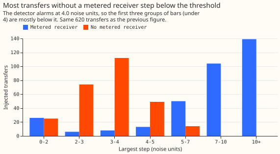
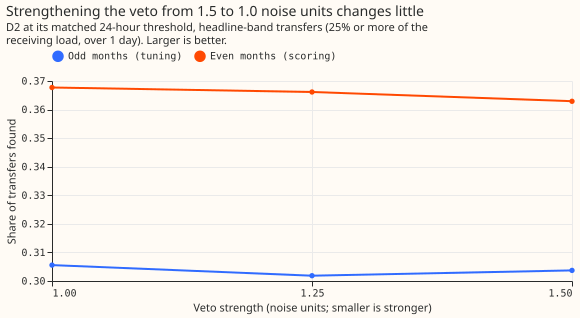

# Experiment 58: is the recall gap without a metered receiver a step-size effect, and does a stronger veto help?

**Much of the gap in recall between injected load transfers with and without a metered receiver
comes from the injected step being too small for the detector to see, and a stronger neighbour veto
adds almost nothing.** We asked two questions about a detector that raises an alarm when one Primary
substation's residual (measured minus predicted power) steps up or down over 24 hours. First,
experiment 55 found 0.50 of the injected transfers that have a metered receiver and 0.17 of those
without one. We re-cut the shares found by the size of the injected step, measured in noise units
(the typical size of the 24-hour step statistic on a quiet day), to see whether the gap is a
property of the detector or of how we built the injected transfers. Second, we made the neighbour
veto, which removes an alarm when at least two neighbouring substations stepped the same way,
stronger than the 1.5 noise units of experiment 55. Step size explains at least half the gap, and
perhaps all of it: 211 of the 274 transfers without a metered receiver step by less than the alarm
threshold of 4.0 noise units. The stronger veto raised the share of transfers found by +0.013
(98.33% interval 0.000 to +0.029), which is no better than experiment 55's +0.008.

## Verdict

**Partly supported.** C1 (the gap) is supported on the pre-registered match and mixed on the check,
and C2 (the veto) is inconclusive. All intervals are 98.33%, from 20,000 resamples of whole calendar
months, over the 620 injected transfers that move 25% to 40% of the receiving load for over 1 day
and start in even months.

| Contrast | Result | Reading |
|---|---|---|
| C1, gap in share found, metered minus unmetered receiver, at equal largest step | -0.002 (-0.166 to +0.119); raw gap 0.33 | Step size explains at least half the gap |
| C1 check, the same on the donor's step alone | +0.161 (+0.013 to +0.322) | Mixed; reported, not decisive |
| C2, D2 at veto 1.0 minus D0M, share found | +0.013 (0.000 to +0.029) | Inconclusive: needs an interval wholly above zero |
| C3, the same, transfers with no metered receiver (274) | +0.037 (+0.011 to +0.055) | Reported only |

D0M is D0 at experiment 43's thresholds (4-hour window 6.0, 24-hour window 4.0); experiment 55
showed the threshold search returns them. D2 is D0 with the neighbour veto. Odd months chose a veto
of 1.0 noise units, but the odd-month shares found were 0.306 at 1.0, 0.302 at 1.25, and 0.304 at
1.5, a spread of two transfers, so the choice is close to arbitrary, and the selection is not
reflected in the C2 interval. The matched 24-hour thresholds were 3.55, 3.65, and 3.70, and the
even-month unexplained 24-hour alarms were 63 for D2 against 80 for D0M. The veto lost 6 transfers
that D0M finds and gained 14.

## Recall by step size

**The share found rises steeply with step size, and the two groups differ in step size more than in
detection.** Among the transfers with a metered receiver, 40 of 346 step by less than 4.0 noise
units and the detector finds 2 of those; 172 of the 306 that step by 4.0 or more are found (0.56).
Among those with no metered receiver, 211 of 274 step by less than 4.0 and 24 are found; 22 of the
63 that step by 4.0 or more are found (0.35). The median largest step is 8.9 noise units with a
metered receiver and 3.3 without one. In the four equal-count bins of the range the two groups share
(0.4 to 6.8 noise units, 358 of the 620 transfers), the metered group has only 19, 5, 7, and 53
transfers per bin against 71, 84, 82, and 37 for the unmetered group, so the matched comparison
rests mostly on the top bin (26 of 53 against 16 of 37).

**The conclusion holds less firmly when the groups are matched on the donor's step alone, and the
two readings bracket the answer.** A transfer with a metered receiver also has a chance to alarm on
the receiver, so the pre-registered match uses the largest step over the donor and the metered
receivers. That maximum is larger than the donor's step for a transfer with a metered receiver,
which may favour that group, so the donor-only match is the better-matched check. Matched on the
donor alone the gap is +0.161, which is just under half of 0.33, and its interval (+0.013 to +0.322)
lies on both sides of 0.165. A logistic regression of found on the logarithm of the step and on a
metered-receiver flag gives a metered coefficient of +0.26 on the largest step and +0.81 on the
donor step (a coefficient of +0.81 is a 2.2 times higher odds of being found, at equal donor step).

## What held in the prediction and what did not

- **Partly held: the gap shrank, but to zero, not to 0.05 to 0.15.** The pre-registered gap was
  -0.002 on the largest step.
- **Not held: the odd months did not pick 1.25.** They picked 1.0 by 0.002 over 1.5, and the
  even-month gain was +0.013, inside the predicted +0.01 to +0.03. The matched threshold fell to
  3.55, inside the predicted 3.4 to 3.6.

## Limits

- **The bins are thin where the groups overlap.** Only 12 transfers with a metered receiver fall in
  the middle two bins, so the matched gap has a wide interval.
- **The bin edges are fixed from the pooled transfers, not redrawn inside each resample.** The C1
  interval is therefore slightly narrow.
- **Noise units are odd-month noise units, and the 620 even-month transfers were seen in experiment
  55,** which is where 0.17 and 0.50 came from. The C1 design is informed by those data.
- **19 of the 1,900 injected transfers move no MW,** because the donor's power is zero or missing
  there (2 of the 620). They stay in every count.
- **A veto of 1.0 or 1.25 noise units falls below the 2.0 that counts a neighbour as a partner.**
  The loss of 6 transfers and gain of 14 shows no harm at these strengths.

## What the next experiment should answer

**The next experiment should show why the detector misses about half of the transfers whose step is
4.0 noise units or more.** Of the 306 transfers with a metered receiver that step by 4.0 or more,
134 are missed, and the cause is not the step size. A shape-aware detector, SW2-7, models the moved
load as a share of the donor's expected daily profile, which is how the injection builds a transfer,
so its recall on the injected transfers would flatter it. Score SW2-7 on transfers injected with a
different shape, such as a flat MW step or a profile reversed in time, on the 14 and 35 labelled
real transfers, and by bins of step in noise units. Report each against D0M in the same bins, so
that a gain shows up as recall at a step the detector already sees, not as a gain from the
injection's own shape.

Code: `ml-experiments/00058-sw2-8b-donor-step-recut-and-stronger-veto/`, with every number printed
by `e00058_report.py` and `e00058_steps.py`.
