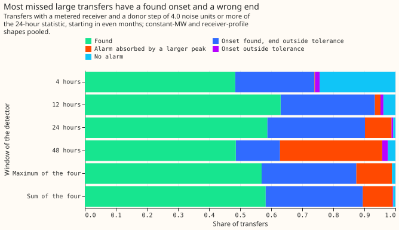
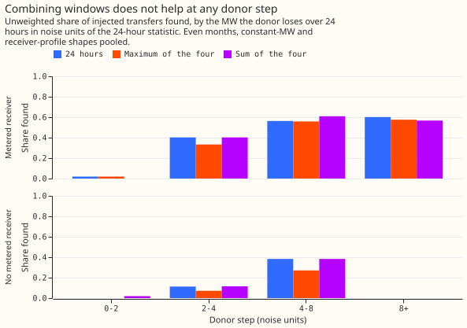

# Experiment 59: does one detector over several windows find more transfers than the best single window?

**Neither of two ways of combining four window lengths found more of the moved MW than the 24-hour
window alone. Among large transfers with a metered receiver, most misses are an interval end placed
outside tolerance, not a missed alarm.** We tested a detector, [experiment
43](../00043-sw2-1-detector-scoreboard/result.md)'s D0, that raises an alarm when the average of one
substation's residual (measured minus predicted power) over a window steps up or down against the
average over the window before it. We injected known load transfers into the power: a donor
substation loses load, and receiver substations gain it. We counted the share of the moved MW whose
transfer the detector finds, with windows of 4, 12, 24, and 48 hours, and with two ways of combining
all four windows: the maximum of the four windows' scores, and their sum. A transfer counts as found
when an alarm places its start within 2 hours and its end within the larger of 6 hours and 10% of
its duration. We set every detector to the same count of alarms that no logged closure explains on
odd months, and we scored the transfers that start in even months. The 24-hour window found 0.473 of
the moved MW. The maximum found 0.423 and the sum found 0.451, so the 24-hour window misses 0.527
of the moved MW. For 541 rows of large transfers with a metered receiver (a receiver whose own power
is measured), the 24-hour window misses 223, and 170 of those have a found start and an end placed
outside tolerance, against 4 with no alarm at all.

## How to read the numbers

- **Noise unit.** A step is measured in multiples of the usual size of that window's statistic on
  the same substation in odd months (1.4826 times the median absolute deviation). A "large" transfer
  moves at least 4.0 noise units of load off the donor over its first 24 hours.
- **Unexplained alarm.** An alarm with no logged closure within 24 hours on the same substation.
  Every detector is held to at most 80 of these on odd months, which is the count of experiment
  43's 24-hour detector.
- **Rows.** Each injected transfer appears once for each of two shapes, a constant MW and a share of
  the receivers' profile, so a count of 620 transfers is 1,240 rows. A "row" count below says so.
- **Shapes.** The donor-profile shape is a drifting share of the donor's own power, as in
  [experiment 58](../00058-sw2-8b-donor-step-recut-and-stronger-veto/result.md). The constant-MW
  shape moves the same MW at every half-hour. The receiver-profile shape is a drifting share of the
  receivers' summed power.
- **Weighted share.** Each row is weighted by the MW the donor loses over the transfer's first 24
  hours, so a transfer that moves more MW counts for more.

## Verdict

**Refuted.** Neither combined detector beat the best single window. The maximum was worse, and the
sum was not better. The intervals are 97.5%, so that two contrasts together keep a 5% chance of a
false signal (a Bonferroni correction), from 20,000 paired resamples of whole calendar months. The
transfers are the 620 that move 25% to 40% of the receiving load for more than 1 day and start in
even months, in the constant-MW and receiver-profile shapes (1,240 rows), each weighted by the MW
the donor loses over the first 24 hours. The best single window, chosen on odd months, is the
24-hour window.

| Contrast | Weighted share found, difference | Unweighted, difference | Reading |
|---|---|---|---|
| C1, maximum minus 24 hours | -0.050 (-0.094 to -0.022) | -0.037 (-0.071 to -0.018) | Refuted: upper end below +0.02 |
| C2, sum minus 24 hours | -0.022 (-0.062 to +0.001) | -0.002 (-0.020 to +0.009) | Refuted: upper end below +0.02 |

The odd-month choice of window was clear: the MW-weighted shares found on odd months were 0.211
(4 hours), 0.317 (12 hours), 0.384 (24 hours), and 0.323 (48 hours). Every detector was calibrated
to at most 80 unexplained alarms on odd months, and the achieved counts were 78, 79, 80, and 79 for
the four windows, 76 for the maximum, and 80 for the sum. On even months the counts of unexplained
alarms on the real residual were 65, 68, 80, and 72 for the four windows, 72 for the maximum, and 91
for the sum. The sum's 91 is 11 above the 24-hour window's 80. The pre-registered rule allows at
most 10, so C2 could not have been `supported`, and the refutation rests on its interval alone.

## Share found, by detector

**The 24-hour and 12-hour windows find about the same share (0.473 and 0.471), and the other
windows and both combinations find less.** The table gives each detector's share of the moved MW
found, with a 95% interval from resampling whole calendar months, on the pooled constant-MW and
receiver-profile shapes. The unweighted share counts each row once, whatever its size.

| Detector | MW-weighted share found | Unweighted share found | Share of moved MW missed |
|---|---|---|---|
| 4 hours | 0.367 (0.264 to 0.464) | 0.223 | 0.633 |
| 12 hours | 0.471 (0.390 to 0.551) | 0.327 | 0.529 |
| 24 hours | 0.473 (0.410 to 0.511) | 0.360 | 0.527 |
| 48 hours | 0.376 (0.294 to 0.434) | 0.294 | 0.624 |
| Maximum of the four | 0.423 (0.340 to 0.472) | 0.323 | 0.577 |
| Sum of the four | 0.451 (0.374 to 0.496) | 0.358 | 0.549 |

The two shapes agree: the 24-hour window finds 0.487 in the constant-MW shape and 0.459 in the
receiver-profile shape. In the donor-profile shape, which experiment 58 used, the differences from
the 24-hour window are -0.060 (-0.103 to -0.033) for the maximum and -0.027 (-0.062 to -0.007) for
the sum. On the 300 transfers that start within 1 day of a bank holiday, the differences are -0.069
(-0.226 to -0.050) and -0.022 (-0.031 to 0.000).

## Why large transfers are missed

**Most large transfers that the 24-hour window misses have a found start and an end outside
tolerance.** The figure covers the 541 pooled rows of transfers with a metered receiver and a donor
step of 4.0 noise units or more of the 24-hour statistic. The 24-hour window finds 318 of the 541
rows (0.588 by count, 0.595 by MW) and misses 223, each for one reason, tried in this order:

- **End outside tolerance (170 rows).** An alarm places the start within 2 hours, and the interval
  places the end outside tolerance.
- **Absorbed (46 rows).** The score exceeds the alarm threshold within 2 hours of the start, but a
  larger peak within 24 hours took the alarm, or a monthly refit of the expected-power model
  dropped it.
- **Start outside tolerance (3 rows).** An alarm lies within 24 hours of the start but not within 2
  hours.
- **No alarm (4 rows).** The best score near the start has a median of 0.34 of the alarm threshold.

The maximum and sum detectors give the same pattern, with 165 and 169 rows of missed ends.

**The missed ends are 7.0 to 10.5 hours out at the quartiles, against a tolerance of 6 hours.** The
median of these 170 rows lasts 32 hours, so the tolerance (the larger of 6 hours and 10% of the
duration) is 6 hours. The missed ends are off by 7.0, 7.5, and 10.5 hours at the quartiles, and by
23% of the duration at the median. The interval builder follows the transfer's level in whole
24-hour blocks, so it can place an end only to about a day. A post hoc variant that takes the step
from the first 24-hour block and ends the transfer after two failing blocks leaves the counts almost
unchanged (171 missed ends for the 24-hour window, against 170).

## Share found by donor step

**The combined detectors find about as many transfers as the 24-hour window at each donor step, and
the maximum never finds more.** With a metered receiver the 24-hour window finds 35 of 87 rows at a
step of 2 to 4 noise units and 318 of 541 at 4 or more. Without one it finds 41 of 363 at 2 to 4 and
51 of 133 at 4 to 8. The sum finds 120 of 197 at 4 to 8 with a metered receiver, against 111 for the
24-hour window, and 195 of 344 at 8 or more, against 207. No row without a metered receiver steps by
8 or more.

## Labelled real transfers over 1 day

Of the 35 labelled real transfers that last over 1 day, the 4-hour window finds 0, the 12-hour 3,
the 24-hour 2, the 48-hour 3, the maximum 4, and the sum 5. The counts are too small to rank the
detectors.

## What held in the prediction and what did not

- **Not held: the best single window found more than predicted.** The prediction was 0.20 to 0.40
  of the moved MW and the 24-hour window found 0.473. Earlier experiments reported unweighted
  shares, and large transfers are found more often than small ones: in the donor-profile shape the
  24-hour window finds 0.355 unweighted and 0.466 by MW.
- **Not held: the combinations lost instead of gaining.** The maximum changed the share by -0.050
  against a predicted +0.02 to +0.06, and the sum by -0.022 against a predicted -0.01 to +0.04.
- **Held: the 24-hour window was the best single window**, chosen on odd months.

## Limits

- **The injected transfers set the answer.** The 24-hour window's 0.47 is a share of injected
  transfers, and the 35 real transfers over 1 day are too few to confirm it.
- **The unexplained-alarm count includes real events that no log records.** A detector that finds
  more of those real events is held to a higher threshold than a less sensitive detector.
- **The two combinations use a peak radius of 24 hours, and each single window uses its own length.**
  The 4-hour window therefore has a smaller peak radius than the maximum, and the 48-hour window a
  larger peak radius. The detectors match in alarm counts, not in alarm spacing.
- **The sum detector's even-month count is 11 alarms above the 24-hour window's.** The
  pre-registered condition allows at most 10, so C2's result does not meet that condition.
- **Scoring by start alone leaves the ordering of the detectors unchanged.** The share of the moved
  MW whose start is found is 0.731 for the 24-hour window and 0.665 for the maximum.
- **Each transfer enters twice, once per shape, with its own weight.** The weight is the MW the
  injection removes from the donor over the first 24 hours.

## Where the limit lies

**Most misses of large transfers are an interval end placed outside tolerance, so scoring by start
alone, beside scoring by start and end, would show how much of the miss is the alarm and how much is
the end.** The 24-hour window already finds the start of 0.731 of the moved MW. Among large
transfers with a metered receiver, 170 of 541 rows have a wrong end, against 4 with no alarm. A
detector that fits a block-shaped step to the residual after the start, such as the shape-aware step
planned as SW2-7, would act on that limit directly. This result recommends the 24-hour window as
the single-window benchmark for the planned experiments SW2-14 and SW2-15.

## Design, as pre-registered

All windows below are given in hours, with half-hours in brackets: 4 hours (8), 12 hours (24), 24
hours (48), and 48 hours (96).

- **Single windows.** The level-shift statistic `z_w` of each window, per series, is in units of
  the series' odd-month noise scale (1.4826 times the median absolute deviation). The single-window
  detector at window `w` raises an alarm at each local peak of `|z_w|` above a threshold `T_w`,
  where a peak is the largest `|z_w|` within one window length either side, exactly as in
  experiment 43. A stamp where fewer than 75% of either half of the window is present has no
  statistic, and counts as zero in the combined scores.
- **Calibration.** `T_w` is the lowest threshold on a grid of 0.05 whose odd-month unexplained
  alarms (alarms with no logged closure within 24 hours on the series) number at most 80. The same
  search, on a grid of 0.01, sets the thresholds of the two combined detectors.
- **Maximum detector.** The score at a stamp is `max_w |z_w| / T_w`. An alarm is a local peak of
  the score within 24 hours (48 half-hours) either side, above a threshold calibrated to 80
  odd-month unexplained alarms. Single windows keep experiment 43's own peak radius, one window
  length.
- **Sum detector.** The score is `|sum_w z_w / T_w|`, with the sign kept so that windows disagreeing
  in direction cancel. An alarm is a local peak of the score within 24 hours either side, above a
  threshold calibrated the same way.
- **Interval.** The end of a transfer comes from the window that alarms: the window with the
  largest `|z_w| / T_w` at the alarm stamp, among the windows whose step has the sign of the
  combined score. The interval builder is experiment 43's, run with that window. For each alarm the
  order is: choose the peak, choose the window, drop the alarm if its window is 24 hours or longer
  and lies within one window length of a monthly refit, and only then count the alarm.
- **Injected transfers.** The 1,900 transfers of experiment 58, of which 1,460 are in the headline
  band (160 + 1,000 + 300), injected with three shapes: a drifting share of the donor's own power
  (experiment 58's shape), a constant MW equal to the mean MW of that share, and a drifting share of
  the metered receivers' summed power (half the donor's power when none is metered), capped at
  80% of the donor's power. Each shape keeps the same donor, receivers, onset, and end. The
  headline pools the constant-MW and receiver-profile shapes, which no detector here assumes; the
  donor-profile shape is the continuity check with experiment 58.
- **Labelled real transfers.** The labelled real transfers that last over 1 day are scored on the
  real residual for each detector, as counts without a verdict.
- **Even months only.** The odd months fix the noise scales, the thresholds, and the choice of the
  best single window. Every score read for a verdict uses transfers that start in even months.
- **Harness check.** Before any new result is read, the 4-hour and 24-hour single windows at
  experiment 43's thresholds must reproduce its alarm counts and the outcome of each of its 600
  injected transfers.

### Reported beside the verdict

- **Recall by donor step in noise units, split by metered receiver**, for the best single window and
  both combined detectors, in the bins experiment 58 used.
- **The MW-weighted share found first and the unweighted share second**, with the share of the moved
  MW that each detector misses, stated in the take-home message. The share whose onset alone is
  found is reported too, because a longer window changes the interval's end as well as the alarm.
- **Why the large transfers are missed.** For every transfer with a metered receiver whose donor
  step is 4.0 or more 24-hour noise units (measured on the injected power, in each shape), each
  detector gives one reason, in this order, from all the series of the transfer pooled: the end is
  outside tolerance (an alarm has a matching onset); the alarm was absorbed (the score exceeds the
  threshold within 2 hours of the onset, but a larger peak within the suppression radius took the
  alarm, or a monthly refit dropped it); the onset is outside tolerance (an alarm lies within 24
  hours of the onset but not within 2 hours); or no alarm (the median best score near the onset is
  reported as a share of the threshold).
- **Each shape separately**, and the achieved odd-month and even-month unexplained-alarm counts of
  every detector.

### Sizing (the five triggers)

1. **What gets stored:** private parquet tables only, nothing in Delta.
2. **The production serving path:** not touched.
3. **A degradation rule:** not touched.
4. **More than one defensible design:** yes (maximum or sum, the choice of windows, the
   calibration), so both combinations and all four windows are fixed here.
5. **Code whose callers cannot be named without searching:** none. The code is an adapted copy of
   experiment 58's harness in this folder, with five changes: the four windows, one window per
   alarm in the interval builder, two new injection shapes, the combined detectors, and the miss
   classification.

The size is medium: one Sonnet plan review, a Sonnet code review, and a Sonnet prose review.

### Earlier advice followed and departed from

- Follows: score the metered-receiver and no-metered-receiver groups separately; report recall by
  donor step in noise units; match thresholds by recounting unexplained alarms on odd months;
  report even-month unexplained-alarm counts; use several hundred headline-band transfers.
- Departs from: nothing.

Code: `ml-experiments/00059-sw2-13-several-windows-in-one-detector/`, with every number printed
by `e00059_report.py`.
