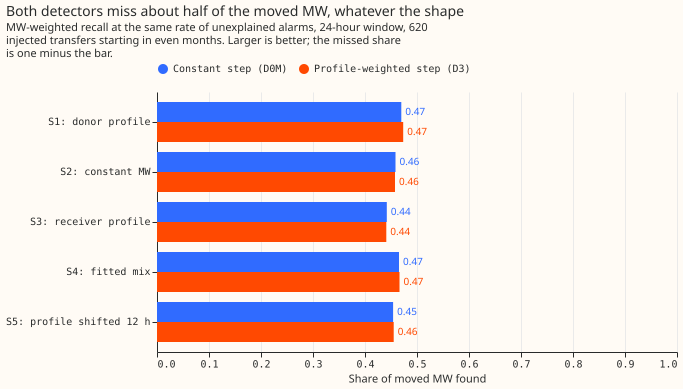
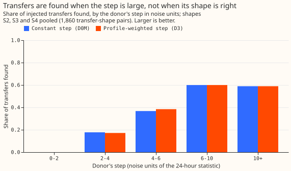

# Experiment 60: does a step that weights each half-hour by the daily profile find more of the moved load?

**A switching detector that expects a load transfer to follow the daily shape of the load finds no
more of the moved power than a detector that expects a constant step.** A load transfer is a
switching operation that moves part of one Primary substation's demand onto neighbouring
substations. Both detectors raise an alarm when the 24-hour average of a substation's residual
(measured power minus the power the lagless XGBoost weather model predicted) differs from the average
of the previous 24 hours. The constant-step detector (D0M) takes a plain average. The
profile-weighted detector (D3) weights each half-hour by the predicted power of the same substation,
so that the busy hours, where a transfer that is a share of the load moves the most MW, count most.

We added known load transfers to the power history in five different daily shapes, such as a share of
the donor substation's load or a constant MW, and compared the share of the moved MW that each
detector found. A transfer is found when an alarm's interval starts within 2 hours of the true start
and ends within the larger of 6 hours and 10% of the true duration. D0M found 0.44 to 0.47 of the
moved MW and D3 found the same, within 0.005, on every shape. Both detectors therefore miss 0.53 to
0.56 of the moved MW.

The step of the two detectors (the change between the two 24-hour averages) is almost the same, so
the shape is not why transfers are missed. Among transfers whose step is 6 noise units or more, a
third have an alarm at the right start but the alarm's interval ends at the wrong time. A noise unit
is the typical size of the step on a quiet day.

## What we tested

**Five injection shapes, one of which is the shape D3 assumes.** Each shape is rescaled so that every
transfer moves the same mean MW as under S1.

- **S1** moves a share of the donor's power, as experiments 43, 55 and 58 did, and is exactly what D3
  assumes.
- **S2** moves a constant MW.
- **S3** gives each metered receiver a share of its own power, and the donor loses the total.
- **S4** mixes S1 and S2, with a profile share drawn from 32 fits to labelled real transfers.
- **S5** moves S1's profile 12 hours ahead, as a guard that works against D3's weights.

The mean correlation between the moved MW and the donor's predicted power is +0.70 (S1), +0.00 (S2),
+0.29 (S3), +0.56 (S4), and -0.17 (S5), so the shapes differ. The transfers are the 620
headline-band transfers of experiment 58 (25% to 40% of the receiving load, lasting over 1 day) that
start in even months; 7 of them move no MW over the whole transfer and carry weight zero. We set
D3's alarm threshold on odd months, which are left out of scoring, so that D3 raises about as many
alarms as D0M that no logged line closure explains: 76 against 80 on odd months, and 82 against 80
on even months.

## Verdict

**Refuted.** The upper end of the pooled interval, +0.008, lies below the +0.01 the decision rule
required. The table gives the gain in MW-weighted recall, the share of the moved MW that sits in found
transfers, of D3 over D0M. Each interval is 98.33%, a 95% interval widened for three planned
contrasts, from 20,000 resamples of whole calendar months. C1, the verdict, pools S2, S3 and S4, the
shapes D3 does not assume. C2 is S1. C3, below, is the labelled real transfers.

| Contrast | Result | Reading |
|---|---|---|
| C1, pooled over S2, S3, S4 | -0.000 (-0.006 to +0.008) | Refuted: no gain of +0.01 |
| C2, S1, the shape D3 assumes | +0.004 (-0.005 to +0.019) | No gain on D3's own shape |
| S2, constant MW | -0.001 (-0.007 to +0.008) | No gain |
| S3, receivers' own profiles | -0.001 (-0.007 to +0.007) | No gain |
| S4, fitted mix | +0.001 (-0.005 to +0.008) | No gain |
| S5, profile 12 hours ahead (guard) | +0.001 (0.000 to +0.006) | No gain |

The pooled gain of -0.000 is a negative number that rounds to zero at three decimals.

## Why the two detectors agree

**D3's step is almost D0M's step.** Across every half-hour of the 16 Primary substations scored, the
two steps, each in its own noise units, have a correlation of 0.989, and 0.996 where D0M's step exceeds
3 noise units. In that range D3's step averages 0.984 of D0M's. A demand profile varies by a modest
factor within 24 hours, so weighting by it changes each half-hour's weight a little. The 4-hour window,
which this experiment did not test, might see more of the shape.

**The share found rises with the size of the step, and the two detectors give nearly the same counts
in every bin.** Pooled over S2, S3 and S4, the share found rises from 0.18 at 2 to 4 noise units to
0.60 at 6 to 10, and stays at about 0.59 above 10. The counts per bin, by shape and by whether a
receiver is metered, are in the printed report.

## Where the misses are (post hoc)

**Among transfers with a donor step of 6 noise units or more, most misses have the right start but the
wrong end.** Of the 215 constant-MW (S2) transfers, out of 620, with a donor step that large, D0M finds
128, finds the start but not the end of 72, and has no alarm at the start for 15. The other four shapes
are within a few transfers of these counts. The end of an alarm's interval comes from a tracker that
follows the level of the residual, in units of the predicted power, for as long as it keeps at least
half its starting size. Both detectors share the tracker (experiments 43 and 58). This table was not
pre-registered.

**The labelled real transfers of more than 1 day are almost all missed.** Of the 35 (10 whose moved
power is matched by the receivers' change, and 25 seen on one side only), D0M and D3 each find the same
2, which is 0.054 of the labelled MW. An alarm at the right start exists for 11 of the 35. In
comparison, D0M found 0.355 of the 620 injected transfers in experiment 58, counted the same way. The
injected transfers may be easier to find than the real events, or the real events may be smaller in
noise units. We have not separated the two.

## What held in the prediction and what did not

- **Not held: D3 gained +0.004 on S1,** against a predicted +0.03 to +0.10.
- **Not held: the pooled gain was -0.000,** against a predicted +0.01 to +0.04.
- **Held: on S2 D3 was level with D0M,** the prediction being level or up to 0.03 worse; the result
  is -0.001.
- **Held: D0M's MW-weighted recall was 0.44 to 0.47,** inside the predicted 0.40 to 0.55.

## Limits

- **Only the 24-hour window was tested.** A shape-aware step could still help at 4 hours, where a
  transfer's daily shape is a larger part of the window.
- **The weights are the predicted power, one choice among several.** Weights proportional to the
  square of the predicted power, or a fit of the profile share per window, were not tried.
- **S4's profile shares come from 32 least-squares fits to labelled real transfers** of 6 hours or
  more, and 23 of the 32 sit at 0 or 1 because a short transfer fits its profile poorly. The fits use
  the same transfers that C3 scores, so C3 favours D3, and still shows no gain.
- **The 620 transfers were already used in experiments 55 and 58,** and the five shapes share the same
  620 events, so the shape results are not independent of each other. The month-resampled intervals
  pair them.
- **The labelled real transfers are too few for an interval:** 35 transfers, 2 found.

## Reviews

- **Plan review (Sonnet):** accepted the fixed MW weights, the guard shape S5, the rescaling of every
  shape to S1's mean, the rule for transfers with no metered receiver, and a stricter decision rule;
  rejected a separate check of noise against load, because the correlation of 0.989 between the two
  steps answers the same question.
- **Code review (Sonnet):** accepted a sign-aligned fit for the profile shares, a separate random
  generator for S4's draws, and a correct 12-hour shift for S5. Rejected writing a new event table (the
  report reads experiment 58's, and the harness check proves the events are the same), a 24-hour
  minimum for the S4 fits (the plan fixed 6 hours before any result), and an assertion on transfers
  that move no MW (some are known).
- **Harness check:** with S1, D0M reproduces experiment 58's outcome for all 1,900 injected
  transfers, of which 620 are in the scored population.
- **Numbers and prose reviews (Sonnet):** every number was checked against the printed report, and the
  wording of the opening, the table, and the log entry was rewritten for a reader who has not seen the
  experiment.

## What the next experiment should answer

**The next experiment should ask why the interval ends are wrong, and why the real transfers are
harder to find than the injected ones.** A step statistic that knows the shape does not help at 24
hours. Paired-step intervals, which find a transfer's start and its return step together (SW2-6 in the
research plan), are a candidate next test, with the counts of start-found-but-end-wrong transfers as
the benchmark. The real-transfer gap needs a look at the 35 transfers' steps in noise units, against
those of the injected transfers.

Code: `ml-experiments/00060-sw2-7-profile-weighted-step-detector/`, with every number printed by
`e00060_report.py`.
