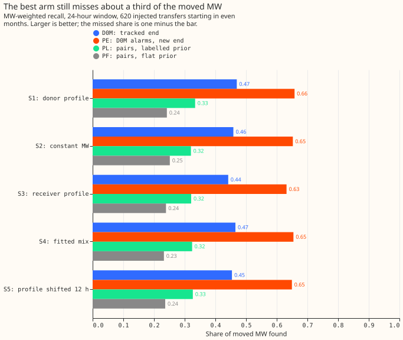
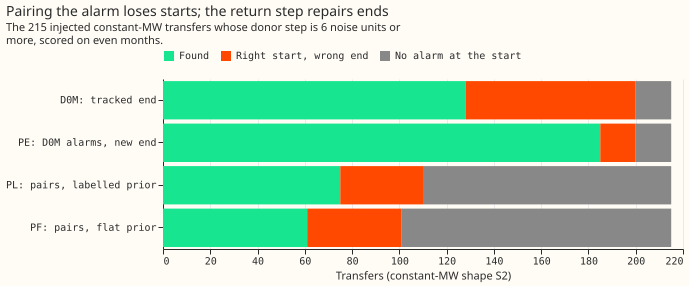

# Experiment 61 (SW2-6, part of the switching-event detector series): does pairing an onset step with its return step find more of the moved load?

**Taking the end of each alarm interval from the strongest opposite step finds 0.19 more of the moved
power than the single-step detector. Scoring the onset step and the return step as one pair finds
0.13 to 0.21 less.** A load transfer is a switching operation that moves part of one Primary
substation's demand onto neighbouring substations for some hours or days. A Primary substation is
the 11 kV or 6.6 kV substation that feeds local distribution circuits. The baseline detector,
D0M, raises an alarm when the 24-hour average of a substation's residual steps away from the
average of the previous 24 hours by 4.0 noise units or more. The residual is the measured power
minus the power that an XGBoost model, using weather forecasts and no past power values, predicted.
One noise unit is the typical size of that step on days with no known switching.

We added known load transfers to the power history, and asked what share of the moved power
(measured in MW) each of four detectors finds. A transfer is found when an alarm's interval starts
within 2 hours of the true start and ends within the larger of 6 hours and 10% of the true duration.
On the three shapes of transfer that no detector assumes, D0M found 0.44 to 0.47 of the moved MW.
The arm PE kept D0M's alarms but took each interval end from the strongest opposite step in the
following 14 days. PE found 0.63 to 0.65. The arms PL and PF (a paired score with a labelled-duration
prior, and with a flat prior) found 0.32 and 0.23 to 0.25. Holding their unexplained alarms to the
same count needed a threshold equal to a lone onset step of 8.8 noise units (PL) or 8.5 (PF), against
D0M's 4.0. The best arm still misses 0.35 to 0.37 of the moved MW.

## What we tested

**Four arms, all scored at the same number of unexplained alarms on odd months.** An unexplained
alarm is one more than 24 hours from every logged closure on its series. The arms differ only in
how an alarm is raised and where its interval ends.

- **D0M** is experiment 60's detector: alarm at 4.0 noise units, end from a tracker that follows the
  residual for as long as it keeps half its starting size.
- **PE** has D0M's alarms, so its unexplained alarms are identical by construction, and takes each
  end from the stamp between 24 hours and 14 days after the onset where the step back is largest,
  when that step is at least 1.5 noise units.
- **PL** scores each candidate onset (a local peak of 2.5 noise units or more) together with the
  best return stamp as `(|onset step| + return step) / sqrt(2)`, plus a log prior on the duration
  taken from the labelled real transfers. The alarm threshold, 5.2, gives 80 unexplained alarms on
  odd months.
- **PF** is PL with a flat prior. Its threshold, 6.0, gives 78 on odd months.

The population is experiment 60's: 620 injected transfers of 25% to 40% of the receiving load,
lasting over 1 day, starting in even months, in five daily shapes. The harness reproduces experiment
58's D0M outcome for every transfer of experiment 58's injection set. S1 moves a share of the
donor's profile, S2 a constant MW, S3 a share of each receiver's own profile, S4 a mix fitted to
real transfers, and S5 shifts S1 by 12 hours. The detectors assume no shape, so the contrasts pool
S2, S3, and S4. Intervals are 98.33% (Bonferroni across the three planned contrasts), from 20,000
resamples of whole calendar months.

## Verdict

**Refuted for the pre-registered arms.** The upper end of C1's interval, -0.007, lies below the +0.02
the decision rule required. The table gives the gain in MW-weighted recall (the share of the moved
MW that sits in found transfers) over D0M, pooled over S2, S3, and S4.

| Contrast | Gain over D0M | Reading |
|---|---|---|
| C1, PL (labelled prior) | -0.133 (-0.233 to -0.007) | Refuted: PL finds less |
| C2, PF (flat prior) | -0.214 (-0.310 to -0.092) | PF finds less |
| PE, descriptive (no verdict) | +0.191 (+0.148 to +0.237) | PE finds more |
| PL minus PF | +0.081 (+0.062 to +0.107) | The prior helps PL, on injected durations drawn from the same labelled set |

Absolute MW-weighted recall on S2, S3, and S4 is 0.44 to 0.47 for D0M, 0.63 to 0.65 for PE, 0.32 for
PL, and 0.23 to 0.25 for PF. Unweighted recall on S2 is 0.345, 0.482, 0.240, and 0.171. On S1 and
S5 the pattern is the same (PE 0.658 and 0.649). Among transfers with a metered receiver, PE finds
0.79 to 0.82 of the moved MW.

## Why pairing loses and the return step alone wins

**Pairing probably turns the alarm budget into noise pairs.** Each candidate onset is paired with
its best return stamp out of up to 2,800 half-hourly stamps. Taking that maximum should raise the
score of noise candidates (we did not measure this), so holding the unexplained-alarm count at 80
forces a high threshold. A lone onset step with no return then needs about 8.8 noise units (PL) or
8.5 (PF), against D0M's 4.0. Of the 215 constant-MW transfers with a donor step of 6 noise units or
more, D0M has no alarm at the start for 15, PE for 15 (the same alarms), PL for 105, and PF for 114.

**The return step repairs ends.** Of the same 215, D0M finds 128 and has the right start and a wrong
end for 72. PE finds 185 and has the right start and a wrong end for 15. PE finds more than D0M in every
donor-step bin from 2 noise units upwards for transfers with a metered receiver (the printed report
has the counts for the others).

## Labelled real transfers (C3)

**Every other arm finds more of the 35 labelled real transfers of more than 1 day than D0M does, but
all arms find under a quarter.** D0M finds 2 (0.054 of the labelled MW), PE 7 (0.126), PL 8 (0.148,
with a prior fitted without the scored half of the transfers), and PF 4 (0.064). An alarm at the
right start exists for 11 of the 35 under D0M and PE, 8 under PL, and 6 under PF. The onset
therefore now limits the real transfers more than the end does.

## What held in the prediction and what did not

- **Not held: PL gained -0.133,** against a predicted +0.03 to +0.08.
- **Not held: PF gained -0.214,** against a predicted +0.02 to +0.06.
- **Not predicted: PE,** added to the plan after the plan review, found 0.19 more than D0M.

## Limits

- **The injected durations come from the same labelled set as PL's prior,** so PL's gain over PF is
  optimistic on injected transfers. The cross-fitted prior for the real transfers differs from the
  full prior by at most 0.18 in log density ratio, so the real-transfer count for PL tests the prior
  only weakly.
- **Injected transfers are clean boxcars,** so PE's return step is easier to find than a real
  transfer's. The 35 real transfers are too few for an interval.
- **PE's search stops at 14 days,** so it cannot repair transfers longer than that, and it may take
  another transfer's larger opposite step as the end. We did not split PE's gain by duration.
- **PE is an interval estimator that needs 24 hours after the end,** as D0M's tracker does. It
  cannot run before the transfer has ended.
- **The match is on the count of unexplained alarms, not on their composition.** The printed report
  shows 70 even-month unexplained alarms for PL and PF against 80 for D0M and PE. PL and PF drop the
  return-step alarm of each pair, which D0M keeps as a separate alarm, so the matched count holds
  more distinct onsets for D0M. We did not run D0M with the same dropping.
- **The 620 transfers were used in experiments 55, 58, and 60,** and the shapes share the same
  events.

## Reviews

- **Plan review (Sonnet):** accepted a worked score formula, a table of fixed constants, the PE arm
  that keeps D0M's alarms, alarm-composition counts, and removing the numbers predicted for the
  wrong-end share; rejected a 97.5% level and a separate arm with a prior fitted on other durations.
- **Code review (Sonnet):** accepted using the prior's lowest value for a candidate with no return
  step in every arm, excluding return stamps within 24 hours of a monthly refit, and printing the
  achieved odd-month counts and the prior values; rejected a D0M arm with the pairs' dropping rule.
  No leakage or off-by-one errors were found.

## What the next experiment should answer

**The next experiment should combine PE's end rule with a better onset.** Of the 35 labelled real
transfers, 24 have no alarm at the start under D0M and PE, so the onset now limits them. Candidates:
a second alarm path for pairs, run only on top of D0M's alarms and capped at a few extra alarms; the
4-hour window with PE's end rule; and SW2-13 (several windows in one detector).

Code: `ml-experiments/00061-sw2-6-paired-step-intervals/`, with every number printed by
`e00061_report.py`.
