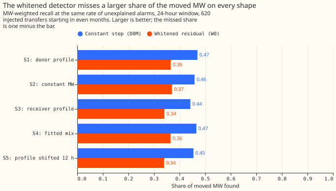
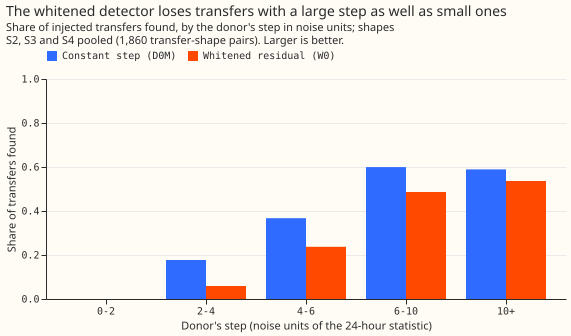

# Experiment 62: does removing the residual's half-hour-to-half-hour memory help the LSC?

**Filtering out the residual's short memory makes the switching detector find fewer load transfers,
not more, because the filter removes a day-long step faster than it removes noise.** A load transfer
is a switching operation that moves part of one Primary substation's demand (a substation that
feeds homes and businesses) onto neighbouring substations. The detector raises an alarm when the
24-hour mean of a substation's residual differs from the mean of the previous 24 hours. The
residual is the measured power minus the power predicted by an XGBoost model trained on weather
forecasts and calendar features, with no recent power as input. Successive residuals are strongly
alike. We therefore subtracted from each half-hour's residual the part that the previous
half-hour's residual predicts (a first-order autoregressive filter, fitted separately for each of
16 substations and each half-hour of the day), and ran the same detector on the result.

We tested both detectors on 620 injected transfers, each a known amount of power moved from one
substation to its neighbours for over 1 day. A transfer counts as found when an alarm's interval
starts within 2 hours of the true start and ends within the larger of 6 hours and 10% of the true
duration. Both detectors had about the same number of alarms that no logged line closure explains.
The unfiltered detector (D0M) found 0.44 to 0.47 of the moved megawatts (MW), and the filtered
detector (W0) found 0.34 to 0.37; each range spans five shapes of transfer through the day. W0
therefore misses 0.63 to 0.66 of the moved MW, against 0.53 to 0.56 for D0M.

## Verdict

**Refuted, and the direction is the reverse of the prediction.** The three planned contrasts are C1,
the verdict (24 hours); C2, the same contrast at 4 hours; and C3, the labelled real transfers. The
upper end of the pooled interval, -0.057, lies far below the +0.02 the decision rule required, and
the whole interval lies below zero. The table gives the change in MW-weighted recall, the share of
the moved MW that sits in found transfers, of W0 over D0M. Each interval is 98.33%, a 95% interval
widened for three planned contrasts, from 20,000 resamples of whole calendar months. The 620
transfers start in even months, and move 25% to 40% of the receiving load.

| Contrast | Result | Reading |
|---|---|---|
| C1, 24 hours, pooled over S2, S3, S4 | -0.097 (-0.132 to -0.057) | Refuted: W0 finds less |
| C2, 4 hours, pooled over S2, S3, S4 | -0.145 (-0.209 to -0.097) | W0 finds less |
| C3, labelled real transfers over 1 day, 24 hours | W0 finds 3 of 35, D0M finds 2 | No difference to read |
| S1, donor profile (24 hours) | -0.105 (-0.150 to -0.055) | Less |
| S2, constant MW | -0.088 (-0.116 to -0.055) | Less |
| S3, receiver profile | -0.101 (-0.140 to -0.058) | Less |
| S4, fitted mix | -0.101 (-0.144 to -0.053) | Less |
| S5, profile shifted 12 hours (guard) | -0.115 (-0.157 to -0.085) | Less |

The shapes are S1, a share of the donor's own profile (the shape of experiments 43, 55, and 58); S2,
a constant MW; S3, a share of each metered receiver's own profile; S4, a mix fitted to the labelled
real transfers; and S5, S1's profile moved 12 hours ahead. Each shape moves the same mean MW per
transfer as S1. The unfiltered detector's recall, as a share of the moved MW, is 0.470 (S1), 0.459
(S2), 0.442 (S3), 0.465 (S4), and 0.454 (S5), against 0.365, 0.370, 0.341, 0.365, and 0.339 for W0.

## Why the filter hurts

**The filter shrinks a day-long step to about 8% of its size, and the noise of the 24-hour step only
to about 12%.** The residual is strongly persistent: the median fitted coefficient is 0.92, and the
correlation of a residual with the previous half-hour's falls from 0.91 to -0.03 after filtering. A
step that persists keeps its full size at one half-hour and then shrinks to 1 minus the coefficient
of its size. The filter also shrinks the noise of the 24-hour step, but by less; we did not
decompose the noise further. The table gives the per-series medians over the 16 substations (range
in brackets), computed on the real residual of odd months with no injection.

| Quantity | Median (range over 16 substations) |
|---|---|
| Fitted coefficient, mean over the 48 half-hours | 0.92 (0.82 to 0.96) |
| Share of the 48 coefficients at the clip of 0.98 | 0.14 (0.06 to 0.50) |
| Correlation with the previous half-hour, raw | 0.91 (0.73 to 0.96) |
| Correlation with the previous half-hour, whitened | -0.03 (-0.07 to 0.10) |
| Correlation with the same half-hour of the previous day, raw | 0.54 (0.22 to 0.70) |
| Correlation with the same half-hour of the previous day, whitened | 0.14 (0.06 to 0.49) |
| Noise scale of the 24-hour step, whitened over raw | 0.115 (0.07 to 0.24) |
| Correlation of the raw and whitened 24-hour steps | 0.81 (0.55 to 0.92) |

The signal-to-noise ratio of a constant step, whitened relative to raw, is 1 minus the mean
coefficient divided by the noise ratio in the table. For each substation the ratio is below 1 (0.52
to 0.85, with most between 0.60 and 0.76). That figure predicts the result without any injection: a
detector whose signal-to-noise ratio is two thirds of another's finds fewer transfers at the same
alarm rate.

## Where the misses are

**Filtering did not remove the interval-end misses and added misses at the start.** Among transfers
whose donor step is 6 noise units or more (the donor is the substation that loses the power, the
receivers are the neighbours that gain it, and a noise unit is D0M's 24-hour step on a typical quiet
day), D0M finds 128 of 215 constant-MW transfers (S2), has the right start and a wrong end for 72,
and has no alarm at the start of 15. W0 finds 113, has the right start and a wrong end for 56, and
has no alarm at the start of 46. The wrong-end share stays near a quarter to a third, so the end
estimate, which comes from the unfiltered residual in both detectors, remains the larger limit. W0
adds 31 transfers with no alarm at the start.

The recall by donor step, split by whether any receiver is metered, shows the loss at most step
sizes (shape S2, found by D0M | found by W0 out of the transfers in the bin, 24-hour window):

| Donor step in noise units | Metered receiver | No metered receiver |
|---|---|---|
| 2 to 4 | 17 \| 10 of 41 | 25 \| 6 of 189 |
| 4 to 6 | 30 \| 25 of 59 | 14 \| 5 of 59 |
| 6 to 10 | 60 \| 51 of 100 | 2 \| 2 of 2 |
| 10 or more | 66 \| 60 of 113 | no transfers |

Below 2 noise units neither detector finds a transfer at 24 hours. The other shapes and the 4-hour
window are in the output of `e00062_report.py` and also show W0 below D0M, with ties in a few small
bins.

## What the matching of alarms did

**W0's threshold is higher than D0M's, and W0 raised fewer alarms on even months at 24 hours but
more at 4 hours.** The thresholds were matched on odd months, so that the count of alarms that no
logged closure explains is at most D0M's. At 24 hours the matched thresholds are 4.0 (D0M) and 4.6
(W0), with 80 and 73 odd-month alarms and 80 and 56 even-month alarms. At 4 hours they are 6.0 and
6.35, with 120 and 118 odd-month alarms and 110 and 143 even-month alarms. The 24-hour W0 therefore
raised 24 fewer alarms than D0M on the even months it was scored on, which is a handicap of unknown
size. We did not rerun W0 at equal even-month alarm counts, so the size of that handicap is not
measured. The 4-hour W0 raised more alarms than D0M and lost more recall than the 24-hour W0, so the
alarm count alone does not explain the loss.

## Labelled real transfers

**The 35 labelled real transfers of more than 1 day are too few and too hard to compare the
detectors.** At 24 hours D0M found 2 and W0 found 3, an MW-weighted recall of 0.054 and 0.082. D0M
had an alarm at the right start for 11 of the 35 and W0 for 7. At 4 hours D0M found 1 and W0 found
0. The write-up of experiment 60 raised the possibility that the injection is easier than the real
events; whitening gives no evidence either way.

## Lessons and what the next experiment should answer

**The residual's preprocessing is not where the detector's recall is limited.** A filter that
removes the half-hour memory removes the slow wander and the step together, and the noise of a
24-hour mean is slow wander. The share of large-step transfers with the right start and a wrong end
stays at about a quarter to a third, and filtering adds transfers with no alarm at the start. The
next experiment on the switching detector should therefore change what happens after the alarm, with
paired-step intervals that find the onset and the return step together (SW2-6 in the research plan),
or a combination of the 4-hour and 24-hour windows (SW2-13), not the residual that the alarm reads.
A lag-48 filter, or a coefficient per series, was not run, and would shrink the step less, but the
lag-48 correlation of 0.54 is only half the lag-1 correlation of 0.91, so we do not expect it to
change the verdict.

## Post hoc and limits

- **Post hoc:** the filter-effect table, the signal-to-noise ratio, and the big-step table were
  added after the plan and do not enter the verdict.
- **The coefficients are not cleaned.** They were fitted from odd-month residuals without masking
  logged closures or labelled transfers, so a persistent real step can raise a coefficient towards
  the clip. The median share of coefficients at the clip is 0.14, and 0.50 for the worst substation.
- **The alarm counts differ,** as the section "What the matching of alarms did" says.
- **The transfers are injected into a residual that a fixed lagless weather model produced.** The
  residual does not reflect an XGBoost model refitted on the injected period, as in experiments 43,
  55, 58, and 60.
