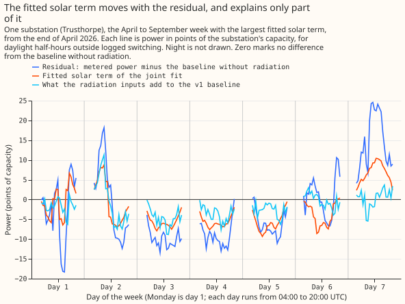
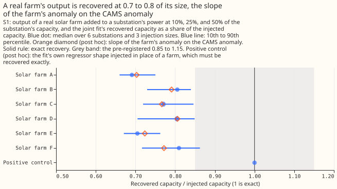
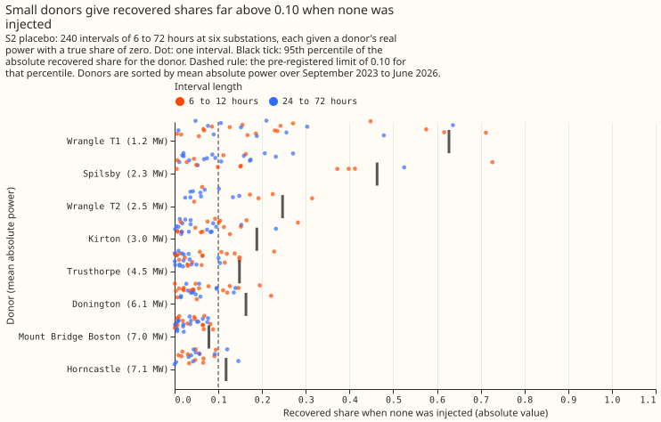

# Experiment 63: does a linear joint fit of baseline, solar, and transfers beat the Flexpectation v1 baseline?

**We asked whether one small fit can explain the power a Primary substation draws as three separate
parts: ordinary weather-driven demand, the output of solar panels behind the meter, and load moved
onto the substation from a neighbour during a switching job.** A Primary substation is a 33/11 kV
substation. We built the fit for the 5 of the 8 Primaries metered in MW that have enough data,
because 2 are excluded for the quality of their solar-capacity estimate and 1 has under a year of
usable data. Flexpectation v1 is NGED's production forecast, built on one XGBoost model that
forecasts the metered total. We compared the fit's median forecast with the Flexpectation v1
forecast outside switching, in hindsight. "In hindsight" means the weather and sunshine inputs are
estimates of the past that do not exist at forecast time, so the gain we measure is a ceiling.

The error measure is the mean absolute error of the median forecast, in points. One point is 1% of a
Primary's capacity. The Flexpectation v1 baseline scores 5.807 points, and 0.35 points is the
smallest gain we judged worth adding the fit to the serving path. The sunshine shape is the unit
solar output estimated from CAMS (the Copernicus Atmosphere Monitoring Service). The solar part of
the fit lowered the error by 0.32 points. We then added known amounts of solar-farm output and of
transferred load to the metered power and checked how much of each the fit found again. Those checks
could not be passed, and the reason lay in how the checks were designed.

**We learned that, in hindsight, the solar part of the fit lowers the error by about a third of a
point, close to the 0.35-point threshold. We did not learn whether the fit recovers the true size of
each part, because the injection checks failed for reasons of test design: CAMS sunshine matches a
real solar farm's output with a slope of only 0.76, and a share of 0.10 cannot be pinned down in
windows of 6 to 12 hours at small donors; the transfer terms were barely exercised, with 2 pairs of
event and Primary fitted. The next experiment should keep the fit's own regressor shape as a
positive control, scale the share gate by donor size, use intervals of 24 hours or longer, allow
events in unobserved weeks, and cover all 8 Primaries.**

**Verdict: inconclusive.** The pre-registered rule tests `refuted` first: C1, the paired error
difference above, is not wholly above zero. The rule then tests the gates: S1 and S2 both failed, and
C1 is not wholly above zero, so the verdict is `inconclusive`. C1 is -0.322 points (-0.437 to
-0.207) over 48,795 half-hours at 5 Primaries, in 112 series-months. C1's 95% interval lies wholly
below zero but not wholly below -0.35, so with both gates passed the rule would have given `small
gain`. Every number below comes from `work/report.txt`, `work/charts_report.txt`, and the
sensitivity reports printed by the committed scripts. Items marked "post hoc" were added after the
first run, and never change the verdict.

**Prediction against outcome.** C1 was predicted at -0.2 points (-0.6 to 0.0) and came out at
-0.322, inside the range. S1 was predicted to recover 0.80 to 0.95 of an injected capacity and
recovered 0.759, below the range. S2 was predicted to have a median absolute share error of 0.02 to
0.06 and had 0.055, inside the range. The placebo share was not predicted.

## The raw series

**The fitted solar term moves with the baseline's residual by day, and explains only part of it.**
The figure shows Trusthorpe over the April to September week with the largest mean absolute solar
term, which starts at the end of April 2026. The residual is metered power minus the baseline
without radiation inputs. The fitted solar term is the joint fit's addition to that baseline. The
third line is what the radiation inputs add to the frozen Flexpectation v1 baseline.



## Absolute scores of every arm

**The joint fit scores 5.484 points of capacity against 5.807 for the frozen Flexpectation v1
baseline, and removing radiation without a solar term scores 6.662.** The table gives each arm's
mean absolute error of the median over all 48,795 scored daylight half-hours, in points of capacity,
with a 95% interval from re-drawing whole calendar months within each Primary.

| Arm | What it is | Mean absolute error, all daylight | April to September | October to March |
|---|---|---|---|---|
| v1 | Flexpectation v1 baseline (frozen), with radiation inputs | 5.807 (5.577 to 6.038) | 5.762 (5.491 to 6.035) | 5.937 (5.621 to 6.253) |
| control | Baseline without radiation inputs | 6.662 (6.379 to 6.961) | 6.480 (6.160 to 6.822) | 7.194 (6.789 to 7.590) |
| c1 | Joint fit, season-year constant capacity, fitted scale | 5.484 (5.233 to 5.740) | 5.511 (5.215 to 5.807) | 5.407 (5.052 to 5.809) |
| c2 | Joint fit with the scale fixed at 1 | 6.840 (6.583 to 7.103) | 6.893 (6.604 to 7.189) | 6.685 (6.240 to 7.209) |
| c3 | Joint fit, weekly capacity (post hoc pair a=2, r=10) | 5.478 (5.228 to 5.728) | 5.497 (5.207 to 5.786) | 5.420 (5.065 to 5.820) |
| c4 | Joint fit without the transfer terms | 5.484 (5.233 to 5.740) | 5.511 (5.215 to 5.807) | 5.407 (5.052 to 5.809) |
| c5 | Joint fit, previous season-year's constant capacity (41,477 half-hours) | 5.464 (5.185 to 5.745) | 5.517 (5.188 to 5.837) | 5.315 (4.944 to 5.740) |

## C1 and the descriptive contrasts

**C1 is -0.322 points (-0.437 to -0.207), and the solar term does most of its work from October to
March.** The paired contrasts below are all in points of capacity; a negative difference means the
first arm has the smaller error.

| Contrast | All daylight | April to September | October to March |
|---|---|---|---|
| C1: c1 minus the Flexpectation v1 baseline (decides the verdict) | -0.322 (-0.437 to -0.207) | -0.251 (-0.383 to -0.118) | -0.530 (-0.731 to -0.306) |
| control minus the Flexpectation v1 baseline (radiation removed, no solar term) | +0.855 (+0.711 to +1.007) | +0.718 (+0.557 to +0.888) | +1.257 (+1.017 to +1.499) |
| c1 minus control (what the solar term buys) | -1.177 (-1.375 to -0.986) | -0.970 (-1.181 to -0.761) | -1.787 (-2.125 to -1.441) |
| C2: c2 minus c1 (scale fixed at 1 minus fitted scale) | +1.356 (+1.196 to +1.508) | +1.382 (+1.185 to +1.569) | +1.278 (+1.077 to +1.486) |
| C3: c3 minus c1 (weekly capacity minus season-year constant) | -0.006 (-0.025 to +0.011) | -0.013 (-0.037 to +0.009) | +0.013 (-0.005 to +0.030) |
| C4: c4 minus c1 (without transfer terms minus with them) | +0.000 (-0.000 to +0.000) | +0.000 (-0.000 to +0.000) | +0.000 (-0.000 to +0.000) |
| C5: c5 minus c1 (previous season-year's capacity minus in-sample), 41,477 half-hours | +0.003 (-0.008 to +0.016) | +0.003 (-0.010 to +0.020) | +0.002 (-0.012 to +0.017) |

- **The solar term is worth more than the radiation inputs it replaces.** Removing the radiation
  inputs alone costs 0.855 points, and the solar term then recovers 1.177 points.
- **The fitted scale is about 0.5, not 1.** Its median over the 112 held-out months is 0.497 (10th
  to 90th percentile 0.471 to 0.517), and it is positive in every month. Fixing it at 1 costs 1.356
  points (C2). One untested conjecture is that the scale falls below 1 because CAMS sunshine and the
  sun over the substation differ (the slope of a real farm's anomaly on the CAMS anomaly is 0.65 to
  0.87), and because the baseline without radiation still holds temperature, dew point, solar
  zenith, and hour, which carry some of the solar dip.
- **The capacity leak is small.** The previous season-year's constant, which the held-out months
  never helped set, gives C1 -0.357 (-0.480 to -0.231) on the same 41,477 half-hours where in-sample
  capacity gives -0.360 (-0.480 to -0.239) (C5).
- **C4 is exactly 0 by construction.** The transfer terms are zero outside switching, and the scored
  half-hours lie outside switching, so C4 cannot measure the transfer terms. S2 and R1 are the
  only tests of the transfer terms in this experiment.
- **A weekly capacity changes nothing.** C3 is -0.006 (-0.025 to +0.011).
- **The pinball loss at the 10th and 90th quantiles agrees.** The joint fit lowers it by 0.086
  (-0.124 to -0.049) at q10 and 0.062 (-0.102 to -0.025) at q90 against the Flexpectation v1
  baseline.

**The joint fit lowers the error at all 5 Primaries in the point estimates, but the interval of 1
Primary includes zero.** The rows below come from `charts_report.txt`; each interval re-draws whole
calendar months within that Primary.


| Primary | Scored half-hours | C1 (95% interval) |
|---|---|---|
| Horncastle | 7,296 | -0.408 (-0.653 to -0.172) |
| Trusthorpe | 13,992 | -0.383 (-0.605 to -0.158) |
| Wrangle T2 | 4,852 | -0.347 (-0.553 to -0.121) |
| Spilsby | 11,191 | -0.295 (-0.606 to +0.014) |
| Donington | 11,464 | -0.210 (-0.416 to -0.006) |
| All 5, months drawn per Primary (planned) | 48,795 | -0.322 (-0.437 to -0.207) |
| All 5, same months for all Primaries (post hoc) | 48,795 | -0.322 (-0.470 to -0.177) |

**Post hoc, drawing the same calendar months for all Primaries widens the interval and leaves the
conclusion unchanged.** The 28 calendar months are drawn jointly in 50,000 resamples, so the weather
that every Primary shared in a month stays together. The all-daylight interval is -0.470 to -0.177,
April to September is -0.251 (-0.384 to -0.112), and October to March is -0.530 (-0.834 to -0.124).

## S1: the injected solar capacity was recovered at 0.76, and the gate was out of reach

**The fit recovered 0.759 of an injected solar farm's capacity (10th to 90th percentile 0.675 to
0.840), so the gate of 0.15 on the miss failed (median miss 0.241).** The injection added the
output of each of 6 real solar farms, labelled A to F as in experiment 00045, at 10%, 25%, and 50%
of a substation's capacity, at 6 substations (108 injections). The ratio is 0.761 in April to
September and 0.752 in October to March. Post hoc, it is the same at every injection size (0.759 at
each).

**The ratio is the agreement between a real farm and the CAMS sunshine shape, and no fit that uses the
CAMS anomaly as its regressor can do better.** Post hoc, the least-squares slope of each farm's
anomaly (its output minus its mean at the same month and half-hour of the day) on the CAMS anomaly
is 0.65 to 0.87 across farms and substations, with correlations of 0.64 to 0.89. The median slope is
0.765 over all farms and substations, and it matches the S1 ratio farm by farm (farm A 0.703 against
0.691, farm B 0.791 against 0.805, farm C 0.766 against 0.770, farm D 0.806 against 0.804, farm E
0.724 against 0.705, farm F 0.772 against 0.810). The median miss of 0.241 fails the gate, and the
farm slopes (0.65 to 0.87)
show that agreement with CAMS sunshine, not the fit, sets the ceiling.

**The positive control passes exactly.** Post hoc, the fit's own regressor shape (capacity times
the CAMS anomaly) was injected at 10%, 25%, and 50% at the same 6 substations, in all three season
subsets (54 injections). The recovered share divided by the injected share lies between
0.999999999999996 and 1.000000000000004 in every injection (largest miss 4.22e-15), so the fitting
code recovers what it should.



## S2: the placebo spread of a transfer share is set by the donor's size

**Injected transfers were recovered with a median absolute share error of 0.055 against a gate of
0.05, and the 95th percentile of the placebo share was 0.304 against 0.10, so both S2 gates
failed.** The test added a donor's real power, times a share of 0.1, 0.25, or 0.5, to a substation
over 6, 12, 24, or 72 hours, 240 intervals in all, and 240 placebo intervals with a true share of
zero, at 6 substations. The error is 0.071 from April to September and 0.052 from October to March.
Post hoc, by share it is 0.051 at 0.1, 0.055 at 0.25, and 0.077 at 0.5, and the breakdown by
duration is in `work/report.txt`.

**Post hoc, the placebo share is large for small donors and short intervals.** A donor of 1.2 MW
mean absolute power (Wrangle T1) gives a median absolute placebo share of 0.176, and donors of 7.0
and 7.1 MW (Mount Bridge Boston and Horncastle) give 0.025 and 0.047. The 95th percentile falls from
0.582 for donors under 3 MW to 0.158 for donors of 3 to 5 MW and 0.137 for donors over 5 MW, and
the 95th percentile of the placebo share by interval length is 0.407 at 6 hours, 0.289 at 12 hours,
0.312 at 24 hours, and 0.159 at 72 hours. No cell of donor size and interval length reaches 0.10:
the lowest is 0.118 (donors of 3 to 5 MW, 24 to 72 hours).

| Donor size (mean absolute power) | Interval length | Placebo intervals | Median absolute share | 95th percentile |
|---|---|---|---|---|
| Under 3 MW | 6 to 12 hours | 38 | 0.159 | 0.631 |
| Under 3 MW | 24 to 72 hours | 40 | 0.091 | 0.481 |
| 3 to 5 MW | 6 to 12 hours | 36 | 0.064 | 0.180 |
| 3 to 5 MW | 24 to 72 hours | 35 | 0.021 | 0.118 |
| Over 5 MW | 6 to 12 hours | 46 | 0.047 | 0.141 |
| Over 5 MW | 24 to 72 hours | 45 | 0.037 | 0.132 |

**The 0.10 gate cannot be met at 6 to 12 hours with small donors.** The injected transfers show the
same pattern: the median absolute share error is 0.179 for donors under 3 MW at 6 to 12 hours and
0.031 for donors over 5 MW at 6 to 12 hours.



## R1: only 2 event-Primary pairs could be fitted

**R1 fitted 2 event-Primary pairs, so it says nothing about the transfer terms.** An event-Primary
pair is one Primary's side of one labelled event. Of 73 real
labelled events, 37 had a side that is not one of the 8 Primaries metered in MW, 14 named no donor,
and the status filter and the observed-weeks filter removed most of the rest. At the 2 pairs fitted,
the share of the residual's variance explained inside the event has a median of 0.027, against a
median of 0.158 on 22 placebo windows of equal length (20 for one pair and 2 for the other, because
the plan shifts each event by whole weeks into periods outside every logged closure and only 2 windows
were found for the second pair; the report prints no further reason) and a 95th percentile of
0.538. Neither pair exceeds its own placebo 95th percentile (0 of 2, against a chance of 0.1), and
the mean rank of the event among its placebos is 0.150, where 0.5 means no effect.

## Sensitivity runs (post hoc)

**Allowing events in unobserved weeks raises the number of fitted pairs from 2 to 7, and 2 of the 7
exceed their placebo 95th percentile, against 0.4 expected by chance.** C1 is unchanged. The mean
rank of the event among its placebos is 0.401, the median share is +0.009, and 5 of the 7 shares are
positive. The 2 pairs that exceed their placebo are a 6-half-hour event with a share of 1.015 and
a variance explained of 0.978, and a 13-half-hour event with a share of -0.718, the wrong sign.

**Keeping all four capacity statuses, not only clean and low-power, moves C1 to -0.226 (-0.352 to
-0.105) over 66,587 half-hours at 7 Primaries.** Wrangle T1 (not-clean) gives C1 -0.759 and Kirton
(range-only) gives +0.381. With events in any week as well, 15 event-Primary pairs fit and 4 of the
15 exceed their placebo 95th percentile, against 0.8 expected by chance. The verdict stays
`inconclusive` in all four runs.

## Departures from the plan

- **The series scored are 5, not 8.** Experiment 00045's status of Wrangle T1 is `not-clean` and of
  Kirton is `range-only`, so the plan's rule of clean or low-power statuses removes both. Mount
  Bridge Boston has under one year of observed data once its first 104 weeks are skipped, so no
  half-hour has a second year in the same calendar month to give an anomaly mean, and none of its
  rows is scored. It still takes part in S1 and S2 as a substation that receives injections.
- **The unobserved-weeks filter removes most event rows.** A week is `unobserved` when closure
  padding leaves fewer than 3 usable days, and the plan's filter applied it to event half-hours as
  well, which left 2 event-Primary pairs for R1 and for the fit. The sensitivity run above lifts it.
- **The R1 window starts in 2022-01, not in September 2023.** The plan set no window for R1, so the
  events are read from the first month of the baseline files.
- **The events are the real labelled events of experiment 00041** with kind starting `real_`,
  visibility conserved or one-sided, and both an onset and an end: 73 events.
- **The injected output is subtracted, not added.** Embedded solar lowers the net power, so the
  farm's output is subtracted from the metered power.
- **Seeds.** The XGBoost baseline uses seed 0 and 1 thread. The S2 interval draws are seeded by the
  Primary's identifier times 1,000 plus 63. The bootstrap uses the shared seed in
  `studies.bootstrap`. One seed only, so no interval here covers fitting-seed variation.
- **The baseline for each training month was fitted by a model that saw the held-out month.** The
  baseline for month m is fitted without month m, but the residuals of the other months, on which
  the scale is fitted, come from models that included month m. The effect is tiny, and the
  Flexpectation v1 arm has the same property.
- **The month bootstrap re-draws months within each Primary.** The plan pooled the Primaries after
  resampling within each. The post hoc shared-month bootstrap above draws the same months for all
  Primaries.
- **No climatology row and no leaderboard post.** The rows are hindsight rows that use the weather
  at the valid time, so the experiment has no forecast rows to post, and its arms are all fits of
  one hindsight baseline.
- **The anomaly mean excludes the held-out month in the C scoring, and uses all months in S1 and
  S2.** The injection harness refits on all months with no month held out.

## Lessons

- **The solar term is worth keeping in the next test, as a ceiling.** The 0.32-point gain uses the
  CAMS sunshine of the valid time and a capacity fitted on the same power, and experiment 00046 found
  that served ensemble sunshine kept almost none of an oracle's gain.
- **The injection tests need their own known answers.** A positive control (the fit's own shape),
  a gate expressed against the real farm's agreement with CAMS, and a share gate scaled by donor
  size would have let the injections pass or fail on the fit and not on the test.
- **The transfer terms are untested.** Two event-Primary pairs, and a placebo spread that swamps
  shares of 0.1 at small donors, leave no evidence on whether the labelled transfers help.

## What the next experiment should answer

**The next experiment should answer whether Flexpectation v2's split into baseline, solar, and
transfers costs accuracy once the test can tell a working fit from a broken one.** It keeps the fit's
own regressor shape as a positive control and judges a real farm's recovery against its agreement
with CAMS. It scales the share gate by donor size, and injects on donors of 5 MW or more and on
intervals of 24 hours or longer. It allows the rows of labelled events in unobserved weeks, which
raised the fitted pairs from 2 to 7, and it covers all 8 Primaries, which needs a full year of data
at Mount Bridge Boston and a decision on the statuses of Wrangle T1 and Kirton.

## Reproducing the figures and numbers

```bash
uv run python ml-experiments/00063-sw2-10-linear-joint-fit-v2-in-miniature/e00063_baseline.py
uv run python ml-experiments/00063-sw2-10-linear-joint-fit-v2-in-miniature/e00063_fit.py
uv run python ml-experiments/00063-sw2-10-linear-joint-fit-v2-in-miniature/e00063_inject.py
uv run python ml-experiments/00063-sw2-10-linear-joint-fit-v2-in-miniature/e00063_real.py
uv run python ml-experiments/00063-sw2-10-linear-joint-fit-v2-in-miniature/e00063_report.py
uv run python ml-experiments/00063-sw2-10-linear-joint-fit-v2-in-miniature/e00063_charts.py
```

The sensitivity runs set `E63_STATUSES=clean,low-power,not-clean,range-only` and
`E63_EVENT_ROWS=any_week`, and write to separate results folders.

## The pre-registered plan

**Plan, written before any fit.** We ask whether one small linear fit per substation can explain a
substation's metered demand as three separate parts: ordinary weather-driven demand, the output of
solar panels behind the meter, and load lent by a neighbouring substation during a switching job.
Flexpectation v1 forecasts the metered total with one XGBoost model. Flexpectation v2 is meant to
forecast the three parts separately, so that NGED can read each one. This experiment is v2 in
miniature, with the switching times given, to learn whether the split costs accuracy and whether the
parts come out at the right size.

## Size

- **What gets stored:** private predictions and tables under `data/ml-experiments/`; nothing in the
  repository except the page and scripts.
- **Production serving path:** not touched; the experiment reads stored hindsight baselines.
- **Degradation rule:** not touched.
- **More than one defensible design:** yes. The capacity can be an input or a fitted value, and the
  baseline can include or exclude radiation. This plan fixes the capacity (the brief's primary),
  fits a scale on it, and excludes radiation from the joint fit's baseline.
- **Code whose callers could not be named without searching:** no; the scripts copy patterns from
  experiments 00041 and 00045, which no other code imports.

This is `medium`: a plan, one Sonnet plan reviewer, Sonnet implementation, one Sonnet code review,
and a Sonnet write-up review. Opus is not used because no verdict depends on a judgement that a
Sonnet reviewer could not check against the printed report.

## Design

- **Series.** The 8 Primaries metered in MW with a capacity in `capacity_weekly.parquet` of
  experiment 00045: Trusthorpe, Horncastle, Spilsby, Wrangle T1, Wrangle T2, Mount Bridge Boston,
  Kirton, and Donington. Mount Bridge Boston from 2023-09-04 to 2025-08-25 is skipped, because its
  constant capacity is about 0 MW over 104 unobserved weeks. Rows use `status` clean or low-power
  and `unobserved` false.
- **Capacity.** The primary is the `season_year_constant` variant (recommended = true). The weekly
  recommended series (post hoc a=2, r=10) is a sensitivity (C3). The vintages file holds no
  season-year-constant rows, so this experiment is a hindsight decomposition and does not claim a
  real-time capacity.
- **Weather and the caveat.** Every weather input is ERA5 at the valid time, and the PV shape is the
  CAMS unit PV shape at the valid time (`u` in experiment 00045's half-hourly inputs). Neither
  exists at forecast time: ERA5 arrives about 5 days late, and CAMS is a past estimate. The
  experiment therefore bounds what a v2 decomposition could do with perfect sunshine. Experiment
  00046 showed that served ENS sunshine keeps almost none of that gain.
- **Why an anomaly.** Both baselines keep the solar zenith, solar azimuth and hour columns, so they
  have already learned the average solar dip in metered demand. Subtracting the full shape would
  count that mean twice, and the experiment 00041 baseline's residual slope on u changes sign by
  month. The fit therefore regresses on the anomaly, as experiment 00046 did.
- **Capacity leak.** Experiment 00045 fitted the season-year constants to the same 2023-2026 power,
  so the held-out months helped set the capacity and C1 is optimistic. The page calls C1 "with
  in-sample capacity" and adds a sensitivity (C5) that uses the previous season-year's constant.
- **Baseline.** Experiment 00041's leave-one-month-out XGBoost (13 columns, logged closures padded
  by 24 hours excluded from training) is the frozen v1 baseline, read from its stored files. The
  joint fit's baseline is the same procedure refitted without `shortwave` and `longwave`, one file
  per series, on 4 cores. Every baseline prediction for a month comes from a model that never saw
  that month, so the joint fit's residuals are not shrunk by overfitting.
- **The joint fit.** For Primary p, with residual r_t = y_t - b_t, an ordinary least-squares fit of
  r_t = -k x C_w(t) x a_t + sum_j beta_j x x_j,t x 1[t in I_j] + e_t, where k is a scale on the
  capacity C_w(t) of the week, a_t the anomaly of the CAMS unit PV shape u_t (u_t minus its mean at
  the same calendar month and half-hour of the day, over the training months of the fold), I_j the
  labelled interval of transfer j, x_j,t the donor's net power in MW (receiver gains when the donor
  is switched onto it), and beta_j its share. Rows are daylight half-hours (for k) plus all
  half-hours inside labelled intervals, with rows in logged closures that carry no label dropped.
  The labelled intervals are experiment 00041's real visible events, conserved or one-sided, with
  `onset_utc` and `end_utc`.
- **Held-out scoring (C1).** Leave one calendar month out. Fit k on the other months, predict b_t -
  k x C x u_t for the held-out month, and score the median. Transfer terms are zero outside
  switching, so C1 is a test of the solar term only; the transfer terms are tested by S2 and R1. The
  v1 arm is b_t with radiation, and the control arm is b_t without radiation, so the page can say
  what the solar term buys over simply removing radiation.
- **Injection harness S1.** The baseline stays frozen (a refit on every injection would need about
  1,300 more XGBoost fits), so the fit sees only the anomaly of the injected output, and the page
  says so. For each Primary, add the half-hourly AC output of a real solar farm from
  `farm_half_hourly.parquet` (experiment 00045's farms) normalised by its 99th percentile and scaled
  to 10%, 25% and 50% of the Primary's capacity, to the Primary's metered power in the scored
  period, and refit. The recovered added capacity is the change in k*C. The injected path is the
  truth.
- **Injection harness S2.** Pick 40 intervals per Primary at random starts outside labelled and
  logged switching, durations 6, 12, 24 and 72 hours, add beta times a donor's real net power (donor
  drawn from the other MW-metered series with data, so the donor's own solar is included; MVA-only
  series are excluded because their power has no sign), beta in {0.1, 0.25, 0.5}, plus 40 placebo
  intervals with beta 0. Half the intervals fall in April to September and half in October to March.
  The recovered beta is compared with the injected one, with the interval given to the fit.
- **R1, real events.** For each real visible event with a named donor that names one of the 8
  Primaries as donor or receiver (events with a null donor are counted and skipped; when a Primary
  is the donor its own power falls, so the regressor is the receiver's net power and the share is
  read with the opposite sign), fit beta in sample and report the variance explained, against 20
  shifted placebo intervals. This is descriptive, because there is one parameter per event.
- **Rows per series.** The write-up reports the scored rows per series (closures remove 12% to 47%
  of rows) with a per-series table.
- **Compute.** The XGBoost refits (about 400 quick fits) run in 4 workers of 1 thread each in slot
  E; the linear fits are negligible. Each fit writes its own file atomically.

## Departures planned

The page will say plainly that C1 uses oracle sunshine, that the fit is in hindsight, and that the
only test of the transfer terms outside the injection harness is the descriptive R1.

## Advice followed

- Experiment 00045: the season-year constant is the primary capacity, because the weekly series did
  not beat it on injected changes.
- Experiment 00046: oracle sunshine is worth about 1 point, served sunshine about nothing; this plan
  labels its gain as a ceiling for that reason.
- Experiment 00041: labelled events are scored as given, with the don't-care bands for transfers
  under 25% of the receiving load named in the write-up.
