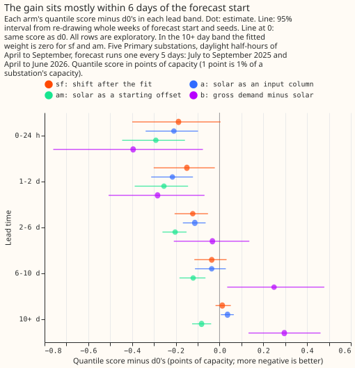
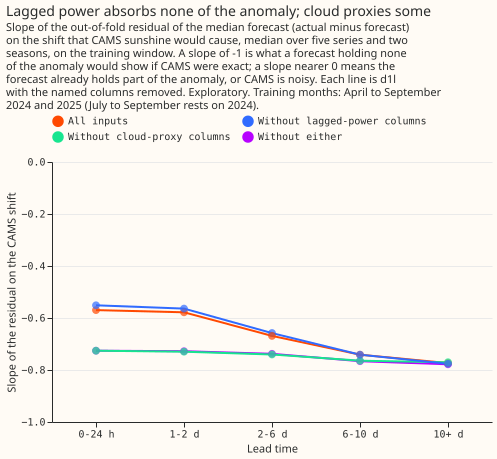
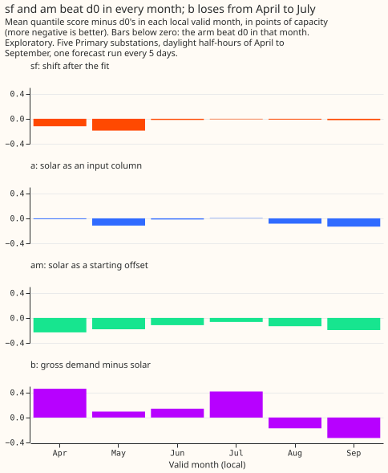

# Experiment 64: does demand minus forecast solar match the best guess? (PVDIS-5)

**Take-home message: giving the XGBoost model the forecast solar output as a starting offset (a
fixed amount added to every tree prediction), with its weight fitted on the training window, beat
`d0`, the best-guess recipe of experiment 33, by 0.15 points of capacity.** Training the XGBoost
model on gross demand (metered power plus the solar panels' output) and then subtracting the
forecast solar output was not shown to score within 0.10 points of `d0`. The starting-offset
forecast has a separate solar term, was no worse than `d0` over all leads, and scored lower than
`d0` at leads under 10 days. The open questions are whether the gain survives a capacity table that
is current for the validation year, and why the starting offset also scores better at 10 days and
beyond, where the weight on the solar term is set to zero.

We asked whether a forecast of the power that a Primary substation draws can be split into ordinary
demand and the output of the solar panels behind the substation without losing accuracy. A Primary
substation is a 33/11 kV or 66/11 kV substation in the electricity distribution network. The
substation's meter reads demand minus the panels' output. We built four forecasts that each carry an
explicit solar term, which is the panels' capacity times a forecast of how much sunnier or cloudier
the day will be than usual. We scored them on five Primary substations over daylight half-hours of
April to September. We compared each with `d0`, and with the same forecast given the solar term of
another date. The score is the quantile score, an error measure in which lower is better, and 1
point is 1% of a substation's capacity. Three of the four forecasts scored 0.06 to 0.15 points lower
than `d0`. The fourth was not shown to score within 0.10 points of `d0`.

**The verdict is `supported`.** The decision rule is in the front matter and was committed before
any code ran. Contrast N is an arm's quantile score minus the quantile score of `d0`. A negative
value favours the arm. Contrast T is an arm's quantile score minus that of its placebo twin, the
same arm given the forecast solar shape of another date, so T measures what the forecast of the
sunshine adds. An arm passes when two conditions hold. The upper end of N is below +0.10 points, so
the arm is within the margin of `d0`. The upper end of T is below 0, so the arm beats its placebo
twin. Arms `sf`, `a`, and `am` pass; `b` beats its twin but is not shown to be within the margin of
`d0`. A gain is reported where the upper end of N at leads under 48 hours is below -0.10, which
holds for `a` and `am`.

| Arm | N: score minus `d0`, all leads | T: score minus placebo twin | Gain: score minus `d0`, leads under 48 hours |
|---|---|---|---|
| `sf` | -0.063 (-0.126 to -0.008) | -0.293 (-0.418 to -0.180) | -0.168 (-0.357 to -0.002) |
| `a` | -0.059 (-0.103 to -0.016) | -0.164 (-0.236 to -0.089) | -0.212 (-0.317 to -0.112) |
| `am` | **-0.152 (-0.199 to -0.111)** | -0.300 (-0.407 to -0.198) | **-0.272 (-0.420 to -0.145)** |
| `b` | +0.105 (-0.090 to +0.292) | -1.068 (-1.361 to -0.790) | -0.338 (-0.661 to -0.040) |

The values are differences in quantile score, in points of capacity, with 98.75% intervals (a 95%
interval split across the four arms by a Bonferroni correction) from 50,000 resamples of whole ISO
weeks of forecast start and of seeds. The 68,903 scored rows per seed are half-hourly forecasts from
29 ISO weeks of forecast start, with 3 seeds, at five Primary substations anonymised as D9, D10,
D11, D14, and D16 (as in experiment 46). Every other read on this page is exploratory, at 95%.

## The four arms

Every arm uses experiment 46's `d1l` inputs and recipe (experiment 33's XGBoost quantile model,
trained on the ENS control member, without radiation inputs) and adds the solar term `s`: the
capacity times the calibrated anomaly of the ensemble-mean ENS sunshine forecast, in power over
capacity. The weight `w` on `s` is fitted per series, lead band, and season.

- **`sf`** adds `w * s` to the stored `d1l` quantiles after the fit. No XGBoost model is refitted.
- **`a`** adds the capacity times the calibrated ENS solar shape as one extra input column.
- **`am`** gives XGBoost the base margin `w * s`, so the trees fit only the remainder.
- **`b`** trains on gross demand (the metered power plus the capacity times the CAMS solar shape),
  with lagged inputs converted to gross demand the same way, and subtracts the capacity times the
  forecast solar shape from each ensemble member's quantiles at inference.

Each arm has a placebo twin (`sf_twin`, `a_twin`, `am_twin`, `b_twin`) that replaces the forecast
solar shape with that of another forecast run in the same series, local month, half-hour, and lead
band. The reference rows are `d0`, `d1l`, `climatology`, and `manual_heuristic` (experiment 33).

## Arm `am` is the best arm, and `b` is the only arm not shown to match `d0`


**The scores are close together, and the paired contrasts are what separate the arms.** The 95%
intervals of the absolute scores overlap because every arm's error rises and falls with the weather
from week to week, which pairing removes. Absolute scores, in points of capacity, with 95% intervals:

| Arm | Quantile score | Placebo twin |
|---|---|---|
| `d0` | 4.620 (4.294 to 4.946) | |
| `d1l` | 4.724 (4.382 to 5.058) | |
| `sf` | 4.557 (4.239 to 4.878) | 4.850 (4.497 to 5.217) |
| `a` | 4.561 (4.240 to 4.890) | 4.724 (4.384 to 5.060) |
| `am` | 4.467 (4.143 to 4.785) | 4.767 (4.407 to 5.133) |
| `b` | 4.724 (4.365 to 5.113) | 5.792 (5.343 to 6.258) |
| `climatology` | 5.272 | |
| `manual_heuristic` | 4.952 | |

`climatology` and `manual_heuristic` are experiment 33's stored forecasts, scored on 68,863 rows
because 40 of the 68,903 rows are missing from them. Neither enters the paired intervals.

**The twin of `b` scores 1.07 points worse than `b`.** One candidate explanation is that `b`
subtracts the shape with a weight of 1 built in, so a wrong-dated shape does more harm there than in
the arms with a fitted weight; no arm tests this. The size of T for `b` is not evidence that `b`
uses the forecast sunshine better than the other arms.

## The gain sits mostly within 6 days of the forecast start



**The gain of `a` is clear up to 6 days and the gain of `sf` from 1 to 6 days, and both are gone
beyond, and `am` stays below `d0` at every lead.** At 10 days and beyond, `am` is -0.082 points
(-0.126 to -0.038) from `d0` although its weight there is zero, `a` is +0.036 (+0.006 to +0.065),
and `sf` is +0.013 (-0.019 to +0.051). The weight is zero in that band because the calibrated ENS
anomaly has a correlation of 0.03 with the CAMS anomaly there on the training rows (0.80, 0.76,
0.58, and 0.27 in the four shorter bands), and the fitted slope ranged from -8.2 to +6.2 across
series and seasons. The 10-plus-day gain of `am` is unexplained. One candidate is the starting
point: `am` starts from its margin alone, while `d1l` and `a` start from XGBoost's estimated base
score.

**Arm `b` is worse than `d0` at 6 days and beyond.** Its N is +0.249 points (0.035 to 0.479) at 6 to
10 days and +0.296 (0.132 to 0.462) at 10 days and beyond, where the ENS forecast of the subtracted
term has little or no skill (its correlation with the CAMS anomaly is 0.27 at 6 to 10 days and 0.03
beyond). This experiment does not test that as the cause.

## The fitted weights are below 1, and lagged power does not explain why

**The fitted weight on the ENS shift is -0.60 to -0.29 at leads under 10 days, well short of the -1
that a perfect shift of the right size would take.** These are the means over the five series of the
slope of the out-of-fold residual (actual minus median forecast) on the shift that `sf` applies,
fitted per lead band and season on the training window. The slope on the oracle shift (the CAMS
anomaly) is -0.80 to -0.47, to compare with experiment 51's -0.69 to -0.42. The effective weights of
the arms, measured as the slope of each arm's median minus `d1l`'s median on minus the shift, are
0.49 for `sf`, 0.41 for `a`, 0.31 for `am` (on top of its fitted margin), and 0.64 for `b`, against
the constant 1 built into `b`.



**Lagged power absorbs none of the sunshine anomaly, cloud proxies absorb about 0.15 at leads
under 2 days, and about -0.73 remains with neither.** Experiment 51 left open whether the slope
below 1 comes from the XGBoost model already absorbing part of the anomaly through its inputs, or
from error in the CAMS sunshine estimate. Four cross-fitted variants of `d1l` (seed 0) give the
median oracle slope below, over five series and two seasons.

| Variant | 0-24 h | 1-2 d | 2-6 d | 6-10 d | 10+ d |
|---|---|---|---|---|---|
| All inputs | -0.570 | -0.578 | -0.669 | -0.741 | -0.774 |
| Without the 3 lagged-power columns | -0.551 | -0.564 | -0.658 | -0.741 | -0.776 |
| Without the 3 cloud-proxy columns | -0.726 | -0.730 | -0.740 | -0.764 | -0.770 |
| Without either | -0.726 | -0.728 | -0.738 | -0.766 | -0.778 |

The remaining slope of about -0.73 with neither group of columns points to noise in the CAMS
estimate of the fleet's sunshine (which pulls a regression slope towards zero) or to a mismatch
between the CAMS shape and the panels' real output. The diagnostic does not separate the two.

## Arms `sf` and `am` beat `d0` in every valid month



**`sf` and `am` are below `d0` in all six months, `a` in five (+0.005 in July), and `b` loses from
April to July and wins in August and September.** The mean of `b`'s N is +0.460 in April and +0.416
in July, and -0.173 in August and -0.327 in September. These are the sign of a mean, not an
interval.

## Other reads (exploratory, 95%)

- **Per series:** `am` is below `d0` at all five series, from -0.113 (-0.165 to -0.058) at D9 to
  -0.236 (-0.298 to -0.174) at D10.
- **Sunniest decile of rows by clear-sky index:** `sf` is -0.296 (-0.437 to -0.168), `a` -0.216
  (-0.283 to -0.147), `am` -0.283 (-0.350 to -0.216), and `b` -0.017 (-0.363 to +0.305). Arm `am` beats
  `a` by 0.093 points (0.057 to 0.129) over all rows and by 0.067 (-0.019 to +0.150) on the sunniest
  decile, so the trees' inability to extrapolate past the capacities seen in training is not shown
  to matter more on the sunniest rows.
- **Against the fixed-coefficient shift of experiment 46:** `d1l` plus that shift scores 4.667, which
  is 0.056 below `d1l`. The arm `sf` is 0.111 points (0.023 to 0.196) below it, and `am` lowers `d1l`
  by 0.256 (0.205 to 0.306).
- **Per-member against ensemble-mean shift:** `sf_member` minus `sf` is -0.004 (-0.010 to +0.001), so
  the member spread adds nothing for `sf`. `b_member` minus `b` is -0.145 (-0.206 to -0.094), so `b`
  needs the member spread.
- **Temperature derating:** `sf_temp` minus `sf` is +0.0003 (-0.0016 to +0.0022), so a derating of
  0.4% per kelvin removes nothing. On sunny rows the quantile score rises 0.070 points per kelvin of
  cell temperature for `d1l` and 0.036 for `sf`, and `sf_temp` leaves that slope at 0.037.
- **Coverage:** the table gives the share of actuals below the 0.05 and 0.95 quantiles, where the
  targets are 0.05 and 0.95. Sunny rows have a clear-sky index of 0.7 or more and cloudy rows under
  0.3. The lower quantile is too high on sunny rows in every arm, and `b` has the worst
  upper-quantile coverage on cloudy rows.

| Arm | Sunny, below q05 | Sunny, below q95 | Cloudy, below q05 | Cloudy, below q95 |
|---|---|---|---|---|
| `d0` | 0.152 | 0.990 | 0.006 | 0.848 |
| `d1l` | 0.151 | 0.990 | 0.005 | 0.846 |
| `sf` | 0.126 | 0.989 | 0.007 | 0.879 |
| `a` | 0.129 | 0.990 | 0.006 | 0.850 |
| `am` | 0.131 | 0.984 | 0.004 | 0.800 |
| `b` | 0.195 | 0.975 | 0.017 | 0.708 |

## Which predictions held

| Prediction made in the plan | Result |
|---|---|
| `sf` is the likeliest arm to pass, at -0.04 (-0.12 to +0.04) against `d0` | Held: -0.063 (-0.126 to -0.008) |
| `sf` gains -0.10 to -0.25 at leads under 48 hours | Held for the point estimate, -0.168 (98.75% interval -0.357 to -0.002); `sf` does not meet the gain rule |
| `a` scores +0.00 to +0.10 against `d0` | Not met: `a` scores -0.059 (-0.103 to -0.016) |
| `am` beats `a` by 0.02 to 0.08 on the sunniest 10% of rows and ties elsewhere | Partly held: `am` beats `a` by 0.067 (-0.019 to +0.150) on the sunniest decile, inside the predicted range, but also by 0.093 (0.057 to 0.129) over all rows, so the tie elsewhere was not met |
| `b` scores +0.05 to +0.25 against `d0` | Held in sign and size (+0.105), with a wide interval (-0.090 to +0.292) |
| The slope on the oracle shift is -0.4 to -0.7 for the full `d1l`, and nearer -1 without lagged power and cloud proxies | Partly held: -0.57 to -0.74 for the full `d1l` and -0.73 to -0.78 without either, which is nearer -1 but not near it |
| The upper end of N is below +0.10 for `sf` and not for `b` | Held: -0.008 for `sf`, +0.292 for `b` |
| The placebo twin scores worse by 0.10 to 0.40 for `sf`, `am`, and `b`, and by 0.02 to 0.15 for `a` | Held for `sf` (0.293) and `am` (0.300); not met for `a` (0.164, slightly above the range) and for `b` (1.068) |
| The half-width of `sf` against `d0` at 98.75% is 0.079 | Realised half-width 0.059 |

## Departures from the plan

**The experiment departed from its plan in the 11 ways below, all decided before any arm was
scored.** None changes the hypothesis, the prediction, or the decision rule.

1. **The weight is zero in the 10-plus-day band.** The ENS anomaly has a correlation of 0.03 with
   the CAMS anomaly there, and the fitted slope ranged from -8.2 to +6.2. The rule was fixed from
   the weights table, which uses training rows only, before any arm was scored.
2. **The capacity is divided by experiment 45's recovery ratio.** The refitted season-year constant
   for 2024/25 is divided by experiment 45's stored recovery ratio (0.71 to 0.79, from an injection
   test on tuning farms), as experiment 45 defines capacity. The capacities used, in MW, are D9
   2.751, D10 2.356, D11 3.457, D14 3.705, and D16 3.578. D14 uses experiment 40's 2023/24 constant,
   because the experiment 64 refit has no 2024/25 constant for it (all of its weeks are unobserved).
3. **The no-cloud-proxy variant drops 3 columns,** `dew_point_temperature_2m`, `precipitation`, and
   `pressure_surface`, because `d1l` has no `precipitation_type` or `pressure_msl` column.
4. **The placebo is a seeded cyclic shift, not a random permutation.** It moves each row's shape by
   between a quarter and three quarters of its group (series, local month, half-hour, and lead
   band). A random permutation paired runs that forecast the same valid time, so the permuted
   anomaly stayed correlated with the real one. After the change, the correlation of the twin's
   anomaly with the real anomaly is -0.012 on the 256,230 validation rows.
5. **Arm `b` drops training rows whose lag has no shape.** At inference the gross lag is missing
   (NaN) there, on 2.8% of validation rows for the lag of the same time the day before and 8.6% for
   the week before. No sensitivity read of this exists. The climatology fallback was not needed.
6. **Two small confounds remain.** The reference temperature of `sf_temp` uses the control member's
   temperature. Arm `am` starts from the margin alone, while `d1l` and `a` start from XGBoost's
   base score, a small confound in the `a` against `am` contrast.
7. **`climatology` and `manual_heuristic` lack 40 of the 68,903 rows,** so they are scored on shared
   rows, outside the paired bootstrap.
8. **The plan's refit count was wrong.** The experiment ran 75 refits (5 arms, 3 seeds, 5 series),
   not "about 90 plus 60".
9. **The weights rest on little data.** The training window holds two April-to-June periods and one
   July-to-September period (2024). The 4 time-block folds of the cross-fit group months by month
   index modulo 4, so adjacent months train each other.
10. **The held capacity is stale.** The held value is 5% to 19% below experiment 45's 2025/26
    constants at the five series (D9 5%, D10 17%, D11 15%, D14 13%, D16 19%). D14 holds the 2023/24
    constant of experiment 40. A capacity that is too low plausibly weakens the solar term and so
    works against the placebo contrast, which would make the gains conservative; no run tests this.
11. **The sunniest-decile read and the `a` against `am` contrasts are exploratory (95%),** not
    corrected across the four arms.

## What the next experiment should answer

**The evidence supports `am` as a candidate for a model release, and the decision to port belongs
to the maintainer and the roadmap.** The next experiment should answer four questions that remain
open:

- **Does the gain survive a current capacity?** Refit `sf` and `am` with capacities that follow
  the validation year (experiment 45's 2025/26 constants are 6% to 23% higher), because the capacity
  held here is stale.
- **Do the weights hold with more training data?** The July-to-September weights rest on one
  summer, so a window with a second summer would show whether the weights move.
- **Why does `am` also beat `d0` at 10 days and beyond?** The weight is zero there, so the base
  score, the margin in training rows at shorter leads, and the trees are the candidates.
- **Can the live service supply `am`'s inputs?** The live service cannot use `am` as built: it needs
  the capacity table, the table of weights, and the ENS calibration slopes at predict time, and
  `am` sets a base margin on each prediction matrix. Whether the serving path can do so is a
  question for the roadmap.

**Arm `b` stays untested in two respects.** Its gross lags are missing on 2.8% and 8.6% of
validation rows with no sensitivity read, and its loss to `d0` at 6 days and beyond could come from
the ENS forecast of the subtracted term, which has no skill there. A variant that subtracts the
shape only inside 6 days would separate the two.

## Reproducing the figures

```bash
uv run python ml-experiments/00064-pvdis-5-net-demand-as-demand-minus-forecast-solar/e00064_stats.py
uv run python ml-experiments/00064-pvdis-5-net-demand-as-demand-minus-forecast-solar/e00064_report.py
uv run python ml-experiments/00064-pvdis-5-net-demand-as-demand-minus-forecast-solar/e00064_charts.py
npx svgo@4 --multipass --precision=1 --final-newline figure_*.svg
```

The fits that the statistics read are in `e00064_run.sh`; the code is in
`ml-experiments/00064-pvdis-5-net-demand-as-demand-minus-forecast-solar/`.
