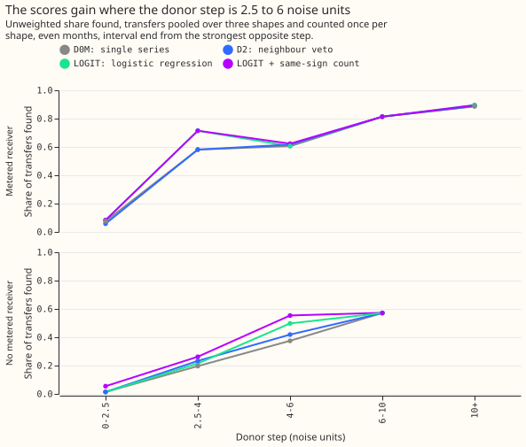

# Experiment 65: does one score from a substation's own step and its neighbours' opposite steps find more of the moved load?

**Adding the neighbouring substations' opposite-sign steps to a substation's own step did not find
clearly more of the moved load than the own step alone.** In a post hoc variant, adding the count of
neighbours that stepped the same way raised the share found. The neighbour veto of experiment 55
already uses that count. Whether one score that combines the own step, the opposite neighbour step,
and the same-sign count beats the own step alone is untested.

We asked whether load transfers are found more often when one alarm score adds a substation's own
step to the largest opposite step among its neighbours. A load transfer moves power off a donor
Primary substation and onto receiver substations. The step of a substation is the change in the
average of its residual (measured minus predicted power) from the 24 hours before a half-hour to
the 24 hours after it, in noise units (multiples of the usual size of that step on a quiet day). We
injected 620 known load transfers into the measured power of 16 Primary substations and counted
the share of the moved megawatts (MW) found. A transfer counts as found when an alarm starts within
2 hours of its start and ends within the larger of 6 hours and 10% of its duration. Every detector
was held to 80 alarms on odd months that match no closure in the NGED switching log. The
single-series detector D0M finds 0.646 of the moved MW (0.354 missed). The logistic-regression
score (LOGIT) finds 0.665, which is +0.019 more (99.17% interval, from resampling whole calendar
months, -0.011 to +0.062). The likelihood-ratio score (LR) finds 0.651, which is +0.005 more
(-0.010 to +0.014).

## Verdict

**The experiment is inconclusive, because the better score's interval against D0M includes zero.**
The likelihood-ratio score (LR) is refuted, because the upper end of its interval
against D0M is below +0.02. The logistic-regression score (LOGIT) is inconclusive, because its interval
against D0M includes zero and its upper end is above +0.02. The experiment takes the more favourable
verdict of the two scores, and that choice is not covered by the correction for six planned
contrasts (a Bonferroni correction). All intervals are
99.17%, from 20,000 resamples of whole calendar months, over the 620
injected transfers that move 25% to 40% of the receiving load for over 1 day and start in even
months, pooled with equal weight over the constant-MW, receiver-profile, and fitted-mix shapes
(none of which the scores assume). Interval ends come from the strongest opposite step in the next
14 days, the end rule of [experiment 61](../00061-sw2-6-paired-step-intervals/result.md). That rule
needs up to 14 days of hindsight, so detectors built on it serve training-time masks and the NGED
event table, not live forecast inputs.

| Contrast (gain in MW-weighted recall) | LR | LOGIT |
|---|---|---|
| Against D0M, the 24-hour single-series detector | +0.005 (-0.010 to +0.014) | +0.019 (-0.011 to +0.062) |
| Against D1, the neighbour gate | +0.101 (+0.043 to +0.176) | +0.116 (+0.050 to +0.231) |
| Against D2, the neighbour veto of [experiment 55](../00055-sw2-8-neighbour-veto-single-series-detector/result.md) | -0.007 (-0.036 to +0.008) | +0.008 (-0.028 to +0.042) |

**Both scores beat the neighbour gate D1 clearly, but D1 is the weakest detector.** At 80
unexplained alarms D1 finds 0.550 of the moved MW against D0M's 0.646. D2 finds 0.658. The
pre-registered rule needed an interval above zero against D0M as well, and neither score has one.

## Recall by arm

**The best arms still miss about a third of the moved MW.** The table gives MW-weighted recall under
each end rule, pooled over the three shapes.

| Arm | Tracked end | Strongest-opposite-step end (PE) | MW missed under PE |
|---|---|---|---|
| D0M | 0.455 | 0.646 | 0.354 |
| D1 | 0.389 | 0.550 | 0.450 |
| D2 | 0.459 | 0.658 | 0.342 |
| LR | 0.460 | 0.651 | 0.349 |
| LOGIT | 0.466 | 0.665 | 0.335 |
| LOGIT + same-sign count (post hoc) | 0.479 | 0.681 | 0.319 |
| D2 at veto 1.0 (post hoc) | 0.466 | 0.666 | 0.334 |

The same contrasts under the tracked end have the same signs and sizes (LR +0.005, LOGIT +0.011).
Even-month unexplained-alarm counts on the real residual were 80 for D0M, 78 for LR, 54 for LOGIT,
72 for D2, and 49 for D1, so no combined score bought its recall with extra alarms. The odd-month
counts are all 80 or 79.

## Where the gain sits

**The scores gain where the donor step is 2.5 to 6 noise units, mostly for transfers with a metered
receiver.** A noise unit is the usual size of the 24-hour step statistic on a quiet day. With a
metered receiver (a receiver whose own power is measured) the share of transfers found at a donor
step of 2.5 to 4 rises from 0.58 for D0M to 0.71 for LOGIT with the same-sign count. Without a
metered receiver the gain spans 2.5 to 6 noise units and is larger at 4 to 6 (0.37 for D0M, 0.55
for that arm). Donor steps below 2.5 noise units are found for 5 of 40 transfers at most. A donor
step above 6 gains nothing, because D0M already finds those transfers.

## Labelled real transfers

**On the 35 labelled real transfers of more than 1 day, the scores find 6 to 8 against D0M's 7
under PE, so the real data cannot separate them.** With the tracked end the scores find 5 and D0M
finds 2. Alarms at the right start are found for 14 (LR), 12 (LOGIT), and 11 (D0M) of the 35. The
count is too small to rank the scores. Of the 35, 20 start in even months and 15 in odd months.

## Fitted scores

**The fitted LR lookup tables rise with both statistics, and LOGIT weights the neighbour step about as
much as the own step.** The standardised logistic coefficients are 2.59 on the own step, 2.95 on the
largest opposite neighbour step, and -1.11 on the number of neighbours. The coefficient on the
MVA-neighbour flag is zero, because every one of the 16 series has an MVA-only neighbour, so the flag
is constant. The post hoc same-sign count has a coefficient of -0.85, which means a same-sign
neighbour step lowers the score, as the veto does.

## Limits

- **Training data come from the same injection generator as the test transfers.** Training uses odd
  months and scoring uses even months, but both draw donors and receivers the same way, so the
  scores may do worse on real transfers.
- **The candidate floor of 2.5 noise units caps recall.** The 507 negative examples are alarm
  candidates from the real odd-month residual.
- **Weights and shrinkage.** Every shape weights a transfer by its MW moved under the donor-profile
  shape, so the three shapes share one set of weights. The logistic regression's penalty of 1.0 is
  weak against about 2,700 training candidates, so it shrinks the coefficients very little.
- **Alarm counts.** LR and both logistic scores land on exactly 80 unexplained odd-month alarms.
  D0M, D1, and D2 reach at most 80 on a 0.05 grid of thresholds (D0M 80, D1 80, D2 80, veto 1.0 at
  79).
- **The post hoc arms** were chosen after reading the pre-registered result, so their intervals
  overstate the evidence. Their contrasts use the same level as the planned ones.

## What the next experiment should answer

**Does one pre-registered score that uses the largest opposite neighbour step, the count of
same-sign neighbour steps, and the own step together beat D0M by at least +0.02?** The post hoc arm
suggests it does (+0.034, +0.013 to +0.091). A pre-registered run would also say whether the gain
holds on the labelled real transfers, where this experiment could not tell the arms apart.
