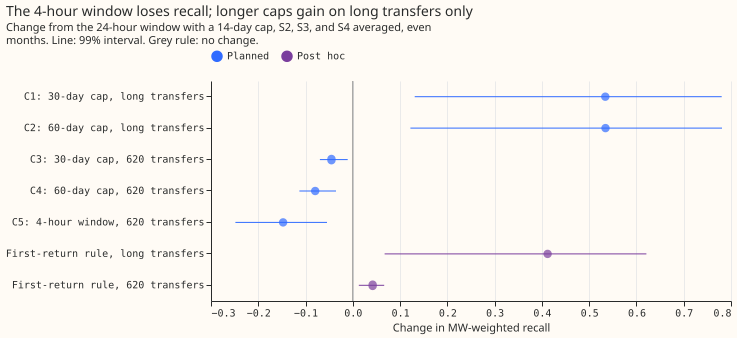
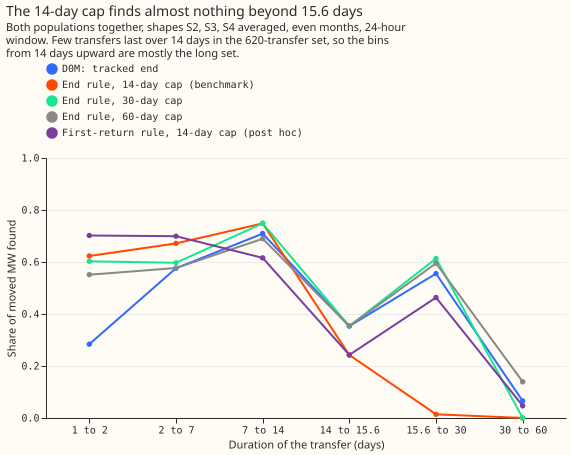

# Experiment 66 (SW2-16, part of the LSC series): which window and cap should the end rule use?

**Ending each alarm's interval at the first opposite step that is at least half the size of the step
that raised the alarm finds more of the moved power than searching 14 days for the strongest
opposite step, and a 24-hour averaging window beat a 4-hour window.** A load transfer is a switching
operation that moves part of one Primary substation's demand onto neighbouring substations for some
hours or days. A Primary substation is the 11 kV or 6.6 kV substation that feeds local distribution
circuits. D0M is the single-series detector of this series. It raises an alarm (the onset step) when
the 24-hour average of a substation's residual steps away from the previous 24-hour average by 4.0
noise units or more. The residual is the measured power minus an XGBoost forecast that uses weather
forecasts and no past power. One noise unit is 1.4826 times the median absolute deviation of that
24-hour step on odd months, for that substation, so 4.0 noise units is a step four times the usual
size. An alarm interval runs from the onset step to the opposite step (the return step) that ends
the transfer. D0M's own tracker finds that end by following the residual's level. Experiment 61
ended each alarm interval at the strongest opposite step within a cap of 14 days after the onset,
and that end rule finds 0.19 more of the moved power than the tracker. All scores below are shares
of the moved power (in MW), from 0 to 1.

We added known load transfers to the power history and asked what share of the moved power each end
rule finds. A transfer counts as found when an alarm interval starts within 2 hours of the true
start and ends within the larger of 6 hours and 10% of the true duration. The score is called
MW-weighted recall: the share of the moved MW that sits in found transfers. Two sets of injected
transfers carry the scores: experiment 58's 620 transfers (25% to 40% of the receiving load, lasting
over 1 day), and a new long set of 215 transfers lasting 15.6 to 60 days. On the long set, a 30-day
cap finds 0.547 of the moved power and the 14-day cap finds 0.013. On the 620 transfers, the 30-day
cap finds 0.045 less than the 14-day cap, because the 30-day cap picks a later, wrong step for some
short transfers. The 4-hour window, with a 14-day cap, finds 0.147 less than the 24-hour window on
the 620 transfers. A rule written after seeing the results (post hoc) ends the interval at the first
opposite step of at least half the onset step, and otherwise keeps the tracked end. The post hoc
rule finds more than the 14-day cap on both sets, although on the long set it finds less than the
30-day cap. The pre-registered decision rule (fixed before any result was read) gives the verdict
`inconclusive`, because the gain on long transfers and the loss on short ones appear together.

## What we tested

**Twelve variants of the end rule (arms) plus three post hoc arms, all scored on the same transfers,
with D0M's alarms in every arm.** The arms differ in the window of the step statistic and in where
the interval ends. D0M and the end rules at one alarm setting therefore raise the same alarms, so
their unexplained-alarm counts match by construction.

- **D0M** ends each interval with a level tracker that stops after 60 days.
- **PE14, PE30, and PE60** (labels for the end rule with a cap of 14, 30, or 60 days) end the
  interval at the stamp between 24 hours and 14, 30, or 60 days after the onset where the step back
  is largest, when it is at least 1.5 noise units (experiment 61's rule). Otherwise the tracked end
  stays.
- **Three alarm settings.** The 24-hour window at 4.0 noise units gives 80 unexplained alarms on odd
  months. The 4-hour window at 6.0 gives 120 (experiment 43's setting). The 4-hour window at 6.35
  gives 78, the threshold that matches the 24-hour window's alarm rate, and C5 uses it.
- **PF14, PF30, and PF60 (labels for the first-return rule with a cap of 14, 30, or 60 days; post
  hoc, 24-hour window only)** take the first stamp where the step back reaches half the onset step
  (and at least 1.5 noise units), end at the largest step back within one window after that stamp,
  and keep the tracked end when no stamp qualifies.

The 620 transfers are experiment 58's headline band (25% to 40% of the receiving load, lasting over
1 day) that start in even months. Only 17 of its 1,160 headline transfers (all months) last over 14
days, so the 620 cannot separate the caps. The long set is 400 new injected transfers that last 15.6
to 60 days, of which 215 start in even months and form the scored set. Each takes its duration and
its pair of substations from one of the 25 labelled real operations that last that long, and 57 of
the 215 scored (26.5%) last over 30 days. Five shapes of moved power (a share of the donor's
profile, a constant MW, a share of each receiver's profile, a mix fitted to real transfers, and the
donor's profile shifted by 12 hours; S1 to S5, from experiment 60) carry the moved power. The
headline pools S2, S3, and S4, the shapes that none of this series' detectors assumes. Intervals are
99% (Bonferroni across the five planned contrasts), from 20,000 resamples of whole calendar months.

## Verdict

**`inconclusive`: C1 and C2 pass the rule's tests on the long set, and C3 and C4 fail its guard on
the 620 transfers.** C5 shows that the window should not change from 24 hours (tested with the
14-day cap, on the 620 transfers). The rule changes the cap only when the long-set gain is at least
+0.01 and the point change on the 620 transfers is no lower than -0.01. The benchmark stays the
24-hour window with a 14-day cap, and no planned contrast supports a change.

| Contrast (24-hour window unless stated) | Change in MW-weighted recall | Reading |
|---|---|---|
| C1, 30-day cap, long set | +0.534 (+0.131 to +0.780) | Large gain on transfers over 15.6 days |
| C2, 60-day cap, long set | +0.535 (+0.122 to +0.781) | Same gain as the 30-day cap |
| C3, 30-day cap, 620 transfers | -0.045 (-0.070 to -0.011) | Fails the guard of -0.01 |
| C4, 60-day cap, 620 transfers | -0.080 (-0.113 to -0.035) | Fails the guard |
| C5, 4-hour window (78 alarms), 620 transfers | -0.147 (-0.248 to -0.054) | The window stays at 24 hours |
| 60-day cap minus 30-day cap, long set (descriptive) | +0.001 (-0.035 to +0.042) | No gain from 60 days |

Absolute MW-weighted recall (S2, S3, and S4 pooled, even months) is in the next table. The missed
share is one minus the recall. For PE14 on the 620 transfers, 0.281 of the moved MW sits in
transfers with no alarm at the start and 0.073 in transfers whose start was found and whose end was
wrong. On the long set the 14-day cap misses 0.599 as wrong ends.

| Arm | 620 transfers | Long set |
|---|---|---|
| D0M (tracked end) | 0.455 (0.364 to 0.502) | 0.503 (0.107 to 0.744) |
| PE14 (benchmark) | 0.646 (0.544 to 0.710) | 0.013 (0.000 to 0.030) |
| PE30 | 0.601 (0.516 to 0.685) | 0.547 (0.131 to 0.807) |
| PE60 | 0.567 (0.464 to 0.662) | 0.547 (0.122 to 0.808) |
| PF14 (post hoc) | 0.688 (0.577 to 0.755) | 0.425 (0.067 to 0.648) |
| PE14, 4-hour window, 78 alarms | 0.499 (0.323 to 0.609) | 0.000 (0.000 to 0.000) |

On odd months, which were not used to rank the pre-registered arms (see Limits for their dependence
on the even-month draw), the 620-transfer recall is 0.372 for D0M, 0.491 for PE14, and 0.521 for
PF14. Unweighted recall for PE14 on the 620 transfers is 0.478.

## The cap trades short transfers for long ones

**A longer cap repairs transfers over 15.6 days and breaks some shorter ones.** The strongest
opposite step in 30 days is probably sometimes a later step that belongs to another event, and the
60-day cap probably picks such a step more often. The printed report shows only the number of wrong
ends: the mean number of transfers per shape on the 620 set whose start was found and whose end was
wrong is 49 at 14 days, 75 at 30 days, and 101 at 60 days. The interval of C1 runs from +0.131 to
+0.780, which is wide, probably because few calendar months contribute.

**The first-return rule is better than the 14-day cap on both sets of transfers, and the cap barely
matters for it.** The post hoc arm PF14 is +0.042 (+0.013 to +0.066) over PE14 on the 620 transfers
and +0.412 (+0.067 to +0.621) on the long set. On odd months the gains are +0.030 (+0.011 to +0.047)
and +0.371 (+0.018 to +0.595). PF30 and PF60 differ from PF14 by 0.009 and 0.018 on the 620
transfers. A return step has to reach half the onset step to end an interval. When no such step
exists, the rule keeps the tracked end. PF30 and PF60 find no more than PF14 on the long set (0.422
and 0.429 against 0.425), and PF14 stays below PE30 there (0.425 against 0.547), with 0.187 of the
long-set MW lost as wrong ends against 0.065 for PE30. The arm was written after seeing the results,
so PF14 needs a confirmation on a fresh draw before the series adopts it. Suppose transfers over
15.6 days were as common as in the labelled operations (25 of the 151 labelled operations over 1
day, 17%, which is a larger set than the 35 transfers scored below). Mixing the long-set and
620-transfer point gains at that share (post hoc, with no interval) gives +0.051 for PE30, +0.022
for PE60, and +0.103 for PF14 over PE14.

## Recall by donor step

**Recall rises with the size of the donor step, and is low for steps below 2 noise units and for
small steps with no metered receiver.** The table counts transfers found out of transfers, summed
over S2, S3, and S4, on the 620 transfers. Steps are in 24-hour noise units.

| Donor step | Receiver | Transfers | D0M | PE14 | PE30 | PE60 | PF14 |
|---|---|---|---|---|---|---|---|
| 2 to 4 | metered | 126 | 49 | 67 | 61 | 46 | 86 |
| 4 to 6 | metered | 175 | 85 | 106 | 99 | 82 | 122 |
| 6 to 10 | metered | 295 | 174 | 240 | 217 | 205 | 254 |
| 10 or more | metered | 343 | 202 | 304 | 289 | 284 | 319 |
| 2 to 4 | unmetered | 563 | 73 | 98 | 77 | 57 | 107 |
| 4 to 6 | unmetered | 179 | 45 | 67 | 63 | 55 | 74 |

The printed report also gives the 4-hour arms, the steps below 2, and the 6-to-10 unmetered row.

## Labelled real transfers

**On the 35 labelled real transfers of more than 1 day, the caps make little difference.** D0M finds
2, PE14 finds 7, PE30 finds 6, PE60 finds 5, and PF14 finds 8 (the same 8 for PF30 and PF60). Only
11 of the 35 have any alarm at the start, so the onset still limits the real transfers. Of the 5
labelled transfers over 14 days, PE14 finds none, and PE30, PE60, and PF14 find 1 each. The counts
are too small for an interval.

## What held in the prediction and what did not

- **Held: C1 +0.534** (predicted +0.30 to +0.55, near its upper edge) and **C2 +0.535** (predicted
  +0.40 to +0.65, mid-range).
- **Held at its lower edge: 60 days over 30 days, +0.001** (predicted +0.00 to +0.20), although
  about 27% of the long set lasts over 30 days.
- **Mechanism:** the 60-day cap's extra gain on transfers of 30 to 60 days (0.139 against 0.000) is
  cancelled by its extra wrong ends on shorter transfers.
- **Not held: C3 -0.045 and C4 -0.080,** against predicted -0.01 to +0.01 and -0.03 to +0.01.
- **Held: C5 -0.147,** against a predicted -0.15 to 0.00, at its lower edge.
- The expected winner, the 24-hour window with a 30-day cap, did not pass the guard.

## Limits

- **The end rule needs up to the cap's worth of hindsight,** so detectors built on it serve
  training-time masks (SW2-12) and the event table for National Grid Electricity Distribution
  (NGED), not live forecast inputs.
- **The long set was redrawn once.** The first draw used experiment 58's quietness rule over the
  whole transfer, which left transfers in 9 months only. The redraw applies the rule to the 7 days
  around the onset and the end, requires 90% of the power to be present there, and allows at most 16
  transfers starting in one month. The first run's contrasts had been printed before the redraw. The
  redraw changed no arm, contrast, or decision rule.
- **Injected transfers are clean boxcars,** so a return step is easier to find than a real
  transfer's.
- **The end rule is applied to every substation of a transfer,** and a longer cap more often picks a
  noise step on a receiver with a small step. A transfer counts as found when any of its substations
  matches.
- **Odd and even months are assigned by the month in which the transfer starts.** A long transfer
  that starts in an even month ends in later months, so the odd-month check is not independent of
  the even-month draw.
- **The donor-step table uses 24-hour noise units for the 4-hour arms too,** because the transfer's
  step is defined once.
- **The long set and the real transfers share their durations and substation pairs,** so they are
  not independent evidence.
- **PF's half-step share and the 1.5 noise-unit floor** are the first values tried and were not
  tuned.

## Reviews

- **Plan review (Sonnet agent):** accepted an explicit rule for every outcome, the cap taken from
  the 24-hour contrasts only, a guard that does not enter the `refuted` test, the 15.6-day lower
  limit, the odd-month recall of the chosen setting, a split of the missed MW, and a list of the
  code that changes. Rejected a one-sided 99% level (the intervals are two-sided at 1 minus 0.05
  over 5) and the claim that no real operation lasts over 30 days (5 of the 25 do).
- **Code review (Sonnet agent):** found no leakage and no off-by-one. Accepted asserting the
  population counts, dropping a tautological alarm count, labelling the donor-step units, printing
  the count of wrong ends, and checking that every shape covers the same months. The inherited
  behaviour of applying the end rule to every substation of a transfer is recorded in Limits.

## What the next experiment should answer

**The first step of SW2-17 confirms the first-return rule on a fresh draw, and the result of that
step picks the benchmark for the rest of SW2-17.** The step is pre-registered here. It draws new
injections with a new seed on both sets of transfers (the 620-style transfers and the long set),
scores even months only, and reads PF14 minus PE14 in MW-weighted recall at the same alarm rate. If
the interval lies above zero on both sets, PF14 is the SW2-17 benchmark. If not, PE14 stays the
benchmark. SW2-17 (the missed onsets of the end rule) then classifies by cause the 24 of 35 labelled
real transfers with no alarm at the start, and tests an onset rule that a later return step
confirms.

Code: `ml-experiments/00066-sw2-16-end-rule-as-baseline/`, with every number printed by
`e00066_report.py`.
