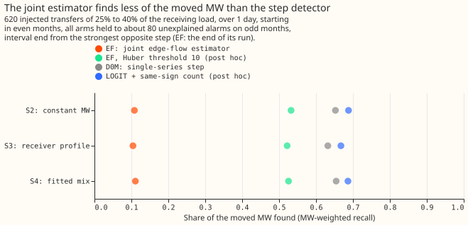
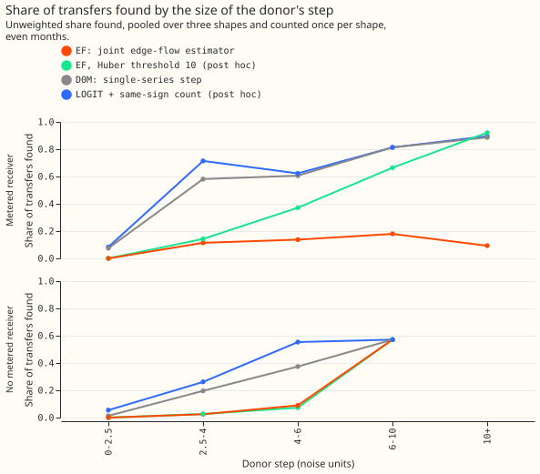

# Experiment 67: does one convex fit of load flows across all boundaries find more load?

**Fitting one flow of power across every pair of neighbouring Primary substations at once, in a
single optimisation, found far less of the moved load than a detector that looks at each substation
alone, and the cause is how the estimator scales hourly residuals by their noise, not the
conservation of power.** We inserted 620 artificial load transfers (power moved from a donor
substation to its neighbours for over 1 day) into the measured power of 16 Primary substations, and
counted the share of the moved megawatts (MW) that each method found. The single-series detector,
which flags a step in one substation's residual (measured minus predicted power) over 24 hours,
found 0.646 of the moved MW. The joint estimator found 0.108, with both methods tuned to raise about
80 alarms that no recorded outage explains, counted over the odd-numbered calendar months (the
months used for tuning). A change we made afterwards to the threshold of the estimator's Huber loss
(quadratic for small residuals, linear for large ones) lifted that to 0.527, still 0.120 lower. The
estimator matched the single-series detector only on transfers that drop the donor's load by 10 or
more standard deviations of its usual noise and have a receiving substation metered in MW. It found
almost nothing where no receiver is metered. The verdict is `refuted`: the estimator's gain over
the single-series detector has an interval wholly below the +0.02 bound set in the plan.

We asked whether fitting every boundary at once finds switched load more reliably than looking at
each substation alone. The estimator explains the residual of all 16 Primary substations as a flow
across each of the 30 pairs of neighbouring substations (a boundary), plus a slack term per
substation for load moved to a neighbour that is not metered. A flow is zero almost always and flat
when it is not. The benchmark is D0M, the 24-hour single-series step detector with the
strongest-opposite-step end rule of experiment 61.

## Verdict

**The joint edge-flow estimator (EF) is refuted: it finds 0.538 less of the moved MW than D0M, with
an interval wholly below the +0.02 bound.** MW-weighted recall is the share of the moved MW that
sits in found transfers. A transfer is found when an alarm interval on one of its series starts
within 2 hours of the true start and ends within the larger of 6 hours and 10% of the duration. The
table gives recall pooled with equal weight over three injection shapes that the estimator does not
assume (S2, a constant MW; S3, a share of the receiver's profile; and S4, a mix fitted to the
labelled real transfers). The 620 scored transfers move 25% to 40% of the receiving substation's
load for over 1 day and start in even months, and each is scored under all three shapes. Weights are
the transfers' moved MW under the donor-profile shape, as in experiment 65.

| Arm | MW-weighted recall | MW missed | Unweighted recall | Unexplained alarms, odd / even months |
|---|---|---|---|---|
| D0M, 24-hour step, strongest-opposite-step end (PE) | 0.646 | 0.354 | 0.478 | 80 / 80 |
| LOGIT + same-sign count (post hoc benchmark, experiment 65) | 0.681 | 0.319 | 0.527 | not counted |
| EF, pre-registered (Huber threshold 3) | 0.108 | 0.892 | 0.082 | 77 / 88 |
| EF, Huber threshold 10 (post hoc) | 0.527 | 0.473 | 0.334 | 71 / 82 |

In the table, LOGIT + same-sign count is experiment 65's logistic score that adds the count of
neighbours stepping the same way as the alarming substation.

The contrasts, read at 97.5% (Bonferroni across two) from 20,000 resamples of whole calendar year-
months:

- **C1, EF minus D0M:** -0.538 (-0.605 to -0.421).
- **C2, EF minus LOGIT + same-sign count (no verdict):** -0.573 (-0.631 to -0.474).
- **Post hoc, Huber 10 minus D0M:** -0.120 (-0.190 to -0.084), and **minus LOGIT + same-sign:**
  -0.154 (-0.262 to -0.103).

## Where the estimator loses

**The post hoc estimator (Huber threshold 10) matches D0M only for large transfers with a metered
receiver, and both estimators find almost nothing when no receiver is metered.** The table gives the
unweighted share of transfers found, pooled over the three shapes and counted once per shape.

| Donor step (noise units) | Metered receiver: EF / EF Huber 10 / D0M / LOGIT + same-sign | No
metered receiver: the same four |
|---|---|---|
| 2.5 to 4 | 0.11 / 0.14 / 0.58 / 0.71 | 0.02 / 0.03 / 0.20 / 0.26 |
| 4 to 6 | 0.14 / 0.37 / 0.61 / 0.62 | 0.09 / 0.07 / 0.37 / 0.55 |
| 6 to 10 | 0.18 / 0.66 / 0.81 / 0.81 | 4 of 7 transfers for every arm |
| 10 or more | 0.09 / 0.92 / 0.89 / 0.90 | no transfers |

Below 2.5 noise units no method finds more than 5 of the 39 to 41 transfers with a metered
receiver in any shape.

In one transfer that EF missed, the donor, a Primary substation metered only in MVA (apparent power,
with no direction), had a residual 8.8 hourly noise standard deviations below its baseline, and the
fit placed no slack run on it. The gradient of a Huber loss with threshold M is at most 2M per noise
unit of residual. At M = 3 the slack penalty that holds the alarms to 80 (1.5 times 3.7, or 5.6) is
close to the maximum gradient of 6, so a slack of a few noise units per hour is switched off. At M =
10 the maximum gradient is 20. The pre-registered tuning shows the same limit: the penalty that gave
0 alarms was only 2.5 times the one that gave about 80.

## Labelled real transfers

**On the 35 labelled real transfers of more than 1 day, EF finds 4, D0M 7, and LOGIT + same-sign
6.** Both EF runs find the same 4. Of the 20 transfers that start in even months, EF finds 4, D0M 6,
and LOGIT + same-sign 5. EF finds none of the 15 that start in odd months, D0M finds 1, and LOGIT +
same-sign finds 1. The counts are too small to rank D0M and LOGIT + same-sign.

## Method and what was fixed in advance

- **Fit.** Hourly residuals, divided by each series' noise scale, in windows of 70 days. A Huber
  (threshold 3), a level penalty `lambda` on flows and slacks (the slack penalty multiplied by `m`),
  and a fused penalty `rho * lambda` on the hourly change of each flow and slack, solved with CVXPY
  and Clarabel. The 8 Primaries metered only in MVA enter as slack-only nodes. - **Tuning on odd
  months.** For each of 6 cells (`rho` of 1, 3, or 10; `m` of 1.5 or 3), `lambda` was matched to at
  matched to at most 80 unexplained odd-month alarms, then the cell was scored on 300 odd-month
  transfers. Recall was 0.064 to 0.086 in every cell, and the cell with `rho` of 10 and `m` of 1.5
  won (`lambda` 3.72, 77 alarms). - **Post hoc variant.** A Huber threshold of 10 with the range of
  `lambda` scaled to match, tuned over 2 cells (`rho` of 3 or 10, `m` of 1.5): recall on the tuning
  transfers was 0.296 and 0.332, and the second cell won (`lambda` 4.07, 71 alarms). It was chosen
  after reading the pre-registered result and does not change the verdict.
- **Alarms.** Each run counts as two alarms per series metered in MW, at its onset and at its end,
  as D0M alarms on both the onset step and the return step. An alarm is explained when a logged
  closure touches its series within 24 hours of its own stamp. A run that starts within 24 hours of
  a monthly refit of the baseline power model that produces the residual is dropped.
- **Checks.** A planted flow and a planted slack were recovered at the right onset and end, and the
  injection reproduced experiment 65's moved MW. All 3,720 scored fits of the two runs were
  `optimal`.

## Limits

- **A simpler fused penalty than the roadmap's.** The group version that ties the changes at one
  Primary together solved 25 times slower (55 s against 2.2 s on a 28-day window), so each flow
  changes on its own. The result does not test the group version.
- **An edge to an MVA-only neighbour is a cheaper slack.** The flow is seen at the metered end
  only, so for those neighbours the fit gains no conservation check. All 16 Primaries have an
  MVA-only neighbour.
- **More context than the benchmark.** Each fit sees 21 to 49 days of residual on each side of a
  run (35 days around a scored transfer), against 14 days for the strongest-opposite-step end.
  Scored transfers sit 35 days from the window edges and the tuning windows have 21 to 49 days of
  context, so the tuning alarm counts are slightly pessimistic for EF.
- **The benchmark is experiment 65's detector.** EF was not scored against the end rule of
  experiment 66, because the plan fixed D0M with the strongest-opposite-step end rule as the
  verdict arm.
- **A coarse grid.** Six cells for the pre-registered run and two for the variant; the Huber
  threshold, the read-out threshold of 0.1 noise standard deviations, and the 24-hour minimum run
  were not tuned.
- **Tuning odd months and scoring even months share residual context** in windows that cross months,
  as the benchmark's 24-hour windows do.

## What the next experiment should answer

**Does a joint fit to the 24-hour step statistics, in noise units, find more of the moved MW than
D0M?** The step statistic already carries a noise scale calibrated on odd months, and the
conservation constraint and slack could be applied to it. The experiment would also say whether
conservation across the 8 MW-metered Primaries helps once the noise model is fixed.

Reproduce with
`uv run --with cvxpy python ml-experiments/00067-sw2-15-joint-edge-flow-estimator/e00067_run.py
check tune score real`, and the same with `--huber 10 --out <data folder>/huber10`. Then run
`e00067_report.py` and `e00067_charts.py`.
