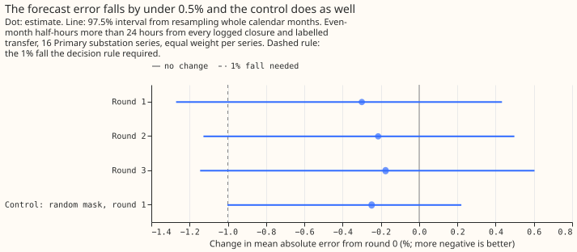
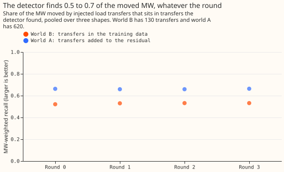

# Experiment 68 (SW2-5, part of the switching-event detector series): does refitting the forecast without the load transfers the detector found help the detector?

**Refitting the lagless XGBoost model without the load transfers that the detector found barely
changed what the detector finds, or the forecast error.** In these 16 series, with this XGBoost
configuration, the limit on the detector is therefore not that the forecast has learned the
transfers. A load transfer is a switching operation that moves part of one Primary substation's
demand onto neighbouring substations for some hours or days. A Primary substation is the 11 kV or
6.6 kV substation that feeds local distribution circuits. SW2 is the series of experiments on
detecting these transfers from the telemetry alone.

The detector reads the residual, which is the measured power minus the forecast of the lagless
XGBoost model. The model uses weather forecasts and calendar inputs and no past power. The detector
raises an alarm when the 24-hour average of a substation's residual steps away from the average of
the previous 24 hours by 4.0 noise units or more, where one noise unit is the typical size of that
step on odd calendar months. We asked whether the model, trained through a transfer, partly learns
the transfer. If it does, the transfer's step shrinks in the residual and the forecast is biased.

We ran a loop of three rounds. Round 0 is the refit with no mask. In each later round the model was
refitted with zero weight on the half-hours inside the intervals that the detector had found on the
previous round's residual (the mask), and the detector was then run again. To test the loop, we
added 130 synthetic load transfers to the measured power before the model trained. The detector
found 0.522 of the megawatts (MW) that those transfers moved at round 0 and 0.532 at round 3
(+0.011, 97.5% interval +0.000 to +0.034). This share of the moved MW is called MW-weighted recall.
We also measured the forecast's mean absolute error on half-hours more than 24 hours from every
logged closure and every labelled real transfer. It changed by -0.175% (-1.145% to +0.603%) from
round 0 to round 3. A mask of about equal volume at random times did as well as the real mask, so
the small changes are no evidence that the detected intervals matter.

## Verdict

**Inconclusive by the decision rule, and the loop is not worth adding at this size.** The rule asked
for two things. Recall had to gain at least +0.02 with an interval above zero. The forecast error
had to fall by at least 1% with an interval below zero. Neither condition holds. `refuted` needed
the upper end of the recall interval below +0.02 and the lower end of the error interval above
-1.0%, and both ends lie just outside (+0.034 and -1.145%). The rule gave `small gain` no opening
either, because the recall interval's lower end is 0.000, not above zero, and the error
interval's upper end is +0.603%. The even-month count of unexplained alarms in world A (defined in
"What we tested") was also 15% below round 0's in rounds 1 and 3, outside the 10% that the rule
allows, so `supported` and `partly supported` were closed as well.

In the table, C1 and C2 are the two contrasts the rule reads, and C3 compares round 1 with a mask of
about equal volume placed at random times.

| Contrast | Change | Reading |
|---|---|---|
| C1, recall, round 3 minus round 0 (world B) | +0.011 (+0.000 to +0.034) | Under the +0.02 bar |
| C2, forecast error, round 3 minus round 0 (world A) | -0.175% (-1.145% to +0.603%) | Under the 1% bar |
| C3, round 1 minus random mask, error | -0.052% (-0.422% to +0.340%) | The mask does no better than random |
| C3, round 1 minus random mask, recall (world A) | +0.004 (-0.003 to +0.016) | The same |

## What each round found

**Absolute recall barely moves between rounds, and a third to a half of the moved power is missed.**
Recall is the share of the MW moved by the injected transfers that sits in transfers the detector
found, pooled with equal weight over three transfer shapes (S2, S3, and S4, none of which the
detector assumes). The two worlds hold different transfers, so their levels are not comparable.

| Round | World B recall | World A recall | World A error (points of capacity) | Labelled real transfers found (of 35) |
|---|---|---|---|---|
| 0 | 0.522 | 0.663 | 8.936 | 7 |
| 1 | 0.530 | 0.659 | 8.909 | 6 |
| 2 | 0.532 | 0.659 | 8.917 | 7 |
| 3 | 0.532 | 0.664 | 8.920 | 6 |
| Random mask, round 1 | not run | 0.655 | 8.914 | 5 |

In world B the missed share of the moved MW is 0.478, 0.470, 0.468, and 0.468. In world A it is
0.337, 0.341, 0.341, and 0.336. The donor step is the size of the step that a transfer makes in the
substation it takes load from, in noise units. A metered receiver is a neighbouring substation whose
power is in the data. In world B, transfers with a metered receiver are found at 16 of 20 with a
donor step of 10 noise units or more, and at 13 of 22 with 6 to 10. None of the 22 transfers below 2
noise units is found in world B, and 3 of 166 are found in world A. Every bin is in the output of
`e00068_report.py`.

**A detail in world A: transfers over 7 days gain +0.018 (+0.000 to +0.037) from round 0 to round
3,** over 93 transfers, and transfers of 7 days or less gain 0.000. World B has 2 transfers over 7
days, so it cannot test this. The gain is post hoc and its interval touches zero.

## What we tested

**The lagless XGBoost model.** The model is the `H0.5` arm of
[experiment 17](../00017-training-window-and-retraining-rule-drift-demand/result.md): 13 inputs
(weather, clock, calendar), refitted monthly on rows that end 7 days before the month, recency
weights with a half-life of 0.5 years, 16 Primary substation series. The round-0 refit reproduced
experiment 17's stored predictions with a largest difference of 0.

**The loop.** Round `k` refits with zero weight on the half-hours inside the intervals found on
round `k-1`'s residual. The detector raises its alarms at the 24-hour window and takes the end of
each interval from the strongest opposite step within 14 days (the detectors D0M and PE of
[experiment 61](../00061-sw2-6-paired-step-intervals/result.md)). The mask for the refit of a month
uses only intervals that end at least 15 days before the refit's training end. In every round the
threshold was lowered from a high value to the lowest that leaves at most 80 unexplained alarms on
odd months. An alarm is unexplained when it lies more than 24 hours from every logged closure on its
series, and odd months set the threshold so that even months are left to score. The detections and
the thresholds use the whole span, so the loop uses information that a live refit would not have (a
research set-up).

**Two worlds.** World A is the real data. World B adds 130 injected transfers to the measured power
before the model trains (a fresh draw of headline-band transfers from experiment 58's generator,
onsets in even months, no two on one series within 1 day, none crossing into an odd month, in the
shapes S2, S3, and S4 in turn). World A also scores 620 injected transfers added to the residual
only, as experiment 61 did. Intervals are 97.5% (Bonferroni across C1 and C2), from 20,000
resamples of whole calendar months.

| Round | Threshold (noise units) | Median noise scale over the 16 series (MW) | Unexplained alarms, odd months | Unexplained alarms, even months (world A) | Detected intervals, all series |
|---|---|---|---|---|---|
| 0 | 4.0 | 0.2343 | 80 | 80 | 297 |
| 1 | 4.1 | 0.2342 | 75 | 68 | 274 |
| 2 | 4.05 | 0.2345 | 78 | 73 | 288 |
| 3 | 4.1 | 0.2338 | 78 | 68 | 276 |
| Random mask, round 1 | 4.1 | 0.2354 | 77 | 73 | 278 |

At round 0's threshold, rounds 1 to 3 have 87, 85, and 87 odd-month unexplained alarms, so the
matched threshold rose by 0.05 to 0.1. Recall at round 0's threshold in world A is 0.664, 0.663, and
0.668, the same as the matched-alarm figures. The masks hold 84,817 half-hours in round 0's
intervals, about 7% of the grid's half-hours across the 16 series.

## What held in the prediction and what did not

- **Held: the predicted recall gain of +0.00 to +0.03 (C1).** The gain was +0.011.
- **Held: the predicted change in error of -1.0% to 0.0% (C2).** The change was -0.175%.
- **Held: neither a recall gain of +0.02 nor a fall of 1% in error was expected,** and neither
  occurred.
- **Not held: the likeliest verdicts, `refuted` and `small gain`.** The verdict was `inconclusive`.
- **Not tested in world B: the larger gain on transfers that last over 7 days.** World B has 2 such
  transfers. The post hoc split in world A shows +0.018 for transfers over 7 days and 0.000 for the
  rest, with an interval that touches zero.

## Limits

- **A transfer that starts in month `M` has never been in the training data of the refit that
  forecasts month `M`.** The mask can raise that transfer's recall only through earlier transfers
  the model learned from, or through a transfer that runs past a month boundary. A null result does
  not show that the mechanism is absent.
- **World B has 130 transfers, and only 2 last over 7 days.**
- **Zero weight is not the same as removing rows,** because XGBoost's histogram bins, row sampling,
  and leaf values depend on the rows present.
- **The random-mask control could not move 72 of its 297 intervals** so the control is looser than
  "equal volume" suggests. Those intervals are the longest, which fill their calendar month, and the
  ones where all 100 random draws overlapped a detected interval. It places 79,018 half-hours
  against round 1's 78,318.
- **The 35 labelled real transfers are in the training data and the mask,** so the counts found (7,
  6, 7, 6) are descriptive.
- **The round-0 check on the stored residuals gave an MW-weighted recall of 0.653 to 0.671, against
  experiment 61's 0.63 to 0.65.** The harness here injects only the 620 transfers of the headline
  band, so its random draws differ from experiment 61's, and the weights here are each shape's own
  moved MW rather than experiment 61's shape-S1 weights.
- **The MW-weighted recall of both worlds is read at a matched count of 80 odd-month unexplained
  alarms,** which the threshold grid met at 75 to 80, not exactly.

## Reviews

- **Plan review (Sonnet):** accepted a mask rule that requires each interval to end 15 days before
  the training end, a second world in which the injected transfers are in the training data, a
  verdict order with `refuted` covering harm, world A's alarm count in the rule, per-round noise
  scale and threshold, recall at round 0's threshold, and a note that a null result does not
  disprove the mechanism. Rejected an oracle mask (optional, and the refit costs 20 minutes per
  round) and a random-mask control for every round (one round has the control, as stated).
- **Code review (Sonnet):** accepted dropping world-B transfers that cross into an odd month, one
  capacity median for the injected target and the panel, a stable left join, a guard on negative
  stamps, per-world reference thresholds, and counting the intervals the random mask could not move.
  Rejected nothing; it found no leakage in the mask and no difference from experiment 17's refit
  other than the mask.

## What the next experiment should answer

**The results point to the onset step, not the forecast, as the place to look next.** Recall in
world A sits at 0.66 whatever the round, and 24 of the 35 labelled real transfers of more than 24
hours raise no alarm at their start
([experiment 61](../00061-sw2-6-paired-step-intervals/result.md)). Experiment 69 tried weak alarms.
They recovered some of the missed onsets but needed a higher threshold for the strong alarms, so
the net gain was +0.007 ([experiment 69](../00069-sw2-17-missed-onsets-of-the-end-rule/result.md)).
The candidates are a better onset statistic or the joint edge-flow fit of experiment 67 (SW2-15).
This loop is not a candidate.

Code: `ml-experiments/00068-sw2-5-train-detect-retrain-loop/`, with every number printed by
`e00068_report.py` and the figures drawn by `e00068_charts.py`.
