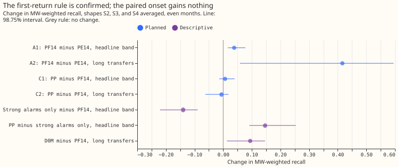
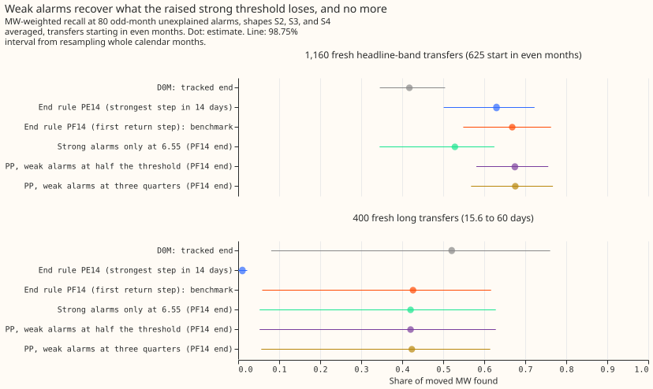
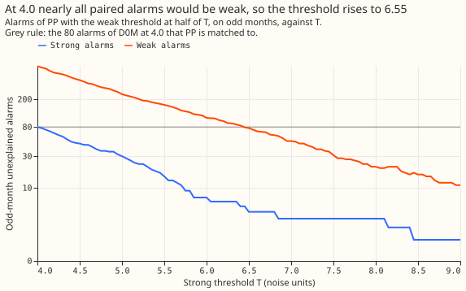

# Experiment 69 (SW2-17, part of the LSC series): why do real transfers raise no alarm at their start?

**Half of the 24 real load transfers with no alarm at their start are not a threshold problem.
Accepting weaker alarms that a step back confirms did not help either, because the stricter
threshold needed to hold the alarm count lost as much as the weak alarms gained.** A load transfer
is a switching operation that moves part of one Primary substation's demand to neighbouring
substations for some hours or days. A Primary substation is the 11 kV or 6.6 kV substation that
feeds local distribution circuits. The single-step detector D0M raises an alarm when the 24-hour
average of a substation's residual (measured power minus an XGBoost forecast that uses no past
power) steps by 4.0 noise units or more. One noise unit is the usual size of that 24-hour step on a
substation's odd-numbered months, so 4.0 noise units is a step four times the usual size. An
unexplained alarm is an alarm more than 24 hours from any closure in NGED's switching log, and the
detector's threshold is set so that it raises 80 unexplained alarms on odd-numbered months. Of the
35 labelled real transfers lasting more than 1 day, 24 have no D0M alarm within 2 hours of the
start. We sorted those 24 by cause: 6 lie in gaps in the data, 3 where the monthly refit of the
XGBoost forecast suppresses the alarm, 3 have an alarm 2 to 12 hours from the labelled start, 8 have
a sharp step of 2 to 4 noise units, 2 have a step that is spread out or late, and 2 show no step. We
then added known transfers to the power history and tested a paired low-threshold onset rule (PP)
that also raises a weaker alarm when an opposite step of a matching size follows within 14 days.
With the strong threshold tuned so that PP and D0M each raise 80 unexplained alarms on odd-numbered
months, PP found 0.675 of the moved power on transfers that start in even-numbered months, against
0.668 for the benchmark, a difference of +0.007 (98.75% interval -0.014 to +0.040). The benchmark is
D0M's alarms with the better of two ways to end each alarm interval, and we confirmed on newly drawn
transfers that the better way is PF14: end at the first opposite step of at least half the onset
step. The alternative, PE14, ends at the strongest opposite step within 14 days.

PF14, PE14, and PP use up to 14 days of hindsight, so they serve training-time masks (the SW2-12
experiment) and the event table for National Grid Electricity Distribution (NGED), not live forecast
inputs.

## What we tested

**Three steps, all scored on injected transfers or on the labelled real transfers, never on
forecasts.** All scores are shares of the moved power in MW (MW-weighted recall): a transfer counts
as found when an alarm interval starts within 2 hours of the true start and ends within the larger
of 6 hours and 10% of the duration.

- **Step 1, confirm PF14.** New injected transfers: 1,160 in the headline band (25% to 40% of the
  receiving load, lasting over 1 day; 625 start in even months) and 400 lasting 15.6 to 60 days (206
  start in even months), under five injection shapes. The headline pools the three shapes (S2, S3,
  and S4) that no detector in this series assumes: a constant MW, a share of each receiver's
  profile, and a mix fitted to the labelled real transfers. PE14 ends each interval at the strongest
  opposite step within 14 days, and PF14 at the first opposite step of at least half the onset step.
- **Step 2, sort the 24 unalarmed real transfers** into seven classes by the first test that
  applies, using the 24-hour step statistic in noise units and D0M's alarms, with control windows
  (windows in odd months with no logged closure nearby) that show how large the largest step is by
  chance.
- **Step 3, PP.** PP raises every D0M alarm at a strong threshold, and also a weak alarm at half
  that threshold when a later opposite step of the same size (0.5 to 2.0 times) follows within 14
  days. The strong threshold is tuned on odd months so that PP and D0M both raise 80 unexplained
  alarms, and the contrasts are read on even months with 98.75% intervals from resampling whole
  calendar months. The arm S raises only the strong alarms of PP.

## Verdict

**`inconclusive` for PP by the rule fixed in the plan: the lower end of C1 is below zero and its
upper end is above +0.02.** The interval does not exclude a gain of +0.04. The point values say that
PP is no better than the benchmark: C1 is +0.007 on the headline-band transfers and C2 is -0.006 on
the long transfers. The benchmark end rule is PF14, because the lower ends of A1 and A2 both lie
above zero.

| Contrast (even months, S2, S3, and S4 pooled) | Change in MW-weighted recall | Reading |
|---|---|---|
| A1, PF14 minus PE14, 625 fresh headline-band transfers | +0.038 (+0.016 to +0.077) | PF14 confirmed |
| A2, PF14 minus PE14, 206 fresh long transfers | +0.416 (+0.059 to +0.595) | PF14 confirmed |
| C1, PP minus PF14, headline band | +0.007 (-0.014 to +0.040) | No gain |
| C2, PP minus PF14, long transfers | -0.006 (-0.063 to +0.018) | No gain |

**Recall rises by +0.146 with the weak alarms and falls by 0.140 with the stronger threshold.** The
control arm S raises only the strong alarms of PP, at the threshold of 6.55 (S itself raises only 4
unexplained alarms on odd months, so it is not at the same alarm count as PP). S finds 0.528 of the
moved MW on the headline-band transfers (0.345 to 0.625), a difference of -0.140 from PF14 (-0.221
to -0.089), and PP finds 0.146 more than S (+0.091 to +0.253). The version of PP with the weak
threshold at three quarters of the strong one, tuned separately to a strong threshold of 4.65,
differs from PF14 by +0.008 (-0.004 to +0.027).

| Arm (PF14 end rule unless stated) | Headline band | Long set |
|---|---|---|
| D0M, tracked end | 0.418 (0.345 to 0.505) | 0.521 (0.080 to 0.761) |
| PE14 | 0.630 (0.501 to 0.723) | 0.010 (0.000 to 0.022) |
| PF14 (benchmark) | 0.668 (0.549 to 0.763) | 0.426 (0.059 to 0.617) |
| S, strong alarms at 6.55 only | 0.528 (0.345 to 0.625) | 0.420 (0.052 to 0.628) |
| PP, weak alarms at half the threshold | 0.675 (0.581 to 0.756) | 0.420 (0.052 to 0.628) |
| PP, weak alarms at three quarters | 0.676 (0.568 to 0.767) | 0.423 (0.056 to 0.615) |

*Absolute MW-weighted recall at 80 odd-month unexplained alarms, with 98.75% intervals. The missed
share is one minus the recall. For PF14 on the headline band, 0.298 of the moved MW sits in
transfers with no alarm at the start and 0.034 in transfers whose start was found and whose end was
wrong. For PP the two shares are 0.304 and 0.021.*

**Most of the extra unexplained alarms are weak ones.** At D0M's threshold of 4.0, PP would raise
673 odd-month unexplained alarms, of which 593 are weak. Only a strong threshold of 6.55 brings the
count to 77, of which 73 are weak (figure 4). No threshold below 6.55 on the grid from 4.0 to 9.0
brought the count down to 80. On even months, which were not used to tune the threshold, PP raises
56 unexplained alarms and D0M 80, so PP raises fewer alarms than D0M there and the comparison does
not favour PP.

## Recall by donor step

**PP finds more of the transfers with no metered receiver and loses some with a metered receiver and
a donor step of 4 to 6 noise units.** The donor is the substation that loses load and a receiver is
a substation that gains it; a receiver is metered when its power is in the telemetry. The table
counts transfers found out of transfers, summed over S2, S3, and S4, on the fresh headline-band
transfers that start in even months, in 24-hour noise units. The printed report also gives the other
arms and the steps below 2.

| Donor step | Receiver | Transfers | D0M | PF14 | PP |
|---|---|---|---|---|---|
| 2 to 4 | metered | 140 | 61 | 87 | 89 |
| 4 to 6 | metered | 164 | 86 | 131 | 117 |
| 6 to 10 | metered | 239 | 151 | 207 | 207 |
| 10 or more | metered | 311 | 166 | 295 | 295 |
| 2 to 4 | unmetered | 610 | 48 | 68 | 77 |
| 4 to 6 | unmetered | 222 | 53 | 103 | 120 |

## Labelled real transfers

**On the 35 labelled real transfers over 1 day, PP finds 4 more than D0M (6 against 2) and 2 fewer
than PF14 (8).** The onset alarm is found for 11 transfers by PF14 and 7 by PP, which is consistent
with the raised strong threshold removing alarms between 4.0 and 6.55 noise units. PP raised an
onset alarm for 1 of the 8 transfers with a sharp step under the threshold. The counts are too small
for an interval.

| Class of the 24 transfers with no D0M onset alarm | Transfers | Transfers whose largest step is above control windows |
|---|---|---|
| Data gap | 6 | 0 |
| Monthly refit | 3 | 3 |
| Alarm outside the 2-hour tolerance (all within 12 hours) | 3 | 3 |
| Sharp step of 2 to 4 noise units | 8 | 7 |
| Spread or late step of 2 to 4 noise units | 2 | 0 |
| No step visible | 2 | 0 |

*The seventh class of the plan, a peak suppressed by the refit away from the start, has no members.
Above control windows: the largest step within 2 hours of the start exceeds the 95th percentile of
control windows' largest steps (2,000 windows per transfer, each series drawn at its own half-hour
in an odd-numbered month at least 7 days from a logged closure). The median moved MW is 1.8 MW for
the data gaps, 2.5 for the refits, 0.9 for the timing cases, and 0.8 for the sharp steps.*

## What held in the prediction and what did not

- **Held:** A1 (+0.038, predicted +0.02 to +0.06), C1 (+0.007, predicted -0.15 to +0.03), and C2
  (-0.006, predicted -0.15 to 0.00). The lowest strong threshold that keeps 80 alarms, 6.55, was
  known before any transfer was scored.
- **Just outside:** A2 at +0.416, against a predicted +0.10 to +0.40 and a predicted size smaller
  than experiment 66's +0.412.
- **Not held:** PE14 was expected to stay the benchmark, and PF14 became it. The classification was
  predicted to put at least 12 of 24 in classes under the threshold, and put 10 there. The first
  plan commit also predicted at most 4 in the data gap class (6 are) and 2 to 6 more real transfers
  found by PP than the benchmark's 8 (PP finds 2 fewer).

## Limits

- **The end rule and PP need up to 14 days of hindsight,** so they serve training-time masks and the
  event table, not live inputs.
- **A fresh draw is new in the placement of transfers and in the injection noise only.** It uses the
  same table of residuals, series, months, and set of 25 long operations as experiment 66, so the
  confirmation cannot detect a rule that fits quirks of that panel. On odd months the gain of PF14
  over PE14 is smaller: +0.010 (-0.005 to +0.031) on the headline band and +0.333 (0.000 to +0.560)
  on the long set.
- **PP and the benchmark are scored on the same fresh draws that chose PF14 as the benchmark.**
- **Injected transfers are exact rectangular steps up and then down,** so a matching step back
  always exists, which favours PP. PP gained nothing even so.
- **Weak alarms can chain:** a weak alarm can itself be the step back of an earlier weak alarm.
- **Alarms within 24 hours of a logged closure count as explained,** for both arms.
- **The weak threshold of half the strong one and the ratio range of 0.5 to 2.0** are the first
  values tried and were not tuned; the version at three quarters is the only other value tried.
- **The 35 real transfers are too few for an interval,** and the class counts rest on a log whose
  start times may be late or early by hours.
- **The control windows draw an independent stamp for each series of a transfer,** so they are a
  fair test of the largest step but not of a step shared across series at one stamp.

## Reviews

- **Plan review (Sonnet agent):** accepted control windows for the classification, an exhaustive
  verdict rule, a full-grid tuning scan, a control arm of strong alarms only, a check that PP with
  the weak alarms disabled equals D0M, named seeds and ids, and a note on boxcar favouritism.
  Accepted a prediction about the benchmark end rule. Rejected a second-series consistency
  requirement for the pair and a minimum duration, because the plan tests the simplest rule first.
- **Code review (Sonnet agent):** found no leakage. Accepted a NaN-safe quantile, a clamp on slice
  starts, a stricter refit test, and a hand-built test of the pairing rule's boundaries. Rejected
  extending the harness check to PP (the control arm S already isolates it) and excluding refit
  windows from the controls (the effect is conservative).

- **Fact check against the printed report (Sonnet agent):** every number matched. Accepted
  replacing "most" with "half" for the transfers that are not a threshold problem, deleting an
  unsupported comparison with a lower threshold, softening two causal claims, saying that the
  control arm S is not at the same alarm count as PP, and renaming the classes-table column.
  Rejected nothing.
- **Prose review (Sonnet agent):** accepted defining D0M, PP, PF14, PE14, noise units, unexplained
  alarms, and the benchmark in the opening, stating that the threshold is tuned on odd months and
  scored on even months, splitting the bold lead, describing the pooled shapes, defining control
  windows at first use, renumbering the figures, and renaming the closing section so that it
  commits the project to nothing. Rejected rewriting the pre-registered front matter (the plan
  commit fixes it), apart from the arithmetic restatement "2% of the moved MW".

## Two untested options

**Two options could recover onsets that a lower threshold cannot reach, and neither has been
tested.** Of the 24 unalarmed real transfers, 3 have a largest step above the control windows that
the monthly refit suppresses, and 3 have an alarm 2 to 12 hours from the labelled start. A detector
that survives a refit, or a scorer that allows 12 hours at the start, could add up to 6 more onsets
among the 35 (their ends were not tested), and the 6 in data gaps are unobservable. A second series
that must confirm each weak pair is a possible way to cut the 593 weak alarms that a single series
raises at 4.0.

Code: `ml-experiments/00069-sw2-17-missed-onsets-of-the-end-rule/`, with every number printed by
`e00069_report.py`.
