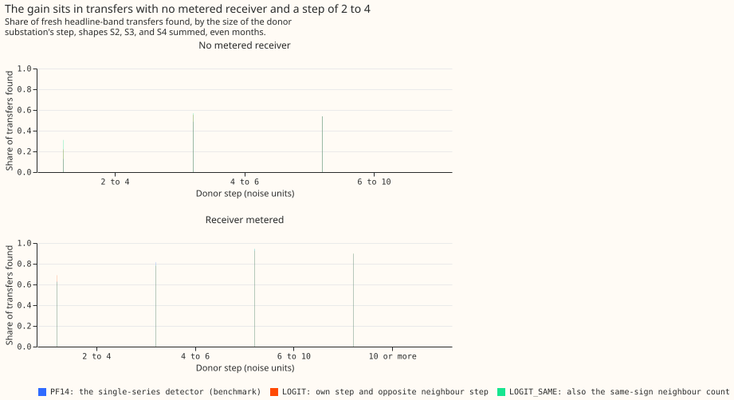

# Experiment 70 (SW2-19, a switching-event detector experiment): does counting the neighbours that step the same way find more moved load?

**Counting how many neighbouring substations step in the same direction as the alarming substation
finds more of the moved load on injected transfers, so the count is worth testing again on more
real transfers. The 35 labelled real transfers are too few to confirm the gain.** The planned
contrast is supported.

We asked whether a detector for load transfers finds more of them when its alarm score uses the
count of neighbouring substations that step the same way as the alarming substation. A load
transfer is a switching operation that moves part of one Primary substation's demand (the donor)
onto neighbouring substations (the receivers) for some hours or days. A Primary substation is the
11 kV or 6.6 kV substation that feeds local distribution circuits.

The benchmark detector is PF14. It raises an alarm when the 24-hour average of a substation's
residual (measured power minus an XGBoost forecast that uses no past power) steps by 4.0 noise
units or more. One noise unit is the usual size of that 24-hour step on odd-numbered months. PF14
then ends the alarm at the first opposite step of at least half the onset step, the first-return
end rule of [experiment 69](../00069-sw2-17-missed-onsets-of-the-end-rule/result.md). LOGIT is a
logistic score on a candidate alarm's own step, the largest opposite-sign step among its
neighbours, and its number of neighbours. LOGIT_SAME adds the number of neighbours that step the
same way.

We added known transfers to the power history of 16 Primary substations and counted the share of
the moved megawatts (MW) that each detector found. A transfer counts as found when an alarm starts
within 2 hours of its start and ends within the larger of 6 hours and 10% of its duration. Each
detector was held to 80 unexplained alarms on odd months, meaning alarms more than 24 hours from
any closure in the switching log of National Grid Electricity Distribution (NGED).

**On 615 fresh transfers per injection shape, all starting in even months, LOGIT_SAME found 0.712
of the moved MW against PF14's 0.665.** The difference is +0.048 (97.5% interval +0.021 to +0.096,
from resampling whole calendar months). The share of moved MW missed falls from 0.335 to 0.288.
The injection shapes are three ways of spreading the moved power over the receivers; the
[Verdict](#verdict) section names them.

## Verdict

**The hypothesis is supported.** C1, LOGIT_SAME minus PF14 on the fresh headline-band draw, has
its lower end above zero (+0.021) and a point value above the threshold of +0.02. C2, the same
contrast on the fresh long draw, is 0.000 (0.000 to 0.000), above the guard of -0.02. All intervals
are 97.5% intervals, wide enough that the two planned contrasts together keep a 5% error rate (a
Bonferroni correction), from 20,000 resamples of whole calendar months. The headline band is
transfers that move 25% or more of the receiving load for over 1 day. The long draw is transfers of
15.6 to 60 days.

The injection shapes pool S2 (a constant MW), S3 (a share of the receiver's profile), and S4 (a
mix fitted to the labelled real transfers), from experiment 60. None of the three is assumed by the
scores, and they are pooled with equal weight.

**The alarm ends use up to 14 days of hindsight, so the detector serves training-time masks and the
NGED event table, not live forecast inputs.**

| Arm (even months, 80 odd-month unexplained alarms) | Headline-band recall | Share of MW missed | Long-set recall |
|---|---|---|---|
| PF14 (benchmark) | 0.665 (0.555 to 0.745) | 0.335 | 0.400 (0.092 to 0.562) |
| LOGIT (no same-sign count) | 0.688 (0.597 to 0.760) | 0.312 | 0.402 (0.095 to 0.563) |
| LOGIT_SAME | 0.712 (0.621 to 0.793) | 0.288 | 0.400 (0.092 to 0.562) |

**The same-sign count roughly doubles the gain of the logistic score.** LOGIT minus PF14 is +0.024
(-0.004 to +0.061), and LOGIT_SAME minus LOGIT is +0.024 (+0.007 to +0.053). Both descriptive
contrasts use the same 97.5% level and carry no verdict. On odd months, which the scores were
fitted on, LOGIT_SAME minus PF14 is +0.050 (+0.017 to +0.096).

**The gain did not come from raising more alarms.** Even-month unexplained alarms were 80 for
PF14, 54 for LOGIT, and 61 for LOGIT_SAME, against exactly 80 on the odd months for all three.

## Where the gain sits

**The gain sits in transfers with no metered receiver, where the donor step is 2 to 6 noise
units.** A metered receiver is a receiver whose own power is measured. Counts here are transfers
summed over S2, S3, and S4. Without a metered receiver, PF14 finds 68 of 537 such transfers, LOGIT
finds 118, and LOGIT_SAME finds 167.
With a metered receiver and a step of 2 to 4 noise units, LOGIT_SAME finds 84 of 135 against
PF14's 85, so it gains nothing there. Without a metered receiver and with a step of 4 to 6,
LOGIT_SAME finds 146 of 257 against PF14's 125 of the same 257. The experiment does not
test why the gain is confined to transfers with no metered receiver.

By injection shape the contrast is similar. LOGIT_SAME minus PF14 is +0.046 for S2, +0.050 for S3,
and +0.047 for S4. It is +0.049 for S1 (the donor's own profile) and +0.039 for S5 (that profile
shifted by 12 hours). All five have their lower end above zero.

## Long transfers and labelled real transfers

**Long transfers gain nothing.** The long-set recall of PF14 and LOGIT_SAME is 0.400 for both,
and C2 is 0.000. The share of MW with no alarm at the start falls from 0.365 to 0.326, and the
share with a wrong end rises from 0.235 to 0.275, so the extra onsets do not become found
transfers. The experiment does not test why.

**On the 35 labelled real transfers of more than 1 day, LOGIT_SAME found 7 and PF14 found 8.**
An alarm started within 2 hours of the labelled start for 12 with LOGIT_SAME and 11 with PF14.
The 35 transfers are too few to rank the arms, so the real data do not confirm the injected result.

## Limits

- **The scores are fitted on transfers drawn by the same code that draws the test transfers.**
  Training uses odd months of the draw of experiment 58 and scoring uses even months of a draw with
  new seeds, but both draws choose donors and receivers the same way. Real transfers may look
  different, and the 7 of 35 does not confirm the gain.
- **The fitted weights are shrunk very little.** The standardised logistic coefficients are 2.66
  on the own step, 2.44 on the largest opposite neighbour step, -1.02 on the number of
  neighbours, and -0.85 on the same-sign count, from 2,230 positive and 507 negative candidates.
  The neighbour count may be a stand-in for how well a substation is connected.
- **The return-step threshold is looser for the scores' alarms.** The first-return end rule needs a
  return step of half the onset step. The scores raise alarms with onset steps of 2.5 to 4 noise
  units, so their return threshold is lower than PF14's, a second effect on top of the better
  alarm ranking.
- **The candidate floor of 2.5 noise units caps recall.** Steps below it cannot be found.

## What the next experiment should answer

**Does the same-sign count survive a labelled set of real transfers large enough to separate the
arms?** The injected transfers show a gain of about +0.05, and the 35 real transfers cannot confirm
or refute it. The detector series could next test the score on the transfers labelled in
a later period, or combine it with the refit and gap fixes of SW2-18.
