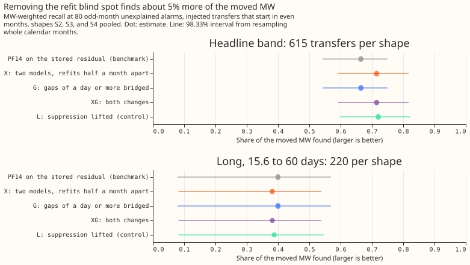
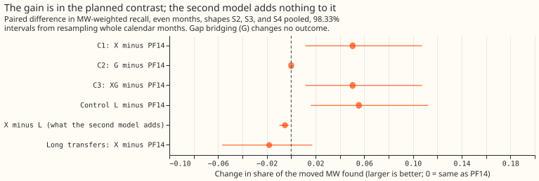
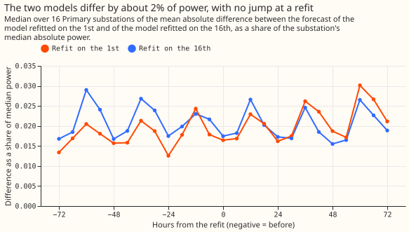

# Experiment 71 (SW2-18, part of the LSC series): does ignoring alarms near a refit make the detector miss load transfers?

**The detector ignored every alarm within 24 hours of the monthly refit of its forecasting model.
Lifting that rule recovers about 5% of the moved power, and the second model that we added to
replace the ignored alarms adds nothing to the recovery on injected transfers.** A load transfer is
a switching operation that moves part of one Primary substation's demand (the 11 kV or 6.6 kV
substation feeding local distribution circuits) to neighbouring substations for some hours or days.
The single-step detector D0M subtracts an XGBoost forecast that uses no past power from the measured
power, averages that residual over 24 hours, and raises an alarm when the average steps by 4.0 noise
units or more. One noise unit is the usual size of that 24-hour step on a substation's odd-numbered
months. The benchmark PF14 is D0M with a rule that ends each alarm interval at the first opposite
step of at least half the onset step. A transfer counts as found when an alarm starts within 2 hours
of its start and its end falls within the larger of 6 hours and 10% of its duration. We score each
detector by MW-weighted recall, the share of the moved power in megawatts (MW) that sits in found
transfers.

**Three changes to the detector were tested on injected transfers: synthetic transfers added to the
substations' real power history.** The XGBoost model is refitted on the 1st of every month, and PF14
ignores every alarm within 24 hours of a refit, so a transfer that starts there is never found. Arm
X adds a second residual model refitted on the 16th. At each stamp the step statistic comes from the
first model, except within 24 hours of the first model's refit, where it comes from the second
model. Arm G makes the step statistic bridge data gaps of a day or longer. Arm XG makes both
changes. Each arm's alarm threshold is set so that it raises at most 80 unexplained alarms (alarms
more than 24 hours from any closure in the logbook of National Grid Electricity Distribution, NGED)
on odd-numbered months, and all contrasts are read on transfers that start in even-numbered months.
Arm X found 0.715 of the moved power against 0.665 for PF14, a gain of +0.050 (98.33% interval
+0.012 to +0.107; 98.33% is 95% corrected for three planned contrasts). The whole gain lies in the
transfers that start or end within 24 hours of a refit. Of the 3 real transfers that start at a
refit, arm X found all 3, where PF14 found none.

## Verdict

**`supported` by the rule fixed in the plan: the lower end of C1 lies above zero and its point value
is at least +0.01.**

| Contrast (even months, S2, S3, and S4 pooled, headline band) | Change in MW-weighted recall |
|---|---|
| C1, X (two models) minus PF14 | +0.050 (+0.012 to +0.107) |
| C2, G (gap bridging) minus PF14 | +0.000 (+0.000 to +0.000) |
| C3, XG (both) minus PF14 | +0.050 (+0.012 to +0.107) |
| Control L (suppression lifted, no second model) minus PF14 | +0.056 (+0.016 to +0.113) |
| X minus L (what the second model adds) | -0.005 (-0.010 to -0.002) |
| Long transfers (15.6 to 60 days), X minus PF14 | -0.018 (-0.057 to +0.017) |

**PF14 misses 0.335 of the moved MW and X misses 0.285, mostly in transfers with no alarm at the
start.** The missed share is one minus the recall. For PF14, 0.301 of the moved MW sits in transfers
with no alarm at the start and 0.035 in transfers whose start was found and whose end was wrong. For
X the two shares are 0.265 and 0.019. Each arm's threshold is the lowest on a 0.05 grid whose
odd-month count of unexplained alarms is at most 80. The injected shapes S2, S3, and S4 are a
constant MW moved, a share of each receiver's own profile, and a mix fitted to the labelled real
transfers. The headline band is the injected transfers moving 25% to 40% of the receiving load for
over 1 day, and the long set is the transfers lasting 15.6 to 60 days.

| Arm | Threshold | Unexplained alarms, odd / even months | Headline band | Long set |
|---|---|---|---|---|
| PF14 (benchmark) | 4.0 | 80 / 80 | 0.665 (0.543 to 0.750) | 0.400 (0.079 to 0.569) |
| X, two models | 4.1 | 75 / 80 | 0.715 (0.591 to 0.818) | 0.382 (0.082 to 0.538) |
| G, gaps bridged | 4.0 | 80 / 80 | 0.665 (0.543 to 0.750) | 0.400 (0.079 to 0.569) |
| XG, both | 4.1 | 75 / 80 | 0.715 (0.591 to 0.818) | 0.382 (0.082 to 0.538) |
| L, suppression lifted | 4.05 | 79 / 84 | 0.720 (0.597 to 0.822) | 0.388 (0.082 to 0.546) |

*Absolute MW-weighted recall on even months with 98.33% intervals. An onset tolerance of the larger
of 6 hours and 10% of the duration, instead of 2 hours, raises every arm by about 0.03 (PF14
0.694, X 0.741) and does not separate the arms.*

## The gain sits in the refit zones

**The gain comes from transfers that start or end within 24 hours of a refit, and the 13% of
transfers in that zone carry all of it.** A zone is the 24 hours either side of a refit of the model
refitted on the 1st. Of the 615 headline-band transfers per shape that start in even months, 81 per
shape start or end in a zone. PF14 finds 0.177 of the moved MW there and X gains +0.431 (+0.182 to
+0.696). Outside the zones X is slightly worse, -0.005 (-0.011 to -0.001), because the alarm
threshold rises from 4.0 to 4.1 to hold the alarm count. We also drew 300 further transfers with
onsets forced into a zone, of which 149 start in even months. On those 149, PF14 finds 0.000 and X
finds 0.689, a gain of +0.689 (+0.420 to +0.845), which shows the mechanism cleanly.

**The second model does not improve on lifting the suppression for injected transfers.** The control
L only stops ignoring alarms near a refit and keeps the first model throughout. L finds 0.720 and X
0.715. L raises 84 unexplained alarms on even months where X raises 80. A real alarm is an alarm on
the real residual, with no transfer injected. Of L's 311 real alarms, 73 lie within 24 hours of a
refit of either model, against 66 of X's 297 and 46 of PF14's 297. The refit jump therefore
produces a few extra alarms in L, and those extra alarms are too few to lower L's recall.

## Gaps, and the real transfers

**Gap bridging changes no outcome, because the panel has nothing to bridge.** The residual panel
holds 188 gaps inside its 16 series. Only 7 last 13 half-hours or longer, and only 3 last a day or
longer. G differs from PF14 in the outcome of 0 of 1,860 injected transfers (the 1,160
headline-band, 400 long, and 300 zone-drawn transfers, under one shape). The 6 real transfers that
experiment 69 called "data gap" all lie on series 12 and 13, whose residual panel holds no rows
before March 2026 (series 12) and February 2026 (series 13), so there is no data on either side of
those transfers to bridge.

**X finds 10 of the 35 real transfers over 1 day, against 8 for PF14.** Its MW-weighted recall is
0.350 against 0.156. The 3 real transfers that start at a refit are 3.9, 2.5, and 2.0 MW; X raises
an onset alarm for all 3, and L for 2 of them. X also finds one further transfer of 1.0 MW whose
onset PF14 found but whose end PF14 placed wrongly. X loses two small transfers (0.6 and 0.5 MW)
when the alarm threshold rises to 4.1, so the 8 found by PF14 become 8 + 4 - 2 = 10. The other 21 of
the 24 transfers with no PF14 alarm at the start are unchanged under every arm: 6 in "data gap", 3
with an alarm 2 to 12 hours from the start, 8 with a sharp step of 2 to 4 noise units, 2 with a
spread or late step, and 2 with no visible step.
| Class of the 24 transfers with no PF14 alarm | Transfers | Onset alarm under X | Found under X |
|---|---|---|---|
| Monthly refit | 3 | 3 | 3 |
| Data gap | 6 | 0 | 0 |
| Alarm outside the 2-hour tolerance | 3 | 0 | 0 |
| Sharp step of 2 to 4 noise units | 8 | 0 | 0 |
| Spread or late step of 2 to 4 noise units | 2 | 0 | 0 |
| No step visible | 2 | 0 | 0 |

## Recall by donor step

**X finds more of the steps of 6 or more noise units with a metered receiver and more of the 4 to 6
unit steps with no metered receiver, and one fewer at 4 to 6 units with a metered receiver.** The
donor is the substation that loses load and a receiver is a substation that gains it; a receiver is
metered when its power is in the telemetry. The table counts transfers found out of transfers,
summed over S2, S3, and S4, on the headline-band transfers that start in even months, by the donor's
step in 24-hour noise units. The table omits donor steps under 2 noise units (143 transfers with a
metered receiver, of which each arm finds 8, and 66 with none, of which each arm finds none) and the
13 transfers with an unmetered receiver and a step of 6 to 10 (PF14 finds 7 and X 10). The printed
report also gives G, XG, and L.

| Donor step | Receiver | Transfers | PF14 | X |
|---|---|---|---|---|
| 2 to 4 | metered | 135 | 85 | 90 |
| 4 to 6 | metered | 136 | 111 | 110 |
| 6 to 10 | metered | 184 | 173 | 178 |
| 10 or more | metered | 374 | 334 | 363 |
| 2 to 4 | unmetered | 537 | 68 | 72 |
| 4 to 6 | unmetered | 257 | 125 | 138 |

## Do the two residual models disagree?

**The two residual models' step statistics differ by far less than the alarm threshold, and their
forecasts show no jump at either refit.** Where neither model refits within 24 hours, the median
absolute difference between the two statistics is 0.136 noise units, taking each series' median and
then the median over the 16 series (0.211 for the series with the largest difference). The 99th
percentile of the difference is 0.889 noise units, again the median over the 16 series. Both are
below the 4.0 noise units that raise an alarm. The forecasts themselves differ by about 2% of a
substation's median power at every hour from the refit. The printed report does not count
return steps near the splice stamps; it counts alarms only.

## What held in the prediction and what did not

- **Held:** the zone split (+0.431 where a gain of at least +0.3 was predicted, and -0.005 where
  about 0 was predicted); C2 within +-0.003 (it is +0.000); at least 2 of the 3 real refit transfers
  found (3 are); the threshold rising above 4.0 (it is 4.1); PF14 finding about 0.67 of the moved MW
  (it finds 0.665).
- **Not held:** C1 of +0.01 to +0.04 (it is +0.050, above the range), an interval about 0.05 wide
  (it is 0.095 wide), and `inconclusive` as the likely verdict (the verdict is `supported`).

## Limits

- **The detector uses up to 14 days of hindsight,** so it serves training-time masks and the event
  table, not live inputs.
- **Injected transfers do not distinguish X from L.** Injection adds the same power to both models'
  residuals on top of the real refit jumps, and the control L, which keeps the first model's jumps,
  loses no recall to them. Only the 3 real refit transfers separate the two arms.
- **The real transfers number 35 and the refit class 3,** so "3 against 2" is not a result with an
  interval.
- **The residual that fixes an interval's end when no return step is found switches to the second
  model inside a zone.** That switch can change the level by the difference between the two
  residual models.
- **The scaled onset tolerance is scored on injected transfers only,** so the real transfers
  table uses the 2-hour tolerance.
- **A fresh draw is new in the placement of transfers and in the injection noise only.** It reuses
  the same residual table, series, months, and set of 25 long operations as experiments 66 and 69.

## A correction to the plan's wording

The pre-registered prediction says that series 12 and 13 have "no power telemetry at all" before
December 2025 and February 2026. The raw power table holds rows for both series from 2024, and the
residual panel is what starts later (March 2026 for series 12 and February 2026 for series 13). The
conclusion is unchanged, because bridging needs residuals on both sides of a gap.

## Reviews

- **Plan review (Sonnet agent):** accepted reordering the verdict rule so that `small gain` is
  tested before `refuted`, rewording the hypothesis to concern arm X only, a zone split of C1, a
  draw with onsets forced into the zones, the splice-agreement and alarm counts near the splice
  stamps, a control arm with the suppression lifted, a statement of the second model's training
  cut-off and a refit of the first model that must return the stored forecasts (it does, to the last
  digit), the tuning rule for the alarm count, and the refit guard on gap bridging. Rejected
  calibrating the noise scale on pseudo-gaps, because arm G is descriptive and almost nothing is
  bridged, and an example time series of the spliced statistic, because the splice-agreement figure
  covers the question the example would answer.
- **Code review (Sonnet agent):** found no leakage and no splice error. Accepted an off-by-one in
  the refit guard of gap bridging, a tolerance on the check that the first model's refit
  reproduces the stored forecasts, a finite check on the power comparison, a warning in place of a
  stop when an arm exceeds 80 alarms, and the two missing planned counts (alarms near the splice
  stamps and transfers whose outcome the gap bridging changes). The count of return steps near the
  splice stamps was not added.
- **Fact check against the printed report (Sonnet agent):** every number matched. Accepted
  rewording the claim about series 12 and 13 (their residual panel has no earlier rows, but the raw
  power table does), "at most 80" for arms with fewer than 80 odd-month alarms, a note on the
  rows left out of the donor-step table, an account of how 8 found transfers become 10, and two
  further items of the held and not-held lists. Rejected nothing.
- **Prose review (Sonnet agent):** accepted rewriting the title and the opening so that D0M, PF14,
  noise units, found, injected, unexplained alarms, and the 98.33% interval are defined before use,
  defining the injected shapes and bands, splitting several leads, using "alarm threshold" and
  "second residual model", replacing the money metaphors, and several count clarifications.
  Rejected rewriting the pre-registered front matter.

## What the next experiment should answer

**Two remaining groups of misses are not mechanical: 8 real transfers with a sharp step of 2 to 4
noise units, and 3 with an alarm 2 to 12 hours from the labelled start.** Neither group changed
under any arm here. A threshold lowered to reach the sharp small steps raises the unexplained-alarm
count, and experiment 69's weak-alarm rule, which accepts a weak alarm that a matching step back
confirms, did not reach them without losing recall elsewhere. The scaled onset tolerance did not
separate the arms on injected transfers, so the 3 timing cases need a score on real transfers with a
duration-scaled tolerance to say whether they are a scoring artefact.

Code: `ml-experiments/00071-sw2-18-refit-offset-and-gap-bridging/`, with every number printed by
`e00071_report.py`.
