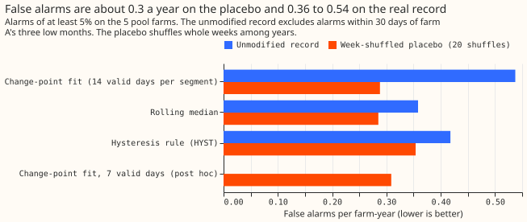

# Experiment 72 (P35): can a step-loss monitor find a lost inverter at the solar farms?

**Take-home message: a solar farm's daily power readings show that the farm has lost 25% of its
output only if the loss lasts 90 days or more, and they show a smaller or shorter loss rarely or
never, so they cannot give early warning of one lost inverter.**

We added artificial losses to the real power of 5 solar farms (a loss multiplies the farm's power by
a fixed share for a set number of days) and ran three monitors over the result. A monitor is a rule
that reads each farm's daily power, relative to the other farms' power, and raises an alarm when the
level drops. The best of the three found 0.84 of the 25% losses that lasted 90 days, 0.26 of the 10%
losses that lasted 90 days, and 3% losses barely above chance (0.02 to 0.07, against 0.00 to 0.02
when no loss was added). Over a 30-day loss it did worse: the change-point monitor found 0.45 of the
25% losses, and the hysteresis monitor found 0.86 of them but 0.13 or less of the 10% losses. In
these 3 monitors on 5 farms, the limit came from the data and not from the method. A farm gives only
about 3 usable days a week (days with clear sky, no inverter clipping, and no stuck meter), and the
daily reading wanders by 6% to 11% of its normal level. A second source of evidence, such as outage
notices from National Grid Electricity Distribution (NGED), could test the losses that the readings
cannot show.

**We asked whether the power a solar farm delivers shows that the farm has lost part of its
generating capacity, for example because an inverter failed.** We also counted how often each
monitor raised an alarm when no loss had been added (a false alarm), and whether each monitor found
the three months in which farm A really did run low. The plan set a stop rule: the experiment is
`refuted` if the change-point monitor finds fewer than 0.80 of the 25% losses that last 30 days. It
found 0.45, so the verdict is `refuted`. The page says "5 solar farms" because the sixth farm, farm
E, has only 2.7 years of record and is monitored but not injected.

## Result

**The verdict is refuted by the first stop rule.** The change-point monitor found 0.45 of 25%
losses lasting 30 days (April to September starts; 100 losses). Each monitor was tuned on a
week-shuffled placebo to about 0.35 false alarms per farm-year. The monitor found all three of
farm A's low months. Its false-alarm rate was 0.29 per farm-year on the scored placebo, which meets
the limit of 0.5. On the unmodified record it was 0.54, which meets the limit of 1. The change-point
monitor beat neither baseline by an interval that excludes 0 (the two contrasts below), and the
other three stop rules did not fire.

| Loss, April to September onset | Change-point fit | Rolling median | Hysteresis rule (HYST) | Change-point, 7-day segment (post hoc) |
|---|---|---|---|---|
| 25%, 30 days | 0.45 | 0.30 | 0.86 | 0.64 |
| 25%, 90 days | 0.84 | 0.72 | 0.82 | 0.84 |
| 25%, to the end of the record | 0.80 | 0.70 | 0.78 | 0.82 |
| 10%, 30 days | 0.04 | 0.05 | 0.13 | 0.05 |
| 10%, 90 days | 0.26 | 0.16 | 0.07 | 0.25 |
| 10%, to the end of the record | 0.38 | 0.12 | 0.13 | 0.37 |
| 3%, 90 days | 0.03 | 0.04 | 0.07 | - |
| 0% (no loss; chance of an alarm in the window) | 0.01 to 0.02 | 0.01 to 0.02 | 0.00 to 0.01 | 0.01 to 0.02 |

Each cell pools 100 losses (5 farms, 20 draws). Among the 25% losses that were found, the median
delay from the first day of the loss to the alarm was 1 day for the change-point fit, 3 days for the
rolling median, and 14.5 days for the hysteresis rule. The rolling median's size estimate was 9.8
points too low. A loss that starts from October to March is found
less often: 25% losses lasting 30 days at 0.27, 0.14, and 0.57 for the change-point fit, the
rolling median, and the hysteresis rule. Losses from that half-year decide nothing.

**The two planned contrasts are positive but their intervals include 0.** On 10% losses lasting 30
and 90 days, C1 (the change-point fit minus the rolling median) is +0.045 (97.5% interval -0.015 to
+0.090), and C2 (the change-point fit minus the hysteresis rule) is +0.050 (-0.010 to +0.105). Farm
A sits below 0 against the rolling median (-0.05), and farm D below 0 against the hysteresis rule
(-0.03). The interval resamples 5 farms that share one 25 km square of satellite irradiance, so it
is a rough guide.

**False alarms were 0.29 per farm-year on the placebo and 0.36 to 0.54 on the real record.** The
unmodified record has more alarms than the placebo because it holds real steps, year-level drift,
and the winter dip at farm D.

**Six of the 18 unmodified-record alarms are farm D's winter dip.** Farm D raised one alarm in
November or December of each year from 2020 to 2025. Farm A's low months raised 2 further alarms.
The count of 18 excludes those 2.

## Why the monitors fall short

**A 30-day loss holds about 13 valid days, and the change-point fit requires segments of at least 14
valid days.** A farm has 3.1 valid days a week from April to September and 2.0 from October to
March. The daily signal has a robust standard deviation (the standard deviation estimated from the
median absolute deviation) of 0.061 to 0.114 (6.1% to 11.4%) at farms A to D and F. The hysteresis
rule needs only 7 valid days below the threshold, which is why it finds 25% losses lasting 30 days
better than the change-point fit does.

**A shorter segment helps by 19 points at 25% and 30 days, but stays under 0.80.** The post hoc arm
with a segment of 7 valid days found 0.64 of 25% losses lasting 30 days (against 0.45), kept 0.31
false alarms per farm-year on the placebo, and left the 10% rows unchanged. The change-point fit
with 7-valid-day segments still fell short of the 0.80 required.

**A temporary loss needs two change points, so the fit finds temporary losses less often.** An L0
fit (a fit that charges a fixed penalty for each change point) whose penalty is tuned to 0.35 false
alarms per farm-year must pay that penalty twice for a loss that starts and ends. A permanent 10%
loss (one change point) was found 0.38 of the time and a 10% loss lasting 90 days (two) 0.26 of the
time.

## Post hoc checks

**Neither check changes the pre-registered verdict.** A window that opens 14 days before the loss
raises the rate of 25% losses lasting 30 days by 19 points for the change-point fit, 13 points for
the rolling median, and 1 point for the hysteresis rule: 25% losses lasting 30 days at 0.64, 0.43,
and 0.87 for the change-point fit, the rolling median, and the hysteresis rule. A change-point fit
with a minimum segment of 7 valid days is the post hoc arm in the table above.

## Method

**Signal.** Each farm's daily ratio of power to the power a physics model expects on clear,
unclipped hours, divided again by the median of the other pool farms' ratios of the same day (four
for a pool farm, five for farm E), and centred on the farm's median over the unmodified record, with
farm A's three low months set aside. Farm E is monitored but is never one of the other farms,
because E has 2.7 years of record and an export cap. A day with fewer than two other farms is
dropped.

**Monitors.** The change-point fit is an optimal partitioning of the valid days (a search for the
split into level segments that has the least squared error plus a fixed penalty per change point,
called an L0 penalty), with a minimum segment of 14 valid days. Each value is first clipped to 3
robust standard deviations around the median of the 15 valid days centred on it, the penalty is the
multiplier (6.0 once tuned) times the robust variance times the logarithm of the number of valid
days, and every alarm is floored at a 5% step. The rolling median is the centred 28-valid-day
median, and the hysteresis rule is `hysteresis_level` of the capacity studies. Each has one
parameter, tuned on 20 week-shuffled placebo copies of the 5 farms (20 random shuffles) to 0.35
false alarms per farm-year and then frozen (`e00072_frozen_config.json`). The scored placebo uses 20
other shuffles.

**Injection.** A loss multiplies one farm's real power by `1 - f` from an onset to the end of the
loss. Each farm, draw, and half-year gets four runs: one run of four losses lasting 30 days (sizes
0%, 3%, 10%, and 25%, where 0% is a control that measures how often a window holds an alarm by
chance), one run of the same four sizes lasting 90 days, and two runs of one permanent loss each
(10% and 25%). Five farms, 20 draws, 2 half-years, and 4 runs make 800 runs, and all 800 placed
their losses. A loss starts at least 60 days after the farm's first valid day and 120 days before
the end of the record, losses in one run are at least 150 days apart, and farm A's losses start at
least 90 days from its low months. The injected farm's neighbours keep their unmodified power, and
only the injected farm is scored. The injection scales a whole farm's power, so it emulates an
inverter loss and cannot emulate a string loss on a farm that clips.

**Known limits.** The monitors remove no snow days and no negative-price hours, fit no trend for
panel degradation, and ignore the day's maximum power, which a lost inverter would also lower. NGED
has not given us a record of any real loss apart from farm A's three low months, so the injected
losses are the only known-answer test.

## Order of the work

**A first scoring run happened before the code review, and its detection table was read.** The
review then found four faults. The rolling-median baseline subtracted a median that included the
injected loss. The week shuffle moved missing days into the record. Farm-years were counted on the
shuffled signal. The alarm sizes of two monitors were not floored at 5%. All four were fixed, the
first run's tables and frozen parameters were moved to a `superseded` folder of the private data
store (not committed), and every table on this page comes from the second run. The second tuning
chose the same parameters as the first (6.0, 0.12, and 0.10), so the first run's reading did not
steer any choice.

## What the next experiment should answer

**Which real events at the 6 solar farms can be labelled, so that the monitor is tested on more than
farm A's three low months?** NGED's outage notices, protection-trip logs, and curtailment records
for the 6 farms would give real losses. With them, the next experiment can ask whether a loss that
the telemetry cannot show (10% or less) can be found from another source, and whether the
hysteresis rule at 25% gives a useful early alert.
