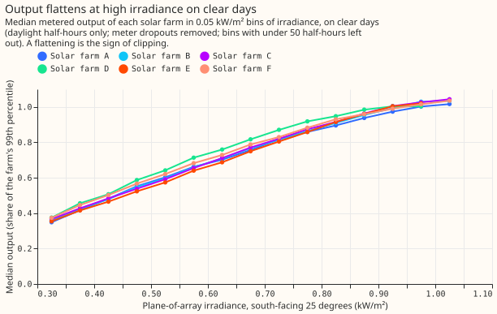
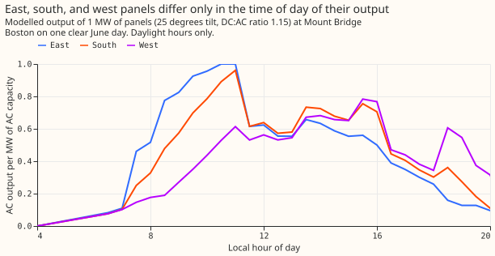
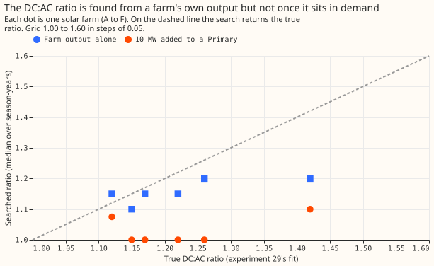
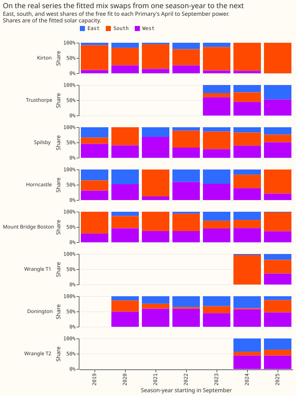
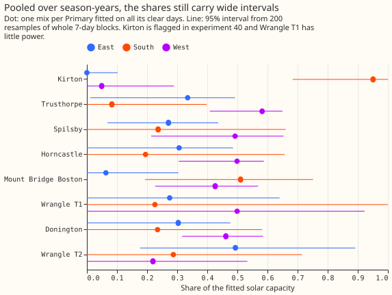
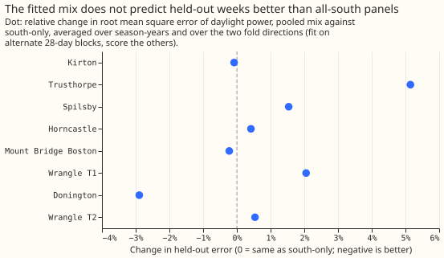

# Experiment 73: can the mix of solar panel orientations and the DC to AC ratio be recovered?

We asked whether two properties of the solar panels behind a substation can be read from the
substation's power alone. The first is the share of panels facing east, south, and west. The second
is the ratio of DC capacity to AC (inverter) capacity, which sets the level at which output flattens
at midday. We tested each fit first on answers we know. We added made-up east-south-west output,
and the real output of 6 metered solar farms, to the real power of 8 Primary substations (the
substations in Lincolnshire that step power down to the local electricity network and are metered
in MW), and checked what the fit recovered. The orientation fit has three non-negative capacities,
one per orientation, and we scored the shares of those capacities against the true shares. Error 0
means exact and error 1 means worst. With no noise the median error was 0.09, against 0.30 for
always guessing the usual fleet mix (0.2 east, 0.6 south, 0.2 west). With the real series' noise
added the median error rose to 0.20. On the real power, the fitted shares changed by a median 0.24
between consecutive September-to-August years. Even so, a blend of the three shapes predicted
held-out 28-day blocks of power 1.3% better than assuming every panel faces south. The DC:AC search
tries ratios from 1.00 to 1.60 and keeps the one whose clipped shape fits best. The search found
each farm's ratio from the farm's own output, but not once the farm's output was added to a
Primary's power, so we dropped the search before touching the real series.

**Take-home message: the three-shape blend is a better solar shape than all-south panels at every
one of the 8 Primaries, but it is a more flexible shape and not a measurement of panel
orientation.** The shares that make up the blend swap from year to year and miss by about 0.2 on a
noisy known answer, so none of them should be published as a finding about a Primary's panels. The
DC:AC ratio cannot be read from a Primary's power at all, so the solar term keeps the fixed ratio of
1.15. The next test is whether the three-shape blend lowers the error of the PVDIS-5 forecast and
not only the fit.

**Verdict `partly supported`, read by the rule written before the run.** Orientation passes its
pre-registered known answers (median error 0.088, at most 0.15; C1 upper limit -0.122, below -0.10)
and gains on held-out blocks (C3 upper limit -0.54%, below -0.5%). DC:AC is not identified. Exactly
one part is identified with its held-out gain, which is the rule's `partly supported`. After the
code review we added a known-answer test that carries noise, because the pre-registered one cannot
fail (see below). The chosen arm fails the added test (median error 0.200, C1 upper limit -0.075),
so the shares are not identified, and the verdict describes the blend and not the shares.

## Known answers

**Without noise, injected east-south-west mixes are recovered far better than a guess.** The arm
chosen on the tuning units (solar-farm locations A to C) was the pooled fit with no prior. On the
scoring units (locations D to F) its median share error is 0.088, against 0.300 for guessing the
fleet mix. C1, the arm's error minus the guess's, is -0.181 (98.75% interval -0.228 to -0.122),
pooled over the five true mixes. With Primaries as the clusters the interval is -0.248 to -0.084.
Per true mix, the guess is exact at the fleet mix itself and the fit is not, and the fit wins at the
other four.

**A known-answer test that adds no noise cannot fail.** A least-squares fit is linear, so the
fitted capacities with and without an injection differ by the fit of the injection alone, whatever
the series' own noise. The first test therefore measures only the sky mismatch between the farm
location and the Primary, plus the cases where the non-negative constraint binds. The code review
found this. We added a second test (post hoc, after the code review and before its result was
seen). It builds a series with no solar of its own: the Primary's fitted solar is added back, the
part left after removing the calendar cells and the weather terms is shuffled between days of the
same month, and the known output is subtracted. The fit then has to find the injection in the real
series' noise, and is scored on its fitted capacities directly.

| True mix (east/south/west) | Pooled fit, no noise | Pooled fit, with noise | Guess: fleet mix | Guess: all south |
|---|---|---|---|---|
| all south (0/1/0) | 0.102 | 0.315 | 0.400 | 0.000 |
| fleet mix (0.2/0.6/0.2) | 0.097 | 0.226 | 0.000 | 0.400 |
| east-heavy (0.5/0.4/0.1) | 0.097 | 0.198 | 0.300 | 0.600 |
| west-heavy (0.1/0.4/0.5) | 0.100 | 0.190 | 0.300 | 0.600 |
| east and west (0.5/0/0.5) | 0.045 | 0.084 | 0.600 | 1.000 |

With noise, the pooled fit's median error on the scoring units is 0.200 against 0.300 for the guess.
The noisy C1 is -0.107 (98.75% interval -0.139 to -0.075), so its upper limit does not reach -0.10,
and the median error is above 0.15. The free fit on each season-year scores 0.169, the clear-day fit
0.296, and the pooled fit with the smallest prior 0.177. All arms miss by more than 0.15 at the
tilt of the fit, so the shares are not identified.

**The robustness arm shows the fragility.** Injected shapes at 15° and 40° tilt, with the fit at
25°, gave noisy median errors for the pooled fit of 0.277 and 0.163 over all farm locations. Without
noise at the fitted tilt, 0.192 of the scoring units hit one of the two bounds (a negative increment
set to zero, or a total increment under 0.3 MW).

**The DC:AC ratio is found from a farm's own output and lost once the farm is added to a Primary.**
The knee gate passed on the median of each farm's farm-years: the median number of clear-day
half-hours at or above the knee at ratio 1.15 is 165 to 188 for five farms and 110.5 for farm D,
against the threshold of 100. Three of the 37 farm-years fall below 100 (the lowest has 84). The
search on each farm's output alone has a median absolute error of 0.055 over the 6 farms and beats
the constant guess (the median ratio of the other five farms) on 5 of 6. With 10 MW of the farm's
output added to a Primary's power, the median error is 0.195 and the search beats the guess on 0 of
6, so DC:AC is not identified. The searched ratio sits at 1.00 to 1.10 for every farm in that case.
The Primary's own solar is still in the series, so this case measures a farm plus a fleet, and not
only the farm.

| Farm | True ratio | Error, farm alone | Error, added to a Primary | Error of the guess |
|---|---|---|---|---|
| A | 1.15 | 0.050 | 0.150 | 0.070 |
| B | 1.17 | 0.020 | 0.170 | 0.050 |
| C | 1.22 | 0.070 | 0.220 | 0.050 |
| D | 1.42 | 0.220 | 0.320 | 0.250 |
| E | 1.12 | 0.030 | 0.120 | 0.100 |
| F | 1.26 | 0.060 | 0.260 | 0.090 |

The ratios of experiment 29 come from the same CAMS irradiance and the same clipping form as the
search, so the farm-alone case is the easiest test of the search. With 6 farms the intervals are
descriptive, and the decision rests on the number of farms, out of 6, where the fit beats the
constant guess.

## The real series

**The shares of the real series are not stable.** The free fit to each Primary-year changes its
shares by a median total-variation distance of 0.237 between consecutive September-to-August years
(33 pairs), and the clear-day fit by 0.326. The pooled fit holds one mix per Primary across its
years, so this test does not apply to it. Its 95% intervals (200 resamples of 7-day blocks of clear
days) are on average 0.49 wide, on a share that runs from 0 to 1.

| Primary | Capacity (MW) | East | South | West |
|---|---|---|---|---|
| Kirton (experiment 40 flagged a daylight load there) | 1.58 | 0.00 (0.00 to 0.10) | 0.95 (0.68 to 1.00) | 0.05 (0.00 to 0.29) |
| Trusthorpe | 7.58 | 0.33 (0.01 to 0.49) | 0.08 (0.00 to 0.40) | 0.58 (0.41 to 0.65) |
| Spilsby | 2.57 | 0.27 (0.07 to 0.44) | 0.24 (0.00 to 0.66) | 0.49 (0.21 to 0.65) |
| Horncastle | 3.03 | 0.31 (0.00 to 0.49) | 0.19 (0.00 to 0.66) | 0.50 (0.30 to 0.59) |
| Mount Bridge Boston | 3.65 | 0.06 (0.00 to 0.30) | 0.51 (0.19 to 0.75) | 0.43 (0.23 to 0.57) |
| Wrangle T1 (little power) | 3.71 | 0.27 (0.00 to 0.64) | 0.23 (0.00 to 1.00) | 0.50 (0.00 to 0.92) |
| Donington | 3.27 | 0.30 (0.00 to 0.48) | 0.23 (0.00 to 0.58) | 0.46 (0.32 to 0.59) |
| Wrangle T2 | 2.69 | 0.49 (0.18 to 0.89) | 0.29 (0.00 to 0.71) | 0.22 (0.00 to 0.53) |

The capacity column is the mean of the years' south-only capacities times the sum of the shares. It
differs from experiment 40's capacities (for example 7.58 MW against 2.48 MW at Trusthorpe). The
orientation fit trades capacity against shape, so these totals are not capacity estimates.

**The fitted mix predicts held-out blocks better than all-south panels at all 8 Primaries.** Each
fit uses alternate 28-day blocks of a season-year, and the other blocks are scored, in both
directions. The south-only comparator has the same total capacity as the mix, so the two differ only
in shape. C3, the relative change in held-out root mean square error of daylight power, is -1.3%
(98.75% interval -2.4% to -0.5%, 80 held-out year-folds). The threshold for a gain is an upper limit
below -0.5%, and the upper limit is -0.54%, so C3 is a gain by a narrow margin. The change ranges
from -0.1% at Kirton to -3.8% at Trusthorpe. C4 was not computed, because the DC:AC fit failed its
known answers.

**The blend improves the fit although its shares are not identified.** The three shapes give the
fit freedom to place solar output earlier or later in the day. Where the cause is a demand pattern
that looks like west-facing output, the blend would improve the fit and the shares would still not
describe panels. This experiment cannot separate the two.

**Five of the eight Primaries have a pooled west share of 0.46 to 0.58.** The fleet mix has 0.2.
The interval of Wrangle T1 runs from 0.00 to 0.92, so that Primary does not support a lean. This
experiment cannot say whether the lean is west-facing panels or demand that rises in the evening,
which looks like west-facing output to the fit.

## Changes from the plan

- **The held-out cell minimum is 5 rows, not 20.** With alternate 28-day blocks, no cell reached 20
  fitted rows, so every held-out row was dropped in the first run. The change was made before any
  held-out result existed.
- **The null arm became a bootstrap.** The plan injected nothing and reported the fitted shares, but
  with no injection the fitted capacities do not change, so the increment is exactly zero by
  construction. The page reports the pooled shares' 95% intervals from resampled blocks.
- **The noisy known-answer test was added after the code review** and is reported beside the
  pre-registered test. The verdict follows the pre-registered rule.
- **The held-out comparator was corrected after the code review.** The first version compared the
  unnormalised pooled capacities with the south-only capacity, which mixed shape and total capacity,
  and gave +0.8% (-0.9% to +2.8%). The corrected comparison gives the figures above.
- **The pooled arm with ridge 0 won the tuning,** so the ridge prior toward the fleet mix never
  entered the chosen arm.
- **The 5 MW injection was dropped,** as the plan review advised, and the 10 MW injection decides.
- **DC:AC has no fitted parameter beyond its grid,** so all 6 farms are scored, and no tuning split
  applies. The 8 Primaries' own series were searched without injection as a reference only (41
  Primary-years, quartiles 1.00, 1.00, and 1.30, range 1.00 to 1.60). The plan stops real-series
  fits for DC:AC, and this reference is not a claim about the Primaries.

## Caveats

- **The known answers use one physics.** Passing the known answers is necessary and not sufficient,
  as the 15° robustness arm shows.
- **Farms A to C and D to F share the same 8 Primaries,** so the tuning and scoring split gives
  little independence. The Primary-cluster interval is reported beside the farm-cluster interval.
- **Only 6 farms score DC:AC,** so the count of farms where the fit beats the guess is a coarse test.
- **The plan had one Sonnet review and no Opus review.**
- **The pooled fit takes each year's total from a south-only fit, floored at 0.1 MW.** East-heavy or
  west-heavy fleets then have shares that sum to more than 1, which is why the pooled capacity
  differs from experiment 40's capacity. The held-out comparison rescales the shares to a common
  total.
- **The 6-farm inner join drops Primary rows** where any farm location's CAMS reliability is under
  0.9, a small loss correlated in time.

## What the next experiment should answer

**The next experiment should ask whether the three-shape blend lowers the error of the PVDIS-5
forecast, and not only the error of the fit.** The held-out gain of 1.3% is for the daylight power of
a fit with the weather inputs known. A forecast has only forecast weather. The test is whether the
per-Primary blend, fitted on the training window, lowers the best guess's error on the PVDIS-5
forecast starts by more than the 0.5% threshold. A second test could fit the same three shapes to
rows after sunset, where no solar exists. If the western capacity appears there, the west lean is
demand and not panels.

## Method

### Size: medium

- **What gets stored:** only private work tables under `data/ml-experiments/`; no Delta table.
- **Serving path:** untouched.
- **Degradation rule:** untouched.
- **More than one defensible design:** yes, so the plan fixes three orientation fits and one
  clipping search before any result.
- **Callers:** the machinery is experiment 39's and 40's code, copied into this folder; no caller
  outside `ml-experiments/`.

The process was the full one, with Sonnet throughout: a plan, one plan review, an implementation, a
code review, and a write-up with a prose review.

### Earlier advice followed

- **From experiment 40:** do not quote a capacity without a bound, and leave Wrangle T1 out of any
  claim that a Primary is free of a load. Every real-series table here flags Kirton and
  Wrangle T1.
- **From experiment 45:** the capacity is held constant within each season-year, not weekly.
- **Departure:** none.

### Data and fits

**Inputs are experiment 39's frame, read and never rebuilt:** half-hourly power of the 8
directional Primaries and 6 solar farms, CAMS irradiance, and ERA5 temperature, on daylight
half-hours (zenith under 75°). The fit window is April to September of each season-year. The demand
term is the calendar-cell term of experiment 40's arm M2h (fixed effect per month, half-hour, and
day type, heating degree-days, and cloud terms in three hour bands). The solar shapes come from
`studies.pv_separation.solar_basis` at 25° tilt, which gives the AC output of 1 MW of east-, south-,
and west-facing panels, clipped at `min(r × irradiance / 1000, 1)`.

**Orientation arms.** Each fits non-negative east, south, and west capacities to a Primary's
season-year.

- **O1, free:** three free capacities.
- **O2, free on clear days:** O1 on days whose mean cloud response is below 0.15. The cloud
  response is `1 - min(ghi_u / ghi_u_clear, 1)` at the Primary's CAMS point, averaged over the day's
  daylight half-hours (experiment 39's frame columns). A Primary-year needs at least 20 clear days
  or it is dropped from O2 and O3 and the count is reported.
- **O3, pooled with a prior:** one mix per Primary shared by all its season-years, clear days only,
  with a ridge penalty pulling the shares towards the fleet mix. The penalty is chosen on tuning
  units from the grid 0, 0.1, 1, 10 (relative to the mean squared column norm).
- **References:** G guesses the fleet mix; S assumes all south.

**DC:AC arm.** For each ratio r on the grid 1.00, 1.05, ..., 1.60, fit one capacity to the clear-day
rows with the shape `min(r × irradiance / 1000, 1)` (south, 25° tilt) and keep the r with the lowest
residual sum of squares. A ratio of 1.00 never clips in GB. The interval is the 2.5th to 97.5th
percentile of the best r over 200 resamples of 7-day blocks.

### Known answers, run before any real fit

- **Orientation:** inject 3 MW of synthetic output, `3 × (wE uE + wS uS + wW uW)` with the shapes
  built from CAMS at each solar farm's location, so the injected sky differs from the sky the fit
  uses at the Primary. A robustness arm, reported and not decisive, injects shapes at 15° and 40°
  tilt while the fit stays at 25°, and passing the known answers is necessary but not sufficient.
  The five true mixes (wE, wS, wW) are (0, 1, 0), (0.2, 0.6, 0.2), (0.5, 0.4,
  0.1), (0.1, 0.4, 0.5), and (0.5, 0, 0.5). Units are Primary × season-year × farm location × mix.
  The estimated shares come from the increment of the fitted capacities, with negative increments
  set to zero. A total increment under 0.3 MW counts as an error of 0.5.
  Each arm reports the share of units that hit either rule.
- **DC:AC:** the DC:AC ratios of the six farms are experiment 29's PyTorch fits: 1.15, 1.17, 1.22,
  1.42, 1.12, and 1.26. Run the search on each farm's output alone against its own location's shape,
  and on each farm's output scaled to 10 MW and added to a Primary's real series. The
  farms are tuned and scored in the same split as orientation (A to C, D to F).
- **Noisy known answer (added after the code review):** rebuild each series with no solar of its
  own and day-shuffled residuals, inject the known output, and score the fitted capacities
  directly, because the increment test above is blind to noise.
- **Self-tests that stop the run:** a made-up all-south mix reproduces the south-only fit; noise-free
  injection into zero demand returns the true mix to 1e-6; noise-free clipped output returns the
  true ratio; linearity of the increment.

### Real series

The real-series fits use the same designs. The free and clear-day fits are per season-year. The
pooled fit has a 200-draw block bootstrap. Contrast C3 fits on alternate 28-day blocks, scores the
others, and reverses, with the capacities fixed from the training blocks and the calendar cells and
nuisance terms refitted on them.
