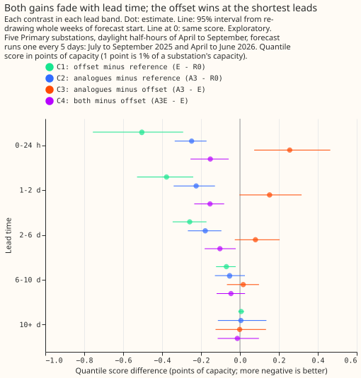
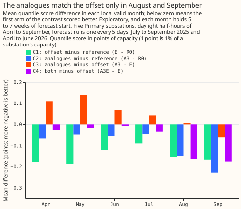
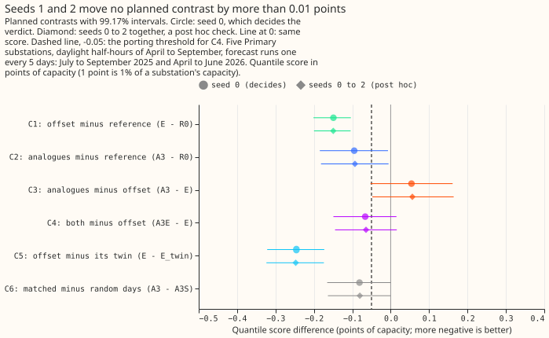

# Experiment 74: do same-time analogues add anything once the solar forecast is explicit? (AN1)

**Take-home message: telling the monthly-refitted demand model about sunshine in either of two ways
lowered the daylight error by 0.09 to 0.15 points of capacity, and the two ways help in different
conditions, so the next test needs more forecast weeks rather than another variant.** The explicit
forecast of the panels' output wins at leads under 2 days and on cloudy rows. The analogues, which
are recent days at the same time of day with similar sunshine, match it on sunny rows and in August
and September. Using both scored best (4.518 points against 4.584 for the explicit forecast alone),
but one validation year cannot resolve a gain that small. The verdict is `inconclusive`.

We asked how to tell a forecast of a Primary substation's power about the sunshine. A Primary
substation steps 33 kV or 66 kV down to 11 kV in the electricity distribution network. Solar panels
behind the substation's meter cut the metered power on a sunny day, so the forecast needs the
sunshine. We tried two ways on five substations over daylight half-hours of April to September. The
first, the explicit way, forecasts the panels' output (their capacity times the forecast sunshine,
with a fitted weight) and gives it to the XGBoost model as a starting offset. The second, the
analogue way, gives the model the metered power on the 3 recent days, at the same half-hour of the
day and of the same day type, whose measured sunshine was closest to the sunshine forecast for the
target. We refitted the model every month on the latest year of data for both ways, because a model
that is never refitted exaggerates the value of any input that follows the recent level of power.
Both ways beat the same refit without them. The explicit way beat it by 0.15 points, where 1 point
is 1% of a substation's capacity. The analogue way beat it by 0.09 to 0.10 points. The experiment
could not tell which way is better, and could not tell whether the analogues add anything once the
offset is in.

## The planned contrasts

**The decision rule was committed before any code ran.** It has six contrasts on the quantile
score, an error measure where lower is better. Every contrast is a paired difference of two arms'
scores, with whole weeks of forecast start resampled, and every interval is 99.17% (a 5% error
split across six). Seed 0 decides the verdict. C3 is the head-to-head contrast. C4 asks whether the
analogues add anything once the offset is in, and needs its upper end below -0.05 to be worth
porting. `refuted` needs C3's upper end below zero or C4's upper end below -0.05. `supported` needs
C1's upper end below zero, C3's lower end above zero, and C4's lower end at or above -0.05. Neither
rule is met, so the verdict is `inconclusive`: C3 runs from -0.053 to +0.161, and C4 from -0.149 to
+0.015.

| Contrast | Arm minus arm | Difference | 99.17% interval |
|---|---|---|---|
| C1 | `E` (offset) minus `R0` (reference) | -0.149 | -0.201 to -0.104 |
| C2 | `A3` (3 analogues) minus `R0` | -0.095 | -0.185 to -0.007 |
| C3 | `A3` minus `E` | +0.054 | -0.053 to +0.161 |
| C4 | `A3E` (both) minus `E` | -0.066 | -0.149 to +0.015 |
| C5 | `E` minus `E_twin` (offset from another date) | -0.246 | -0.322 to -0.173 |
| C6 | `A3` minus `A3S` (3 random days) | -0.081 | -0.165 to +0.001 |

The values are differences in quantile score, in points of capacity. A negative value favours the
first arm. The rows are 68,903 half-hourly forecasts from 29 weeks of forecast start, at five
Primary substations anonymised as D9, D10, D11, D14, and D16, one forecast run every 5 days in July
to September 2025 and April to June 2026. The half-width of each interval is 0.05 (C1), 0.09 (C2),
0.11 (C3), 0.08 (C4), 0.07 (C5), and 0.08 (C6), and every one except C1 is wider than the 0.05
threshold, so C4 could not rule out a gain of that size.


**The arms' absolute scores sit close together, and the pairing is what separates them.** Scores
are in points of capacity, with 95% intervals from resampling whole weeks:

| Arm | Quantile score |
|---|---|
| `R0`, reference | 4.734 (4.441 to 5.057) |
| `E`, explicit offset | 4.584 (4.302 to 4.909) |
| `E_twin`, offset from another date | 4.830 (4.531 to 5.159) |
| `A1`, 1 analogue | 4.631 (4.338 to 4.952) |
| `A3`, 3 analogues | 4.639 (4.343 to 4.960) |
| `A5`, 5 analogues | 4.673 (4.367 to 5.006) |
| `A3E`, 3 analogues and the offset | 4.518 (4.229 to 4.832) |
| `A3S`, 3 random days | 4.720 (4.431 to 5.040) |
| `R0_rad`, reference plus radiation inputs (context) | 4.614 (4.338 to 4.933) |

For context, experiment 64's frozen models score 4.620 (`d0`), 4.724 (`d1l`), and 4.467 (`am`) on
the same rows. Those models carry the 14-day correction, so no contrast uses them.

## The offset wins at short leads and on cloudy rows; the analogues catch up on sunny rows



**Both gains are largest within 2 days of the forecast start and are gone from 10 days, and the
offset gains more at the shortest leads.** At leads under 48 hours, C1 is -0.439 (95% interval
-0.578 to -0.306) and C2 is -0.237
(-0.316 to -0.172), so C3 is +0.203 (+0.060 to +0.346). The analogues add to the offset in that
range: C4 is -0.153 (-0.227 to -0.086). From 10 days, no contrast differs from zero. All reads on
this page other than C1 to C6 are exploratory, at 95%.

**The split by sunshine shows why the two ways differ.** On cloudy rows (a clear-sky index under
0.3), the analogues trail the offset by 0.429 points (0.224 to 0.657). On sunny rows (an index of
0.7 or more), C3 is -0.050 (-0.199 to +0.098) and C4 is -0.138 (-0.251 to -0.023). The forecast
sunshine helps most on a cloudy day, and a similar past day helps most on a sunny day. By
substation, C3 favours the offset at D9 (+0.166, +0.066 to +0.269) and D11 (+0.101, +0.051 to
+0.153), and is under 0.04 in size, in either direction, at D14 and D16.



**The analogues match the offset only in August and September.** C3 is +0.110, +0.139, +0.067, and
+0.043 in April to July, +0.006 in August, and -0.061 in September, so the analogues trail the
offset in the first four months. C4 is -0.163 in August and -0.175 in September. These are the means
of each month's differences, each from 5 to 7 weeks of forecast start, so they show a sign and no
interval.

## Other reads

- **Matching helps.** `A3` against `A3S`, the 3 random days, is -0.081 (-0.165 to +0.001) over all
  rows, so C6's upper end is a hair above zero. The gain is -0.197 (-0.275 to -0.130) at leads
  under 48 hours and -0.188 (-0.307 to -0.060) on sunny rows. On cloudy rows it is +0.137 (+0.002 to
  +0.293), which means that matched analogues are worse than random days there.
- **One analogue is enough.** `A1` minus `A3` is -0.008 (-0.037 to +0.019), and `A5` minus `A3` is
  +0.034 (+0.014 to +0.060).
- **The offset adds to the analogues.** `A3E` minus `A3`, the offset's gain on top of the
  analogues, is -0.121 (-0.157 to -0.086).
- **The offset carries solar information.** C5 shows the offset beats its twin by 0.246 (0.173 to
  0.322), which also held in experiment 64 (0.300).
- **At night the analogues are level with random days.** At night rows of April to September, `A3`
  minus `A3S` is -0.020 (-0.042 to +0.002), `A3` minus `R0` is -0.006 (-0.030 to +0.017), and `E`
  minus `R0` is +0.004 (-0.001 to +0.009).
- **Radiation inputs help the reference too.** `R0_rad` minus `R0` is -0.120 (-0.151 to -0.090), a
  context read that no contrast uses.
- **Coverage.** The 0.05 quantile lies above the actual power on 13.5% to 15.0% of sunny rows in
  every arm, and the 0.95 quantile lies above it on 80.6% to 82.9% of cloudy rows.
- **8.7% of forecast cases have no analogue** (a bank holiday, or no day of the same type with
  observed power and CAMS data in the window), and 89.4% have all 3.



**Seeds 1 and 2 changed no planned contrast by more than 0.003 points.** The widths of the
intervals come from the weeks of forecast start, not from fit noise. The verdict from seeds 0 to 2
together is also `inconclusive` (C3 lower end -0.048, C4 upper end +0.016). This check is post hoc.

## Which predictions held

| Prediction made in the plan | Result |
|---|---|
| C1 at -0.10 to -0.25 | Held: -0.149 |
| C2 at -0.02 to -0.10 | Held, at the end of the range: -0.095 |
| `E` beats `A3` by 0.03 to 0.20 | Held in the point estimate (+0.054); the interval includes zero |
| C4 within -0.03 to +0.02 | Not met: -0.066, with an interval from -0.149 to +0.015 |
| `E_twin` worse than `E` by 0.15 to 0.35 | Held: 0.246 |
| `A3S` worse than `A3` by 0.01 to 0.06 | Not met: 0.081, slightly beyond the range |
| `A3` and `A3S` within 0.02 at night | Held at the edge: -0.020 |

## Departures from the plan

**The experiment departed from its plan in four ways, none of which changes the hypothesis, the
prediction, or the decision rule.**

1. **A ninth arm, `R0_rad`, was fitted as context.** It enters no contrast.
2. **Seeds 1 and 2 were fitted after the verdict, as a post hoc check.**
3. **The prediction sets are stored under lower-case names**, `r0`, `e`, `a3`, and so on, for seed
   0, and with the suffix `-s012` for seeds 0 to 2, because a stored set cannot be overwritten.
4. **The common starting level is the median of the training labels, not zero.** Experiments 76
   and 78 found that XGBoost's estimated base score costs 0.07 to 0.10 points against a start at
   zero in the same pipeline. The plan gave every arm one common level so that the contrasts do not
   carry that effect. Whether a start at zero would change `R0`, or the ranking of the arms, is not
   tested.

**Limits that the plan stated hold.** The capacity table is experiment 64's and is 5% to 19% below
experiment 45's 2025/26 values, which experiment 78 found costs `am` about 0.02 points. The weights
and the sunshine calibration are fixed on data to 2025-06-30. The analogues are matched in training
to the ensemble-mean sunshine and at inference to each member's own, which widens the pooled spread
of the analogue arms. The candidates share a UTC half-hour, so a window that straddles a clock
change shifts a local-time profile by an hour. The placebo twin of `E` is a cyclic shift over the
whole window's rows, so its donor for a row from the early window may be a forecast issued after
that refit; only a sunshine anomaly crosses that boundary, and no power or label does.

## What the next experiment should answer

**The next experiment should test the analogue columns on top of the offset with enough forecast
weeks to resolve a gain of 0.05 points.** The ENS backfill's second validation year (experiment
R11) would roughly double the 29 weeks, which would bring the half-width of C4 from 0.08 towards
0.06. The experiment should start from one analogue, read sunny and cloudy rows separately in the
plan, and add a variant whose analogues are matched on the day type alone, because C6 does not
separate the sunshine from the day type. The decision whether to port either way belongs to the
maintainer and the roadmap: the offset costs a table of capacities and weights, and the analogue
columns cost the last 3 to 16 days of telemetry, a CAMS-like sunshine record, and a bank-holiday
calendar at every forecast.

## Reproducing the figures

```bash
uv run python ml-experiments/00074-an1-same-time-analogues-vs-explicit-solar-forecast-demand/e00074_inputs.py --part post_u
uv run python ml-experiments/00074-an1-same-time-analogues-vs-explicit-solar-forecast-demand/e00074_inputs.py --part shape --check
uv run python ml-experiments/00074-an1-same-time-analogues-vs-explicit-solar-forecast-demand/e00074_fit.py --prepare D9
# repeat the line above for D10, D11, D14, and D16
bash ml-experiments/00074-an1-same-time-analogues-vs-explicit-solar-forecast-demand/e00074_run.sh 0 1 2
uv run python ml-experiments/00074-an1-same-time-analogues-vs-explicit-solar-forecast-demand/e00074_assemble.py
uv run python ml-experiments/00074-an1-same-time-analogues-vs-explicit-solar-forecast-demand/e00074_stats.py --seeds 0 --tag seed0
uv run python ml-experiments/00074-an1-same-time-analogues-vs-explicit-solar-forecast-demand/e00074_stats.py --seeds 0 1 2 --tag seeds012
uv run python ml-experiments/00074-an1-same-time-analogues-vs-explicit-solar-forecast-demand/e00074_charts.py
npx svgo@4 --multipass --precision=1 --final-newline figure_*.svg
```

`e00074_stats.py` prints every number on this page. The code is in
`ml-experiments/00074-an1-same-time-analogues-vs-explicit-solar-forecast-demand/`.
