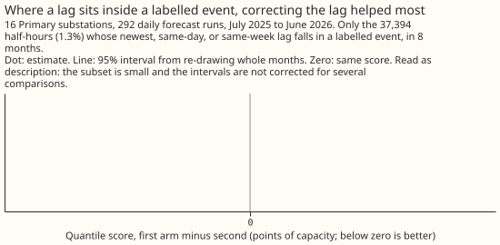
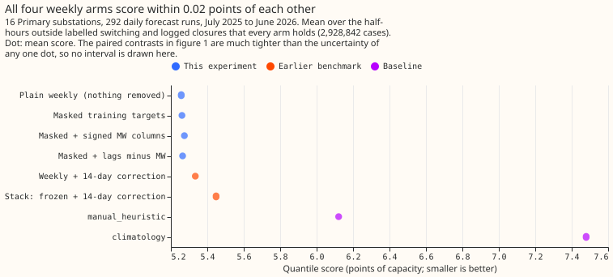

# Experiment 75: can a Primary demand forecast learn the normal running arrangement from labelled switching?

**Take-home message: outside switching, the Primary demand forecast was already close to the normal
running arrangement, so neither removing the labelled switching from training nor telling the model
how much load switching moved changed the score by more than 0.06 points of capacity.** The
experiment cannot show that masking is harmless to within its own margin of 0.02 points, and it
cannot show a gain from either extra input. The plain weekly-refitted model stays the v1 candidate.
The corrected lags did help on the few half-hours whose lag sits inside an event, so SW2-12 should
test them first. The verdict is **inconclusive**.

An electricity network operator sometimes closes a normally open switch, so that one Primary
substation (a substation that steps down to the local distribution network) carries load that
belongs to a neighbour. We asked whether an XGBoost demand model forecasts the normal running
arrangement (NRA) as well when its training targets leave out the labelled switching half-hours,
and whether giving the model the signed MW that switching moved at each lagged power input, or
subtracting that MW from each lag, lowers the error further.

We refitted the model weekly for 16 Primary substations on four arms and scored them on the 292
daily forecast runs of experiment 48, on half-hours outside labelled switching and logged closures.
The labels are experiment 41's 82 visible events, which are hindsight values, so the result is an
oracle ceiling for a detector.

- **Arms (all weekly, seed 0, N1 recipe of experiment 48).** `plain`: nothing removed. `nra`:
  training rows whose valid time lies inside a labelled event are dropped. `nra_mw`: `nra` plus
  the signed MW at each of the 3 lags. `nra_lag`: `nra` with each lag replaced by the lag minus
  that MW.
- **Row set.** `fold_a_daily_gap_v1`, 16 Primary series, 3,199,243 cases, of which 2,928,842 are
  NRA rows (outside labelled events and logged closures). Every arm holds identical cases.
- **Score of each arm on the NRA rows (quantile score, points of capacity).** `plain` 5.257, `nra`
  5.261, `nra_mw` 5.274, `nra_lag` 5.264. Benchmarks on the same rows: experiment 48 weekly with
  the 14-day correction 5.334, the stack 5.448, `manual_heuristic` 6.121, `climatology` 7.479. The
  absolute scores on all half-hours are 5.440, 5.446, 5.473, and 5.450.
- **C1, masked minus plain: +0.004 (98.33% interval -0.026 to +0.025).** The upper end exceeds the
  +0.02 non-inferiority margin, so the mask is not shown to be harmless, and not shown to be
  harmful either. By the decision rule the plain arm is the v1 NRA candidate.
- **C2, signed MW columns minus masked: +0.013 (-0.013 to +0.052). C3, corrected lags minus masked:
  +0.004 (-0.019 to +0.019).** Neither interval lies below zero, so neither arm is supported.
- **Descriptive, plain minus each arm.** Minus `nra_mw` -0.017 (95% interval -0.035 to +0.001),
  minus `nra_lag` -0.007 (-0.028 to +0.018). Corrected lags minus MW columns -0.010 (-0.037 to
  +0.008).
- **Half-hours with a lag inside an event.** Only 37,394 NRA half-hours (1.3%), in 8 months. There
  the mask lowered the score by 0.50 (95% interval -2.08 to +0.35), the corrected lags lowered it
  by a further 0.42 (-1.51 to +0.02), and the MW columns raised it by 1.07 (-0.19 to +3.31).
  These intervals are not corrected for several comparisons.
- **Metered view.** Over all half-hours, C1 is +0.006 (-0.014 to +0.025), C2 +0.027 (-0.001 to
  +0.073), and C3 +0.004 (-0.010 to +0.016). The view decides nothing.
- **Reproduction check.** The plain arm's mean score on all cases, 5.4403, matches experiment 48's
  stored weekly score, 5.4402. Only 9% of per-case scores match to 0.001, and the largest gap is
  4.39 points, because repeated graphics-card fits are not bit-for-bit identical. The 0.004
  difference in C1 is therefore at the level of fit-to-fit noise.
- **Caveats.** Labels, onsets, ends, and the moved MW are hindsight values. Only 22 of the 82
  labelled events fall in the scored year. Events before January 2022 are not masked in training.
  One validation year, one seed.
- **What the next experiment should answer.** SW2-12 repeats the arms with the detector's labels.
  Its first addition is the corrected lags plus the MW columns together, which this experiment did
  not run. The corrected lags were the one input that helped where a lag sits inside an event.
