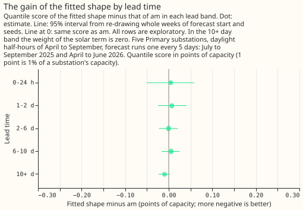
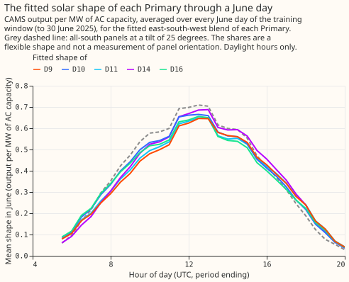
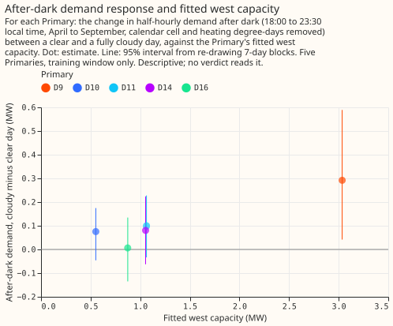

# Experiment 77: does the fitted solar shape lower the error of arm am? (PVDIS-6b)

**Take-home message: the shape of the solar term does not limit experiment 64's arm `am`.** Replacing
its south-facing panel shape with a blend of east-, south-, and west-facing shapes fitted to each
substation's own power left the score unchanged, and so did using another substation's blend. What
did matter was the forecast of the sunshine itself: giving the same arm the sunshine of another date
raised the score by 0.32 points. The next work on the solar term should go into the sunshine forecast
and the capacity table, not into the panel shape. The verdict is `refuted`.

We asked whether a forecast of the power drawn at a Primary substation improves when its solar term
is built from a blend of east-, south-, and west-facing panel output instead of south-facing panels
only. A Primary substation is a 33/11 kV or 66/11 kV substation in the electricity distribution
network. Experiment 73 (PVDIS-6) found that such a blend fits the half-hourly power of Primary
substations 1.3% better than south-facing panels do, although its shares are not identified. We fitted
one set of shares per substation on rows up to 30 June 2025, rebuilt the solar term of experiment
64's best arm `am` with the blend, and scored the forecasts on the same rows as experiment 64: five
Primaries, 68,903 daylight half-hours per seed in April to September, with 3 seeds. The score is the
quantile score, an error measure in which lower is better, and 1 point is 1% of a substation's
capacity. The blend scored 4.466 points and `am` 4.467.

**The verdict is `refuted`, read by the rule written before any arm was scored.** The rule uses
three contrasts, each an arm's score minus another arm's, at a 98.33% interval from 50,000 resamples
of whole weeks of forecast start. C1 is the fitted shape minus `am`. C2 is the fitted shape minus
all-south panels at the fitted shape's tilt of 25 degrees, which separates mixing from the tilt
change. C3 is the fitted shape minus its placebo twin, the same arm given the forecast sunshine of
another date. The threshold is 0.5% of `am`'s score, which is 0.022 points. The rule says `refuted`
when the lower end of C1 is above -0.022 and the upper end is at most +0.022, so that a gain of 0.5%
is excluded and a loss of 0.5% is not shown.

| Contrast | Difference | 98.33% interval |
|---|---|---|
| C1: fitted shape minus `am` | -0.001 | -0.018 to +0.014 |
| C2: fitted shape minus all-south at tilt 25 | -0.001 | -0.014 to +0.011 |
| C3: fitted shape minus its placebo twin | -0.323 | -0.441 to -0.212 |

The differences are in points of capacity, and negative favours the fitted shape. The interval of C1
has a half-width of 0.016 points, below the 0.022-point threshold, so the design could have seen a
gain of 0.5% and did not.

## Every arm scores the same, except the placebo twin

**The fitted shape, the all-south shape at either tilt, and another Primary's shape are not
distinguishable.** Absolute scores, in points of capacity, with 95% intervals from the same
resampling:

| Arm | Quantile score |
|---|---|
| `d0`, the best guess (experiment 33) | 4.620 (4.294 to 4.946) |
| `am0`, `am` without the solar term (experiment 76) | 4.640 (4.295 to 4.977) |
| `am`, all-south shape at tilt 35 (experiment 64) | 4.467 (4.143 to 4.785) |
| `am_s25`, all-south shape at tilt 25 | 4.467 (4.142 to 4.783) |
| `am_blend`, the fitted shape | 4.466 (4.144 to 4.781) |
| `am_shuffled`, another Primary's fitted shape | 4.465 (4.143 to 4.781) |
| `am_blend_twin`, fitted shape with the sunshine of another date | 4.789 (4.430 to 5.157) |

The fitted shape minus the shuffled shape is +0.001 points (95% interval -0.006 to +0.007,
exploratory). If the shares carried information about a Primary's panels, the shape fitted to the
Primary's own power would score below the shape fitted to another Primary's. That matches experiment
73's finding that the shares are not identified, and here it also holds for the forecast.

**The forecast sunshine carries the gain.** The fitted shape scores 0.173 points (95% interval
-0.227 to -0.121) below `am0`, the same arm without a solar term, and 0.323 points below the same arm
given the sunshine of another date. The fitted shape scores 0.153 points (-0.193 to -0.116) below
`d0`, as `am` does in experiment 64. A season-year capacity vintage does more than the fitted shape:
the fitted shape scores 0.017 points (+0.002 to +0.033) above experiment 78's `am_sy`.

## Lead time, series, and month show no gain either

The fitted shape minus `am` has an interval that includes zero in every lead band, at each of the
five series, and over leads under 48 hours (+0.006, -0.031 to +0.044). Beyond 10 days, where the
weight of the solar term is zero, the difference is -0.010 points (-0.023 to +0.002), and experiment
76 found no route for a leak there. By local valid month the difference runs from -0.022 points in
April to +0.019 in August with no pattern, on 29,715 to 39,663 rows per month over the three seeds.

## The fitted shapes, and the evening-west check

**The five fitted shapes differ little from all-south panels at a tilt of 25 degrees.** They have a
lower midday peak and a larger afternoon and evening share, by amounts small beside the error of
the sunshine forecast. The shares behind them are a flexible shape and not a
measurement of panel orientation: the south share is 0.06 to 0.15 at three of the five Primaries and
0.34 to 0.57 at the other two.

**The evening-west check does not settle whether the west share is evening demand.** For each
Primary we removed the calendar cell and heating degree-days from the after-dark half-hours of April
to September (18:00 to 23:30 local time) and regressed the remainder on that day's mean daytime
cloud. The change from a clear to a fully cloudy day is +0.29 MW at D9 (95% interval +0.04 to +0.59),
which has the largest fitted west capacity (3.04 MW), and between +0.01 and +0.10 MW at the other
four, with intervals that include zero. Five Primaries cannot show a relation, and D9 is a
low-power Primary with two training years. The check is descriptive and no verdict reads it.

## Caveats

- **Weights differ by arm only through the shape.** Each arm refits the weight `w` on its own
  cross-fit of the same XGBoost model without a solar term. GPU fits are not exactly repeatable, so
  `w` carries a small amount of noise that differs between arms. The mean weights are -0.32 to -0.48
  (blend) and -0.38 to -0.52 (all-south at tilt 25).
- **The capacity of D14 is scaled, not fitted.** D14 has no 2024/25 weeks, so its capacity is
  experiment 64's capacity times the median ratio of the shape's capacity to experiment 64's at the
  other four series.
- **D9's shares rest on two training years.** The other four Primaries have five or six.
- **The result is for ensemble-forecast sunshine at five Primaries in one trial area.** A different
  weather forecast with less error could make the panel shape matter more.

## What the next experiment should answer

The solar term of arm `am` is limited by its inputs, not its panel shape. The candidates that the
evidence supports are a better sunshine forecast (experiment 50 and experiment 53 compared
other weather forecasts) and a capacity table that is current (experiment 78 found a gain of 0.018
points from a season-year vintage). This experiment does not propose an order.

**The sections from here to the end are the plan as committed before any code ran, apart from the
last section, which lists the changes made after the plan and before any arm was scored.**

## What is held fixed and what changes

**One set of shares per Primary, fitted on the training window only, replaces the all-south shape.**
Experiment 73's pooled fit (one set of east, south, and west shares per Primary, shared by every
season-year) is refitted on summer half-hours up to 2025-06-30 only, on experiment 73's
plane-of-array shapes at a tilt of 25 degrees and a DC to AC ratio of 1.15. Experiment 73's own
shares used rows up to 2026 and are not reused. The shares are held fixed across training years,
which removes the year-to-year swing of 0.24 that experiment 73 found.

**The blend replaces the all-south shape everywhere that the solar term is built.** The CAMS shape,
the CAMS and ENS climatologies, the ENS anomaly and its calibration slope per lead band, the
capacity, and the weight `w` fitted on the training window are all rebuilt for the blend, by the
code of experiments 46 and 64 with the plant output replaced by the blend of the three orientations'
output. The per-member ENS anomaly is computed from the shortwave radiation of each of the 51
members, as in experiment 46. The weight `w` absorbs a scale error in the capacity, so the capacity
keeps experiment 45's recovery ratio of the fleet shape; the effect of that choice is a caveat of
the write-up.

## Arms

- `am_blend`: arm `am` with the fitted shape.
- `am_s25`: arm `am` with all-south panels at a tilt of 25 degrees, the control for the tilt change.
  The script prints the AC capacity of `am_s25` and of `am_blend` for each series, and the
  weights `w`, so that a difference in level between the arms is visible.
- `am_blend_twin`: `am_blend` with the forecast sunshine taken from another date, by experiment 64's
  permutation of runs within series, month, half-hour, and lead band. The donor run is the same for
  the east, south, and west anomalies, so the twin keeps their mutual timing.
- `am_shuffled`: `am` with the shares of another Primary (a fixed cyclic permutation of the 5
  series), refitted capacity and weight. This is exploratory.
- Reference rows, read from experiment 64's stored predictions: `am`, `am_twin`, `d0`, `d1l`,
  `climatology`, and `manual_heuristic`.

Each XGBoost arm has 5 series and 3 seeds, 15 fits, with experiment 64's settings and column list.
Each model is trained on its own history.

## No fitted quantity sees the validation period

**Every fitted quantity is read with a valid time up to 2025-06-30 23:30 UTC, and the scripts assert
it.** The quantities are the shares, the AC capacity, the CAMS and ENS climatologies, the
calibration slope per lead band, the weight `w`, and the 14-day correction and spread factor, which
are refitted per arm on training rows only. Each script prints the latest timestamp of every table
it fits. The shares are fitted on rows of `shapes.parquet` and the frame up to that time. The ENS
members' half-hour irradiance is read from the archive and passed through the plane-of-array
calculation for the east, south, and west orientations at 25 degrees, since the stored ENS tables
hold only the fleet shape. The reliable-hour mask of the CAMS shapes must give the same scored rows
as experiment 64's; where it does not, all arms are restricted to the intersection, and `am` is
rescored on it.

## The evening-west check

**A west-leaning share at some Primaries may be evening demand and not solar.** Experiment 73's
advice recommends a check before the west share is read as solar. For each Primary, using training
rows only, we remove the calendar cell and heating degree-days from the half-hours after dark
(solar zenith above 90 degrees, 18:00 to 23:30 local time), and regress the remainder on that
evening's mean cloud cover and on its mean temperature. If evening demand were the source of a west
share, the after-dark residual would rise in dull weather, so a positive cloud slope is the
expected sign. We tabulate, for each of the 5 Primaries, the slope as a share of the Primary's
capacity beside its west share. With 5 Primaries, no rank correlation has power, so the table is
descriptive, and no verdict uses it.

## Size

- **What gets stored:** prediction sets under `data/ml-experiments/` (private, uncommitted); nothing
  in production.
- **Production serving path:** not touched.
- **Degradation rule:** not touched.
- **More than one defensible design:** yes, in how the shares are fitted (fixed, or under a
  year-to-year penalty) and at which tilt. The plan fixes the shares across years because that
  choice removes the instability experiment 73 found, and uses `am_s25` to separate tilt from mix.
- **Callers not nameable without searching:** the code is copied from experiments 46 and 64, so the
  callers are known.
- **Size: medium.** One Sonnet plan review, one Sonnet code review, one Sonnet write-up review, and
  one Sonnet prose review.

## Changes made after the plan was committed and before any arm was scored

- **The flat-timing control `am_blend_flat` is dropped.** A reviewer of the code showed that a
  single scale on the south shape cancels: the calibration slope, the capacity, and the weight `w`
  absorb it, so the arm would equal `am_s25`. A per-cell version was not built.
- **The evening-west check regresses on the day's mean daytime cloud and heating degree-days.**
  The frame holds no cloud measure after dark, because irradiance is zero then, so the cloud
  variable of the plan's "that evening" is the same day's daylight cloud.
- **The fallback capacity of the series with no 2024/25 constant (D14) is scaled by the shape.** It
  is experiment 64's capacity times the median ratio of the shape's capacity to experiment 64's at
  the other four series.
- **Exploratory contrasts against `am0` and `am_sy` are added,** at the request of the manager,
  because experiment 78 found that a zero base margin alone lowers `d0`'s score. `am0` is
  experiment 76's `am` without the solar term, and `am_sy` is experiment 78's `am` with a
  season-year capacity vintage.

## Earlier advice followed and departed from

- Followed: use `am` (a starting offset) and not an input column or a shift after the fit
  (experiment 64); describe the blend as a fitted solar shape and not as a measurement of
  orientation, and do not publish shares (experiment 73); hold the shares fixed across training
  years (experiment 73); check the west lean against after-dark demand (experiment 73).
- Departed from: none.
