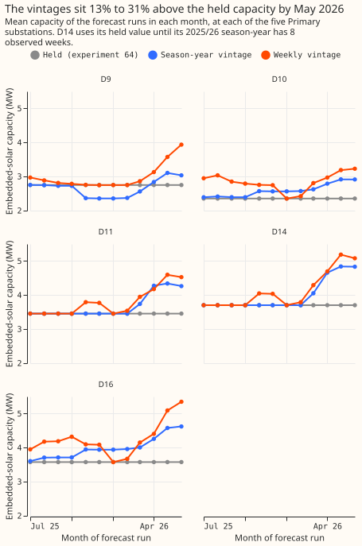
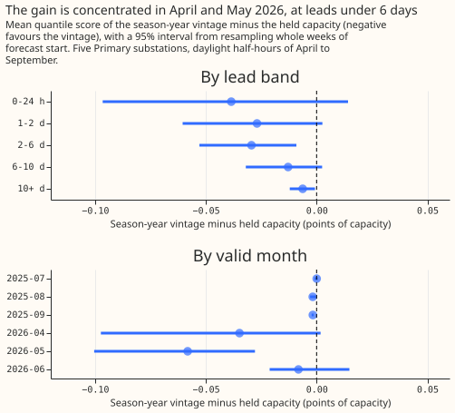

# Experiment 78: does a re-estimated solar capacity lower the error? (PVDIS-5, check 2)

**Take-home message: re-estimating the solar capacity before each forecast run lowers the quantile
score of `am`, the best-scoring forecast of experiment 64, by only 0.018 points, so a capacity table
refreshed about once a season-year is enough.** The quantile score is an error measure in which
lower is better, and 1 point is 1% of a substation's capacity. A larger finding sits beside this
one. XGBoost starts each model from an estimated starting prediction (its base score). Starting from
zero instead lowered the score of the reference model `d0` by 0.07 points, and by about 0.10 points
for the model that carries no solar term, so part of the gain that experiment 64 reported over `d0`
was a start-at-zero effect. The solar term still lowers the score by 0.100 points against a `d0`
that starts from zero. The next experiment should test the starting point, which needs no extra
production work to change.

We asked whether a better estimate of how much solar capacity sits behind each Primary substation
improves a forecast of the substation's power. A Primary substation steps electricity down from
33 kV or 66 kV to 11 kV. Experiment 64 forecast power with an XGBoost model that starts from a
solar term: the substation's solar capacity times a forecast of how sunny the day will be, added as
a base margin (a fixed starting prediction supplied for each row). That experiment fixed the
capacity at the value estimated from data before July 2025. Here we re-estimated the capacity before
every forecast run from only the data available then, and predicted again with the same fitted
XGBoost models. The score fell by 0.018 points. We also refitted two reference models, `d1l` and
`d0`, to find out whether the start-at-zero effect that experiment 76 suspected is real. The
start-at-zero effect is real.

**The verdict is `small gain`.** The pre-registered rule is in the front matter and was committed
before any code ran. The headline contrast C1 is the quantile score of `am_sy` (`am` with the
season-year vintage of the capacity) minus that of `am` (experiment 64's held capacity), over all
leads. The upper end of C1 is -0.004, below zero but not below the threshold of -0.05. The threshold
is a third of experiment 64's gain over `d0`, because a weekly refit of the capacity table is a
production step that a fixed table does not need. C3 and C4 in the table confirm that the solar term
carries solar information.

| Contrast | Difference in quantile score | 98.75% interval |
|---|---|---|
| C1: `am_sy` minus `am`, all leads | -0.018 | -0.036 to -0.004 |
| C2: `am_sy` minus `am`, leads under 48 hours | -0.033 | -0.086 to +0.012 |
| C3: `am_sy` minus `am0`, all leads (the solar term) | -0.190 | -0.267 to -0.118 |
| C4: `am_sy` minus `am_sy_twin`, all leads (a wrong-date sunshine forecast) | -0.357 | -0.496 to -0.227 |

The values are in points of capacity and come from 50,000 resamples of whole ISO weeks of forecast
start (29 weeks) and of 3 seeds, on experiment 64's 68,903 scored rows per seed: daylight
half-hours of April to September at the five Primary substations D9, D10, D11, D14, and D16, in July
to September 2025 and April to June 2026. `am0` is the XGBoost model with a base margin of zero and
no solar term (experiment 76). C2 does not meet the rule for a gain at short leads, because its
interval includes zero.


## The arms

- **`am`, `am_twin`, `d0`, `d1l`:** experiment 64's stored forecasts. `am` has a base margin of the
  weight times the held capacity times the forecast sunshine anomaly. `d0` is the best-guess recipe,
  and `d1l` is `d0` without the two radiation inputs.
- **`am0`:** experiment 76's stored forecasts: `am`'s recipe with a margin of zero in every row.
- **`am_sy`, `am_sy_twin`, `am_wk`:** experiment 64's fitted `am` and `am_twin` models, predicted
  with the capacity of the season-year vintage (`am_sy`, `am_sy_twin`) or the weekly vintage
  (`am_wk`). Nothing is refitted, so the weights and the capacity in the training margin stay
  experiment 64's.
- **`d1l_r`, `d0_r`, `d0_m0`:** `d1l` and `d0` refitted here with experiment 64's recipe and seeds,
  and `d0` refitted with a zero base margin.

**The season-year vintage re-fits experiment 45's season-year constant before each forecast run.**
The fit uses the usable half-hours of the weeks up to two weeks before the Monday of the run's week,
and divides by experiment 45's recovery ratio. The recovery ratio is experiment 45's measured
fraction of injected solar capacity that the fit recovers, and a usable half-hour is one with an
observed power and a CAMS solar estimate. A run takes the capacity from the first of three steps
that applies. Step 1 is the vintage's constant for the run's season-year (September to August), once
that season-year has 8 observed weeks. Step 2 is the previous season-year's constant. Step 3 is
experiment 64's held capacity. Step 1 supplied 84% of runs at D9, D10, and D16, 47% at D11, and 29%
at D14. D14's weeks from 2023-09-04 to 2025-08-25 are unobserved, so step 3 supplies the other 71%
of its runs. **The weekly vintage** averages the 4 latest observed weeks of experiment 45's `frozen`
weekly fit (a free capacity per week with a fixed penalty on changes), from the
vintage with the latest origin up to a week before the run.

## The estimated capacity rose 13% to 31% above the held value by May 2026



**The vintages move away from the held capacity in November 2025 and sit 13% to 31% above it in May
2026.** D9's vintage falls 14% below the held value in November, and D10's and D16's rise 9% and 10%
above it.
The season-year vintage in June 2026 is 3.0 MW at D9 (held 2.751 MW), 2.9 at D10 (2.356), 4.3 at D11
(3.457), 4.8 at D14 (3.705), and 4.6 at D16 (3.578), against experiment 45's
final 2025/26 constants of 2.9, 2.9, 4.1, 4.2, and 4.4. The weekly vintage is higher and noisier.
In November 2025 the new season-year's own constant takes over at D9, which is why the vintage there
falls (2.37 MW against 2.75).  Experiment 45 found that the latest weeks of a
real-time fit are the least accurate.

## The gain is small and sits mostly in May 2026



**The point estimate is negative at every lead, but only the 2-to-6-day and 10-days-and-beyond
intervals exclude zero.** The effect is almost zero at 10 days and beyond. The point estimates of
`am_sy` minus `am` are -0.039 (-0.097 to +0.014) at 0 to 24 hours, -0.027
(-0.061 to +0.003) at 1 to 2 days, -0.029 (-0.053 to -0.009) at 2 to 6 days, -0.013 (-0.032 to
+0.003) at 6 to 10 days, and -0.006 (-0.012 to -0.001) at 10 days and beyond. By valid month, the
read is about zero from July to September 2025 (the vintage is within 4% of the held capacity
there), -0.035 (-0.097 to +0.002) in April 2026, -0.058 (-0.100 to -0.028) in May, and -0.008
(-0.021 to +0.015) in June. At D16 the read is -0.045 (-0.073 to -0.020), at D14 -0.022 (-0.044 to
-0.002), at D10 -0.018 (-0.034 to -0.003), at D11 -0.012 (-0.032 to +0.005), and at D9 +0.006
(-0.003 to +0.018). These reads are exploratory, at 95%.

**The weekly vintage does no better than the season-year vintage.** `am_wk` minus `am_sy` is -0.005
(-0.013 to +0.003), and `am_wk` minus `am` is -0.023 (-0.042 to -0.007) over all leads and -0.054
(-0.116 to +0.004) under 48 hours. A weekly refresh would lower the score by a further 0.005 points
at most, which the intervals do not separate from zero. Restricted to runs where step 1 supplied the
capacity, `am_sy` minus `am` is
-0.022 (-0.037 to -0.008), so the fallback to the held value dilutes the effect slightly.

## Absolute scores

Mean quantile score in points of capacity, after the 14-day correction and the 1.15 spread factor.

| Arm | All leads | Under 48 hours | 10 days and beyond |
|---|---|---|---|
| `am_wk` | 4.444 | 3.717 | 4.896 |
| `am_sy` | 4.449 | 3.739 | 4.898 |
| `am` | 4.467 | 3.772 | 4.904 |
| `d0_m0` | 4.550 | 3.966 | 4.916 |
| `d0` | 4.620 | 4.044 | 4.986 |
| `d0_r` | 4.620 | 4.044 | 4.987 |
| `am0` | 4.640 | 4.237 | 4.939 |
| `d1l_r` | 4.723 | 4.342 | 5.025 |
| `d1l` | 4.724 | 4.343 | 5.025 |
| `am_twin` | 4.767 | 4.478 | 4.975 |
| `am_sy_twin` | 4.807 | 4.570 | 4.982 |

The climatology scores 5.272 on the 68,863 rows it holds (a month-by-half-hour mean, experiment 64).
The wrong-date twin gets worse when the capacity grows: `am_sy_twin` minus `am_twin` is +0.040
(+0.022 to +0.058), as expected for a solar term that carries no timing information.

## XGBoost's estimated starting point raises the score by 0.07 to 0.10 points

**A refit of `d1l` in this pipeline scores the same as experiment 46's stored `d1l`, so the gap
that experiment 76 saw is not a difference between pipelines.** `d1l_r` minus `d1l` is -0.0004
(-0.0020 to +0.0013), and `d0_r` minus `d0` is +0.0004 (-0.0018 to +0.0025).

| Contrast | Difference | 98.33% interval |
|---|---|---|
| D1: `d1l_r` minus `am0`, 10 days and beyond, no 14-day correction | +0.102 | +0.035 to +0.169 |
| D2: `d0_r` minus `d0_m0`, 10 days and beyond, no 14-day correction | +0.089 | +0.028 to +0.153 |
| D3: `d1l_r` minus `am0`, all leads | +0.084 | +0.053 to +0.121 |

The pre-registered rule reads D1 as a real starting-point effect: the lower end of D1 is above zero
and its point estimate is above 0.05. D2 gives the same reading for `d0`. Over all leads, `d0_m0`
minus `d0_r` is
-0.071 (-0.099 to -0.047, exploratory), and under 48 hours -0.078 (-0.118 to -0.036).

**XGBoost estimates one base score per quantile level, and the score rises with the level.** For
`d0_r` at D9 it runs from 0.403 at the 0.05 level to 0.899 at the 0.95 level (power over capacity),
and it is identical across seeds and for `d1l_r`. The recipe
trains a fixed 500 rounds at a learning rate of 0.05, with no early stopping, so no interaction
with early stopping exists. The reason a start at zero scores better is not tested here.

**The solar term survives the correction for the starting point.** `am_sy` is 0.100 points (-0.142
to -0.061) below `d0_m0` over all leads and 0.227 (-0.361 to -0.103) under 48 hours (post hoc,
exploratory), against 0.171 and 0.305 below `d0`. Experiment 64's gain of `am` over `d0`, 0.152,
is 0.082 (-0.113 to -0.052) over `d0_m0`.

## Which predictions held

| Prediction made in the plan | Result |
|---|---|
| C1 at -0.02 (-0.04 to 0.00) | Held: -0.018 (-0.036 to -0.004) |
| C2 at -0.04 (-0.09 to 0.00) | Held in size: -0.033 (-0.086 to +0.012) |
| `am_wk` the same as `am_sy` or 0.00 to 0.05 higher | Held for "the same": -0.005 (-0.013 to +0.003) |
| `d1l_r` 0.00 to 0.10 above `am0` at 10 days and beyond, uncorrected | Just above the range: +0.102 (+0.035 to +0.169) |
| Verdict `small gain` or `inconclusive` | `small gain` |

## Departures from the plan

1. **The weekly vintage drops weeks older than 8 weeks before the run's Monday.** The code review
   found that D14's weekly vintage would otherwise average weeks from 2023, from before the gap in
   its record. The change was made before any arm was scored.
2. **The first run of the statistics script grouped the bootstrap by month, not by week.** A column
   name was wrong, so the intervals rested on 7 blocks. The corrected run uses 29 weeks. The
   verdict changed from `refuted` to `small gain`, so every number on this page comes from the
   corrected run.
3. **Six exploratory reads were added after the results were seen**, and are labelled post hoc:
   `d0_m0` against `d0_r` under 48 hours, `am_sy` and `am` against `d0_m0` (each over all leads and
   under 48 hours), and `am0` against `d0_m0`. The reads against `d0_m0` carry the claim that the
   solar term survives a zero start.

## Limits

- **The training margin keeps the held capacity.** The weights, and the capacity inside every
  training row, are experiment 64's, so the contrast measures the capacity at prediction only. A
  refit with a vintage capacity in the training rows is a larger design that this experiment does
  not test.
- **The recovery ratio is the full-record value.** Each vintage divides by one number per series,
  from experiment 45's injection test on the full record, so the vintages carry a small look-ahead
  that `am` and the vintage arms share.
- **One validation year and 29 weeks of forecast start.** July to September 2025 and April to June
  2026 are two seasons of one year, and the 2026 months hold the gain.
- **D14 keeps its held capacity for 71% of runs.** The vintage for D14 matters only from March 2026.
- **The reason a zero start helps is not tested.** The experiment shows the size, not the mechanism.

## What the next experiment should answer

**Does a zero base margin help every XGBoost model in the production recipe, and at which leads?**
The effect is 0.07 to 0.10 points on the Primary demand models of this experiment, larger than the
effect of the capacity, and it costs nothing in production. A test across the series and model
types that the best guess `d0` covers (BSP and GSP demand, solar, and wind) would settle whether
the base score belongs to the production recipe. If the capacity matters for a later model release,
the evidence here is consistent with refreshing the capacity table once a season-year.

## Reproducing the figures

```bash
uv run python ml-experiments/00078-pvdis-5-current-capacity-vintages/e00078_capacity.py
bash ml-experiments/00078-pvdis-5-current-capacity-vintages/e00078_run.sh
uv run python ml-experiments/00078-pvdis-5-current-capacity-vintages/e00078_stats.py
uv run python ml-experiments/00078-pvdis-5-current-capacity-vintages/e00078_charts.py
npx svgo@4 --multipass --precision=1 --final-newline figure_*.svg
```

The code is in `ml-experiments/00078-pvdis-5-current-capacity-vintages/`.
