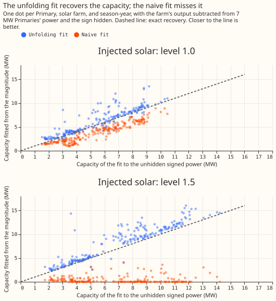
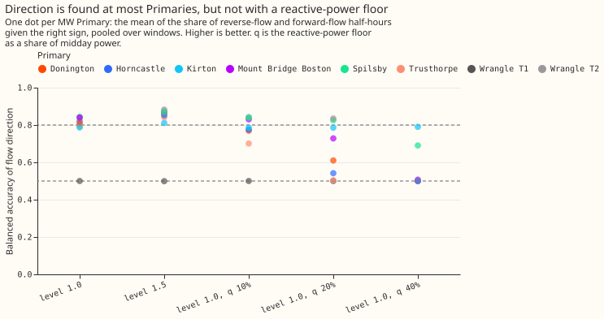

# Experiment 79: can the direction of flow be recovered at Primaries metered only in MVA?

**Hiding the sign of a Primary's power and recovering it works well enough to trust the capacity,
and about four times in five for the direction of flow, but the real MVA-only Primaries show almost
no reverse flow to recover, and the one that might (Stickney) cannot be checked.** For 7 of the 8
Primaries metered only in MVA the MVA reading can stand in for MW in April to September, so no fit
is needed there. Stickney is the exception, and the next step is a few weeks of signed power from
NGED for it. The verdict is `partly supported`.

We asked whether the direction of the power flowing through a substation, and the capacity of the
solar panels behind it, can be found from a meter that records only the size of the flow, not its
direction. Eight substations that feed the 11 kV network have such meters. First we tested the
method where the answer is known. We took the 8 substations whose meters do record direction,
subtracted the recorded output of a real solar farm from their power so that the flow reversed on
sunny middays, threw the sign away, and asked the fit to recover both. Then we ran the same fit on
the real readings of the 8 MVA-only substations. The fit found the solar capacity to within about 9%
to 11% of the answer from the signed power, where ignoring the missing sign gave 29% to 100% errors.
It found the direction of flow correctly for 78% to 86% of half-hours, a share that falls to 67% or
less once the power has an unmeasured reactive part. At 7 of the 8 MVA-only substations it found no
reverse flow at all.

## Result

**Capacity is identified, direction is not, by the rule fixed before the run.** Capacity needed a
median error of at most 0.25 and an upper interval end below zero for the contrast against the naive
fit (a fit that treats the magnitude as if it were signed). Direction needed a balanced accuracy
(the mean of the share of reverse-flow half-hours and the share of forward-flow half-hours that get
the right sign) of at least 0.80 and a lower interval end of at least 0.25 above the all-positive
guess of 0.5. Injection level 1.0 is solar capacity equal to the window's median absolute midday
power, and level 1.5 is 1.5 times that. A window is one Primary in one season-year (September to
August, as in experiment 00073), April to September. Intervals are 99% from a bootstrap that
resamples Primaries and then windows.

| Injection | Capacity error, unfolding fit | Capacity error, naive fit | C1 (difference) | Balanced accuracy | C2 (accuracy minus 0.5) |
|---|---|---|---|---|---|
| Level 1.0 (227 windows) | 0.092 | 0.290 | -0.198 (-0.409 to -0.068) | 0.779 | +0.279 (+0.157 to +0.337) |
| Level 1.5 (227 windows) | 0.113 | 1.000 | -0.887 (-0.920 to -0.754) | 0.811 | +0.311 (+0.184 to +0.372) |

*Median relative capacity error against the signed fit, and balanced accuracy of the fitted flow
direction, 8 MW Primaries and 6 farms. Four windows at level 1.0 and one at level 1.5 had too few
reverse-flow half-hours to score for sign.*

**The capacity error against the injected farm alone is larger (0.151 at level 1.0, 0.073 at level
1.5) than against the signed fit,** because the signed fit's own error is part of the difference.
Level 0.5 has almost no reverse flow and is a no-signal check: the unfolding and naive fits both
reproduce the signed capacity to within 0.4% and 0.1%, and the fitted flow is never negative. On the
30 windows of the 5 Primaries that almost never go negative, with no injection, the median fitted
negative share is 0.0000, so the fit does not invent reverse flow. That check passes trivially for a
fit that never finds any.

**A reactive-power floor the fit cannot see lowers both parts quickly.** The reading was
`sqrt(power² + q²)` with `q` equal to 10%, 20%, or 40% of midday power (level 1.0). The unfolding
fit's capacity error is 0.130, 0.309, and 0.529 against the naive fit's 0.331, 0.404, and 0.539, and
its balanced accuracy is 0.756, 0.666, and 0.561. At 20%, three Primaries (Horncastle, Trusthorpe,
and Donington) fall to a recall of reverse flow of 0.01 to 0.23. This reading is descriptive and did
not change the verdict. A power factor of 1 is therefore a strong assumption for the direction, and
nothing in this experiment measures the real reactive power at any Primary.

## Post hoc: Wrangle T1 and Stickney

**One MW Primary, Wrangle T1, drags the direction score below its limit, and the same weakness may
hide Stickney.** Wrangle T1 is net generation on 76% of April-to-September daylight half-hours. With
level 1.0 injected, the fit returns capacity 0 and no negative flow there, against a signed capacity
of 1.73 MW, so its balanced accuracy is 0.5. Without it, the balanced accuracy is 0.819 (0.791 to
0.843) at level 1.0 and 0.856 (0.831 to 0.874) at level 1.5, with 0.69 and 0.77 of reverse-flow
half-hours found and 0.95 and 0.94 of forward-flow half-hours kept. This split was chosen after
seeing the result and does not change the verdict.

**Stickney's reading rises on sunny middays, which is what reverse flow would look like, and the
registered fit does not find it.** Its median midday reading is about 2.4 times its typical reading
on sunny days and about 0.8 times on cloudy days (figure 1). The other seven MVA-only Primaries are
flat or fall slightly on sunny days. Experiment 00039 found a negative capacity at Stickney in every
year. With extra starting sign patterns that flip every half-hour above a solar-output threshold (a
post hoc change, not tried on the known answers) the fit reaches a capacity of 1.3 to 7.2 MW with a
negative flow in 75% to 87% of daylight half-hours from 2021, and lowers the loss by 9% to 18% in 4
of 5 windows. Because the same fit fails at Wrangle T1, where the answer is known, this result is
not evidence.

## The real series

**At 7 of the 8 MVA-only Primaries the fit finds no reverse flow, and its capacity equals the naive
fit's** (figure 4). The median fitted negative share is 0.0% at all of them except Stickney, where
the registered fit gives 0.7% and a capacity of 0. The fitted capacities are 6.0 MW at Warth Lane
Skegness, 2.5 at Sleaford Road Boston, 1.4 at Langrick, 1.1 at Alford, Chapel St Leonards, and Marsh
Lane, and 0.7 at Ingoldmells. They come from a fit that cannot be checked against signed power, and
a load that tracks sunshine would give the same numbers. The lowest midday readings are 0.017 MW at
Stickney, 0.026 MW at Marsh Lane, and 0.099 MW at Langrick; the other five stay above 0.87 MW.

## Failures and caveats

- Reverse flow was injected from 6 real solar farms, with farms A to F all used because the fit has
  no tuned setting. The 8 MW Primaries are 8 clusters, so a conclusion about direction rests on 8
  Primaries, one of them an outlier.
- The capacity truth is the model's own signed fit, so a capacity error here measures the unfolding
  step and not the real solar capacity. Real capacity at the MVA-only Primaries has no truth.
- Natural reverse flow gave only 5 eligible windows (Spilsby in three season-years and Wrangle T1 in
  two), so known answer (4) of the plan says little. Spilsby's recall of reverse flow is 0.35.
- The first code review found that the unfolding fit's starting points were sized from the same
  number that sized the injection, so that the fit began at the answer. The run reported here uses a
  scale computed from the magnitude reading alone.
- The fit's capacity at the MVA-only Primaries uses the fleet shape (0.2 east, 0.6 south, 0.2 west
  at a DC:AC ratio of 1.15) and the nuisance terms of experiment 00073, and is not corrected for the
  0.77 recovery experiment 00039 found.

## Lessons for later experiments

**The sign can be recovered where reverse flow is sometimes present, and the capacity follows, but
the method has no validated answer for a Primary that is a net exporter on most sunny days.**
Wrangle T1 is the known answer where it fails, and Stickney is the real Primary that looks like it.
The registered starts and the post hoc starts both need a known answer in that regime before any
Stickney value is quoted. NGED could settle Stickney with the direction of flow on a few sunny days.

## What the next experiment should answer

**Does a start that flips whole sunny middays recover the capacity and direction at Wrangle T1, and,
if so, does it give a consistent answer at Stickney?** The test should use injection at levels where
reverse flow is the usual state (level 2.0 and above), keep the 50-row sign rule, and add the post
hoc starts to the self-tests. It should also check that a Primary with no reverse flow (the other
seven) still returns the naive fit. Signed power from NGED for Stickney on even a few days would
settle it without a model.

## The plan as registered

**Question.** Eight of the 16 trial-area Primaries have a meter that records only the magnitude of
apparent power (MVA). When embedded solar pushes net flow through zero, that reading bounces off
zero and shows no direction. NGED cannot supply real and reactive power at these 8, so the only
route
to MW is the model. The fit assumes a power factor of 1.

**Method.** Each window's model is as in experiment 00073: power equals a calendar cell
(month, half-hour, day type) plus heating degree-days and cloud terms, minus a capacity `c >= 0`
times a solar shape (the fleet orientation mix of 0.2 east, 0.6 south, and 0.2 west at 25° tilt,
clipped at a DC:AC ratio of 1.15). The unfolding fit sees only `|power|`. It starts from a set of
sign patterns (all positive, and the patterns implied by capacities of 0.5, 1, 1.5, and 2 times the
window's median absolute midday power), alternates between fitting the model to `sign x |power|` and
resetting each sign to the sign of the fitted value, and keeps the start with the lowest squared
error. The naive fit is the first pass of the all-positive start.

**Known answers.** (1) Injected: the output of each metered solar farm (A to F, normalised to a 99th
percentile of 1) is scaled and subtracted from each of the 8 MW Primaries' power, at levels 0.5,
1.0,
and 1.5 times the window's median absolute midday power, then the sign is hidden. The truth is the
signed
fit to the same series. (2) Reactive floor: the same at level 1.0, with `sqrt(power^2 + q^2)` taken
as the reading, where `q` is 0.1, 0.2, or 0.4 times the window's median absolute midday power,
unknown
to the fit. Only 0.2 enters a contrast (C3). (3) No injection: the sign of the five MW Primaries
that
almost never go negative is hidden, and the share of half-hours where the fitted flow is negative
counts
false reverse flow. (4) Natural reverse flow: Wrangle T1 and T2 and Spilsby go negative in the
real data; the sign is hidden and recovered with no injection, where a window has at least 20
reverse-flow half-hours.

**Self-tests.** On a synthetic series with a known capacity and no noise, the fit recovers it to
1%. On series with capacity 0 and a small capacity that never nears zero, the unfolding fit returns
an all-positive sign pattern. A start that flips the signs wins only if it lowers the loss by more
than 0.5% of the all-positive start's loss. The run records, per window, the number of distinct
capacities the starts reach and the loss gap between the best and second-best start. Before any fit
runs, a script tabulates the reverse-flow rows per window and level, and the midday minimum of the
magnitude at each MVA-only Primary, to show whether level 1.0 resembles the real series.

**Size.** Medium. What gets stored: private tables only. Serving path: untouched. Degradation
rule: untouched. More than one defensible design: yes (alternating signs, a grid over capacity, or
a mixture fit), so the plan is reviewed once. Callers: the experiment copies experiment 00073's
fitting code, and nothing imports it.

**Earlier advice followed.** Experiments 00039 and 00056: leave the MVA Primaries out of a signed
capacity estimate (here they are fitted with the unfolding fit and reported apart), and report the
share of near-zero half-hours. Experiment 00039: injection into a linear fit tests the shape only;
the magnitude link is non-linear, so injection tests the fit here. Experiment 00045: use the
season-year constant capacity, which this experiment does. No earlier advice item is departed from.
