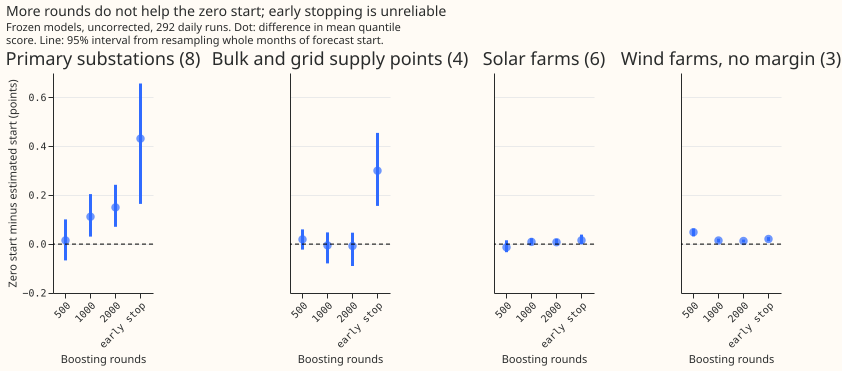
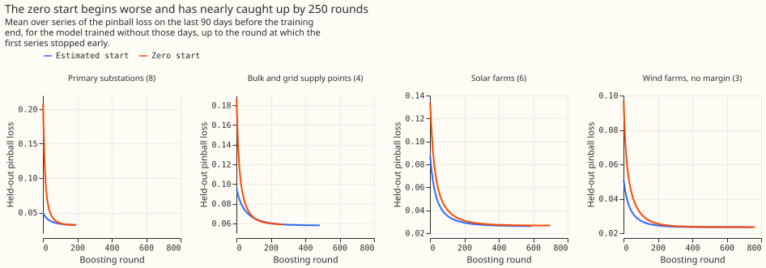

# Experiment 80: does a zero starting value lower the error of the production XGBoost models? (BM0)

**Take-home message: starting an XGBoost model from zero instead of from its own estimate does not
lower the error of the forecasts that serve, so the zero start is not worth porting.** The gain of
0.071 points that experiment 78 found for its reference model did not appear for Primary substation
demand, bulk and grid supply point demand, or solar farms, where every difference was under 0.04
points of capacity with an interval that includes zero. For wind XGBoost models without a
power-curve margin a zero start was worse by 0.049 points. Four times as many boosting rounds did
not help either start. The verdict is `inconclusive`, which here means that no gain could be shown.

XGBoost's quantile model begins from a starting prediction (the base score) that it estimates from
the training labels, one value for each of the nine quantile levels. We refitted XGBoost models for
four classes of series with a starting prediction of zero, and compared them with the stored
models of experiment 48, which use the estimated start, on the same 292 daily forecast runs from
July 2025 to June 2026. The classes are Primary substations (the 33 kV or 66 kV to 11 kV
transformers) and bulk and grid supply points (the larger sites above them), all retrained weekly,
plus solar farms and wind farms, retrained monthly. We also asked whether more boosting rounds
(500 are used now), or early stopping, make the estimated start catch up. The score is the
quantile score, an error measure in which lower is better, and 1 point is 1% of a series' capacity.

*Each dot is the difference in mean quantile score; negative means the zero start is better.*

*The zero-start gap does not close with more rounds; the early-stopping dots compare the two starts
at different stopping rounds.*

*The zero start begins far behind and approaches the estimated start by about 250 rounds.*

- **Arms:** the estimated start (experiment 48's stored predictions) against a zero start
  (`base_score` 0, the same XGBoost model as a zero base margin), refitted here with the same rows,
  weights, seed 0, and spread factor 1.15, and for C3 the 14-day correction. Arm scores below use
  every run of the arm; the differences use only the runs both arms share.
- **Row set:** `fold_a_daily_gap_v1`, 292 daily runs; intervals resample whole origin months.
- **C1, Primary substations, weekly refits:** 5.104 against 5.119 points; difference -0.017
  (98.75% interval -0.072 to +0.054). Per series the difference ranges from -0.107 to +0.151.
- **C2, bulk and grid supply points, weekly refits:** the 2 bulk supply series score 9.417 against
  9.409 and the 2 grid supply series 17.258 against 17.223; difference +0.006 (-0.091 to +0.092).
- **C3, Primary substations, frozen XGBoost model with the 14-day correction:** 5.302 against
  5.339; difference -0.033 (-0.084 to +0.031).
- **C4, solar farms, monthly refits:** 4.961 against 4.971; difference -0.010 (-0.036 to +0.028).
- **Wind (exploratory, 95%):** experiment 48's wind XGBoost model supplies a power-curve base
  margin, which makes XGBoost ignore its starting value, so a zero start changes nothing there. On
  wind XGBoost models without the margin the zero start scores 11.100 against 11.051 (+0.049,
  +0.032 to +0.065), and the model with the margin scores 10.989.
- **Held-out loss by round:** on the 90 days before the training end, the mean pinball loss at
  Primary substations is 0.122 for the zero start against 0.045 for the estimated start at round
  10, 0.0288 against 0.0283 at round 250, and 0.0246 against 0.0214 at round 500.
- **Rounds (exploratory, 95%):** at 8 Primary substations the zero-start gap is +0.015 (-0.067 to
  +0.101) at 500 rounds, +0.112 (+0.031 to +0.204) at 1,000, and +0.150 (+0.071 to +0.243) at 2,000.
  The gap is not detectable at 500 rounds and grows with more rounds, so the rule "removed by more
  rounds" is not met for any class. With the estimated start, 2,000 rounds scored 0.211 points
  worse than 500 (+0.100 to +0.352) at Primary substations.
- **Early stopping (exploratory):** on the last 90 days before the training end, the stopping
  round ranged from 90 to 1,292 at the demand series. Against its own matched 500-round prefix,
  early stopping with the estimated start gained -0.011 (-0.032 to +0.008) at Primary substations
  and -0.035 (-0.070 to -0.003) at solar farms. The comparison of the two starts at each start's own
  stopping round (+0.431 at Primary substations) mostly reflects different stopping rounds.
- **Noise floor:** GPU fits are not bit-reproducible. A repeat fit of the estimated-start frozen
  XGBoost model scored +0.004 (Primary substations) and -0.007 (grid supply points) points from
  experiment 48's stored predictions, above the planned tolerance of 0.001 and well below the
  intervals. In the weekly repeat fits, single quantiles moved by up to 0.06 of capacity.
- **Deviations, made before any result was read:** weekly zero-start refits cover every second
  weekly refit (26 of 52), because all 52 would have taken about 35 hours on the shared GPU. The
  differences therefore use half the runs (1.7 million of 3.2 million Primary-substation cases,
  417,000 of 785,000 supply-point cases). The rounds family covers every second Primary substation
  (8 of 16) and all 4 bulk and grid supply series, 6 solar farms, and 3 wind farms. The
  reproduction check covers 2 weekly refits, not 4, and the planned tolerance was exceeded.
- **Caveats:** one seed, so intervals reflect months only; with 4 bulk and grid supply series, 6
  solar farms, and 3 wind farms the intervals are wide; the early-stopping held-out block is not
  purged of runs that began before the cut.
- **Next:** at the Primary substations, the median best round on the held-out block is 373, so
  fewer than 500 rounds may be enough; the number of rounds, not the starting value, is the open
  question.
