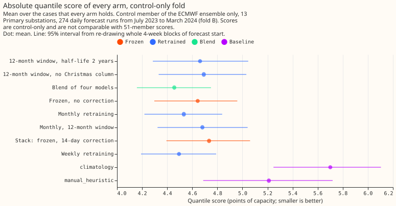
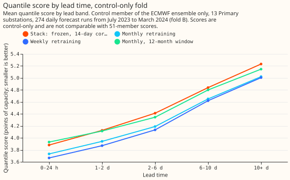

# Experiment 81: do the weekly-retraining findings hold on July-to-March forecast runs the project has not scored?

**Take-home: weekly retraining of the Primary demand model beat the stack again, on forecast runs
from a different period, by about as much as before (0.24 points of capacity), so the
case for porting it now rests on two periods instead of one.** The gain is concentrated: without
the three substations that carried experiment 48, it is 0.09 points (95% interval -0.19 to -0.01).
The Christmas column earns its place, and the five-model blend does not carry over as a
four-model blend. The verdict is **supported**.

We scored 13 Primary substations on 274 daily runs from 2023-07 to 2024-03, for which the project
holds only the control member of the ECMWF ensemble (ENS), so every number is a control-only number
and no absolute score is comparable with experiments 48 or 49. The error is the quantile score
in points of capacity (1 point is 1% of a substation's capacity); smaller is better. The stack is a
model fitted once, with a 14-day correction built from its recent errors.

- **Arms:** stack; weekly, monthly, and rolling-12-month refits (half-life 0.5 years, no
  correction); rolling without the Christmas column; rolling with a 2-year half-life; a blend of
  weekly, monthly, rolling, and stack. Baselines: `manual_heuristic`, `climatology`.
- **Rows:** fold B is `control_fold_b_daily_v1` (274 runs, 2023-07-01 to 2024-03-31, 9 km). Fold C
  is `control_fold_c_daily_v1` (273 runs, 2022-07-01 to 2023-03-31, 18 km, 15 months of history).
  Seed 0. Intervals use 4-week blocks of forecast start (10 blocks).
- **Absolute scores, fold B:** blend 4.457, weekly 4.494, monthly 4.533, rolling 4.681, stack
  4.734, `manual_heuristic` 5.211, `climatology` 5.700 (95% intervals about plus or minus 0.3).
  Fold C: weekly 4.020, monthly 4.054, rolling 4.073, stack 4.100, `manual_heuristic` 4.845,
  `climatology` 6.099.
- **C1, weekly minus the stack:** fold B -0.240 (99.17% -0.360 to -0.145; 95% month t-interval
  -0.359 to -0.121). Fold C -0.080 (-0.187 to +0.051). Without D8, D12, and D5, fold B -0.093
  (95% -0.189 to -0.014) and fold C -0.084 (-0.170 to +0.018). D8 alone gains 2.05 (95% -2.60 to
  -1.44).
- **C3, weekly minus monthly:** fold B -0.039 (-0.064 to -0.012; the month t-interval, -0.078 to
  -0.000, only just excludes zero). Fold C -0.035 (-0.085 to +0.014).
- **C2, monthly minus the stack (descriptive):** fold B -0.201 (-0.324 to -0.105); fold C -0.045
  (-0.162 to +0.082).
- **C4, rolling without the Christmas column minus with it:** fold B +0.011 (-0.115 to +0.188),
  fold C +0.041 (-0.054 to +0.252), unresolved. Inside 2023-12-18 to 2024-01-04 dropping the column
  raised the score by 1.20 points, against -0.07 outside the window; the winter before, +1.79
  against -0.08.
- **C5, half-life 2 years minus 0.5 years:** fold B -0.019 (-0.060 to +0.040), fold C +0.014
  (-0.027 to +0.058), unresolved.
- **C6, blend minus weekly:** -0.038 (-0.070 to -0.007), a small gain that misses the -0.05 threshold.
  The blend has four members; experiment 49's had five.
- **Correction and spread:** the 14-day correction made the frozen model worse here (+0.091, -0.005
  to +0.187). The 0.95 exceedance rate is 0.052 for weekly with the spread factor and 0.073 without
  it; re-choosing the factor on the first three months (1.10) changed later scores by +0.002.
- **9 km check (descriptive):** the frozen model beat `manual_heuristic` by 9.1% on runs before
  2023-06-27 (18 km) and by 6.3% after (9 km), April to September 2023. The weeks differ in
  season, so this is a hint that part of weekly retraining's fold B gain is adaptation to the 9 km
  product, not a measurement.
- **Caveats:** neither fold can separate retraining from adaptation to a weather product. Effective
  capacities come from the stage 1 pilot's table, built from all data, so they scale scores and
  inputs but were not fitted before each fold. The spread check chose its factor on cases whose
  targets reach 14.6 days into the first scored month. R-b pools two periods that score the same 13
  substations as if independent. The 13 substations exclude three that lack data (series 7, 13, 12).
- **More history or the full ensemble?** More history, not the full ensemble. The folds answer
  retraining and column questions, which depend on how much the weather-to-demand relation drifts,
  so a longer or more varied history would narrow C4 and test the 9 km confound. Ensemble spread and
  CRPS features would not change any conclusion tested here, because none of the six contrasts
  uses them.
- **Next:** a summer fold is the open test for the solar arms of experiments 64, 78, and 74; this
  experiment could not run them.
