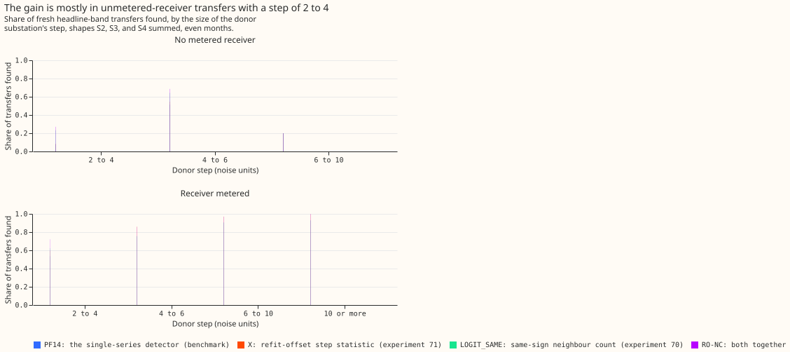

# Experiment 82: do two improvements to the load-transfer detector add up?

**Yes: the two improvements find different missed load transfers, so using both finds about twice as
much extra moved power as either alone.** A load transfer is a switching operation that moves part
of one Primary substation's demand (the donor's) onto neighbouring substations (the receivers) for
hours or days. A Primary substation steps 33 kV down to 11 kV. On injected transfers, the combined
detector (RO-NC) found a share of 0.770 of the megawatts (MW) moved, and the benchmark detector
(PF14) found 0.656. The misses that remain are mostly (by count) transfers with a small donor step
and no metered receiver, so the next experiment could test a stronger detection signal for those
transfers. The verdict is `supported`.

We asked whether two earlier improvements to a detector for load transfers combine. The detector
subtracts an XGBoost forecast, which uses no past power, from a substation's measured power, and
raises an alarm when the 24-hour average of that residual steps by 4.0 noise units or more. One
noise unit is the usual size of that step on odd-numbered months. The XGBoost model is refitted on
the 1st of every month, and PF14 ignores every alarm within 24 hours of a refit.
[Experiment 71](../00071-sw2-18-refit-offset-and-gap-bridging/result.md) removed that blind spot by
adding a second XGBoost model refitted on the 16th (the refit offset).
[Experiment 70](../00070-sw2-19-same-sign-neighbour-count/result.md) scored each alarm candidate
partly by the number of neighbouring substations stepping the same way as the donor (the same-sign
neighbour count).

We added synthetic transfers to the real power history of 16 Primary substations, combined the two
improvements, and counted the share of the moved MW that each detector found. Each detector was held
to 80 alarms on odd months that no closure in the switching log (the log of real switching
operations) explains. Odd months set the thresholds and fitted the scores. Recall was read on
transfers that start in even months.

## Results

- **Arms.** PF14: alarm when the 24-hour residual step reaches 4.0 noise units, end at the first
  opposite step of at least half the onset step. X: PF14 with the step taken from whichever of two
  residual models, refitted half a month apart, did not refit within 24 hours. LOGIT_SAME: PF14's
  candidates scored by a logistic regression that includes the same-sign neighbour count. RO-NC: the
  same logistic score fitted on X's candidates.
- **Row set.** 611 fresh headline-band transfers per injection shape (25% or more of the receiving
  load, over 1 day) starting in even months, shapes S2, S3, and S4 pooled (S2 a constant MW, S3 a
  share of the receiver's profile, S4 a mix fitted to the labelled real transfers); 214 long
  transfers (15.6 to 60 days). Fresh seeds, not those of experiments 69 to 71.
- **MW-weighted recall (98.33% interval, resampling whole calendar months):** PF14 0.656 (0.530 to
  0.727); X 0.713 (0.596 to 0.803); LOGIT_SAME 0.706 (0.591 to 0.776); RO-NC 0.770 (0.665 to 0.857).
  The sanity arms X and LOGIT_SAME reproduce their experiments' gains: +0.056 and +0.050 over PF14.
- **Planned contrasts:** C1 RO-NC minus PF14 +0.114 (+0.074 to +0.182); C2 RO-NC minus X +0.058
  (+0.034 to +0.096); C3 RO-NC minus LOGIT_SAME +0.064 (+0.028 to +0.127). All three lower ends are
  above zero, C1 is above the threshold of +0.02. The sum of the single gains (+0.106) is slightly
  below C1, so the gains add and do not overlap; C1, C2, and C3 all landed above the ranges
  predicted in the plan, which expected a combined gain smaller than the sum.
- **Share of the moved MW missed:** PF14 0.344, X 0.287, LOGIT_SAME 0.294, RO-NC 0.230. For RO-NC,
  0.195 is transfers with no alarm at the start and 0.035 is transfers with a wrong end.
- **Shapes:** RO-NC minus PF14 is +0.107 to +0.116 for S1, S2, S3, and S4, and +0.096 for S5; all
  lower ends are above zero.
- **By donor step, transfers found (S2 to S4 summed):** with a metered receiver and a step of 2 to 4
  noise units, RO-NC 109 of 151, PF14 81. With no metered receiver and a step of 2 to 4, RO-NC 149
  of 550, PF14 42. With no metered receiver and a step of 4 to 6, RO-NC 175 of 255, PF14 131.
- **Long transfers (descriptive):** RO-NC minus PF14 +0.000 (-0.026 to +0.026).
- **Labelled real transfers of more than 1 day (35):** found RO-NC 12, X 10, PF14 8, LOGIT_SAME 7;
  an alarm started within 2 hours of the labelled start for RO-NC 15, X 12, LOGIT_SAME 12, PF14 11.
  The 35 are too few to rank the arms; MW-weighted recall on them is RO-NC 0.357, X 0.350, PF14
  0.156, and LOGIT_SAME 0.144, so X alone nearly matches RO-NC there.
- **Alarms:** unexplained alarms on even months were PF14 80, X 80, LOGIT_SAME 61, RO-NC 67, against
  at most 80 on odd months for all arms (X 75, at its grid threshold of 4.1).

## Caveats

- The alarm ends use up to 14 days of hindsight, so the detector serves training-time masks and
  the NGED event table, not live forecast inputs.
- The logistic score is fitted on odd-month injections, so the odd-month contrast (+0.141) is
  in-sample and decides nothing.
- A check on experiment 71's draw (850 rows per arm) reproduced the `found` flags of PF14, X, and
  LOGIT_SAME exactly; there is no earlier reference for RO-NC.
- The 35 real transfers give a weak signal only (12 against 8 found).

## What the next experiment should answer

By count, 401 of the 725 transfers RO-NC misses have a donor step of 2 to 4 noise units and no
metered receiver (149 of 550 found). Options to test include a longer averaging window and a check
that the receivers' combined step balances the donor's.
