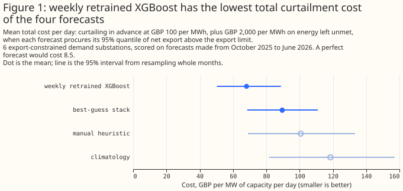

# Experiment 83: a curtailment-cost metric and tail calibration, on experiment 48

**A forecast that sits too low in the tail looks cheap until the energy it leaves unmet is charged,
so the metric charges both the energy curtailed in advance and the energy left unmet.** We built two
scoring tools for the studies code: a tail-calibration table and a simple curtailment-cost metric.
We ran both on the stored demand forecasts of experiment 48. The stack is the demand model fitted
once, with a correction from its own recent errors. The weekly retrained XGBoost model had the
lowest total cost, and the other three forecasts cost more. Every price and limit is an assumption.
NGED has supplied no real curtailment price and no real export limit, so the numbers rank forecasts
and are not a saving.

The intervals overlap, but the pairing cancels the shared month-to-month swing: the weekly model
minus the stack is -21.4 (95% interval -35.4 to -10.7), climatology minus the stack is +28.9 (+7.3
to +53.3), and the manual heuristic minus the stack is +11.1 (-8.2 to +30.9), over 9 months of
forecasts made from October 2025 to June 2026.

## What the metric does

- **Cost:** for each half-hour, curtail in advance the amount by which the forecast's quantile of
  net export exceeds the export limit, at GBP 100 per MWh. The quantile level, called tau, is 0.95
  here. The total cost adds a charge for the energy that needed curtailing but was not curtailed
  (the unmet energy), and is in GBP per MW of the series' capacity per day, averaged over the scored
  half-hours. Energy that was needed but not curtailed is charged at
  GBP 2,000 per MWh, which is `1 / (1 - 0.95)` times the first price. That ratio makes the score a
  proper scoring rule: the true quantile minimises it in expectation. Without the charge, a forecast
  biased low would win.
- **Limit:** the 99th percentile of each series' net export from July to September 2025. A series
  whose limit is not above zero never exports, so it is not export-constrained and is left out (14
  of 20 here). NGED's real limits
  often sit at the next substation up, or on circuits set by N-1 power-flow analysis, so this
  single-series limit is a crude stand-in. The sweep below lowers it to 0.75 and 0.5 times as a
  crude proxy for post-fault headroom.
- **Rows:** only forecasts 12 to 36 hours ahead, so each valid time counts about once.
- **Scope:** each series stands alone, with no netting across parallel Primaries. The code works on
  any series, so BSP and GSP series are scored like Primaries.
- **Code:** `studies.curtailment_cost` and `studies.tail_calibration`, called through
  `read_arms` and `align_arms` in a few lines (`e00083_report.py`).

## Results (exploratory, tau 0.95, 6 export-constrained series)

| Forecast | Total cost per day (95% interval) | Cost of curtailing in advance | Unmet share |
|---|---|---|---|
| weekly retrained XGBoost | 68.1 (50.3 to 88.8) | 18.3 | 0.291 |
| best-guess stack | 89.6 (68.5 to 110.9) | 28.5 | 0.357 |
| manual heuristic | 100.7 (69.0 to 133.3) | 42.9 | 0.338 |
| climatology | 118.5 (81.7 to 157.1) | 63.2 | 0.324 |
| perfect forecast | 8.5 | 8.5 | 0 |

- **By substation type:** the 6 series are 2 BSP, 2 GSP, and 2 Primary substations. The weekly model
  is cheapest in all three groups, but the groups differ by a factor of more than 100, so read the pooled
  figure as a ranking of six series only.
- **Rank stability:** the order weekly, stack, manual heuristic, climatology holds at every limit
  scale (1, 0.75, 0.5) and ratio of the price of unmet energy to the price of curtailed energy (10, 20)
  tried.
- **Equal risk is out of reach:** at tau 0.95 the unmet share on the calibration months is 0.67 to
  0.88, so a 5% target cannot be met and tau stops at 0.95 for every forecast.
- **Tail table (section D of the report, 20 series pooled):** coverage of the 0.05 quantile is 0.066
  to 0.085 and of the 0.95 quantile is 0.891 to 0.927, so every forecast is too narrow in both
  tails. Weekly retraining has the lowest pinball loss at both levels. The 0.01 and 0.99 rows read
  "not delivered", because the stored sets hold nine quantiles from 0.05 to 0.95.

## Caveats and next steps

- **Small sample:** 6 series and 9 months. The limit comes from 3 summer months and the scored
  months are October to June, so summer 2025 is not scored.
- **Not scored:** experiment 64's stored sets carry no `actual` column, so they were not scored here.
- **Next:** write the 0.01 and 0.99 quantiles in new experiments, add the tail coverage on rows where
  the forecast export is above the limit, and replace the calibration-window limit with a limit
  from each series' full history.

Reproduce with `uv run python ml-experiments/00083-*/e00083_report.py`. The printed report is in
`data/ml-experiments/00083-curtailment-cost-and-tail-calibration-worked-example/report.md`.
