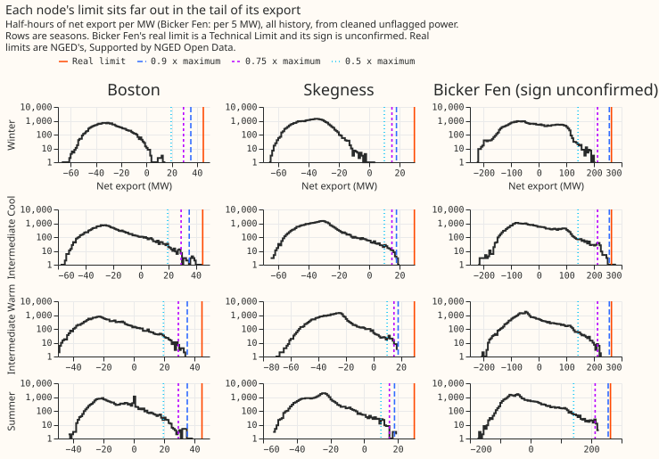
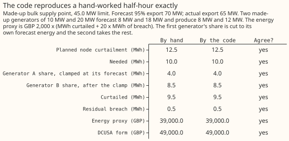
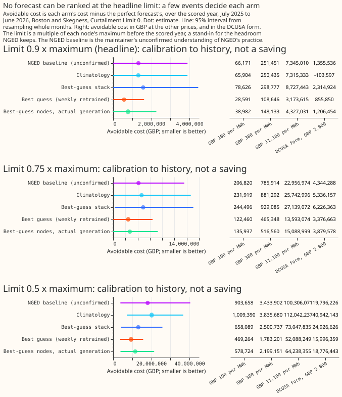

# Experiment 84: the substation-limit curtailment metric on the pilot, a worked example

**We asked what it would have cost if the electricity network operator had capped nearby generators
whenever a forecast said a substation would export more than its safe limit, and whether two
substations hold enough such half-hours to tell forecasts apart.** We scored the stored demand and
generator forecasts of experiment 48 for Boston and Skegness over the year to 30 June 2026. The
safe limit is NGED's published limit, and also a limit scaled from each substation's own history,
because the published limit is almost never reached. The answer is that two substations hold far too
few events to rank forecasts. At the published limit one half-hour in the year is over the limit,
and at 0.9 times the maximum there are 19. The next step is the January 2027 delivery of about 2,500
series, which the same code can score unchanged.

**Verdict: inconclusive (no registered contrast).** At the real limit every arm costs GBP 0, and
that figure demonstrates the arithmetic. At a scaled limit, the cost is a calibration to history, not
a saving, and it rests on events in one or two months, so at 0.9 times the maximum the month-resampled 95% interval of
every arm reaches GBP 0. Real limits are NGED's, Supported by NGED Open
Data. Questions for NGED are collected in [issue #1318 (Questions to ask NGED about
curtailment)](https://github.com/openclimatefix/nged-substation-forecast/issues/1318).

## The event census comes first

**The counts are too small to rank forecasts at any limit an operator would recognise.** Counts below
are half-hours of metered flow beyond the limit in the scored year, from cleaned unflagged power.

| Node | Real limit | 0.9 x maximum | 0.75 x maximum | 0.5 x maximum |
|---|---|---|---|---|
| Boston | 1 (45.0 MW) | 17 | 36 | 215 |
| Skegness | 0 (29.8 MW) | 2 | 10 | 108 |
| Bicker Fen (sign unconfirmed, not scored) | 0 | 0 | 84 | 734 |

- **Scored nodes:** Boston and Skegness together have 19 half-hours at 0.9 times the maximum, 46 at
  0.75, and 323 at 0.5. Only at 0.5, half the observed peak, are there hundreds, and no operator runs
  a substation at that limit.
- **The single real-limit event is not scored.** It falls on a half-hour in which one of the four
  forecast generators under Boston has no metered reading, so `node_curtailment` drops it.
- **Import:** the scaled import counts are in figure 1. No real import limit is used, and curtailing
  generators cannot relieve an import limit, so import is counted and not priced.
- **Signs:** Boston and Skegness are -1 (a positive reading is import), from our own data. Bicker Fen
  is +1 and unconfirmed. Walpole's sign is unknown, so the metric excludes it.

## Does the code reproduce a hand-worked answer?

**Yes: all eight quantities agree exactly.** The example is made up (a 45.0 MW limit and two
generators of 10 MW and 20 MW). It includes a generator share cut to the generator's own forecast
and a residual breach, and `e00084_known_answer.py` fails if the code and the hand answer disagree.

## Cost per arm

**Absolute and avoidable cost, GBP over the scored year at GBP 2,000 per MWh (energy proxy,
Curtailment Limit 0).** The perfect forecast's own cost is its absolute cost: at 0.9 times the
maximum it is GBP 25,058, because the generators cannot always cover the excess.

| Arm | Real limit | 0.9 x maximum | 0.75 x maximum | 0.5 x maximum |
|---|---|---|---|---|
| Perfect forecast (absolute) | 0 | 25,058 | 117,386 | 964,812 |
| Best guess (weekly retrained) | 0 | 399,124 | 1,718,924 | 8,528,793 |
| Best-guess stack | 0 | 559,040 | 2,511,947 | 10,664,275 |
| Climatology | 0 | 353,280 | 2,264,254 | 17,796,363 |
| NGED baseline (unconfirmed) | 0 | 357,665 | 1,969,239 | 12,956,194 |
| Best-guess nodes, actual generation | 0 | 366,785 | 1,769,207 | 9,990,713 |

Rows after the first are avoidable cost: the arm's cost minus the perfect forecast's.

- **0.9 times the maximum:** no contrast has an interval that excludes zero. For example, the best
  guess minus the NGED baseline is +GBP 41,459 (95% interval 0 to 130,590).
- **0.75 times the maximum:** the stack costs GBP 793,023 more than the best guess (interval 86,689
  to 2,028,806). Other contrasts have intervals that include 0.
- **0.5 times the maximum:** the best guess costs GBP 9,267,569 less than climatology (interval
  -19,005,228 to -2,869,380), and GBP 4,427,400 less than the NGED baseline (interval -14,079,771 to
  +2,226,513). This is a rehearsal at a limit nobody operates at.
- **DCUSA form and other prices:** the energy proxy scales with price, so the other prices rank
  the arms as GBP 2,000 does. The DCUSA form charges each instructed generator its whole headroom
  and can rank arms differently (figure 4, right).
- **The cost is dominated by uncovered excess:** at 0.9, most of each arm's cost is 8.07 MWh of
  Boston excess in the Intermediate Cool season (March, April, and November). The generators relieve
  little or none of it, and the remainder is priced at 20 times the price.

## What to watch

- **Rows lost to a missing generator reading:** `node_curtailment` drops a node row when any
  curtailable generator under the node has no finite forecast or metered output, which removed
  8,638 rows, 31% of the rows that held a node forecast. The 19,298 rows scored are node and
  forecast-run rows in the 12 to 36 hour lead window.
- **Forecast capped at capacity:** the perfect forecast of a generator whose metered output exceeds
  its effective capacity is capped at the capacity, as `node_curtailment` requires. All arms are
  capped alike, and metered output above capacity stays in the score.
- **The NGED baseline is unconfirmed.** It is the maintainer's understanding that NGED forecasts
  substation flow only with the manual heuristic, so each generator is assumed to run at full
  capacity. NGED has not confirmed it.
- **Real limits:** Boston and Skegness use the smaller of the two transformers' published limits.
  Boston's all-history maximum export, 45.08 MW, sits on the 45.0 MW limit, so 45.0 MW may be an
  operating ceiling or a clipped meter.
- **Anonymisation:** no generator appears singly. Every generator figure is a sum over at least 4
  generators, in GBP or MWh, and the table joining generators to substations stays in the private
  data folder.

## What the next experiment should answer

**Whether a ranking appears once the January 2027 delivery gives about 2,500 series.** The same
function scores any number of nodes from longer tables, so the next experiment needs those tables
and an agreed rule for a half-hour in which one generator has no reading.

Reproduce with `uv run python ml-experiments/00084-*/e00084_report.py`, then `e00084_known_answer.py`
and `e00084_charts.py`. The printed report is in
`data/ml-experiments/00084-substation-limit-curtailment-cost-worked-example/report.md`.
