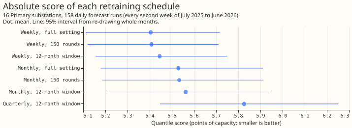

# Experiment 85: do cheaper retraining schedules rank arms the way weekly retraining does? (SPD1)

**Refitting the demand model monthly on the latest 12 months of data (150 boosting rounds), or
weekly on the whole history with 150 rounds at a higher learning rate, gives the same gap between
monthly and weekly retraining as full weekly retraining does, at 0.03 to 0.31 of its fit time.**
Refitting only quarterly scores much worse. The contrast between starting a model from zero and
from XGBoost's estimated value is too small on these rows to rank any schedule.

We asked whether research experiments can use a cheaper retraining schedule instead of weekly
retraining. For the 16 Primary substations we refitted the XGBoost demand model (N1: one model per
substation, trained on the ECMWF ensemble control forecast) under seven cheaper schedules. We then
compared the gaps in the quantile score between arms under each schedule with the gaps stored
weekly retraining gives, on 158 daily forecast runs from July 2025 to June 2026. The quantile
score is the mean pinball loss over nine quantile levels, in percentage points of the substation's
capacity (lower is better). The verdict is partly supported: by the rule fixed in advance every
schedule passes, but the pass on the starting-value contrast is empty, so only the cadence
contrast supports the claim. The page covers these two contrasts for the Primary N1 model only. It
leaves out the `am`-against-`d0` contrast of experiment 64 and the five-model blend of experiment
49, because experiment 64 has no weekly reference and the blend mixes schedules.

## Results

- **Terms:** the cadence gap is the monthly arm's score minus the weekly arm's. The starting-value
  gap is the score of a model whose boosting starts from zero minus that of a model that starts
  from XGBoost's estimate from the training labels. A 12-month window means each refit trains on
  the latest 12 months only (150 rounds, learning rate 0.15). The full setting trains on the whole
  history (500 rounds, learning rate 0.05).
- **Rows:** 16 Primary substations, 158 runs, N1 model with the spread factor 1.15 (a fixed widening
  of the quantiles) and no 14-day correction. Every weekly arm refits at the 28 weekly dates that
  experiment 80's stored zero-start arm holds, and every contrast keeps the runs those refits
  serve.
- **Noise floor:** 0.01 points. A repeat of the 12-month-window monthly fit scored 5.563 against
  5.563, and its zero-start repeat 5.547 against 5.546. The tolerance is 0.05.
- **Cadence gap:** the full-setting reference is +0.125 (95% interval +0.036 to +0.229). The
  12-month window gives +0.118 and the 150-round whole-history recipe +0.125, so both agree with
  the reference. Quarterly minus weekly refits on the 12-month window, descriptive because no
  full-quarterly reference exists, is +0.381 (+0.207 to +0.565).
- **Starting-value gap:** the reference is -0.017 (-0.062 to +0.037), smaller than the -0.07 the
  plan predicted. Every schedule gives between -0.003 and -0.020, so each agrees under the rule for
  an unresolved reference (an estimate within 0.05 of zero). Any estimate within 0.05 of zero
  passes, so the agreement is weak evidence.
- **Pass table:** monthly 12-month window 2 of 2 contrasts, weekly 150 rounds 2 of 2, weekly
  12-month window 1 of 1, quarterly 1 of 1, full monthly 1 of 1 (the last three on starting value
  only). The plan's other predictions: quarterly scored 0.263 above monthly (predicted 0.10 to
  0.20), and the monthly gap was within 0.01 of the reference (predicted within 0.05).

| Arm | Score | 95% interval | Coverage of q05 to q95 | Pinball at q05 | Pinball at q95 |
|---|---|---|---|---|---|
| Weekly, full setting | 5.405 | 5.111 to 5.716 | 0.889 | 0.910 | 1.236 |
| Weekly, 150 rounds | 5.408 | 5.119 to 5.711 | 0.897 | 0.908 | 1.233 |
| Weekly, 12-month window | 5.445 | 5.157 to 5.749 | 0.889 | 0.912 | 1.245 |
| Monthly, full setting | 5.530 | 5.179 to 5.912 | 0.888 | 0.907 | 1.294 |
| Monthly, 150 rounds | 5.533 | 5.185 to 5.913 | 0.896 | 0.911 | 1.288 |
| Monthly, 12-month window | 5.563 | 5.219 to 5.939 | 0.889 | 0.920 | 1.288 |
| Quarterly, 12-month window | 5.826 | 5.446 to 6.252 | 0.883 | 0.946 | 1.372 |

## Cost

- **Fit time of one refit (one series, 2 threads):** 114 s at the full setting, 33 to 36 s for the
  150-round whole-history recipe, and 13 to 51 s for the 12-month window. Other jobs shared the
  machine, so the same recipe varied by up to 4 times.
- **A year for 16 series:** full weekly about 1,590 compute minutes (the full monthly fit time
  times 52, not measured separately), full monthly 366, weekly 150 rounds 460 to 500, monthly
  12-month window 42 to 164, quarterly 54.
- **Against the one-third rule:** monthly 12-month window (0.03 to 0.10 of full weekly) and weekly
  150 rounds (0.29 to 0.31) pass. Weekly on the 12-month window (0.31 to 0.35) is borderline.

## Caveats

- **Departure from the written rule:** by the pre-registered rule every schedule passes, and
  quarterly (0.034 of full weekly's cost) would become the default for the starting-value
  contrast. The page declines that, because the rule is vacuous for a gap of 0.017 and the
  descriptive quarterly gap of 0.38 is large.
- **Starting value is untested:** the stored weekly zero-start arm covers half of the weeks, and
  the gap on those runs is within the noise. A later experiment should test schedules on a contrast
  of 0.1 points or more that has a stored weekly reference.
- **One series class, one seed:** Primary N1 demand only. Tail scores stop at q05 and q95, because
  the stored quantile models have nine levels from 0.05 to 0.95.
- **Cost is noisy:** the plan priced a schedule by the mean fit time of its recipe. Identical
  recipes ran 4 times apart because of other jobs, so the page gives a range, and the cost is an
  order of magnitude.

## Recommended R&D defaults

- **Feature and recipe contrasts of 0.05 points or more:** use monthly refits on a 12-month window
  with 150 rounds and learning rate 0.15. The schedule reproduced the cadence gap to within 0.01
  and repeated to within 0.001. A weekly year costs about 1,590 compute minutes and this schedule
  saves 1,420 to 1,545 of them (90 to 97%). Only the cadence contrast was tested, so a feature
  contrast is assumed to carry over.
- **Contrasts about cadence, retraining rules, or how fast a model adapts:** use the weekly refit
  on the whole history with 150 rounds and learning rate 0.15. The schedule scored within 0.003 of
  full weekly and saves about 1,090 minutes (69%). Experiment 34 found a weekly-analogue gain of
  0.05 shrank to 0.01 under monthly retraining, so a conclusion about recent-data features, the
  14-day correction, the training window, or the half-life can change with the schedule. Check
  such a conclusion on the weekly 150-round refit.
- **Absolute scores and tail scores:** quote them from weekly retraining at the full setting.
  Monthly refits on a 12-month window score 0.16 points above that (5.563 against 5.405) and 0.05
  above at the q95 pinball loss, so a model reads worse under any cheaper schedule than under
  weekly retraining.
- **Quarterly refits:** do not use them. Quarterly refits score 0.26 above monthly refits, and the
  experiment cannot show that quarterly refits rank any contrast correctly.
- **Contrasts under 0.05 points:** the experiment cannot say which schedule keeps such contrasts,
  because the only one tested, the zero-start gap, was -0.017.
