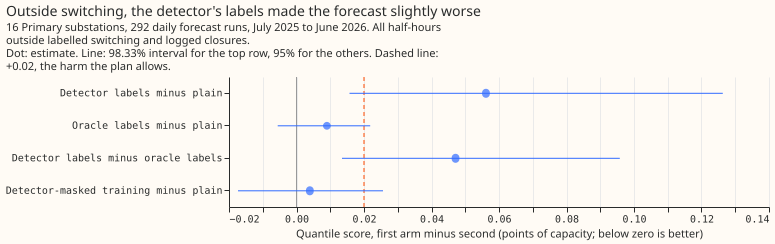
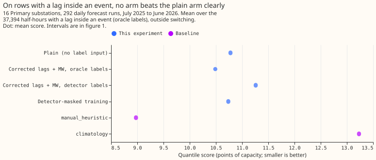
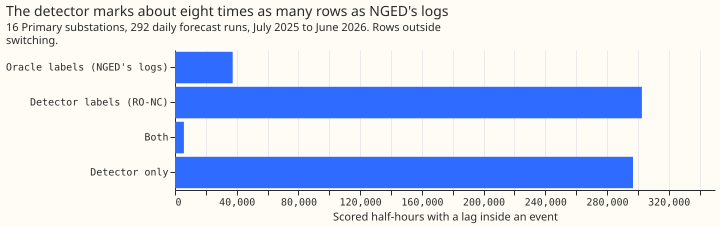

# Experiment 86: do the detector's switching labels give the same gain as NGED's logs?

**Take-home message: correcting each past power reading (a lag) for switching did not lower the
error of the XGBoost demand forecast for Primary substations with either source of labels, and the
detector's labels raised the error slightly on all rows outside switching.** Here "oracle labels"
are the switching events in NGED's logs, and "detector labels" are the events found by a detector
that reads no log. On the half-hours whose lag falls inside a logged event, the oracle labels
changed the quantile score by -0.29 points of capacity (98.33% interval -2.06 to +0.68), and the
detector labels by +0.48 (-0.06 to +1.72). On all half-hours outside switching, the detector labels
changed the score by +0.056 (+0.016 to +0.126). The detector marks 8.1 times as many half-hours as
the logs and marks only 15% of the half-hours the logs mark. These data cannot show whether the
detector or the logs is wrong where they disagree. Eight months of in-event half-hours are too few
to show a gain even for the logs. One option for a next experiment is to inject switching events of
known size and test whether the corrected-lag forecast recovers the true normal running arrangement.
The verdict is **inconclusive**.

An electricity network operator sometimes closes a normally open switch, so that one Primary
substation (a substation that steps down to the local distribution network) carries load that
belongs to a neighbour. A forecast of the normal running arrangement (NRA) matters most for two
cases: half-hours whose lags were measured during such a switch, and forecasts made while a
substation is in an abnormal arrangement. We asked whether subtracting the moved MW from each lag,
and giving the moved MW to XGBoost as three more columns, lowers the error. We tried it with the
events in NGED's switching logs (oracle labels) and with the events found by the XL load-transfer
detector of [experiment 82](../00082-sw2-18-19-combined-refit-offset-and-same-sign-count/result.md).
The detector reads no log.

We refitted the XGBoost demand model monthly on a rolling 12-month window ([experiment
49](../00049-vp1-screening-reference-under-p-roll-demand/result.md)'s cheap schedule) for 16 Primary
substations, and scored 292 daily forecast runs from July 2025 to June 2026. The score is the
quantile score in points of capacity, where smaller is better.

- **Arms** (experiment 75's inputs, seed 0). `plain`: all rows, no label input. `lagmw_oracle`: lags
  minus the signed MW plus three MW columns, oracle labels, trained on all rows. `lagmw_xl`: the
  same inputs with the detector's (XL) labels. `mask_xl`: training rows inside an XL event dropped
  (descriptive).
- **Rows.** 3,199,243 cases, of which 2,928,842 lie outside switching (oracle events and logged
  closures). The headline rows are the 37,394 of those (1.3% of the 2,928,842, in 8 months) with a
  lag inside an oracle event.
- **Score on the headline rows** (`plain` / oracle / XL / `mask_xl`): 10.778 / 10.488 / 11.260 /
  10.736. `manual_heuristic` scores 8.975 and `climatology` 13.231 on the same rows.
- **Score on all rows outside switching:** 5.408 / 5.417 / 5.464 / 5.412. `manual_heuristic` 6.121
  and `climatology` 7.479 (on slightly fewer rows).
- **Contrasts (98.33% intervals).** C1 +0.48 (-0.06 to +1.72). C2 -0.29 (-2.06 to +0.68). C3, the
  skill lost without NGED's logs, +0.77 (+0.13 to +2.34). The share of the oracle gain recovered is
  not defined, because C2 is not a gain. N1, C1 on all rows outside switching, +0.056 (+0.016 to
  +0.126): its upper end exceeds the +0.02 margin.
- **Descriptive contrasts (95%).** `lagmw_xl` minus `plain` on the 296,878 rows with a lag inside an
  XL event only: +0.47 (+0.24 to +0.84), which is the harm from detector labels the logs do not
  confirm. `lagmw_oracle` minus `plain` on all rows outside switching: +0.009 (-0.006 to +0.022).
  `mask_xl` minus `plain` outside switching: +0.004 (-0.017 to +0.026); on the headline rows -0.042
  (-0.084 to -0.008).
- **Tails** (coverage of the 5%-to-95% band, nominally 90%; pinball loss at 0.05 and 0.95, in
  points). Outside switching, `plain` 0.893, 0.914, 1.162; oracle 0.892, 0.913, 1.161; XL 0.885,
  0.929, 1.181. On the headline rows, `plain` 0.784, 1.506, 3.386; oracle 0.750, 1.498, 3.385; XL
  0.721, 1.808, 3.424. The 0.01 and 0.99 quantiles are not stored (nine levels).
- **Label coverage.** Rows outside switching with a lag inside an event: 37,394 by the logs, 302,619
  by the detector, 5,741 by both. The detector may be marking real transfers that NGED did not log,
  which these data cannot tell apart from false alarms.
- **Caveats.** Both label sources use hindsight: an event's end is known up to 14 days later. C3
  therefore compares like with like, but the absolute gain is not what a live service would get. The
  headline rows are few and fall in 8 months, so the intervals are wide. There is one seed. The
  detector's signed MW is the substation's own 24-hour residual step, not a logged MW. Where both
  sources label a half-hour, the correlation is weak (0.19 at the only substation where it could be
  computed).
- **Models kept.** All 768 boosters (4 arms, 12 monthly refits, 16 substations) are saved under
  `data/ml-experiments/00086-sw2-12-detector-labels-for-nra-forecast/work/boosters/<arm>/` for the
  follow-up that injects switching events.
- **What the next experiment should answer.** Whether the corrected-lag forecast recovers the true
  normal running arrangement when switching events of known size are injected into the lags, so that
  the in-event rows are numerous enough to measure.
