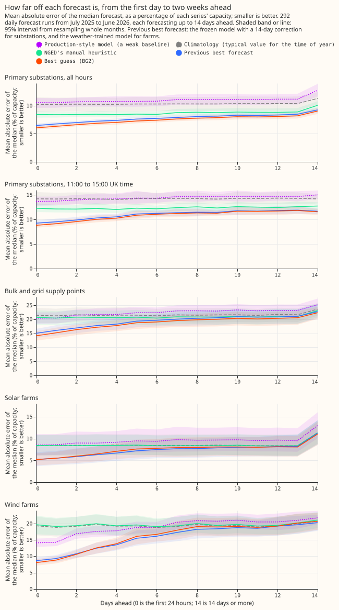
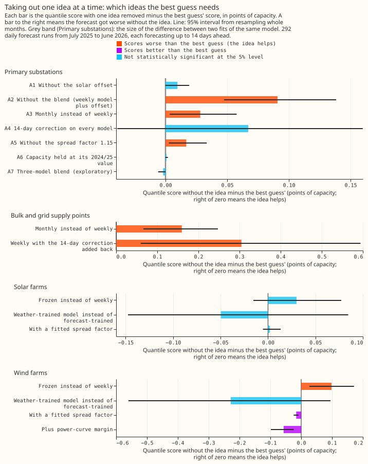
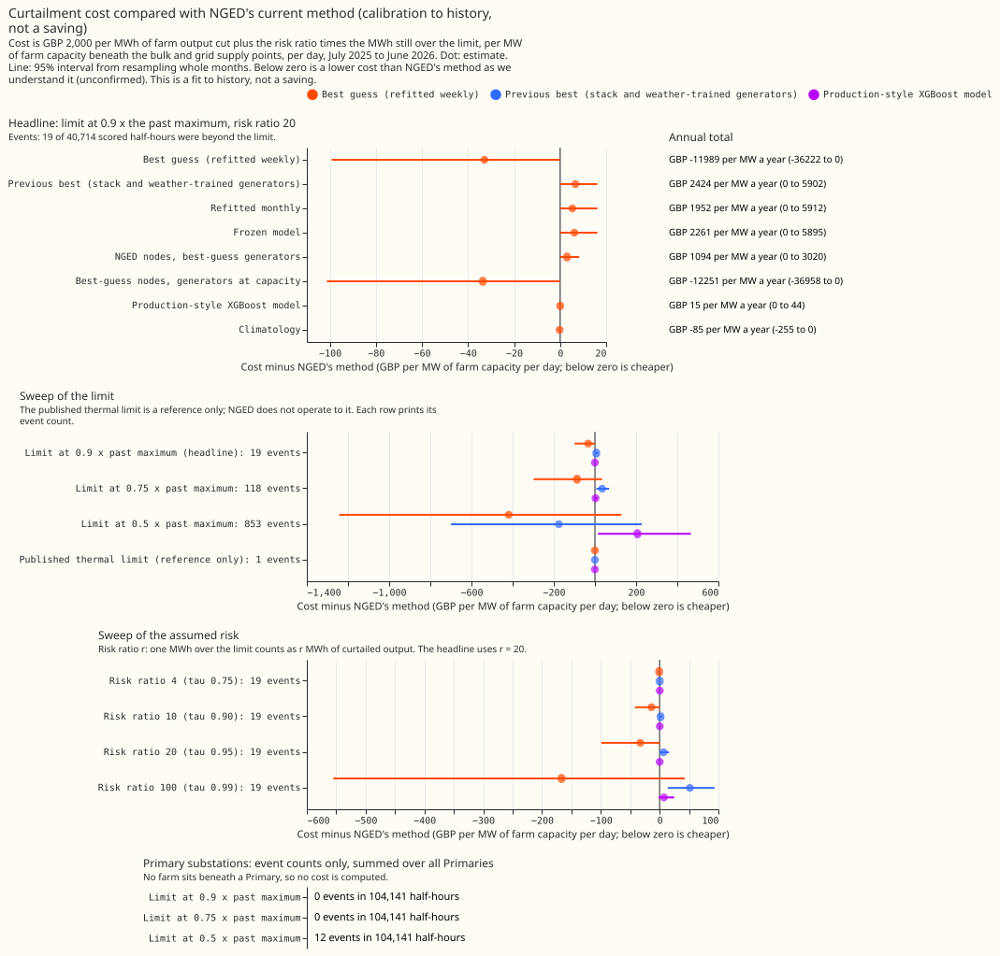

# Experiment 87: BG2, the best guess so far and what each part contributes

**Take-home message: weekly refitting and a blend of five models make the Primary-substation and
supply-point forecasts clearly better than the previous best, while the farm forecasts are still too
close to call.** The previous best was a model trained once, with a 14-day correction. At the 16
Primary substations the best guess (BG2) scores 5.26 points of capacity against 5.54, and at the 4
bulk and grid supply points 12.93 against 13.56. One point is 1% of a series' capacity, and a lower
score is better. The solar offset, which was the headline of earlier experiments, adds only 0.01
points over the whole year. For the solar and wind farms, training on the ensemble forecast's own
history scored slightly worse than the ERA5-trained mixture, and nine farms cannot show whether the
loss is smaller than 0.10 (solar) or 0.30 (wind) points. The verdict is `partly supported`.

We asked whether the best ideas of the last experiments still work when combined in one forecast,
and which idea each part of the gain comes from. We refitted every model on the schedule the idea
needs, forecast 292 daily runs from July 2025 to June 2026, and scored each target class (Primary
substations, bulk and grid supply points, solar farms, wind farms) against its previous best forecast
and against NGED's `manual_heuristic`. Each drop-one ablation removes one idea from the
best guess. The solar farms and wind farms are anonymised in every figure.

The other figures are in this folder: the stages and ablations as lines (`figure_2_*`), error by lead
band, hour, month, season and sunshine (`figure_5_*`), error by series (`figure_6_by_series`), tail
calibration (`figure_7*`), and the side panels of experiments 81 and 54 (`figure_9_side_panels`).

## Results

- **Primary (16 substations):** BG2 5.260 (95% interval 4.987 to 5.534). Verdict contrast against the
  stack: -0.283 (98.75% interval -0.425 to -0.146), supported. Against `manual_heuristic`: -0.920
  (-1.078 to -0.767).
- **Supply points (4):** BG2 12.925 (11.569 to 14.177). Verdict contrast against the frozen model with
  the correction: -0.634 (-1.111 to -0.279), supported.
- **Solar farms (6):** BG2 5.012 against 4.962 for the ERA5-trained mixture, contrast +0.050 (-0.125
  to +0.168). Non-inferiority within 0.10 is not shown.
- **Wind farms (3):** BG2 11.032 against 10.804, contrast +0.228 (-0.178 to +0.653). Non-inferiority
  within 0.30 is not shown. The power-curve margin scores 10.975 (an add-one arm).
- **Largest ablation per class:** Primary, no blend, +0.091 (0.048 to 0.138). Supply points,
  correction added back, +0.305 (0.060 to 0.594). Solar, weekly to frozen, +0.030 (-0.015 to +0.077).
  Wind, weekly to frozen, +0.098 (0.027 to 0.171).
- **Staircase, Primary:** frozen 6.927; stack -1.384; monthly -0.065; weekly -0.123; blend -0.086;
  offset -0.010 (-0.019 to 0.000).
- **Noise floor:** a repeat fit of the monthly model at 4 Primaries moved the score by -0.001 (-0.003
  to +0.001).
- **Check on the 73 runs of `fold_a_every5d_v1`:** BG2 minus the stack is -0.285 (-0.402 to -0.171),
  the same as on the 292 runs.

| Tail check, BG2 | Quantile | Primary | Supply points | Solar | Wind |
|---|---|---|---|---|---|
| Share of actuals below the quantile | 0.01 | 0.007 | 0.004 | 0.007 | 0.003 |
| | 0.05 | 0.042 | 0.039 | 0.028 | 0.038 |
| | 0.95 | 0.937 | 0.944 | 0.973 | 0.951 |
| | 0.99 | 0.986 | 0.995 | 0.997 | 0.987 |

- **Curtailment (calibration to history, not a saving):** with the limit at 0.9 times the past
  maximum export, 19 of 40,714 scored half-hours at the 3 scored supply points were beyond the limit,
  so the count is too small to rank forecasts. BG2 minus NGED's method (the maintainer's unconfirmed
  understanding of it) is -32.85 GBP per MW per day (-99.24 to +0.00), not statistically significant
  at the 5% level. At 0.75 there are 118 events, -87.03 (-298.28 to +34.62); at 0.5 there are 853,
  -418.99 (-1242.54 to +129.46). The published thermal limit holds 1 event and is a reference only.

## Deviations, caveats, and next steps

- **Schedule:** full production recipe (500 rounds, learning rate 0.05, half-life 0.5 years), weekly
  refits for the best guess. The generator models refit monthly, not weekly, because the 16 GPU-hour
  budget (raised to 20) did not hold 52 weekly refits of each of the 9 farm models. The monthly refit is what the generator
  rows show. The noise-floor repeat also used the monthly schedule. GPU use was 14.4 hours of wall
  time.
- **Offset:** weights come from experiment 64's fit before the validation year (the design says to
  refit them), the capacity per run comes from experiment 78's vintages, and offset models start
  from the median of the training labels plus the offset. Ablation A6 holds the capacity at its
  pre-validation value.
- **Pooled member:** it refits monthly on the full history with 500 rounds, not under P-roll.
- **References:** `climatology` and `manual_heuristic` are recomputed at 11 levels. The
  production-style row is the stored `xgboost_baseline` from the local `data/power_forecasts` table;
  its band is far too narrow, so its tails are noise.
- **Ablation A3** replaces the weekly member with the monthly one, so the blend holds a duplicate.
  **Ablation A7** (three members) scores 0.002 below BG2, so two members are not needed; it is
  exploratory and not in the best guess.
- **Selection bias:** the spread factor 1.15, the blend scheme, the offset gate, and the half-life
  were chosen or scored on this validation year.
- **Not run:** corrected lags, analogues on top of the offset, pooling by type on cleaned targets,
  and any UKV, ICON-EU or IFS blend. The side panels of figure 9 repeat numbers from experiments 81
  and 54 and are labelled control-only and "ceiling, not available live".
- **Next:** a tail-specific spread factor, since the upper-tail coverage at 0.95 is 0.937; weekly
  refits at the farms with more farms or a second year; and a second validation year for the offset.
