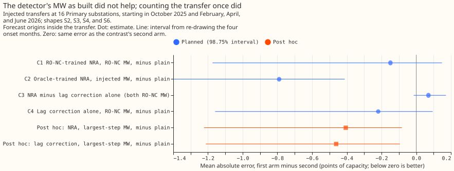
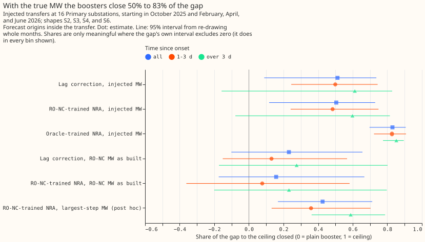
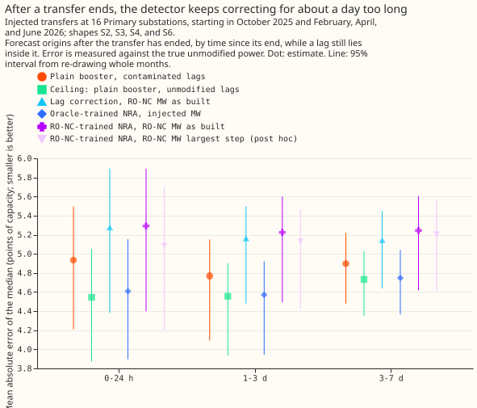

# Experiment 88: does the full NRA forecast recover the normal arrangement during a switch?

**Take-home message: a demand forecast that corrects its inputs for a switching transfer recovers
the power the substation would have drawn only when the megawatts (MW) moved are known, and the
detector we have does not yet supply them well enough.** A switching transfer is load that the
network operator NGED moves from one Primary substation to its neighbours for hours or days. The
normal running arrangement (NRA) is the network as it is when no transfer is on. With the true MW,
correcting the earlier half-hours of power that the forecast reads (the lags) closed about half of
the extra error that a transfer causes, and an XGBoost model trained on NGED's logged transfers
closed 83%. With the MW from the refit-offset neighbour-count detector (RO-NC), run only on data
from before the forecast, the gain was 16% and could not be told from zero. The detector's MW was
about 1.5 times the true MW from the second day after a transfer began, because the detector reports
overlapping time intervals for one transfer and their MW is added together. The detector also kept
reporting MW for days after a transfer had ended. Counting overlapping intervals once, a choice made
after seeing the results, closed 43% during a transfer but still raised the error after it ended.
Dropping the transfer's half-hours from the training data added nothing. The verdict is
**inconclusive**.

**The headline numbers cover only forecast origins inside an injected transfer, 13% of the
year's forecast origins.** The forecasts are issued at 09:00 UTC each day from 2025-07-02 to
2026-06-30 (292 daily runs) for 16 Primary substations, which is 4,672 pairs of a substation and a
forecast origin. We injected known transfers into the recorded power of those substations,
under five shapes (ways of spreading the moved MW over time, listed in the method bullet below).
A case is one transfer under one shape at one substation and one origin. The 613 cases per shape
that fall inside a transfer come from 172 transfers and 233 distinct substation-origin pairs
(5% of the 4,672), and give 292,575 forecast half-hours, 13% of the year's roughly 2.24 million
half-hours at leads up to 10 days. The four pooled shapes give 2,452 cases. The transfers start
in four of the even-numbered months (October 2025, February, April, and June 2026), and those four
months are the blocks that the intervals resample. August and December hold no 15-day window with
no logged closure or detector alarm on a substation, so they are not scored. Every forecast is
scored against the true, unmodified power, never against the metered power, which is abnormal
while a real switch is on.

We asked whether the NRA booster of experiments 75 and 86 forecasts the power a substation would
have drawn had the switch not happened, while the switch is on (family A) or after it has ended
(family B). Five arms were scored. Arm 1 is the plain booster on the contaminated lags. Arm 2
corrects the lags with the MW. Arm 3 is the NRA booster trained on NGED's logged transfers, and
arm 4 the NRA booster trained on RO-NC transfers, both with corrected lags and the MW as columns,
and with the transfers' half-hours removed from the training targets. Arm 5, the ceiling, is the
plain booster on lags the transfer never touched. Arms 2 to 4 were run with the MW from the
injection and with the MW from RO-NC. The gap is arm 1 minus arm 5, and a share of the gap closed
is the fall in error from arm 1 divided by that gap.

- **Method: injected transfers.** We injected 839 transfers over 10 months, using experiment
  82's sampler, which places each transfer where no logged closure or detector alarm lies within 7
  days. Each transfer is injected under five shapes. S1 takes a share of the donor substation's
  own daily profile, S2 moves a constant MW, S3 takes a share of each receiver's profile, S4 mixes
  constant and profile (the mix fitted to the labelled real transfers), and S6 uses the donor's
  profile reversed in time. The headline pools S2, S3, S4, and S6, the shapes that do not match how
  the sampler builds S1. Shape S5 of experiment 82 (the profile shifted by 12 hours) is not scored.
- **Method: boosters and scoring.** Arms 1, 2, and 5 are experiment 86's `plain` and `lagmw_xl`
  boosters. Arms 3 and 4 are two new boosters, `nra_oracle` and `nra_xl`. (The `xl` in `lagmw_xl`
  and `nra_xl` names the RO-NC detector's labels.) All are refitted monthly
  on a rolling 365-day window (150 rounds, eta 0.15, seed 0), because the contrasts are about lags
  and not retraining cadence. Each forecast uses 11 of the 51 ensemble members and leads to 10
  days. The error is the mean absolute error of the median forecast, in percentage points of the
  substation's capacity, weighted by the transfer's mean MW.
- **Absolute error in family A (points of capacity, 95% interval).** Plain 5.409 (4.785 to
  6.049). Ceiling 4.455 (3.913 to 4.976). Lag correction, injected MW 4.923; RO-NC MW 5.190.
  Oracle-trained NRA, injected MW 4.619; RO-NC MW 5.069. RO-NC-trained NRA, injected MW 4.929;
  RO-NC MW as built 5.261; largest-step MW (post hoc) 5.003. The plain-to-ceiling gap is 0.95
  (0.70 to 1.44) points, and it persists at every lead: plain minus ceiling is 0.74, 0.78, 1.05,
  and 0.96 at leads of 0 to 24 h, 1 to 2 d, 2 to 6 d, and 6 to 10 d.
- **Planned contrasts (98.75%, which is 95% adjusted for four contrasts; shapes pooled).** C1 is arm
  4 with RO-NC MW minus arm 1, C2 is arm 3 with injected MW minus arm 1, C3 is arm 4 minus arm 2
  (both with RO-NC MW), and C4 is arm 2 with RO-NC MW minus arm 1. C1 -0.149 (-1.174 to +0.148), 2
  of 4 months
  negative. C2 -0.790 (-1.397 to -0.412), 4 of 4. C3 +0.070 (-0.015 to +0.171). C4 -0.219
  (-1.159 to +0.095). Per shape (95%), C1 is -0.06 to -0.25 with every interval containing zero,
  and C2 is -0.69 to -0.84 with none containing zero.
- **Share of the gap closed (95%).** Injected MW: lag correction 51% (9% to 74%), RO-NC-trained
  NRA 50% (12% to 73%), oracle-trained NRA 83% (70% to 91%). RO-NC MW as built: lag correction
  23% (-10% to 66%), RO-NC-trained NRA 16% (-17% to 67%), and oracle-trained NRA 36% (-2% to 74%).
  Largest-step MW (post hoc): lag correction 48%
  (18% to 71%), NRA 43% (17% to 71%). By time since onset the gap is 0.42, 0.93, and 1.95 points
  (0 to 24 h, 1 to 3 d, over 3 d), and RO-NC-trained NRA with the as-built MW closes 17%, 8%, and
  23%, none separable from zero.
- **What the detector reports.** At the newest lag the forecast may use (3.5 hours before the
  origin), it had marked 32%, 73%, and 70% of the
  moved MW (by time since onset), with the right sign in all but 2% of cases. The median ratio of
  its MW to the injected median was 0.80, 1.43, and 1.50. Split after the fact by the ratio of the
  detector's MW to the injected MW, the
  as-built RO-NC-trained NRA booster changed the error against plain by -0.55 points where the
  detector's MW was at most 1.5 times the true MW (583 of 2,452 cases), +0.27 where it was more
  than 1.5 times (443 cases), and -0.06 where the detector marked nothing (1,426 cases). The
  largest-step MW changed the error by -0.71 in the second group.
- **After a transfer ends (family B, descriptive).** Plain 4.93, 4.77, and 4.90 points at 0 to 24 h,
  1 to 3 d, and 3 to 7 d after the end. RO-NC-trained NRA with as-built MW is higher than plain by
  0.36
  (0.07 to 0.55), 0.46 (0.23 to 0.73), and 0.35 (0.12 to 0.50). The same booster with injected MW
  is lower than plain by 0.31, 0.16, and 0.11. The detector still marked 43%, 36%, and 13% of
  cases after the end.
- **Tails (family A, shapes pooled).** Pinball loss at the 0.05 quantile, pinball loss at the 0.95
  quantile, and 90% interval coverage, in that order: plain 0.794, 0.792, 0.878; oracle-trained
  NRA with injected MW 0.609, 0.675,
  0.913; RO-NC-trained NRA as built 0.798, 0.736, 0.882; ceiling 0.587, 0.667, 0.923. The stored
  boosters hold nine quantile levels, so the 0.01 and 0.99 quantiles and the curtailment-cost
  metric are not scored.
- **Odd months (descriptive; the detector was tuned there).** C1 -0.165 (-0.590 to +0.060), post hoc
  largest-step MW -0.204 (-0.592 to just below zero), oracle -0.328 (-1.102 to +0.034), 95%
  intervals.
- **False-alarm check.** On 401 distinct (series, origin) pairs with no transfer, the detector
  marked none at the newest lag, so no false alarm arose. Running the NRA boosters with zero MW
  raised the error over the ceiling by +0.004 (RO-NC-trained), +0.015 (lag correction), and
  +0.041 (oracle-trained) points.
- **Real-event check: not scored.** Three conserved real transfers of the validation year (load
  that left one substation and arrived at others) have both sides at most half missing. They last
  12.0, 5.0, and 13.5 hours, and no daily 09:00 origin falls inside any of them. The longer
  conserved transfers have one side mostly missing.
- **Caveats.** Four month blocks give a coarse interval, and intervals read as ranges. Injected
  transfers add a known MW to recorded power with the stored residual model unchanged (the fast
  path of experiment 43). The causal detector may fire up to a day before the true onset with the
  step understated, which the code reproduces from experiment 82. Experiment 86's RO-NC labels sum
  overlapping intervals, as the as-built arm does. The oracle-trained arm 3 uses NGED's logged
  events at training, and the RO-NC-trained arm 4 uses hindsight labels, so neither is a live
  service.
- **Deviations from the plan.** Months, draw size, and shapes are in the plan section "Changes made
  before any scoring" below. After the first scoring pass, the causal detector's overlapping
  alarm and partner intervals at one onset were summed twice (the experiment 82 label export keeps
  one); the double-counting was fixed and the causal variants re-run before any number above was
  written. The
  largest-step variants are post hoc.
- **What to try next.** Replace the detector's summed MW by one MW per half-hour, end a transfer
  as soon as the step reverses, and let the MW decay in the days after the end, then repeat the
  family A and B contrasts. Score real transfers with several forecast origins a day.

## Plan (written before any code ran)

- **Question.**
  [Experiment 75](../00075-sw2-11-nra-forecast-with-labelled-switching-masks/result.md)
  could not tell whether a forecast trained without switching half-hours, with corrected lags,
  helps, because the metered target is abnormal during a switch and only 1.3% of scored
  half-hours had a lag inside an event. Injection makes the unmodified power known, so the
  forecast can be scored on what it is for.
- **Sizing (the five `plan-issue` triggers).** What gets stored: two new sets of boosters
  (arms 3 and 4), per-case forecast tables, and the injected-event tables, all private under
  `data/`; no table the production code reads. Production serving path: not touched. Degradation
  rule: not touched. More than one defensible design: yes (how a detector run causally reports an
  open event, and which shapes form the headline), so the plan fixes both. Code whose callers
  cannot be named without searching: no, the scripts copy the experiment 82 injection and
  detector code and the experiment 86 forecasting code. The experiment is `complex` because it
  has a new method (the causal detector and the injected-lag forecasting) and more than one
  defensible design. Per the brief, all plan and code reviews are Sonnet.
- **Earlier advice followed.** Experiment 75: test corrected lags with the MW columns (arm 2),
  judge a refit arm against a same-code repeat of the plain arm (arm 1 and arm 5 use experiment
  86's stored boosters, so no repeat is needed), and score on rows with a lag inside an event
  (every injected case has one by construction). Experiment 82: score a detector on shapes it
  does not assume (S6 is new), and report by donor step in noise units. Experiment 58 and 43:
  injected events are in quiet periods (no logged closure within 7 days, no alarm within 2 days).

### Design

- **Injection.** Experiment 82's harness: `draw_events` with the 600-event stratification (160 in
  the headline band, 55 in each of the other eight bands of size and duration), onsets restricted
  to the six even months of the validation year (2025-08, 2025-10, 2025-12, 2026-02, 2026-04,
  2026-06), each quiet on every series it touches. `inject_shaped` injects each event under five
  shapes: S1 donor profile, S2 constant MW, S3 receiver profile, S4 fitted mix (the profile
  shares fitted to the labelled real transfers), and S6, the donor's profile in time-reversed
  order across the interval (new; replaces experiment 82's S5, the profile shifted 12 hours,
  which is also reported). The headline pools S2, S3, S4, and S6. Each shape rescales its MW to
  S1's mean, as in experiment 82. The pilot sets the number of events: if forecasting all of them
  would take over 4 hours, the draw is halved to 300 before any scoring, and the number is
  recorded in the write-up.
- **Cases.** The 292 daily runs of `fold_a_daily_gap_v1` (origin 09:00 UTC; the runs that
  experiment 86's boosters forecast, so the 73 every-fifth-day runs are not used). Family A: the
  origins with onset at or before the origin minus 3.5 hours (so the newest usable lag is inside the
  interval), up to 7 days after the onset and before the end. Family B: the origins from 3.5 hours
  after the end up to 7 days after the
  end (the lag window; a lag at least 7 days and 3.5 hours before the origin cannot touch the
  interval). A case is an (event, series, origin, valid time), for the donor and each metered
  receiver, with lead up to 10 days. The donor, the metered receivers, and the unmodified power
  are read from the dense half-hourly grid of experiment 86; the injected power adds the
  injected MW to it, and the lags are rebuilt from the injected power. Cases whose true power is
  missing, or inside a logged closure or an oracle-labelled event, are dropped. Experiment 82's
  stamps start on 2022-01-01 and experiment 86's grid on 2019-09-01, an offset of 40,896
  half-hours. The injected MW is divided by each series' `effective_capacity_mw`, and a printed
  check asserts that the panel's observed power over that capacity equals the dense grid wherever
  both exist.
- **Truth.** The unmodified observed power over effective capacity. Weights: the case's event's
  mean injected donor MW, so a large transfer counts for more (the MW-weighted rule of
  experiments 37 and 82); unweighted means are secondary.
- **Bins.** Family A by time since onset at the origin: 0-24 h, 1-3 d, over 3 d. Also by lead
  band (0-24 h, 1-2 d, 2-6 d, 6-10 d), step in noise units (donor step over experiment 82's
  noise scale, bins 2-4, 4-6, 6+), shape, duration band, and metered receiver or not.
- **Boosters.** Arms 1, 2, and 5 re-use experiment 86's boosters
  (`work/boosters/<arm>/<site>_s0_<refit>.ubj`, monthly refits from 2025-07-01, N1 recipe, 150
  rounds, learning rate 0.15, seed 0): `plain` and `lagmw_xl`. Arms 3 and 4 are new boosters on the
  same schedule and recipe as experiment 86: `nra_oracle` and `nra_xl` drop the training rows whose
  valid time lies inside an oracle (arm 3) or RO-NC (arm 4) event, replace each lag by the lag minus
  the signed MW, and add the signed MW as three columns. Labels are the hindsight labels of
  experiment 86 (oracle: experiment 41; RO-NC: experiment 82's `xl_intervals.parquet`). Arm 2 uses
  `lagmw_xl` so that arms 2 and 4 differ only in the training-target mask.
- **Forecast-time MW.** Two sources for arms 2 to 4. (i) Injected: the event's median injected MW
  on each series (negative on the donor), constant over the interval, as the oracle labels
  are; used for a lag whose valid time lies in the interval. (ii) Causal RO-NC: experiment 82's
  RO-NC detector (refit-offset step statistic, logistic score `models.pkl`, threshold from
  `thresholds.json`), run on the injected residuals (fast path of experiment 43: the stored
  residual plus the injected MW) with every value at or after the cut stamp (the origin minus 3.5
  hours) set to missing, and with only the 45 days before the cut visible. The functions are those
  that built experiment 82's `xl_intervals.parquet`, with four causal rules added. The step
  statistic exists only where its
  48-half-hour after-window is complete, and a candidate is a local peak among those stamps. A
  rising step can therefore fire up to 24 hours before its true onset, with the step understated;
  this is what the same code does when run live, so it is kept, and the write-up reports the
  onset error and the detected step over the injected median MW by hours since onset. A return
  step or level failure ends an interval only when it lies
  at least 48 half-hours before the cut, and the first-return search stops at the cut. Any other
  interval is open and runs to the cut. Partners follow the rule that built `xl_intervals.parquet`
  (an opposite-sign neighbour step above 2.0 noise units whose level holds at least half the step
  for 24 hours). The signed MW of an interval is its series' 24-hour step at the onset over
  capacity. Known mild leaks, stated rather than removed: the noise scales, the logistic score and
  its threshold were fitted on odd months of the whole record, including months after an origin,
  and the injected power does not enter the monthly residual-model refits (the fast path). A
  property test perturbs every residual value at or after the cut over many (event, origin)
  pairs and asserts that the detector output is unchanged.
- **Contrasts and bootstrap.** As in the decision rule. Family B is reported by hours since the
  end of the transfer. The share of the arm 1-to-ceiling gap
  that arms 2, 3, and 4 close is reported overall and by time since onset, lead band, step
  size, shape, and duration, with 95% intervals by the same resampling. The quantile score and
  the pinball loss at the 0.05 and 0.95 quantiles are reported beside the MAE. The stored boosters
  have 9 quantile levels, so the 0.01 and 0.99 tails cannot be scored.
- **False-alarm check (descriptive).** For 500 (series, origin) pairs drawn at random outside every
  injected interval and outside logged closures, arm 4 and arm 2 with causal RO-NC MW minus arm 5.
  This is how much the NRA boosters raise the error when the causal detector raises an alarm that
  is not a transfer.
- **Second check: real events.** The conserved two-sided events of experiment 41 in the
  validation year with both sides at most half missing (about 22). For each side the NRA
  estimate is the metered power minus the labelled signed MW of the other side of the event
  (the donor's estimate adds the receiver's step, and vice versa); inside the event the target is
  this estimate and outside it the metered power. Arm 1 and arm 4 (causal RO-NC MW, with the oracle
  MW beside it) are scored on family A origins with the same MAE. This truth is itself an
  estimate.
- **Schedule.** The cheap monthly P-roll schedule of experiment 49: a refit on the 1st of each
  month, 365-day window, 150 rounds, eta 0.15, recency half-life 0.5 years, seed 0. The contrast
  is not about retraining cadence, so a weekly schedule is not used. The two new booster arms
  need 12 refits x 16 Primaries x 2 arms = 384 fits, on the slot's GPU share (12 GB) and 8 cores.
- **Compute.** The causal detector runs once per (batch of events, shape, origin), on arrays
  restricted to the 45 days before the cut. The pilot measures seconds per detector run and per
  booster prediction (about 480 valid times by 51 members per case and arm) and the plan's event
  count is fixed from them before scoring. Worker count times threads per worker stays within 8
  cores. Each worker handles one batch of events (disjoint series within 7 days) and writes its
  output to its own file. Scoring waits until experiment 86 has written all its boosters.

### Process

1. Sonnet writes this plan; one Sonnet reviewer reads it; findings are triaged below.
2. Sonnet implements. One Sonnet code reviewer checks for leakage (nothing at or after the
   origin minus 3.5 hours reaches the causal detector or the lags; the booster for a case is the
   latest refit at or before its origin; training masks use hindsight labels, which is allowed).
3. Sonnet runs and writes up. A Sonnet reviewer checks the write-up against the printed report,
   and a second Sonnet reviewer runs the prose review.
4. The PR merges under the skill's "Merging" rules.

### Plan review

A Sonnet reviewer found these, all accepted unless noted.

- Rising-step peaks fire early on a partial window: kept as live behaviour, with onset error and
  step ratio reported by hours since onset.
- "Open interval" was undefined on truncated data: fixed by the explicit end rule above.
- The first-return search could fix an end early: ends are accepted only 48 half-hours before the
  cut.
- Family B is hurt for about a day after the end: predicted, and reported by hours since the end.
- Fitted constants are a mild leak: stated. Partner rule: made explicit. Grid and capacity offsets:
  stated and asserted.
- Six month blocks: per-month signs are now part of the verdict. Bonferroni now covers four
  contrasts, adding the lag correction alone (C4).
- The 20% threshold is also reported for the 1-3 d bin. A share of the gap is reported only where
  the gap's interval excludes zero.
- Compute estimate and a pilot are added; the 73 every-fifth-day runs are dropped.
- Rejected: none.

### Changes made before any scoring

The event draw and a timing pilot ran before any forecast was scored. They changed the plan as
follows.

- **Scored months.** August and December 2025 hold no 15-day window that is quiet on any series,
  so the draw returned none. The scored months are the four even months that do:
  October 2025 (76 events), February 2026 (72), April 2026 (99), and June 2026 (99). The
  decision rule's resampling therefore uses four month blocks, and C1 must be negative in 3 of
  them. Events starting in the odd months (July, September, January, March, May) are drawn too and
  reported separately as a descriptive check, because the detector's score and threshold were
  fitted on odd months and so favour it there.
- **Quiet rule.** Experiment 37's switching log ends in March 2026, so the quiet rule also
  excludes 7 days around every closure in experiment 41's labelled set, which runs to June 2026.
- **Draw.** 839 events in total, 27 headline-band and 9 per other band requested per month, those
  drawn over a data gap removed. Shape S5 (profile shifted 12 hours) is not scored.
- **Compute.** The pilot forecast 40 cases with all 8 variants in 9 s, so all events and 5 shapes
  are scored. Each forecast uses 11 of the 51 ENS members (the control member and every fifth),
  leads up to 10 days, and the spread factor of 1.15 of experiment 33 on the quantiles.
