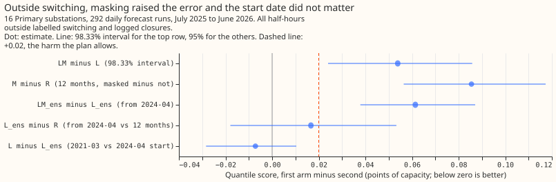
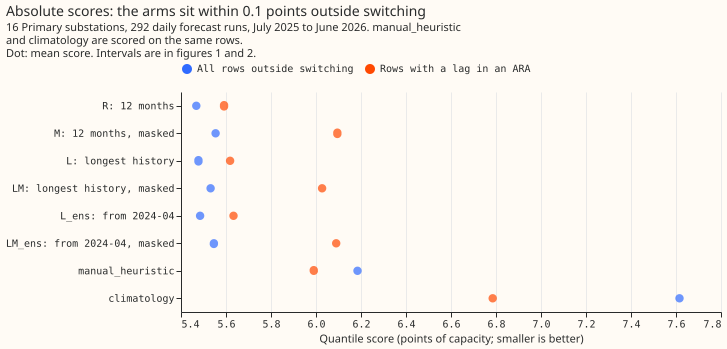
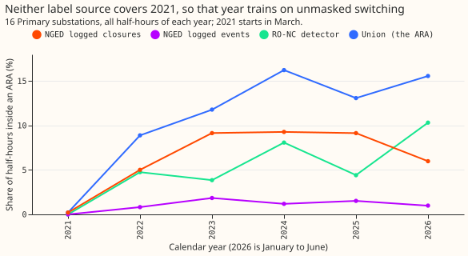
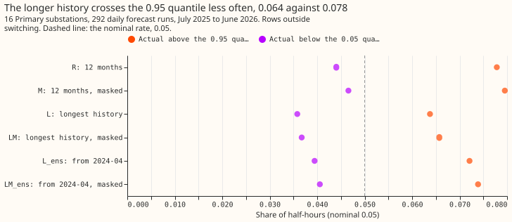

# Experiment 89: does the longest history, with switching masked, improve the NRA forecast?

**Take-home message: hiding the past power readings (lags) that were measured while the electricity
network was switched away from its normal arrangement made the demand forecast for Primary
substations (the substations that step down to the local distribution network) worse, and training
on all history since March 2021 instead of the last 12 months changed nothing.** Removing the
switched half-hours from the training targets therefore did not make the longer history help, so the
labelled switching we have does not explain why a long history fails to help demand forecasts. The
masking raised the error by 0.409 points of capacity (98.33% interval +0.281 to +0.517) on the
half-hours whose lags were measured during switching. The longest history scored 0.009 points
worse than the 12-month window (-0.052 to +0.069). The next step is to test whether a label that
marks fewer half-hours lets masking help, using injected events of known size. The verdict is
**refuted**: the plan called a masking interval wholly above zero a refutation.

An electricity network operator sometimes moves load between substations by closing a normally open
switch. We call the period while the network is switched away from its normal arrangement an
abnormal running arrangement (ARA). NGED, the network operator, supplied the data, and NRA means
normal running arrangement. We asked two questions of an XGBoost demand model for 16 Primary
substations. First, with ARA half-hours removed from the training targets, does training on all
history since March 2021 beat training on the last 12 months? Second, does setting to missing every
past power reading (lag) that was measured inside an ARA lower the error on forecasts that use such
a lag? We refitted the model monthly and scored 292 daily forecast runs from July 2025 to June 2026
on half-hours outside every ARA. The ARA is the union of the intervals of the refit-offset
neighbour-count (RO-NC) detector (called XL in experiments 70, 71, and 82), NGED's logged events,
and NGED's logged closures. The score is the quantile score in points of capacity (smaller is
better).

- **Arms.** R: last 365 days, recency half-life 0.5 years, lags unmasked. M: R with lags in an ARA
  set to missing. L: all rows since 2021-03, half-life 2 years, lags unmasked. LM: L with masked
  lags. L_ens and LM_ens: L and LM using only runs from 2024-04-01. Every arm drops training rows
  whose target is inside an ARA. Monthly refits, 150 rounds, eta 0.15, control member only, seed 0.
- **Rows.** 3,199,243 forecast cases (one substation, one forecast run, one lead time); 2,704,935
  outside every ARA (the scored rows), of which 352,765 (13.0%) have a lag inside an ARA (the
  headline rows) and 30,950 have a lag inside a logged event. Row set `fold_a_daily_gap_v1`.
- **Planned contrasts (98.33%).** C1, LM minus L, rows with a lag in an ARA: +0.409 (+0.281 to
  +0.517). C2, L minus R, all rows outside switching: +0.009 (-0.052 to +0.069). C3, LM minus R,
  rows with a lag in an ARA: +0.436 (+0.301 to +0.603). No-harm check, LM minus L, all rows outside
  switching: +0.054 (+0.024 to +0.086), above the +0.02 margin.
- **Absolute scores, all rows outside switching.** R 5.468, L 5.478, L_ens 5.485, LM 5.531, LM_ens
  5.546, M 5.554; `manual_heuristic` 6.184; `climatology` 7.616.
- **Absolute scores, rows with a lag in an ARA.** R 5.591, L 5.618, L_ens 5.633, LM 6.027, LM_ens
  6.090, M 6.095; `manual_heuristic` 5.990; `climatology` 6.785. Masking pushed the XGBoost model
  behind `manual_heuristic` on these rows.
- **Descriptive contrasts (95%).** M minus R: +0.504 (+0.407 to +0.611) on rows with a lag in an
  ARA, +0.086 (+0.056 to +0.117) elsewhere. LM_ens minus L_ens: +0.456 (+0.332 to +0.566) and
  +0.061 (+0.038 to +0.087). L_ens minus R: +0.017 (-0.018 to +0.053). L minus L_ens: -0.007
  (-0.028 to +0.010). LM minus L on the 30,950 rows with a lag in a logged event: -0.038 (-0.652 to
  +1.927).
- **Tails, all rows outside switching** (share of actuals below the 0.05 quantile and above the
  0.95 quantile, nominal 0.05): R 0.044 and 0.078; L 0.036 and 0.064; LM 0.037 and 0.066; M 0.047
  and 0.080. Pinball loss at 0.05 and 0.95: R 0.912 and 1.202; L 0.899 and 1.185. The longer
  history crossed the 0.95 quantile less often and scored a little better in the tails, though the
  quantile score did not move. The nine quantile levels have no 0.01 or 0.99.
- **Labelled switching per year** (share of half-hours inside an ARA, all 16 series): 2021 0.2%,
  2022 8.9%, 2023 11.8%, 2024 16.2%, 2025 13.1%, 2026 (January to June) 15.6%. None of the three
  sources labels most of 2021, so the first 10 months of training history keep their switching in
  the targets.
- **Schedule.** Monthly refits, which the 12-month and longest-history arms share. A weekly
  schedule was not run, and the history contrast could depend on it.
- **Weather.** The forecast's own control-member weather at forecast time; nothing from ERA5. The
  control member is 18 km before 2023-06-27 and 9 km after, and the archive from 2024-04-01 is a
  different product. L_ens and LM_ens (runs from 2024-04-01) scored within 0.02 of L and LM outside
  switching, so the seam did not decide the contrasts.
- **Curtailment cost.** Not scored: this experiment forecasts Primary demand only and has no
  generator forecasts for the node metric.
- **Caveats.** Masks use hindsight labels, so C1 and C3 are the best masking could do for an event
  known only afterwards. L differs from R in window and half-life together, and L_ens separates them
  only partly. Possible reasons for the harm (not tested): the union marks 9 to 16% of half-hours
  per year from 2022, so masking discards a good lag on many rows, and a missing lag leaves the
  model with no recent anchor.
- **What to try next.** Test masking with a tighter label (logged events only, 30,950 rows), or
  replace a masked lag with a forecast of the normal arrangement, both on injected switches whose
  truth is known (experiment 88 injects them).
