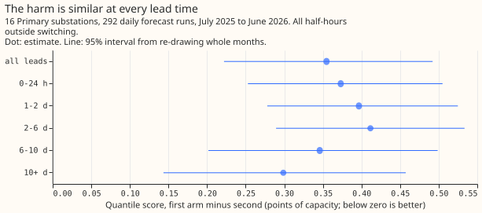
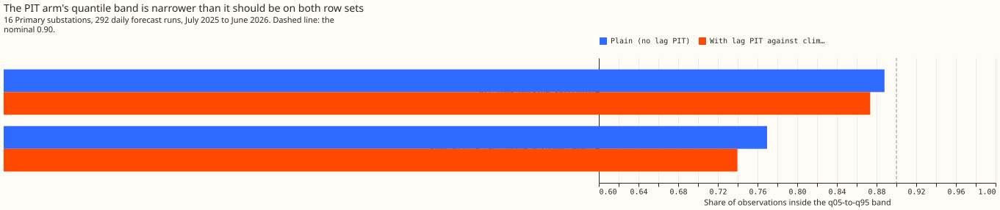

# Experiment 90: does telling the model how unusual each lag is improve the forecast?

**Take-home message: telling the XGBoost demand model how unusual each of its lags is made the
forecast worse, not better.** In this experiment the extra inputs added no useful signal beyond what
the lag values and the calendar already give. The three lags are the newest reading, the reading at
the same time yesterday, and the reading at the same time last week. The unusualness of a lag is the
share of that series' ordinary readings, at the same time of day, kind of day, and month, that were
lower than the lag. On the half-hours whose lag lies inside a logged switching event, the extra
inputs did not make the XGBoost model widen its quantiles either. A switching event is a period when
the electricity network operator closes a normally open switch, so that one Primary substation (a
substation that steps down to the local distribution network) carries a neighbour's load. The next
approach to test is an explicit widening rule (SW2-27, a planned experiment). Do not retry the
unusualness inputs in this form. The verdict is **refuted**.

We asked two questions with the same model fits. First, does the unusualness of each lag improve the
forecast on all half-hours outside switching? Second, on the half-hours whose lag lies inside a
logged switching event, does the model learn to give wider quantiles? We refitted the XGBoost demand
model monthly for 16 Primary substations, with and without the three unusualness inputs, and
scored 292 daily forecast runs from July 2025 to June 2026. Both versions train only on half-hours
outside every switching event. The score is the quantile score in points of capacity (smaller is
better), over 11 quantile levels from q01 to q99.

- **Arms** (seed 0, one refit a month on a rolling 12-month window, 150 rounds, eta 0.15; the cheap
  schedule of [experiment 49](../00049-vp1-screening-reference-under-p-roll-demand/result.md)).
  `plain`: the inputs of [experiment 86](../00086-sw2-12-detector-labels-for-nra-forecast/result.md)
  with raw lags. `clim_pit`: the same plus the three lag PITs (the probability integral transform:
  the share of reference values below the lag, ties counted as half). The reference is the series'
  readings outside switching in the refit's training window, in cells of local month, weekday or
  weekend, and half-hour of day, each pooled with the two half-hours either side.
- **Training rows.** Both arms drop half-hours inside an oracle event, a logged closure, or an
  event of the RO-NC detector (called XL on earlier pages). This is a lab shortcut: these are
  hindsight labels, and the weather inputs are ERA5 at lag times, which a live service would not
  have.
- **Rows scored.** 2,928,842 half-hours outside switching (the general headline). 37,394 of them
  have a lag inside a logged event (the switching headline, 1.3%, spread over 8 of the 12 months).
  The spread factor of 1.15 is applied to both arms, as in the production recipe.
- **Planned contrasts** (`clim_pit` minus `plain`, 97.5% interval, whole months re-drawn). C1, all
  rows outside switching: +0.355 (+0.209 to +0.513), `refuted`. C2, rows with a lag inside a logged
  event: +0.795 (-0.325 to +2.787), `inconclusive`. The `supported` bar was an upper end below -0.02.
- **Absolute scores** (`plain` / `clim_pit`). Outside switching 5.349 / 5.703; with a lag inside a
  logged event 10.506 / 11.301. By lead band on all rows outside switching, the difference runs from
  +0.30 (10 days and beyond, 95% interval +0.14 to +0.46) to +0.41 (2 to 6 days, +0.29 to +0.53).
- **Descriptive contrasts** (95%). All half-hours: +0.334 (+0.203 to +0.471). Rows with a lag
  inside a detector event: +0.097 (+0.002 to +0.243); inside a detector event only: +0.083 (-0.013
  to +0.234).
- **Tail calibration** (`plain` / `clim_pit`; coverage nominal 0.98, 0.90, 0.80; pinball loss in
  points).

| Rows | Coverage q01-q99 | Coverage q05-q95 | Coverage q10-q90 | Pinball q01 | q05 | q95 | q99 |
|---|---|---|---|---|---|---|---|
| Outside switching | 0.985 / 0.985 | 0.888 / 0.874 | 0.789 / 0.759 | 0.298 / 0.300 | 0.918 / 0.969 | 1.172 / 1.203 | 0.390 / 0.391 |
| Lag inside a logged event | 0.971 / 0.972 | 0.770 / 0.740 | 0.668 / 0.612 | 0.482 / 0.491 | 1.494 / 1.530 | 3.629 / 3.573 | 0.665 / 0.678 |

- **What it rules out.** The unusualness inputs did not make the XGBoost model widen its band: on
  rows with a lag inside a logged event the band covers 0.740 instead of 0.770 with the inputs. Only
  the upper tail on those rows improved (pinball at q95 3.573 against 3.629), and the 97.5% interval
  of C2 contains zero.
- **Caveats.** The training PITs are in sample (a lag usually lies inside the climatology window
  that defines its PIT), while forecast-time PITs for lags after the refit are out of sample. A
  cell's pooling also crosses midnight, so the first and last half-hours of a day borrow values from
  the neighbouring day type and month. The in-sample training PITs and the midnight pooling may each
  add to the harm. This experiment tested neither. The result uses one seed and the monthly
  schedule: this experiment did not test a weekly refit. Only the climatology reference was run. The
  lag-free-booster PIT and neighbour arms of SW2-28 need the booster of SW2-27, which does not exist
  yet, and experiment 88's injected cases were not rescored. The curtailment metric was not scored.
- **Open question for the next experiment.** Whether an explicit rule that widens the quantiles
  from the probability that a lag is inside an abnormal arrangement (SW2-26 feeding SW2-27) fixes
  the 0.77 coverage that the inputs tested here did not fix.
