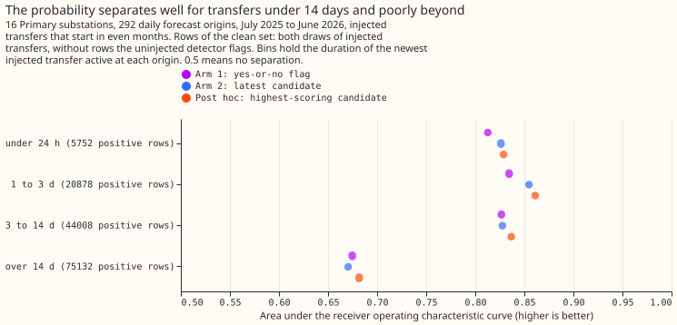
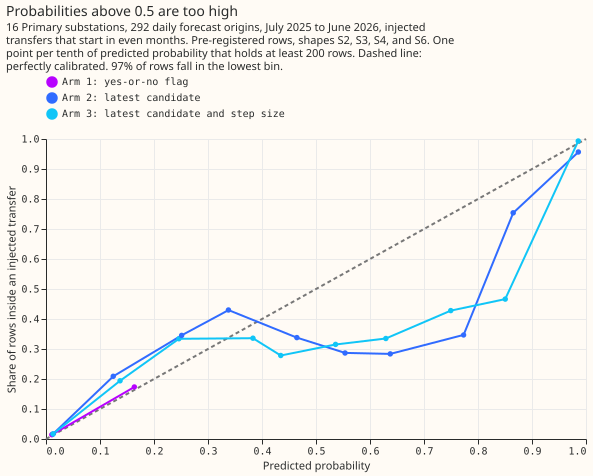

# Experiment 91: a probability that a past half-hour lies inside a switching period

**Take-home message: a probability built from the causal switching detector is not reliably better
than the detector's yes-or-no flag, and against NGED's switching logs it has almost no skill.** The
detector is called RO-NC here (the refit-offset neighbour-count detector, called XL in experiments
70, 71, and 82) and is "causal" because it sees only data before the forecast origin. A rule that
widened the forecast's uncertainty bands whenever the probability is high would widen them for only
about 8% of the half-hours that NGED's logs mark as switching. The probability beats the flag only
for injected transfers large enough for the detector to see. One option for a later experiment is a
warning signal that needs no switching label, such as how unusual the recent power readings are.

An abnormal running arrangement (ARA) is a period when a network operator has closed a normally
open switch, so that one Primary substation (a substation that steps down to the local
distribution network) carries load that belongs to a neighbour. A forecast made at an origin time
takes as inputs the power readings (lags) of the 7 days before the origin, the lag window. The
forecast is misled when one of those readings was taken during an ARA. We asked whether the
detector can give each half-hour of the lag window a probability of lying inside an ARA.

We added a known amount of load (a transfer) to the recorded power of 16 Primary substations, 839
times, using the draw of experiment 88.
A second draw added 183 longer transfers, lasting 1 to 60 days, so the two draws hold 1,022
transfers. The probability was fitted on transfers that start in odd calendar months and scored on
transfers that start in even months.

The verdict is **inconclusive**. The calibrated score of the latest candidate (arm 2, defined below)
has a Brier score (the mean squared error of a probability; smaller is better) 3.3% below the
recalibrated yes-or-no flag (arm 1), with a 97.5% interval from -7.6% to +1.6%. The interval
includes zero, so the experiment can neither support nor refute a gain, and the pre-registered
prediction required at least 20%. The 20% threshold is the smallest gain judged worth carrying the
extra detector output to the serving path. In a post hoc subset (chosen after seeing the results)
that drops transfers whose donor substation steps by under 4 noise units (the size of the
substation's usual half-hour-to-half-hour variation), the gain is 11.2% (-20.3% to -2.0%). Area
under the receiver operating characteristic curve (0.5 means no skill, 1.0 means perfect
separation of half-hours inside a transfer from half-hours outside) is 0.53 against NGED's logs.

**Arm 2's gain over the flag is small and its interval includes zero on the pre-registered rows.**

**The probability separates well for transfers under 14 days and poorly beyond.**

**Probabilities above 0.5 are too high.**

## Arms

A candidate is an interval that the detector proposes, with a score, an onset, a size in noise
units, and, once it has ended, a return step.

- **Arm 1:** the flag. A half-hour is flagged when it lies inside a candidate whose score reaches
  the detector's threshold. Each flag value is replaced by the share of odd-month half-hours with
  that value that lay inside a transfer, so the flag is calibrated too.
- **Arm 2:** for the most recent candidate whose switching has not been reversed, a logistic
  regression on its score, its age, the time from its onset to the half-hour, and any return step,
  then isotonic regression (a monotone calibration curve). A half-hour with no such candidate gets
  the odd-month rate.
- **Arm 3:** arm 2 plus the candidate's size in noise units.
- **Post hoc arm:** arm 2 with the highest-scoring candidate instead of the most recent.

## Results

- **Pre-registered rows.** The even-month test set holds 3,358,215 half-hours with 85,650 inside a
  transfer, for the five shapes S1 to S6 that the injection uses (a shape is how the moved MW
  varies through the day). The four shapes S2, S3, S4, and S6 are pooled for the contrasts. Brier
  scores: arm 1 0.02321, arm 2 0.02243, arm 3 0.02229, post hoc arm 0.02239. Area under the curve:
  0.710, 0.728, 0.729, and 0.718.
- **Contrasts** (change in Brier score against arm 1, 97.5% intervals from resampling the 83
  injection batches, each a set of about 10 transfers injected together). C1, arm 2: -3.3% (-7.6% to
  +1.6%). C2, arm 3: -4.0% (-8.2% to +0.8%). Arm 3 against arm 2: -0.7% (-1.9% to +0.9%). In 3 of the
  4 even months that contain half-hours inside a transfer, arm 2 has the lower Brier score.
- **Calibration.** The prediction's reliability condition (no probability bin holding at least 5% of
  half-hours misses the diagonal by more than 0.1) is met. It is met only because 97% of half-hours
  fall in the lowest bin, so the condition tests almost nothing. In the bins covering probabilities
  0.55 to 0.77, only 0.29 to 0.35 of the half-hours lie inside a transfer.
- **Post hoc rows.** Dropping the half-hours that the same detector already flags on the uninjected
  power (which holds unlabelled real switching) changes arm 2 to -1.6% (-6.1% to +2.9%). Also
  dropping transfers whose donor step is under 4 noise units gives the table below.

| Arm | Brier score | Change against arm 1 (97.5% interval) | Area under the curve |
|---|---|---|---|
| 1: flag | 0.00902 | - | 0.871 |
| 2: latest candidate | 0.00801 | -11.2% (-20.3% to -2.0%) | 0.880 |
| 3: with size | 0.00798 | -11.6% (-20.7% to -2.2%) | 0.880 |
| Post hoc: highest-scoring candidate | 0.00780 | -13.5% (-23.6% to -3.5%) | 0.879 |

- **By duration of the newest injected transfer** (post hoc subset, both draws, half-hours at
  origins whose newest transfer has that duration):

| Duration | Half-hours inside a transfer | Area under the curve: flag | arm 2 | post hoc arm | Flag marks (inside / outside a transfer) |
|---|---|---|---|---|---|
| Under 24 hours | 5,752 | 0.813 | 0.826 | 0.829 | 64% / 1.1% |
| 1 to 3 days | 20,878 | 0.835 | 0.855 | 0.861 | 70% / 2.8% |
| 3 to 14 days | 44,008 | 0.827 | 0.828 | 0.837 | 68% / 2.9% |
| Over 14 days | 75,132 | 0.675 | 0.670 | 0.682 | 37% / 2.4% |

- **Real half-hours.** The 292 forecast origins (one per daily run) have lag windows holding 130,816
  half-hours, of which 19,099 lie inside a closure in NGED's logs or a labelled event. Area under
  the curve: flag 0.521, arm 2 0.532, arm 3 0.528, post hoc arm 0.531. The flag marks 6,271
  half-hours, of which 1,607 (26%) lie inside the logs, and misses 17,492 of the 19,099 logged
  half-hours. NGED's logs are incomplete, so some flagged half-hours counted as wrong may be real
  switching, and 26% is a lower bound on the share of flagged half-hours that are real.

## Laboratory shortcuts and caveats

- **A live probability would need a different weather input.** The detector's expected-power model
  uses ERA5 weather estimates, which arrive about 5 days late. A live version would use ENS
  (ECMWF ensemble) forecasts, and this experiment does not test one.
- **Some fitted constants saw months after the origin.** The noise scales, the logistic score, and its
  threshold were fitted on odd months of the whole record, including months after an origin.
- **The injected power skips the monthly refits.** The expected-power model is not refitted on the
  injected power, and its expected power is floored at 10% of its whole-record median.
- **Rows are sampled and split by month.** The lag window contributes every sixth hour. A half-hour
  inside a transfer takes the calendar month the transfer starts in, and any other half-hour takes
  the month of its timestamp. Half-hours at one origin can therefore fall on both sides of the
  odd-even split.
- **The longer draw is smaller than planned.** We planned 384 longer transfers and placed 183,
  because the requirement that a transfer start in a quiet period left few windows long enough.
- **The calibration curve and the regression share training rows.** The isotonic regression is
  fitted on the logistic regression's own odd-month training rows. All scores use even months, so
  this does not touch the results above.
- **Arm 3 adds little at the receiving substation.** A receiving substation's candidates inherit the
  score and size of the donor substation's alarm, so the size gives arm 3 almost no extra
  information there.

## What to try next

One option is an input that measures how unusual the recent lag power is, which needs no switching
label (the question of experiment 90, SW2-28). Another is a detector that sees the real switching
that the logs hold, since this detector flags only 8% of the half-hours that NGED's logs mark as
switching.
