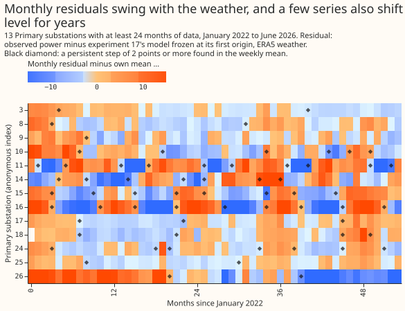
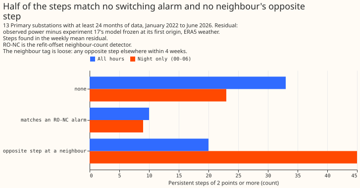
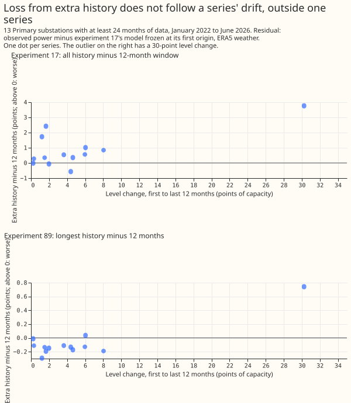
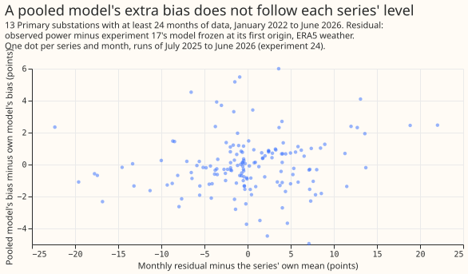
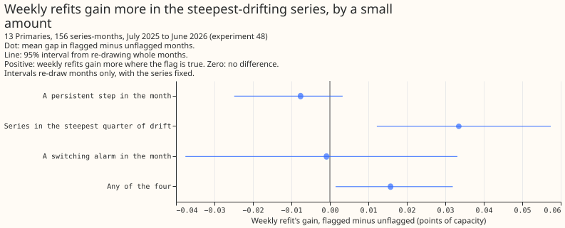

# Experiment 92: how has Primary demand drifted since 2022? (LV0)

**The drift in Primary substation demand since 2022 is real and specific to each series, but a plain
level shift does not explain why longer history hurts or why pooled models lose.** That narrows the
plan for LV1 (the level-normalised long-history experiment): the explicit solar term is the likeliest
carrier, and AGE1 (does an old training year still hurt once its level is removed) should run first.

We asked how a Primary's demand has drifted away from what a forecast trained in 2021 would
predict. We took the stored forecasts of five earlier experiments, which hold every substation's
forecast against its observed power, and measured the gap by hour of day, by season, and by month.
We then asked whether the gap explains three results of those experiments: longer training history
scoring worse, pooled models scoring worse than per-series models, and weekly refits scoring a little
better than monthly refits. No model was fitted.

## Findings

- **Predictions and schedules used.** The residual is observed power minus experiment 17's model
  frozen at its first origin (ERA5 weather), in points of capacity. D4 also reads experiment 17's
  all-history and 12-month-window arms (monthly refits) and experiment 89's reference and
  longest-history arms (monthly refits). D5 reads experiment 24's per-series and pooled models.
  D6 reads experiment 48's weekly and monthly refits at the full setting. Experiment 78 supplies
  the solar capacity flag for 5 series only. Experiment 87 and experiment 81 were not used:
  experiment 81 has no weekly arm.
- **Series.** Experiment 17 holds 16 series. Three have under 24 months of data (3 series: 4, 5,
  and 22 months) and are dropped, leaving 13.
- **D1, drift by hour band.** The pooled all-hours slope is +0.04 points a year (-0.90 to +0.89),
  because the series drift in both directions. In 12 of 13 series some band moves by at least 1
  point a year, and in 5 of 13 the all-hours slope does. April-to-September midday is -1.30 (-2.32
  to -0.92), evening is -0.88 (-1.57 to -0.24), and night is +0.69 (+0.15 to +1.36). The
  October-to-March bands span zero. The midday fall fits growing embedded solar output.
- **D1, share of drift that is a common level.** By a straight-line fit, the all-hours component
  holds over half of the trend variance in 6 of 13 series (95% interval 6 to 11). By a 12-month
  rolling mean, which also captures steps, it holds over half in 12 of 13. The prediction of at
  least 10 of 16 holds on the second measure and fails on the first, so the experiment cannot say
  it held.
- **D2, step census.** A step is a change of at least 2 points in the weekly mean residual lasting
  at least 8 weeks. The search finds 63 steps over all hours (33 matching nothing, 20 with an
  opposite step at another series within 4 weeks, 10 within 2 weeks of an alarm of the
  refit-offset neighbour-count detector, "RO-NC"). The penalty was set so that shuffled weekly
  values gave 0.39 steps per 5 years. Caveat: the frozen model's seasonal misfit also produces
  persistent changes, and the median step is 14 points, so 63 is an upper bound. At night only,
  where solar does not enter, the search finds 77 steps (23 untagged).
- **D3, common against own drift.** The first principal component of the monthly level holds 39%
  of the variance (95% interval 34% to 48%), and the median correlation between two series is 0.25
  (0.15 to 0.34). Drift is mostly specific to each series, which is why pooling without a
  per-series level should struggle.
- **D4, loss from extra history.** In experiment 17, all history scored 0.86 points worse than a
  12-month window. The loss tracks each series' level change at r = 0.70 (interval -0.34 to +0.98),
  but one series with a 38-point level change carries the correlation: without it r = -0.03 and
  the rank correlation is 0.27. Experiment 89's longest-history arm scored 0.08 points better on
  average, and its correlation with level change is 0.90 with that series and 0.06 without. The
  loss is not linked to drift in the other 12 series.
- **D5, pooling gap.** Experiment 24's all-series pool with an identifier scored 0.40 points worse
  than per-series models (0.51 after the 14-day correction). The pooled models' extra monthly bias
  correlates with the series' monthly level at r = 0.13 (-0.04 to +0.33), so the gap is not about
  level.
- **D6, cadence gap.** Weekly refits scored 0.017 points better than monthly refits over the 156
  series-months (mean pinball over nine quantile levels). The gap is larger in the 3 series with
  the steepest all-hours slope (+0.033, 0.011 to 0.057 more than elsewhere), and not larger in
  months with a step (-0.008, -0.027 to +0.003), a switching alarm (-0.001), or capacity growth
  (-0.002). Any flag holds 83% of the gap in 60% of the series-months, so the prediction's "over
  half" is met but barely beats the base rate.
- **Tails, weekly and monthly refits on the same 13 series.** The table is the stored forecasts of
  experiment 48. The stored forecasts stop at q05 and q95, so q01 and q99 are not available.
  A curtailment-cost score does not apply because no new forecast was made.

| Refit | q05 coverage | q05 pinball | q95 coverage | q95 pinball |
|---|---|---|---|---|
| Weekly | 0.071 | 0.834 | 0.913 | 1.025 |
| Monthly | 0.070 | 0.834 | 0.912 | 1.038 |

## Lessons and next experiment

- **Verdict.** Inconclusive: the two measures of the common-level share disagree, and the D6
  prediction is met only against a high base rate.
- **LV1.** The decision rule to proceed is met by D1 (5 of 13 series at 1 point a year or more
  overall) but not by D4 or D5, so LV1's mechanism (level removal) is unproven.
- **AGE1 should run first.** It tests directly whether an old year still hurts after its level is
  removed.
- **Caveat on every diagnostic.** The residual comes from a frozen model on ERA5 weather, so the
  results describe drift in a lab setting, not in the live service.
- **What the next experiment should answer.** Whether a frozen model's seasonal misfit hides real
  steps. LV2 (steps) should first remove the seasonal pattern before searching for them.
