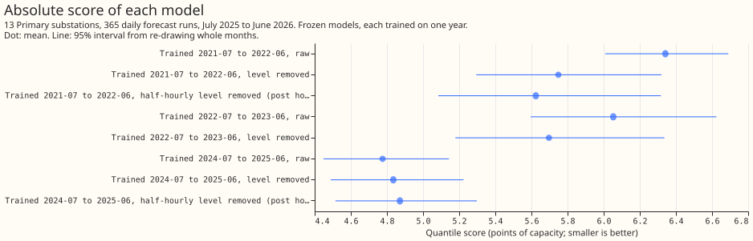
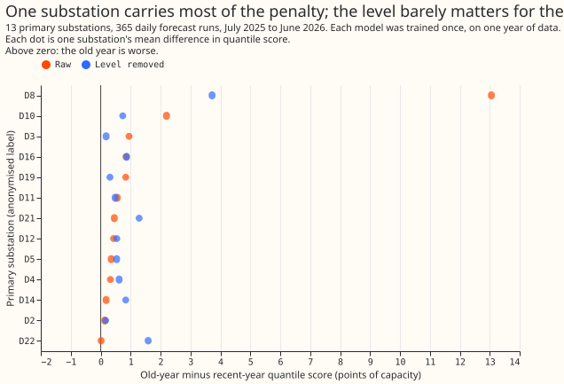
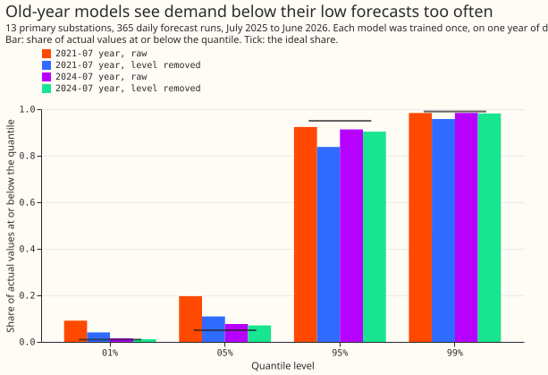

# Experiment 93: does an old training year still hurt once the level is removed? (AGE1)

**Taking each substation's average demand level out of the training data removes under half of the
extra forecast error that an old training year causes, and removes none of it for 12 of the 13
substations.** The old training year differs from the recent one in more than its average level.
The weather data also changed between the years (18 km grid spacing in the old years, 9 km in the
recent year), and this experiment could not separate that change from age, so the next experiment
should test the change of weather product. The prediction is refuted: the extra error reached the
size predicted, but level removal took off 42% of it, not the half predicted.

We trained one XGBoost quantile model per substation on one year of forecasts from the unperturbed
run ("control member") of the European Centre for Medium-Range Weather Forecasts (ECMWF)
ensemble, for 13 primary substations (33 kV to 11 kV substations, the "Primary" type in NGED's
data). Each model was trained once and not retrained. We scored every model on 365 daily forecast
runs from July 2025 to June 2026, with the quantile score: the average pinball loss over 11
quantile levels, in percentage points of the substation's effective capacity ("points"; smaller is
better). Four planned models trained on 2021-07 to 2022-06 or on 2024-07 to 2025-06. For each year,
one model used the demand as measured and one had the substation's trailing 365-day average demand
(its "level") subtracted from the target and from the power lags (demand at earlier times), then
added back to the forecast. Four post hoc models repeat the design with other training years and a
half-hourly level.

**Names used below.** The "raw penalty" is the 2021-07 model's score minus the 2024-07 model's
score, both raw (planned contrast C1). The "level-removed penalty" is the same difference with the
level removed (C2). C3 is the raw penalty minus the level-removed penalty.

## Results

- **Penalty.** The raw penalty is 1.57 points (98.3% interval 1.14 to 2.00); the level-removed
  penalty is 0.91 (0.69 to 1.20). The difference C3 is 0.65 (0.04 to 1.23), which is 42% of the raw
  penalty. The 98.3% level is the Bonferroni level for three planned contrasts. The prediction
  needed a raw penalty of at least 0.5 and a removed share of at least 50%, so its second half
  failed.
- **Without the substation with the largest raw penalty (post hoc, 95%).** The raw penalty is 0.61
  (0.41 to 0.81) and the level-removed penalty is 0.68 (0.47 to 0.94), so level removal raised the
  penalty slightly. One substation has a raw penalty of 13.1 points; the other 12 range from 0.0 to
  2.2.
- **Repeat with 2022-07 to 2023-06 (post hoc, 95%).** The raw penalty is 1.28 (1.04 to 1.55) and the
  level-removed penalty is 0.86 (0.60 to 1.17), so level removal takes off 33%.
- **Half-hourly level (post hoc, 95%).** Subtracting a level for each half-hour of the day gives a
  penalty of 0.75 (0.47 to 1.09) for the 2021-07 year, close to the 0.91 from the level averaged
  over all hours.
- **Rows in the normal switching arrangement only (95%).** These are the rows where the
  substation's part of the electricity network was not in a labelled abnormal arrangement. The raw
  penalty is 1.65 (0.85 to 2.03) and the level-removed penalty is 0.72 (0.56 to 1.00).
- **Level removal does not help the model trained on the recent year.** Its score is 4.78 raw and
  4.84 with the level removed.
- **Quantile score of each model (points, 95% interval).** 2024-07 raw 4.78 (4.45 to 5.14);
  2024-07 level removed 4.84 (4.49 to 5.22); 2021-07 raw 6.34 (6.01 to 6.69); 2021-07 level removed
  5.75 (5.29 to 6.32); 2022-07 raw 6.05 (5.60 to 6.62); 2022-07 level removed 5.70 (5.18 to 6.34).
- **Level removal more than halves the old year's miss at the 0.01 quantile, and widens its miss
  at the upper quantiles.** The table gives the share of actual values at or below each quantile.

| Model | 0.01 | 0.05 | 0.95 | 0.99 |
|---|---|---|---|---|
| Ideal share | 0.01 | 0.05 | 0.95 | 0.99 |
| 2024-07 raw | 0.015 | 0.077 | 0.913 | 0.984 |
| 2024-07 level removed | 0.012 | 0.071 | 0.903 | 0.981 |
| 2021-07 raw | 0.091 | 0.196 | 0.924 | 0.984 |
| 2021-07 level removed | 0.041 | 0.109 | 0.838 | 0.958 |

  The pinball loss at the 0.01 quantile is 1.30 for 2021-07 raw and 0.27 for 2024-07 raw.

## Caveats

- **Schedule.** Frozen fits of 150 boosting rounds at learning rate 0.15, seed 0, one fit per
  substation and arm. The comparison is between frozen models, so the retraining schedule does not
  enter.
- **Weather data.** The old years use the 18 km control member and the recent year uses the 9 km
  control member, so age and weather resolution cannot be separated here.
- **Switching labels.** Labels that mark when a substation was in an abnormal switching
  arrangement exist only from 2022-01, so the rows of the first half of the 2021-07 training year
  could not be excluded. The 2022-07 repeat is fully labelled and gives a raw penalty of 1.28 and a
  level-removed penalty of 0.86.
- **Intervals.** The intervals resample 12 whole calendar months with replacement, so they rest on
  only 12 blocks and are coarse.
- **Not scored.** The climatology and `manual_heuristic` benchmark rows and the curtailment-cost
  metric were not computed, because the question is a contrast between training years of one model.

## What to try next

Most of the penalty is not explained by the level. For the 12 substations without the large outlier,
the old year is about 0.6 points worse with or without the level. A candidate next experiment
separates age from the change of weather product, for example by training the recent year on the
18 km control member. After that, the heating-demand and solar-generation terms remain to be
checked. The planned experiment LV1 (training on a long history with the level subtracted) is not
supported by this result.
