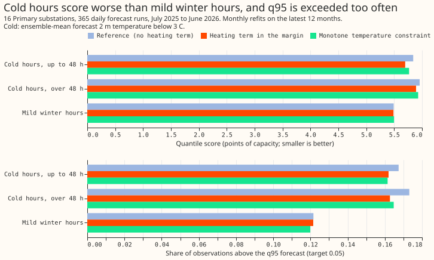
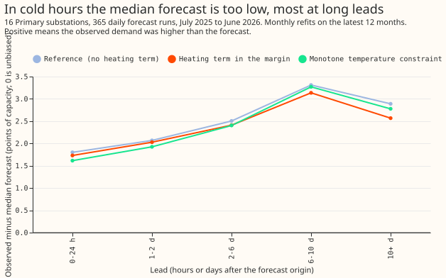
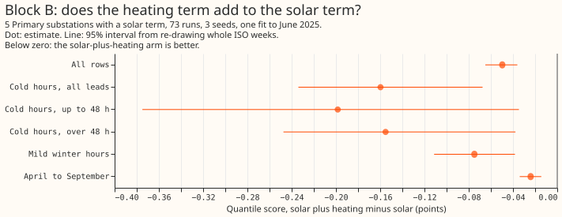
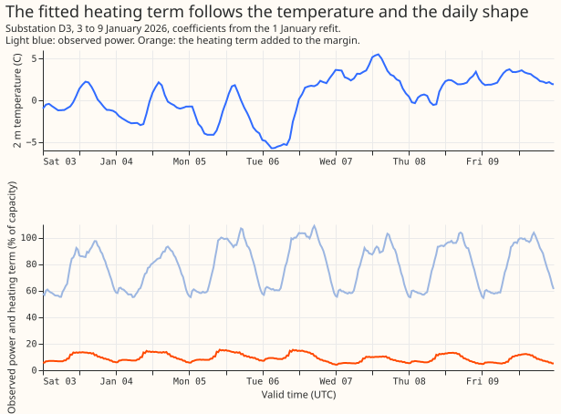

# Experiment 94: does an explicit heating term lower the cold-hour error? (HT1)

**Giving the XGBoost demand model an explicit heating term lowered its error in cold weather by a
little, and did not fix the cold-weather tail.** We asked whether telling the model about heating
explicitly helps when it is cold. XGBoost is a forecasting method built from decision trees, and a
tree predicts a constant for temperatures colder than any hour it was trained on. For each of 16
Primary substations (which step 33 kV down to 11 kV) and each hour of the day, we fitted by least
squares how much a substation's demand, as a fraction of its capacity, rises per degree Celsius
below 15.5 °C, using the training rows only. We then gave XGBoost the product of that slope and the
degrees below 15.5 °C as a base margin (a fixed starting prediction supplied for each row). We
compared the result with the same XGBoost model without the term on 365 daily forecast runs from
July 2025 to June 2026.

The quantile score is an error measure for a probabilistic forecast, in points of a substation's
capacity (lower is better). In cold hours (ensemble-mean forecast temperature below 3 °C from the
ECMWF ensemble, ENS) at leads up to 48 hours, the heating term lowered the score by 0.143 points.
The threshold fixed in advance for a worthwhile gain was 0.3 points, so the verdict is `small gain`.
The q95 forecast should be exceeded by 5% of observations. In those hours it was exceeded by 16.7%
of observations without the term and 16.2% with it. A decreasing monotone constraint on temperature
gained about half as much as the heating term. This experiment did not locate the remaining
cold-hour error. One untested candidate is the ENS temperature forecast, so the next experiment
could compare the forecast temperature with the observed temperature in cold hours by lead.

A second comparison, block B, adds the heating term to experiment 64's solar term. It covers only
the 5 Primaries that have a solar term and the 73 forecast runs of `fold_a_every5d_v1`, and it
lowered the all-rows score by 0.050 points. The 16-substation arms have no solar term, so the two
blocks do not share rows.

## Results

- **Arms:** `ref` is the stored zero-start monthly P-roll arm `pm0` of experiment 85 (no solar
  term). `ht` adds `b_h * H` to the base margin, where `H` is the degrees the ensemble temperature
  is below 15.5 C and `b_h` is a per-series coefficient for each local hour of day, fitted on the
  refit's training rows with a month-by-hour intercept and floored at zero. `mono` is `ref` with a
  decreasing monotone constraint on `temperature_2m`.
- **Schedule:** monthly refits on the latest 12 months, 150 rounds, `eta` 0.15, seed 0, no 14-day
  correction, spread factor 1.15. The schedule is the research default of experiment 85, so
  absolute scores and the bias of about +2.4 points over all rows are those of this cheap schedule
  and would be smaller under weekly refits. The contrasts may depend on the schedule.
- **Rows:** 4,004,653 cases (16 series, 365 runs, all valid times); cold means the
  ensemble-mean ENS 2 m temperature of the case is below 3 C (215,476 cases, 5.4%; 28,344 at leads
  up to 48 hours). The temperature is available at forecast time; ERA5 enters only in a check.
- **Pre-registered contrasts (98.75% intervals from 20,000 resamples of whole ISO weeks), quantile
  score, arm minus `ref`:**
    - C1, `ht` in cold hours at leads up to 48 hours: -0.143 (-0.203 to -0.034).
    - C2, `ht` over all rows: -0.022 (-0.042 to +0.000).
    - C3, `mono` in cold hours at leads up to 48 hours: -0.074 (-0.111 to -0.020).
    - C4, `mono` over all rows: -0.011 (-0.024 to +0.003).
- **Absolute quantile scores (`ref`, `ht`, `mono`):** all rows 5.564, 5.542, 5.553; cold up to 48
  hours 5.841, 5.698, 5.767; cold over 48 hours 5.957, 5.893, 5.931; mild winter hours 5.491,
  5.488, 5.498.
- **Tail calibration (share of observations above q95, target 0.05; below q05, target 0.05;
  pinball loss at q95 in points of capacity):**

| Slice | Arm | Above q95 | Below q05 | Pinball at q95 |
|---|---|---|---|---|
| Cold, up to 48 h | `ref` | 0.167 | 0.042 | 1.460 |
| Cold, up to 48 h | `ht` | 0.162 | 0.045 | 1.381 |
| Cold, up to 48 h | `mono` | 0.161 | 0.040 | 1.405 |
| Cold, over 48 h | `ref` | 0.173 | 0.040 | 1.618 |
| Cold, over 48 h | `ht` | 0.163 | 0.046 | 1.564 |
| Cold, over 48 h | `mono` | 0.165 | 0.040 | 1.597 |
| Mild winter | `ref` | 0.122 | 0.030 | 1.240 |
| Mild winter | `ht` | 0.122 | 0.033 | 1.214 |
| Mild winter | `mono` | 0.120 | 0.030 | 1.240 |

- **Bias (observed minus median, points of capacity) in cold hours:** over 48 hours 2.90, 2.70,
  2.81; at leads up to 24 hours 1.80 (`ref`), 1.73 (`ht`), 1.61 (`mono`); at 6 to 10 days 3.31,
  3.14, 3.27; beyond 10 days 2.89,
  2.57, 2.78. The bias is positive at every lead, so the forecast is too low in the cold.
- **Exploratory contrasts (95%):** `ht` in cold hours at all leads -0.074 (-0.138 to +0.007), over
  48 hours -0.064 (-0.132 to +0.030), with cold hours defined by ERA5 temperature at leads up to 48
  hours -0.118 (-0.163 to -0.048), in mild winter hours -0.003 (-0.054 to +0.053), and in June to
  August +0.002 (-0.006 to +0.009). `ht` minus `mono` in cold hours up to 48 hours is -0.069 (-0.104
  to +0.005).
- **Block B (5 series, 73 runs, 3 seeds, experiment 64's frozen recipe, 14-day correction,
  95% intervals):** `amh` (the solar margin plus the heating margin) minus `am`: all rows -0.050
  (-0.065 to -0.036), cold hours -0.160 (-0.234 to -0.067), cold up to 48 hours -0.198 (-0.375 to
  -0.035), mild winter hours -0.075 (-0.111 to -0.038), April to September -0.024 (-0.034 to
  -0.014). Absolute scores `am` 3.940 and `amh` 3.890 over all rows. The heating term therefore
  lowers the score of
  the solar model further, by more than in block A in every slice. Block B differs from block A in
  series, runs, seeds, refits, and the 14-day correction, so the sizes are not comparable. No arm
  with the heating term alone ran on the block B rows, so additivity is not tested. In cold hours
  up to 48 hours the bias of `amh` is -0.425 against -0.155 for `am` (more over-forecast), and the
  q95 exceedance is unchanged (0.136 against 0.136).
- **Explainability:** the last figure shows the fitted term for one substation over 3 to 9
  January 2026. The term follows the temperature and the daily shape, and sits at about 5% to 15%
  of the substation's capacity when the demand is 55% to 105%.
- **Deviations from the plan:** the solar offset is not in the 16-substation arms (it acts only in
  April to September at 5 series, and its inputs exist only for the 73 runs and to June 2025), so
  block B tests the heating term on top of the solar term. The plan said "member temperature" for
  the cold slice; the
  scoring uses the ensemble mean, one value per case. The curtailment-cost metric and q01 and q99
  tail reads are not reported, because the nine-level model stops at q95. The optional arm scaled
  by Low Carbon Technology heat-pump counts was skipped, because the data needs a portal account.
- **Caveats:** in block B the heating coefficients are fitted on net power without removing the
  solar margin first, so the heating coefficient may absorb part of the demand reduction that the
  solar margin already models. Block A used one seed. Experiment 85 found that repeat fits change
  the score by 0.000 to 0.001. Three ISO weeks (2025-W47, 2026-W01, and 2026-W02) hold 66% of the
  28,344 cold cases at
  leads up to 48 hours, and the C1 and C3 intervals rest on 21 weeks of one winter. The other
  intervals rest on 53 weeks (C2, C4), 23 weeks (cold, all leads), 13 weeks (mild winter), and 15
  weeks (June to August).
- **Predictions against results:** a cold-hour fall of at least 0.3 failed (0.143). A q95 exceedance
  fall of at least 0.03 failed (0.005, from 0.167, not the 0.18 predicted). An all-rows change of
  at most +0.01 passed (-0.022). A long-lead bias fall of under half passed (5% to 11%). A `mono`
  gain of at most a third of the offset's failed (0.074 against 0.143, 52%).
- **What the result shows:** in this winter's data, the heating degree-hour term did not repair the
  cold-hour tail. The heating term leaves the exceedance of q95 at 16% to 17% of cold hours.
- **What to try next:** compare the forecast temperature with the observed temperature in cold
  hours by lead; test the monotone constraint inside the production recipe, since it adds no
  serving column; a second winter is needed before any decision to port the heating term.
