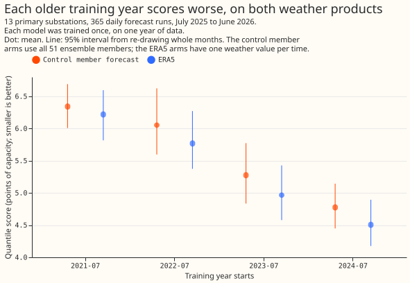
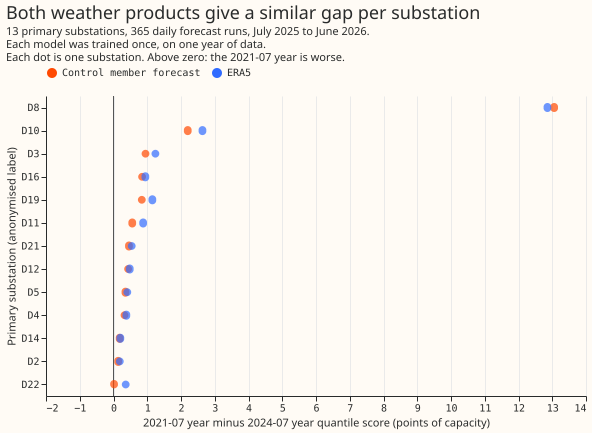
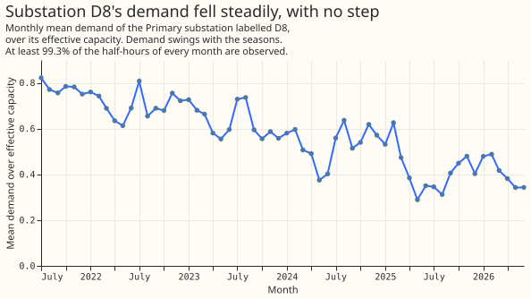
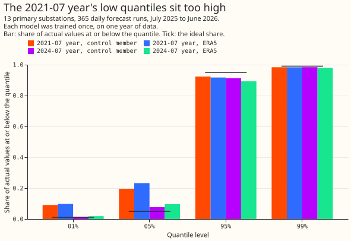

# Experiment 95: does an old training year score worse because of the weather product, or its age? (AGE2)

**A model trained on demand from July 2021 to June 2022 forecasts demand in 2025-26 worse than a
model trained on 2024-25 demand, and the coarser weather forecast of the old years is not the main
reason.** The extra error ("gap") was 1.71 points of capacity when both models were trained and
scored on ERA5, the European Centre for Medium-Range Weather Forecasts (ECMWF) estimate of past
weather, against 1.57 points with the ECMWF ensemble forecast's unperturbed run ("control member").
Here "points of capacity" are percentage points of a substation's effective capacity on the
quantile score, where smaller is better. The gap also grew with each year older. Experiment 93
found that a difference in the average demand level between the years does not explain the gap.
The cause is therefore probably a change in how the substations' demand depends on weather and time
of day, such as growing embedded solar output or heating, or a change to the electricity network.
Explicit solar and heating terms are the candidate explanations the next experiment could test.

**The prediction was refuted on both counts.** The ERA5 gap was 109% of the control-member gap, not
under half. The model trained on July 2023 to June 2024 was 0.50 points behind the 2024-25 one, not
under 0.3.

We trained one XGBoost quantile model per Primary substation (13 substations, each named in the
figures by an anonymised code such as D8) on one year of demand and weather. "The 2021-07 year"
means the year of data from 2021-07 to 2022-06, and likewise for the other years. Experiment 93 had
shown that the 2021-07 year scores 1.57 points worse than the 2024-07 year, and that its years
also used a coarser weather forecast (18 km grid spacing, against 9 km from July 2023). Here each
arm (one training year with one weather product) was trained once, not retrained, and scored on the
365 daily forecast runs from July 2025 to June 2026. The ERA5 arms used ERA5 weather at the valid
time. The control-member arms used the control member's forecast. The quantile score is twice the
mean pinball loss over 11 quantile levels from 0.01 to 0.99, weighted by the probability each level
represents, in percentage points of capacity.

## Results

- **The ERA5 gap is no smaller than the control-member gap (99% intervals, the Bonferroni level
  for five planned contrasts).** C1, the 2021-07 year minus
  the 2024-07 year on the control member, is 1.57 (1.12 to 2.03). C2, the same on ERA5, is 1.71
  (1.15 to 2.29). C3, C1 minus C2, is -0.15 (-0.32 to -0.002), so the ERA5 gap is slightly larger;
  C2 is 109% of C1 (1.00 to 1.18). C4, the 2023-07 year minus the 2024-07 year on the 9 km control
  member, is 0.50 (0.28 to 0.76). C5, the 2021-07 year minus the 2022-07 year on the 18 km control
  member, is 0.29 (-0.35 to 0.85), which cannot separate one year of age from zero.
- **The gap grows with each year of age on ERA5 (95%).** Against the 2024-07 year the 2022-07 year
  is 1.26 points behind (1.10 to 1.44) and the 2023-07 year is 0.46 behind (0.36 to 0.57). On the
  control member the 2022-07 year is 1.28 behind (1.04 to 1.55).
- **Absolute quantile score (points, 95% interval).**
    - ERA5: 2021-07 6.22 (5.82 to 6.60); 2022-07 5.77 (5.37 to 6.27); 2023-07 4.97 (4.58 to 5.43);
      2024-07 4.51 (4.18 to 4.89).
    - Control member: 2021-07 6.34 (6.01 to 6.69); 2022-07 6.05 (5.60 to 6.62); 2023-07 5.28
      (4.84 to 5.77); 2024-07 4.78 (4.45 to 5.14).
- **Without D8, the substation that carries most of the penalty (post hoc, 95%).** C1 is 0.61 (0.41
  to 0.81), C2 is 0.78 (0.53 to 1.04), C4 is 0.35 (0.19 to 0.53), and C5 is -0.05 (-0.52 to 0.37).
  The ERA5 gap is larger than the control-member gap here: C3 is -0.18 (-0.28 to -0.08) and C2 is
  129% of C1 (116% to 144%), so D8 dilutes the ratio with all 13 series. D8's own gap is 13.1 points
  on the control member and 12.9 on ERA5.
- **D8's demand fell smoothly; the checks found no step change or stuck meter.** Its monthly mean
  demand fell from 0.82 of capacity in 2021-07 to 0.34 in 2026-06, with no month under 99.3%
  observed half-hours and under 0.6% of half-hours repeating the previous value. The largest change
  in the 60-day mean demand over 60 days is 0.22 of capacity, a rise ending 2024-08-25. Summer
  demand fell faster than winter demand (August 0.77 in 2021 and 0.31 in 2025; January 0.76 in 2022
  and 0.48 in 2026), which fits growing embedded solar output, but this experiment did not test
  whether embedded solar output grew.
- **Rows in the normal switching arrangement only (95%).** C1 is 1.65 (0.84 to 2.03) and C2 is 1.81
  (0.79 to 2.26), so labelled switching events are not the main explanation, though the intervals
  are wide. The switching-event labels start in 2022-01, so the first half of the 2021-07 year is
  not masked.
- **Weather product within one year (post hoc, 95%).** ERA5 gives a quantile score 0.31 points lower
  (better) than the control member for the 2023-07 year (0.16 to 0.46) and 0.27 lower for the
  2024-07 year (0.13 to 0.42).
- **Tail calibration (share of actual values at or below the quantile; ideal 0.01, 0.05, 0.95,
  0.99).**

| Model | 0.01 | 0.05 | 0.95 | 0.99 |
|---|---|---|---|---|
| 2021-07, control member | 0.091 | 0.196 | 0.924 | 0.984 |
| 2021-07, ERA5 | 0.098 | 0.233 | 0.917 | 0.983 |
| 2024-07, control member | 0.015 | 0.077 | 0.913 | 0.984 |
| 2024-07, ERA5 | 0.019 | 0.096 | 0.893 | 0.980 |

  The pinball loss at the 0.01 quantile is 1.30 (control member) and 1.35 (ERA5) for the 2021-07
  year, and 0.27 and 0.28 for the 2024-07 year, in points of capacity.

## Caveats

- **Schedule.** Frozen fits of 150 boosting rounds at learning rate 0.15, seed 0, one fit per
  substation and arm. Weekly or monthly refits would give an old year's model newer data, so the
  contrasts describe how old a frozen model's training data is, not a retraining schedule.
- **ERA5 arms are diagnostic.** ERA5 arrives about 5 days after the weather, so no live service
  could use it at forecast time. The ERA5 arms score the same runs and valid times as the control
  member arms, with a single weather value per time and no ensemble spread. Absolute scores and tail
  calibration are therefore not like for like across the two products, and C3 compares two
  contrasts, each computed within one weather product.
- **The 2023-07 year.** Its rows come from experiment 81's daily frames up to 2024-03-31 and from
  the stage 1 pilot's training file from 2024-04-01. The 2024-01-03 run is missing, so the year has
  one run fewer. The 18 km to 9 km change took place in June 2023, so the 2023-07 year is 9 km.
- **Intervals.** They resample 12 whole calendar months, so they are coarse. The share C2 over C1 is
  a ratio of two means and its interval is only informative because C1's interval excludes zero.
- **Not scored.** The curtailment-cost metric and the `manual_heuristic` and climatology rows, as in
  experiment 93.

## What to try next

The age penalty is about 0.5 to 0.8 points for each year older on ERA5 and 0.3 to 0.8 on the control
member, and a level shift does not explain it. Two experiments could test what does: an explicit
heating offset (the subject of the reserved experiment 94) and an explicit embedded-solar term, with
the old years re-scored. If either term shrinks the gap across the four years, the result would
support trying a longer training history. If neither does, the data give no reason to move away from
the newest year or two.
