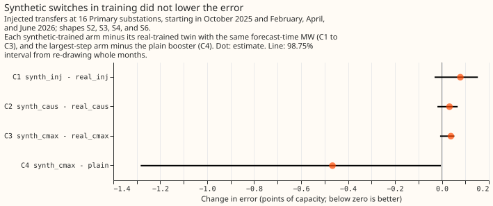
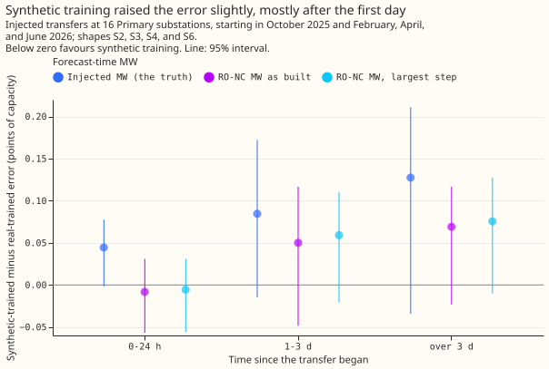

# Experiment 96: do synthetic switches in the training data make the NRA forecast recover the normal arrangement better?

**Take-home message: adding about three times as many synthetic switching transfers to the
training data did not improve the forecast of the power a substation would have drawn without the
transfer, so the verdict is inconclusive, and the limit is the estimate of the MW moved, not the
amount of training data.** A switching transfer is load that the network operator NGED moves from
one Primary substation (the donor) to its neighbours (the receivers) for hours or days. A synthetic
transfer is one made by adding a known MW to the recorded power of a donor and its receivers. The
forecast error rose by 0.03 to 0.08 points of capacity (percentage points of the substation's
capacity, in mean absolute error) when synthetic transfers were added, and no 98.75% interval
excluded zero. Given the true MW, the XGBoost model trained on real transfers alone already closes
83% of the gap between the error of a plain model (no correction) and the error of the same model
reading unmodified lags (the ceiling). A lag is an earlier power reading. Given the detector's MW,
the same model closes 32% to 53% of the gap, and training on exact MW did not change that. A likely
reason is that a lag corrected by the exact MW equals the lag with no transfer, so a synthetic
transfer looks like a row with no transfer. The next test of synthetic transfers should train with a
MW that carries the detector's errors.

**The experiment asked whether more switching examples in training help the model that recovers
the normal running arrangement (NRA).** The NRA forecast subtracts the MW moved from each earlier
power reading it uses. [Experiment
88](../00088-sw2-21-nra-forecast-recovers-normal-arrangement-during-and-after-injected-switches/result.md)
trained that XGBoost model on the 56 real transfer intervals (one per series and transfer) of its
training windows. In this experiment a second XGBoost model was trained on those 56 intervals plus
169 synthetic ones (from 94 synthetic transfers, 3.0 times the real count). Both models were scored
on experiment 88's held-out synthetic transfers, with the MW at forecast time taken from the
injection, from the causal refit-offset neighbour-count detector (RO-NC), or from the largest
overlapping detector step.

- **Arms.** Arm 1: booster trained on the real transfers only (experiment 88's `nra_oracle` recipe,
  refitted at 11 quantile levels). Arms 2 to 4: one booster trained on the real and the synthetic
  transfers, scored with the injected MW (2), the RO-NC MW as built (3), or the largest-step MW (4).
  Each synthetic arm is compared with arm 1 scored with the same MW source.
- **Training recipe.** Monthly rolling refits (P-roll: 365-day window, 150 rounds, learning rate
  0.15, recency half-life 0.5 years, seed 0). The ensemble-control rows inside a real or synthetic
  transfer are dropped as targets. Each lag is replaced by the lag minus the signed MW at the lag
  time, and the signed MW at the three lags is a column. A synthetic transfer's signed MW is its
  median injected MW, constant over the transfer. The correction is the one experiment 88 used,
  with no other.
- **Rows.** Experiment 88's 2,452 injected cases in even onset months (October 2025, February, April,
  and June 2026), shapes S2, S3, S4, and S6, forecast origins inside the transfer (family A). The
  synthetic training transfers start only in odd months (2024-07 to 2026-05); one of the 94 ends in
  an even month.
- **Absolute error, family A (points of capacity, 95% interval).** Plain 5.409 (4.785 to 6.049);
  ceiling 4.455 (3.913 to 4.976). Injected MW: arm 1 4.620 (4.116 to 5.176), arm 2 4.698 (4.150 to
  5.325). RO-NC MW: 5.068 (4.332 to 5.782) and 5.101 (4.322 to 5.843). Largest-step MW: 4.905 (4.227
  to 5.644) and 4.943 (4.219 to 5.690).
- **Planned contrasts (98.75%).** C1 +0.079 (-0.031 to +0.153). C2 +0.032 (-0.019 to +0.067). C3
  +0.038 (-0.008 to +0.053). C4 -0.466 (-1.283 to -0.004). C1 to C3 were negative in 1 of 4 onset months.
  The decision rule gives `inconclusive`: no interval of C1 to C3 excludes zero in either direction.
- **Share of the plain-to-ceiling gap closed (95%).** Injected MW: arm 1 83% (71% to 90%), arm 2 75%
  (54% to 87%). RO-NC MW: 36% (-3% to 73%) and 32% (-10% to 73%). Largest-step MW: 53% (14% to 79%)
  and 49% (9% to 76%).
- **By time since onset (95%).** Synthetic minus real-trained error grows with the age of the
  transfer: with the injected MW +0.044 (-0.002 to +0.078) in the first 24 hours, +0.085 (-0.015 to
  +0.173) from 1 to 3 days, and +0.128 (-0.034 to +0.211) after 3 days. With the largest-step MW
  -0.006, +0.059, and +0.075; every interval includes zero.
- **After a transfer ends (family B, descriptive).** Every contrast lies within +/-0.03 points and
  every interval includes zero. All arms with the RO-NC MW have an error about 0.4 points of
  capacity higher than the plain model's (5.31 against 4.86), as in experiment 88.
- **Tails (family A).** Nominal values are 0.01 for the share of actuals below q01 and above q99,
  and 0.05 for the share above q95. Real-trained and synthetic-trained arms with the injected MW:
  below q01 0.0136 and 0.0134; above q95 0.0133 and 0.0139; above q99 0.0004 and 0.0003; pinball
  loss at q01 0.212 and 0.212, at q99 0.329 and 0.330; coverage of q01 to q99 0.986 and 0.986.
  With the largest-step MW: below q01 0.0145 and 0.0144; above q99 0.0004 for both. Synthetic
  training did not widen the quantiles. The lower tail is slightly under-covered and the upper
  tail over-covered in every arm. The plain booster has 9 quantile levels, so its tails are not
  scored. The curtailment-cost metric was not scored, because the injected cases are single series
  and not a node with its generators.
- **Reproduction check.** Arm 1's error minus experiment 88's stored nine-level scores is +0.000
  (-0.008 to +0.007) with the injected MW and -0.000 (-0.009 to +0.008) with the RO-NC MW.
- **Schedule and lab conditions.** Monthly P-roll refits; the contrast is about training data, not
  cadence, and could depend on it only through the number of synthetic transfers in each window.
  Training uses hindsight labels and the injected MW, and the detector's residual uses ERA5, so no
  arm is a live service. The median-MW correction uses power after a refit when a synthetic transfer
  straddles one, which is the same hindsight convention as the real labels.
- **Caveats.** Only 4 onset months, so intervals are coarse. The training transfers needed a looser
  quiet rule than experiment 88's (see below). Arms 2 to 4 share boosters, so they are not three
  independent trainings.
- **Reviews.** One Sonnet code review found no leakage. It flagged that one training transfer ends
  in an even month (accepted as immaterial: 1 of 94, stated above), that the median MW uses
  hindsight (stated above), and that the reproduction guard might trip on 11-level pooling (it did
  not). Findings on the unused `power` argument and on memory were not acted on.
  A numbers review and a prose review followed; their valid findings (four rounding slips, one
  mislabelled range, and an opening that used undefined terms) were applied.
- **What to try next.** Train the booster with a MW that carries the detector's errors (about 1.5
  times too large, ending late) in the synthetic transfers, and score it with the detector's MW. A
  better MW estimate at forecast time is the other route.

## Plan (written before any code ran)

- **Question.** [Experiment 88](../00088-sw2-21-nra-forecast-recovers-normal-arrangement-during-and-after-injected-switches/result.md)
  showed that a booster trained on the real logged transfers recovers the normal arrangement during
  an injected transfer only when the MW is known (83% of the gap closed), because the real record
  holds about 56 transfer intervals in the training window. Does adding about three times as many
  synthetic transfers to the training history help, and does the help survive the detector's MW?
- **Sizing (the five `plan-issue` triggers).** What is stored: two sets of boosters (arms 1 and 2),
  a table of the synthetic training events, and per-case scores, all private under `data/`.
  Production serving path: not touched. Degradation rule: not touched. More than one defensible
  design: yes (how many events, which shapes, which months, which MW the booster is trained with),
  so the plan fixes them below. Code whose callers could not be named without searching: no, the
  scripts copy experiment 88's harness. Size: complex (new method and several designs), with Sonnet
  reviewers only, as the brief says.
- **Training injection.** Experiment 88's harness (`draw_events`, `inject_shaped`) draws synthetic
  transfers in the odd calendar months from 2024-07 to 2026-05, quiet on every series they touch
  (no logged closure within 1 day, no alarm within 2 days; see "Changes made before any fit").
  The shapes S2, S3, S4, and S6 are
  assigned in turn. The number of series-intervals injected is 3 times the number of real labelled
  transfer intervals (experiment 41's labels) that start in the 365-day windows of the refits,
  counted per series; the script prints both counts. Test transfers (experiment 88's 839) start in
  even months only, so no training transfer shares a calendar month with a test transfer.
- **What the booster sees in training.** The booster's rows are experiment 88's: the ENS control
  member, a 365-day window, monthly refits (P-roll, 150 rounds, eta 0.15, half-life 0.5 years, seed
  0), no calendar columns beyond the existing derived set. The power the lags are read from is the
  recorded power plus the injected MW. Rows whose valid time lies inside a real (experiment 41) or
  injected transfer are dropped as training targets (the ARA, abnormal running arrangement, is
  masked). Each lag is replaced by the lag minus the signed MW at the lag time, and the signed MW
  at the three lag times is added as three columns. The signed MW is each event's median injected
  MW, constant over the event, summed over events, plus the real oracle MW. No other lag correction
  is used. This is experiment 88's `nra_oracle` recipe with the injected events added.
- **Arms.** Arm 1: `nra_oracle`, real transfers only, refitted at 11 quantile levels (q01, q05 to
  q95, q99) with the injected MW, the RO-NC MW, and the largest-step MW at forecast time. Arm 2:
  synthetic-trained, injected MW (oracle). Arm 3: the same boosters, RO-NC MW from the causal
  detector as built. Arm 4: the same boosters, largest-step MW (post hoc in experiment 88; a
  planned arm here). Arms 2 to 4 share boosters, so the training cost is two booster sets.
- **Scoring.** Experiment 88's script copied: the same 839 test transfers, shapes, origins,
  causal detector, and truth. Plain and ceiling come from experiment 88's stored cells. A check
  that arm 1's q05 to q95 reproduce the stored 9-level `nra_oracle` scores to 0.01 points guards
  the copy. Families A and B, bins by time since onset and lead band, the quantile score, and tail
  calibration (coverage and pinball at q01, q05, q95, q99) are reported.
- **Labels and lab conditions.** Training labels use hindsight (oracle events and injected MW),
  the detector's residual model uses ERA5, and the MW at forecast time in arm 2 is the injected
  truth. Nothing here runs live. The forecast needs the weather the lags are corrected with only
  through the lags themselves, so no ERA5 enters the booster.
- **Schedule.** Monthly refits on a rolling 365-day window, because the contrasts are about
  training data and not retraining cadence. The contrast could depend on the schedule only through
  the number of injected events inside each window, which the write-up reports.
- **Compute.** 2 arms x 12 refits x 16 Primaries = 384 fits at about 25 s, at most 4 GPU hours;
  scoring about 3 CPU hours. If the pilot shows over 4 GPU hours, arm 1's refit at 11 levels is
  dropped (stored 9-level scores are used and the tails are reported for arm 2 only) and the manager
  is told.
- **Earlier advice followed.** Experiment 88: use the largest-step MW and not the sum (arm 4);
  test with the true MW first (arm 2); do not expect target masking to add (arm 1 is masked
  already). Experiment 89: lag masking is worse and the longest history no better, so the window is
  365 days. Departures: none.

## Changes made before any fit

- **Quiet rule for training transfers.** With experiment 88's rule (no logged closure within 7
  days), only 33% of the odd-month half-hours are quiet and the draw yielded 74 series-intervals,
  1.3 times the 56 real ones. The training transfers therefore keep only 1 day clear of a logged or
  labelled closure and 2 days clear of a detector alarm, which yields 94 transfers and 169
  series-intervals (3.0 times the real count). A nearby real transfer does no harm in training
  because it is corrected with its labelled MW. The test transfers keep experiment 88's 7-day rule.
