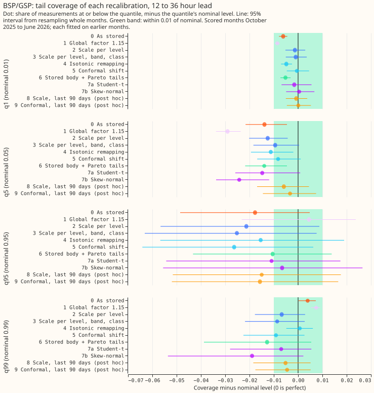
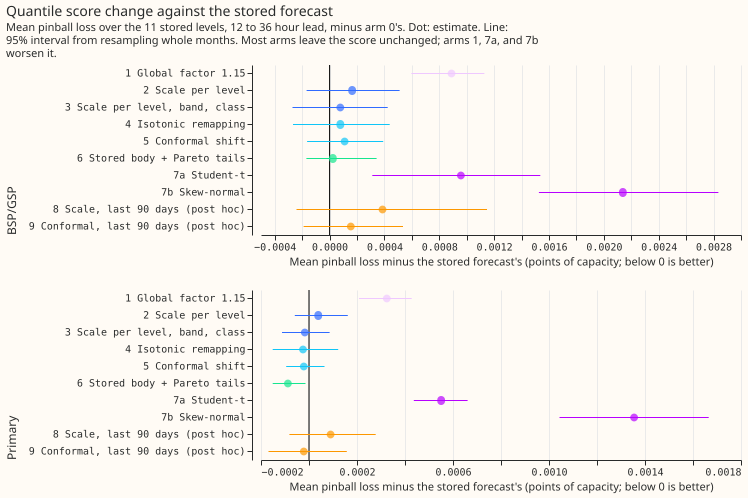
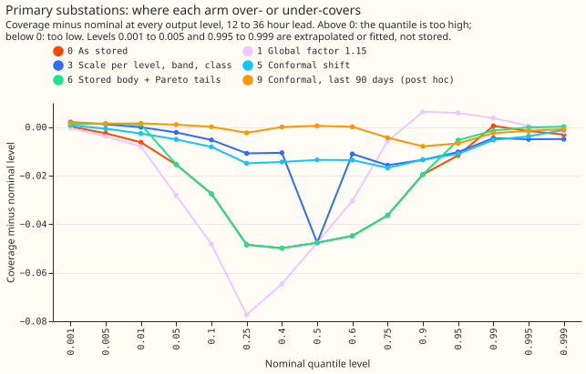

# Experiment 97: which post-hoc recalibration of the best guess fixes its tails

**Take-home: the best guess's stored tails are already close to nominal, and a calibration table
fitted on earlier months does not reliably improve them.** A quantile forecast at level 0.05 (q05)
should have 5% of measurements at or below it; that share is the quantile's coverage, and 0.05 is
its nominal level. At 12 to 36 hours lead for Primary substations, the stored q05 has a coverage of
0.035 and the stored q95 has 0.938 (nominal 0.95), so the lower quantile sits too far out and the
upper quantile slightly too close in. No recalibration of arms 1 to 7b moved the Primary q05 or q95
coverage by more than 0.013, which is less than the plus or minus 0.02 interval that 9 months of
data give. Two larger faults show in the results: the coverage of q95 swung between 0.88 and 0.97
from month to month, and the stored median has a coverage of only 0.45 for Primary substations, so
those forecasts sit slightly low. A static table cannot correct either fault.

We asked whether the 11 stored quantiles of the weekly-retrained best-guess forecast (BG2,
experiment 87) can be recalibrated after the fact. For each month from October 2025 to June 2026 we
fitted eight recalibrations (arms 1 to 7b) on every earlier measurement, compared each with the
stored forecast (arm 0), and scored them on the forecast runs of that month, for 16 Primary
substations and 4 bulk or grid supply points. **Verdict: refuted by the pre-registered rule, but
inconclusive about recalibration in general.** No arm brought the coverage of q01, q05, q95, and q99
within 0.01 of nominal in both classes and kept its centre score within 1% of the stored forecast's.
Nine months of data are too few to tell a real improvement from noise.

## Figures

## Design

- **Stored sets:** `p_s4_weekly` (Primary) and `b_weekly` (supply points) of experiment 87, 292
  daily runs from 2025-07-02 to 2026-06-30, weekly retraining, 3,984,540 rows after dropping rows
  with no measurement. Scored months October 2025 to June 2026, calibration window expanding from
  July 2025. The experiment reads no weather data; it uses only the stored quantile forecasts.
- **Arms:** 0 as stored; 1 global factor 1.15; 2 scale per level; 3 scale per level, lead band,
  and class; 4 isotonic level remapping; 5 split-conformal shift; 6 stored q10 to q90 plus Pareto
  tails; 7a Student-t; 7b skew-normal. Arms 8 and 9 are post hoc: arms 3 and 5 refitted on the last
  90 days only. Levels 0.5%, 99.5%, 0.1%, and 99.9% are extrapolated (arms 0 to 5) or fitted (arms 6
  and 7). Arm 6 can widen a tail and cannot narrow one: a level whose stored tail is already too
  wide keeps its stored value.
- **Leakage guard:** the script asserts, before any number prints, that every calibration row's
  valid time precedes the first scored run of its month. A fitted scale factor was clipped to the
  allowed range of 0.5 to 5 in 44 of 1,440 fits.
- **Classes:** the supply-point class pools 2 bulk and 2 grid supply points. The BG2 sets that
  existed when the experiment ran held no solar or wind series, so neither class is covered.

## Results

- **Stored forecast, Primary, 12 to 36 hours:** coverage of q01, q05, q95, q99, and q99.5 is 0.0037,
  0.0346, 0.9383, 0.9905, and 0.9934.
- **Stored forecast, supply points, 12 to 36 hours:** coverage of q01, q05, q95, and q99 is 0.0039,
  0.0362, 0.9323, and 0.9939, from 44 to 347 days with an exceedance.
- **Primary tail coverage after recalibration:** arm 3 gives Primary coverage of 0.0100, 0.0478,
  0.9397, and 0.9855, but supply-point q95 coverage of 0.9248, which is 0.025 from nominal.
- **Tail test:** all 9 arms fail at least one of the 8 decision cells (4 levels, 2 classes). Every
  cell has at least 30 days with an exceedance except the supply-point q01 and q99 cells of arm 1.
- **Centre test:** arms 0 and 6 pass; arms 1 to 5, 7a, and 7b fail it on the all-leads centre score
  (upper bound above 1% of the stored centre score). At 12 to 36 hours the Primary centre changes
  by at most 0.0003 for arms 1 to 6.
- **Quantile score, Primary, 12 to 36 hours (minus arm 0, points of capacity):** arm 1 +0.00032
  (+0.00021 to +0.00043), arm 3 -0.00002 (-0.00011 to +0.00009), arm 5 -0.00002, arm 6 -0.00009
  (-0.00015 to -0.00001), arm 7a +0.00055 (+0.00044 to +0.00066), arm 7b +0.00135 (+0.00104 to
  +0.00167). The stored forecast's score is 0.01882.
- **Beyond q99:** arm 6 gives Primary coverage of 0.9949 at 99.5% (stored 0.9934, arm 5 0.9912)
  and 0.0064 at 0.5% (stored 0.0024, arm 5 0.0044; nominal 0.005). Arm 6 is closer to nominal than
  the stored forecast at both levels, and closer than arm 5 at 99.5% only. The intervals of all
  three arms overlap. Supply-point q99 coverage falls from 0.9939 to 0.9772 under arm 6.
- **Median bias:** the stored q50 has a coverage of 0.452 (Primary) and 0.427 (supply points) at 12
  to 36 hours. Among arms 0 to 7b, arm 5 is the only arm that moves the median's coverage, to 0.487
  and 0.442; the post hoc arm 9 gives 0.501 and 0.479.
- **Drift:** stored Primary q95 coverage by month ranges from 0.880 (January 2026) to 0.974 (April
  2026), and q05 coverage from 0.018 (March 2026) to 0.063 (April 2026).
- **Post hoc arms 8 and 9:** the last-90-days window does not beat the expanding window: Primary
  q05 coverage 0.051 for both, q95 0.945 and 0.943, quantile score +0.00009 and -0.00002 against
  arm 0.
- **Curtailment at the scaled limit of 0.9 (node-only, two bulk supply points, GBP 2,000 per MWh,
  a retrospective calculation, not a saving):** 17 half-hours of export beyond the limit, all at one
  node. Avoidable cost is GBP 618,171 for the stored forecast and GBP 629,684 to 668,866 for arms 1
  to 5, with every interval from 0 upwards, so the arms are not separable. Arms 7a and 7b have
  avoidable costs of GBP 2.36 million and GBP 3.12 million because they plan 911 and 1,364 MWh of
  curtailment against 57.5 MWh for the stored forecast and 33.7 MWh needed.

## Caveats

- **Few months:** 9 scored months give coarse intervals, so a pass or fail at 0.01 is partly noise.
- **Classes missing:** solar and wind sets did not exist, and the supply-point class holds 4 series.
- **Exploratory:** only the 12 to 36 hour cells are decision cells; every other number is
  exploratory, and arms 8 and 9 are post hoc.
- **Extrapolation:** arms 0 to 5 read levels beyond q01 and q99 off a normal extrapolation, so
  differences between those arms at those levels reflect the extrapolation rule.

## What the results point to

- **Median bias:** the median's coverage is the largest fault in the central levels, and only a
  shift of the median (arms 5 and 9) changes it.
- **Drift:** the month-to-month swing in tail coverage is larger than any arm's correction, so a
  test of an update that tracks recent level and spread needs at least 2 years of scored runs.
- **Solar and wind:** the Pareto tails of arm 6 are untested on those classes.
