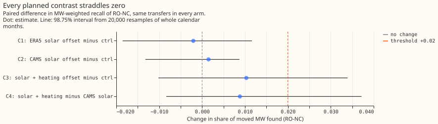
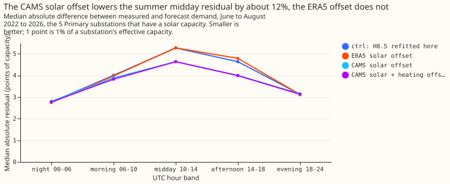
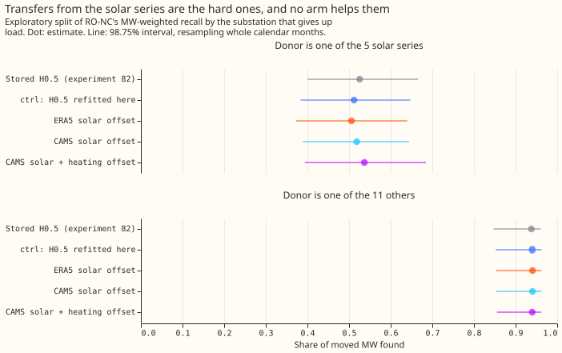

# Experiment 98: do the best guess's solar and heating offsets sharpen the LSC?

**Giving the demand forecast behind the switching detector two explicit corrections, one for solar
output and one for heating, did not detectably raise the share of moved power the detector finds,
although the solar correction made the forecast error in summer middays 12% smaller.** So removing
the solar and heating part of the forecast's weather error does not reach the misses that remain.
They are mostly small load transfers from substations whose neighbours are unmetered. The verdict
is `inconclusive`: the interval for the solar and heating arm (+0.034 at its upper end) cannot rule
out a gain of the +0.02 that we set as worth porting, and the two solar-only arms show no gain.

A load transfer is a switching operation that moves part of one Primary substation's demand (the
donor's) onto neighbouring substations (the receivers) for hours or days. A Primary substation
steps 33 kV down to 11 kV. The refit-offset neighbour-count detector (RO-NC, defined in
[experiment 82](../00082-sw2-18-19-combined-refit-offset-and-same-sign-count/result.md))
subtracts an XGBoost forecast of demand, H0.5, from the measured power and raises an alarm when the
24-hour average of the difference, the residual, steps by a set number of noise units. The best
guess is the project's current forecasting recipe, which gives its XGBoost model a solar term and
a heating term as a base margin (a fixed starting prediction for each row). We gave H0.5 the same
terms, using irradiance from ERA5 or from CAMS (two estimates of past weather), and re-ran
experiment 82's detector on the same synthetic transfers. Each arm, meaning each variant of the
forecast model, is held to 80 alarms on odd months that no logged closure explains. We compared the
share of the moved megawatts (MW) found, on transfers starting in even months.

## Results

- **Arms.** `h05_stored` is experiment 82's own result, reproduced (0.770). `ctrl` is H0.5 refitted
  here with a constant starting margin. `era5_solar` and `cams_solar` add a base margin of minus
  the capacity over effective capacity times the anomaly of a unit PV shape, at the 5 series that
  have a capacity (experiment 64's D9, D10, D11, D14, and D16), with the margin's weight fixed at
  -1. `heat` adds experiment 94's heating term at all 16 series to the CAMS solar arm, which had
  the smaller summer midday residual on odd months (5.29 points of capacity, against 5.73 for ERA5
  and 5.41 for `ctrl`).
- **Row set.** The row set is the 611 headline-band transfers per shape of experiment 82, with the
  same seeds, shapes S2, S3, and S4 pooled, starting in even months, on 16 Primary substations.
  The S4 profile shares are fitted once on the stored panel and reused in every arm. There are no
  forecast rows, so no tail-calibration or curtailment-cost table applies.
- **RO-NC MW-weighted recall (98.75% interval):** `h05_stored` 0.770 (0.659 to 0.860); `ctrl`
  0.766 (0.654 to 0.855); `era5_solar` 0.764 (0.647 to 0.853); `cams_solar` 0.769 (0.651 to 0.857);
  `heat` 0.776 (0.670 to 0.861). PF14 stays at 0.656 to 0.663 in the first four arms and 0.685 in
  `heat`.
- **Planned contrasts:** C1 `era5_solar` minus `ctrl` -0.002 (-0.019 to +0.012); C2 `cams_solar`
  minus `ctrl` +0.003 (-0.014 to +0.011); C3 `heat` minus `ctrl` +0.010 (-0.012 to +0.034); C4
  `heat` minus `cams_solar` +0.007 (-0.011 to +0.036). The rule calls `refuted` only when the upper
  ends of C1, C2, and C3 are all under +0.02, and C3's is +0.034. `ctrl` minus `h05_stored` is
  -0.004 (-0.014 to +0.003), so the cheaper refit schedule moved the detector by less than the
  width of the interval.
- **Residual noise.** The median absolute residual of the 5 solar series at 10:00 to 14:00 UTC, in
  points of capacity (1 point is 1% of a substation's effective capacity). In June to August:
  `ctrl` 5.26, `era5_solar` 5.27, `cams_solar` 4.63, `heat` 4.63. In March to May: `ctrl` 5.44,
  `era5_solar` 6.26, `cams_solar` 5.51, `heat` 5.45. At 14:00 to 18:00 UTC in June to August:
  `ctrl` 4.63, `era5_solar` 4.78, `cams_solar` 4.00, `heat` 3.99. On odd months from April to
  September, the slice that chose the parent arm, the CAMS gain is 2% (5.41 to 5.29). The mean
  absolute error of H0.5 over all 16 series and all hours, row-weighted, in points of capacity:
  `ctrl` 6.72, `era5_solar` 6.75, `cams_solar` 6.70, `heat` 6.68.
- **By donor (exploratory, same interval level).** When the donor is one of the 5 solar series
  (325 transfers per shape) RO-NC finds 0.512 (`ctrl`), 0.518 (`cams_solar`), and 0.537 (`heat`);
  `heat` minus `ctrl` is +0.025 (-0.030 to +0.062). When the donor is one of the other 11 (286
  transfers) it finds 0.940 in `ctrl` and 0.938 to 0.941 in every arm.
- **By donor step (S2 to S4 summed, each arm in its own noise units).** With no metered receiver
  and a step of 2 to 4 noise units, transfers found out of transfers in the bin: `ctrl` 139 of 545,
  `cams_solar` 105 of 490, `heat` 95 of 456. A quieter residual turns the same MW step into more
  noise units, so the larger steps move to the 4 to 6 bin (`ctrl` 174 of 256, `cams_solar` 206 of
  308, `heat` 221 of 333), and the counts of the two bins are not comparable between arms.

## Caveats

- **Lab shortcuts.** The experiment takes three. It uses ERA5 weather in the XGBoost demand
  model, where a live service would use the ECMWF ensemble. It uses the 24-hour hindsight end rules
  of experiment 82. It uses solar capacities fitted partly on data after some scored dates
  (experiment 64's held value before July 2025, experiment 78's season-year value after).
- **Schedule.** H0.5 is refitted on the 1st and on the 16th of each month, 150 rounds at eta 0.15,
  against experiment 17's 500 rounds at eta 0.05. `ctrl` matches the stored fit's mean absolute
  error for series 7 to three decimals, so the contrasts should not depend on the schedule.
- **Only 5 of 16 series have a solar term**, so the pooled recall cannot move much by
  construction. The donor split shows no detectable change among transfers from those 5 series
  either (`cams_solar` minus `ctrl` +0.007, -0.029 to +0.028; `heat` minus `ctrl` +0.025, -0.030
  to +0.062).
- **The margin's weight of -1 was fixed before the run.** Experiment 64's fitted weights of -0.3
  to -0.6 were for noisy forecast anomalies, and no other weight was tried. The capacity is used
  as experiment 64 used it, and its unit (AC or DC) was not re-checked. The ERA5 arm raised the
  spring midday residual, which may mean the margin is mis-scaled; the run does not test that.
- **CAMS has no value for about 10% of daylight half-hours** (dawn, dusk, and gaps), where the
  anomaly counts as zero. ERA5 shortwave is taken as the half-hour ending at its timestamp.
- **Not run.** The blend arm (4) was not run because ERA5 and CAMS recall did not differ, and the
  bank-holiday arm (6) because experiment 47 found it leaves recall unchanged.

## What the next experiment should answer

Of the 725 transfers that experiment 82's stored fit missed out of 1,833, 401 had a donor step of
2 to 4 noise units and no metered receiver, and another 66 had a step under 2 and no metered
receiver. Recall there needs a different detection signal. Experiment 82 lists two candidates: a
longer averaging window for the 24-hour step, and a check that the receivers' combined step
balances the donor's.
