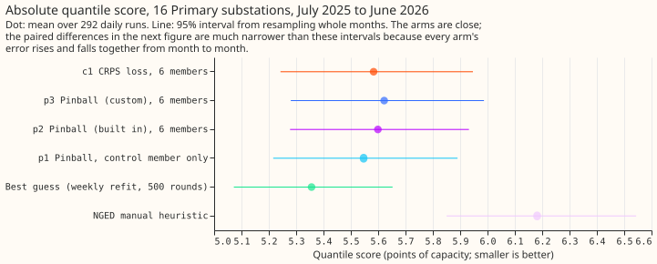
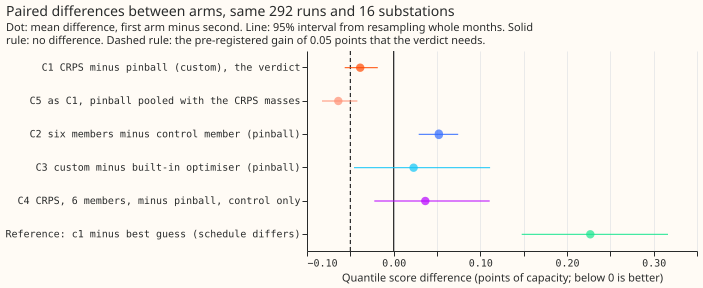
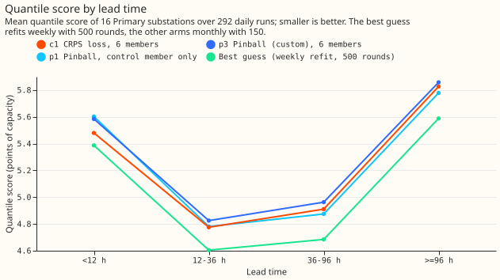
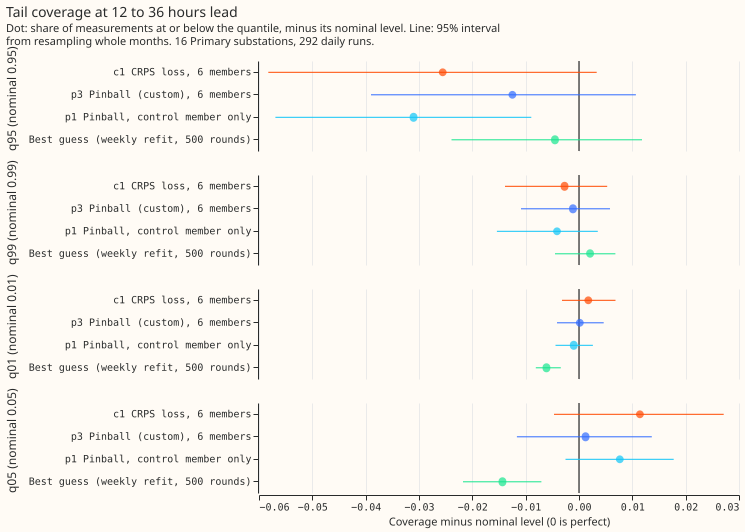

# Experiment 99: does training on the CRPS of the pooled ensemble forecast beat the pinball loss? (CRPS1 pilot)

**Take-home message: showing the model several ensemble members at once, with a loss that scores
their pooled forecast, repairs the damage that several members do to the pinball loss and does not
go further, so the 51-member run is not worth its cost for Primary substations.** The CRPS loss beat
the pinball loss on the same rows by 0.039 points of capacity. Giving the pinball loss 6 members per
run instead of the control member alone made it 0.052 points worse. The CRPS arm therefore ends
0.036 points (95% interval -0.022 to +0.111) behind the control-member recipe, and its tails are no
closer to nominal. What it narrows: the gain from a CRPS-type loss sits in the median, and the
tails need another route. The verdict is `small gain`.

We asked whether a substation forecast improves when the model learns from the ensemble's members
jointly. Each daily run gave the control member and 5 drawn members as separate rows. The CRPS arm
scores the mixture of the 6 rows' predicted quantiles, and the pinball arms score each row alone.
All arms refit monthly on a rolling 12-month window (the cheap P-roll schedule, 150 rounds, learning
rate 0.15) and forecast the 292 daily runs of July 2025 to June 2026 at 16 Primary substations,
pooling all 51 members at prediction time. One point is 1% of a substation's capacity, and a lower
score is better.

## Results

- **C1 (verdict), c1 minus p3:** -0.039 (95% interval -0.057 to -0.018), `small gain`. The
  pre-registered threshold needed the interval's upper end below -0.05. With the spread factor 1.15
  on both arms: -0.051 (-0.069 to -0.032).
- **C5, c1 minus p3m:** -0.064 (-0.083 to -0.042), where p3m is arm p3's model pooled with the
  CRPS masses. C5 is larger than C1 because pooling arm p3's pinball atoms with the CRPS masses
  costs it 0.025 points.
- **C2, p2 minus p1:** +0.052 (0.029 to 0.074). Six members as separate rows hurt the pinball loss.
- **C3, p3 minus p2:** +0.023 (-0.046 to +0.111). The custom optimiser and the built-in one cannot
  be told apart.
- **C4, c1 minus p1:** +0.036 (-0.022 to +0.111). The whole change does not beat the current recipe.
- **Reference:** c1 is 0.227 (0.148 to 0.317) and p1 is 0.190 (0.131 to 0.251) worse than the best
  guess, which refits weekly with 500 rounds; the schedule explains this gap. c1 beats the
  `manual_heuristic` by 0.598 (0.396 to 0.796).
- **Absolute scores, all leads (95% interval):** p1 5.547 (5.216 to 5.890); p2 5.599 (5.278 to
  5.932); p3 5.622 (5.280 to 5.987); c1 5.583 (5.243 to 5.946); best guess 5.356 (5.072 to 5.653);
  `manual_heuristic` 6.182 (5.850 to 6.544).
- **Other scores for C1:** the mean absolute error of the median falls by 0.109 (0.066 to 0.149);
  the threshold-weighted score at the 95th percentile of history rises by 0.008 (0.002 to 0.014);
  at the 99th and 5th percentiles the change is within noise.

| Tail check, 12 to 36 h | Quantile | c1 | p3 | p1 | Best guess |
|---|---|---|---|---|---|
| Share of actuals below the quantile | 0.01 | 0.012 | 0.010 | 0.009 | 0.004 |
| | 0.05 | 0.061 | 0.051 | 0.058 | 0.036 |
| | 0.95 | 0.924 | 0.938 | 0.919 | 0.945 |
| | 0.99 | 0.987 | 0.989 | 0.986 | 0.992 |
| Pinball loss (points of capacity) | 0.95 | 1.32 | 1.28 | 1.18 | 1.09 |

## Caveats and next steps

- **Schedule:** monthly P-roll with 150 rounds, not the weekly production recipe, so absolute scores
  are not the best guess's. The contrasts C1, C2, C3, and C5 hold the schedule fixed; whether they
  depend on it is untested.
- **Pilot limits:** 6 members per run at training (51 at prediction), every third daily run, and
  16 Primary substations. A run on all 51 members could behave differently, and the pilot cannot say
  how.
- **Tuning:** the constant Hessian (10) was chosen on four substations and January to March 2025,
  inside the training period. Both custom arms share it; its best value for each loss may differ.
  The level weights of the CRPS gradient are divided by twice the atom mass, so c1 is a
  preconditioned CRPS gradient with the same fixed point.
- **Not scored:** the curtailment-cost metric covers supply points with generators behind them, and
  this pilot trains Primary substations only. Climatology is left out because its rows stop short of
  the longest leads, so including it would drop 5% of the rows from every arm.
- **Rows:** all arms and the stored best guess share 3,197,611 forecast rows.
- **Compute:** 1.55 GPU hours of wall-clock time, 10 worker processes of one thread each.
- **Options for later:** a tail-specific spread factor on the best guess, or pooled-member spread
  statistics as input columns, because this pilot moved the centre of the distribution and left the
  tails where they were.
