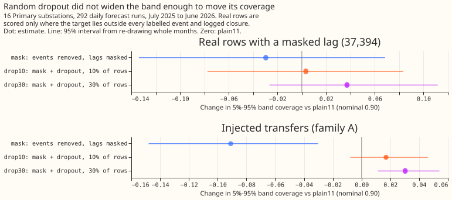
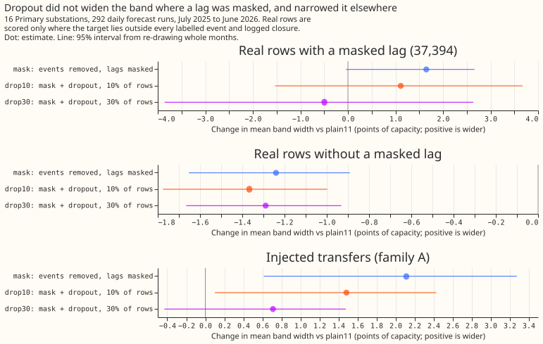
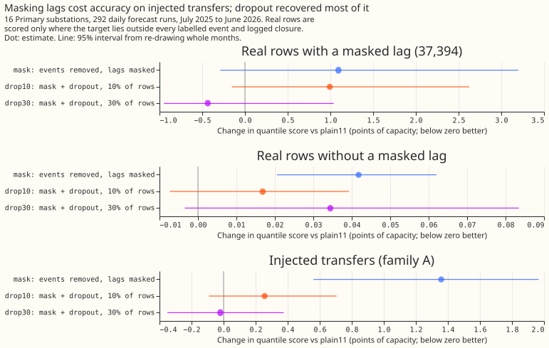
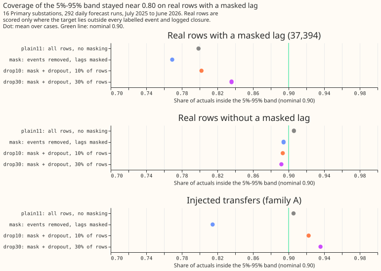
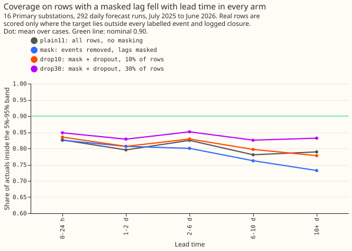

# Experiment 100: does random lag dropout make the demand forecast widen its band when a lag is missing?

**Take-home message: training the XGBoost demand forecast with its earlier power readings (lags)
hidden at random did not make its forecast interval wider where a lag is missing.** On the 37,394
real half-hours for which a lag is set to missing, the forecast's 5% to 95% interval contained 0.799
of the actual demand readings for the plain model (`plain11`, which never masks a lag) and 0.802 for
the model trained with lags hidden in 10% of its training rows (`drop10`). A well-calibrated
interval contains 0.90. The change was +0.003 (98.75% interval -0.093 to +0.101; the level is 98.75%
because four contrasts were planned). Dropout did fix a different problem. On synthetic switching
transfers of known size (from experiment 88), masking lags without dropout raised the quantile score
by 1.36 points of capacity against the plain model. Dropout in 30% of training rows brought that
difference to -0.02 (95% interval -0.35 to +0.38), which is no detectable difference. A forecast
that must run with missing lags can therefore be trained to do so. An input column that flags a
missing lag is one untested way to get the widening. The verdict is **inconclusive**: the planned
coverage contrasts did not exclude zero, and the quantile score on rows without a masked lag rose by
up to 0.046 points, above the 0.02-point limit set in the plan.

An electricity network operator sometimes closes a normally open switch, so that a Primary
substation (a substation that steps down to the local distribution network) carries a neighbour's
load for hours or days. We asked whether an XGBoost demand forecast for 16 Primary substations,
trained with some lags set to missing, would learn that a missing lag means more uncertainty. Four
XGBoost models were refitted each month on the preceding 12 months of data. `plain11` masks nothing
and has 11 quantile levels. `mask` drops the training rows whose target lies inside a labelled
switching event or logged closure (9% of rows) and sets to missing every lag inside a labelled
event. `drop10` and `drop30` add lags set to missing inside random intervals during training, in 10%
and 30% of training rows. Real rows were scored on 292 daily forecast runs (July 2025 to June
2026). The synthetic transfers supplied rows where the true unmodified series is known. The
quantile score is the mean pinball loss over the quantile levels, in points of capacity, and smaller
is better.

- **Rows with valid truth.** Real rows whose target lies outside every labelled event and logged
  closure (2,928,842). Of these, 37,394 have a lag inside a labelled event (masked rows, 81% from
  3 substations, 89% in 5 months) and 2,891,448 do not (unmasked rows). Real rows with the
  target inside an event or closure have no valid normal-arrangement truth and are never scored.
  Point accuracy during a real abnormal arrangement is not a metric.
- **Injected rows.** 3,000 family A cases (forecast origin inside the transfer; shapes S2, S3, S4,
  and S6 pooled with equal weight), from every second batch of experiment 88's events, in 10 onset
  months. Truth is the unmodified series. The lag mask is the injected interval plus the labelled
  real events (oracle masking).
- **Arms.** All at seed 0, 150 rounds, learning rate 0.15, half-life 0.5 years, 11 quantile levels,
  spread factor 1.15, mixture of 51 members (injected cases: 11). `plain11`: all rows, no masking.
  `mask`: 9% of rows dropped as targets; lags inside a labelled event set to missing in training and
  test. `drop10` and `drop30`: `mask` plus pseudo-event intervals (durations drawn from the 82
  labelled events) inside which lags are also set to missing in training only, covering 9.3% to
  10.1% and 29.3% to 30.1% of each series' training rows. At test time every arm masks only the lags
  inside a labelled event. The rows and weights of `mask`, `drop10`, and `drop30` are identical (the
  script checks the row counts).
- **Reproduction.** Experiment 86's stored `plain` had nine quantile levels and covered 0.784 on the
  masked rows; `plain11` has 11 levels and covers 0.799. `plain11` minus experiment 86's stored
  `plain` on 2,928,842 shared rows: +0.0000 points of quantile score (stored mean 5.408). The masked
  rows number 37,394, as in experiment 86.
- **Absolute scores, real masked rows** (`plain11` / `mask` / `drop10` / `drop30`). Quantile score
  10.726 / 11.820 / 11.718 / 10.291. Coverage of the 5% to 95% band 0.799 / 0.769 / 0.802 / 0.836.
  Mean width of that band 44.9 / 46.6 / 46.0 / 44.4 points of capacity.
- **Absolute scores, real unmasked rows.** Quantile score 5.339 / 5.381 / 5.356 / 5.374. Coverage
  0.906 / 0.894 / 0.893 / 0.892. Width 31.2 / 30.0 / 29.8 / 29.9.
- **Absolute scores, injected family A** (`plain11` on contaminated lags / ceiling / `mask` /
  `drop10` / `drop30`). Quantile score 3.790 / 3.435 / 5.149 / 4.046 / 3.770. Coverage 0.906 / 0.938
  / 0.815 / 0.923 / 0.936. Width 23.6 / 23.2 / 25.7 / 25.0 / 24.3. The plain model with its lags
  masked (never trained with a missing lag) scored 5.453, covered 0.867, and was 27.6 wide.
- **Planned contrasts, `drop10` minus `plain11` (98.75%).** P1, coverage on real masked rows: +0.003
  (-0.093 to +0.101). P2, coverage on injected cases: +0.017 (-0.013 to +0.055). G1, quantile score
  on injected cases: +0.256 (-0.148 to +0.847). G2, quantile score on real unmasked rows: +0.017
  (-0.013 to +0.046); its upper end exceeds the +0.02 guard. Width on real unmasked rows: ratio
  0.956 (0.940 to 0.969), so the guard of at most 1.03 holds, because the band narrowed.
- **Descriptive contrasts (95%).** On real masked rows `drop30` minus `drop10`: coverage +0.034
  (+0.000 to +0.069), quantile score -1.43 (-2.67 to -0.28). `drop10` minus `mask`: coverage +0.033
  (+0.011 to +0.062), quantile score -0.10 (-0.74 to +0.39). On injected cases `drop10` minus `mask`
  quantile score -1.10 (-1.66 to -0.44), coverage +0.108 (+0.039 to +0.168); `drop30` minus `drop10`
  -0.28 (-0.41 to -0.17). Injected cases with the target inside the transfer give the same signs
  (`drop10` minus `plain11`: coverage +0.012, quantile score +0.267). Family B (after the transfer
  ends): `drop10` minus `plain11` quantile score -0.033 (-0.121 to +0.013).
- **Tails on real masked rows** (`plain11` / `mask` / `drop10` / `drop30`). Coverage of the 1% to
  99% band 0.983 / 0.977 / 0.975 / 0.979 (nominal 0.98). Share of actuals above q99 0.0166 / 0.0234
  / 0.0249 / 0.0208 (nominal 0.01). Pinball loss at q01 0.503 / 0.508 / 0.508 / 0.510 and at q99
  0.654 / 0.629 / 0.692 / 0.680. Quantiles crossed before sorting in no member forecast, in any arm.
- **Why the verdict is `inconclusive`.** The planned rule needs P1 and P2 to exclude zero for
  `supported`, P2 to exclude zero for `small gain`, and P2's upper end below zero or G1's lower end
  above +0.02 for `refuted`. P2's interval contains zero and G1's lower end is -0.148, so none
  applies. G1's upper end (+0.847) and G2's upper end (+0.046) both exceed the +0.02 guard. The plan
  sets `not-for-production` when G2 fails, which is a production status and not a verdict word, so
  the verdict word stays `inconclusive` and `production_status` is `not-for-production`.
- **A confound the plan did not isolate.** `mask` alone lowered the coverage of the 5% to 95% band
  on unmasked rows from 0.906 to 0.894 and narrowed it by 4%. The cause is probably the 9% of
  training rows (event and closure half-hours) dropped as targets. Dropping them leaves the XGBoost
  model fitted to quieter data. A control that drops the same rows but leaves every lag unmasked
  would separate the effect of dropping rows from the effect of masking lags. The plan did not
  include that control.
- **Schedule, weather, and lab shortcuts.** The models are refitted each month on a rolling 12-month
  window (the P-roll schedule). The dropout contrasts could depend on that schedule only through
  which refits contain pseudo-event intervals. Weather is the control (unperturbed) member of the
  ECMWF ensemble forecast, available at forecast time. Labels are hindsight labels at training and
  test, and the injected mask is the true interval, so no arm is a live service. Causal-detector
  masks and the curtailment-cost metric were not scored (see the changes below).
- **Caveats.** The real masked rows come from an estimated 15 to 20 events, mostly at three
  substations, in 10 months, so P1's interval is wide (nearly +/-0.1). The injected cases are 3,000
  cases from 10 onset months. Coverage is not a proper score: a wider band reaches 0.90 without
  being better, so every coverage read is beside the quantile score.
- **Changes made after the plan.** (1) The first fit run failed at one substation, whose 30% pseudo
  share overshot (0.345), because the bisection over a prefix of intervals jumped over the target.
  The pseudo-event masks were rebuilt by accepting intervals greedily until the share is within 1.5
  points, and both dropout arms were refitted (`plain11` and `mask` were kept). (2) The injected
  scoring ran on shapes S2, S3, S4, and S6 and on every second batch of events, because the full run
  would have taken more than 12 hours; the planned causal-detector (RO-NC) masks were dropped for
  the same reason. (3) The `manual_heuristic` and `climatology` reference rows were not scored. (4)
  The plain model with masked lags was added as a descriptive variant.
- **Reviews.** One Sonnet code review found no leakage and no bug. The pseudo-event share is
  measured on each series' whole training history and not on each refit's window (accepted: the
  per-series shares are printed). The same-rows check compares row counts only (accepted: the three
  arms share one filter). An Opus design review preceded the fits. A Sonnet numbers review found
  two wrong figures (the 30% pseudo share range and a width range in `lessons`), both corrected, and
  asked that the verdict follow the plan's order of rules (rejected, because `not-for-production` is
  a production status and not a verdict word; the page now says so). A Sonnet prose review's
  findings on undefined terms in the opening, bare "model", numerals, and the claim that the
  widening "has to" come from elsewhere were applied.
- **Options for a next experiment.** Add one missingness-indicator column for each lag, so that a
  tree can give a masked lag its own leaf. Alternatively, fit a separate XGBoost model of the quantile
  spread on rows with a masked lag. Dropout rates above 30% are a third option, because the 30% arm
  had the higher coverage and the lower quantile score than the 10% arm on both the real masked rows
  and the injected cases. A control that drops the event and closure rows but leaves every lag
  unmasked would separate the effect of dropping rows from the effect of masking lags.

## Plan (written before any code ran)

- **Question.** [Experiment
  89](../00089-sw2-22-longest-history-nra-forecast-with-ara-lags-masked/result.md) set lags inside a
  union of detector and logged events to missing and made the forecast worse. [Experiment
  86](../00086-sw2-12-detector-labels-for-nra-forecast/result.md) showed that on the 37,394 rows with
  valid truth and a lag inside a logged event, the 5% to 95% band covers only 0.784 of actuals. We
  ask whether training with lags missing at random intervals teaches the model to widen its band when
  a lag is missing, instead of treating a missing lag as an extreme value.
- **Design.** An Opus design review is committed beside this file as `opus_design.md` (in
  `ml-experiments/00100-drop1-random-lag-dropout-widens-intervals/`). It departs from the
  maintainer's brief in two ways, both accepted: lags are set to missing in place (not by adding
  masked copies), so every dropout arm has the same rows and weights as `mask`; and the dropout masks
  whole pseudo-event intervals with durations drawn from the 82 labelled events (not each lag
  independently), so the missing-lag patterns match real events. The fourth arm is a 30% dose check
  rather than a group-dropout arm, because intervals already mask lags in groups.
- **Arms** (seed 0, 12-month rolling window, monthly refits, 150 rounds, eta 0.15, 11 quantile
  levels, spread factor 1.15). `plain11`: all rows, no masking. `mask`: targets inside a labelled
  event or logged closure dropped, lags inside a labelled event missing in training and test.
  `drop10`: `mask` plus pseudo-event dropout touching 10% of training rows. `drop30`: the same at
  30%, whose pseudo events include those of `drop10`.
- **Rows with valid truth.** Real rows whose target lies outside every labelled event and logged
  closure. Of these, the 37,394 with a lag inside a labelled event are the masked rows (headline);
  the rest are the unmasked rows. Real rows whose target lies inside an event or closure have no
  valid normal-arrangement truth and are never scored. Experiment 88's family A injected cases
  (truth: the unmodified series) cover the cases real data cannot validate, including a target
  inside the transfer. Point accuracy during a real abnormal arrangement is not a metric.
- **Interval behaviour is the primary read:** coverage and width of the 5% to 95% and 1% to 99%
  bands on masked and unmasked rows, the widening ratio against `plain11` on the same rows, and the
  quantile score as the proper score beside them.
- **Sizing (the five `plan-issue` triggers).** Stored: private boosters and predictions only.
  Serving path: not touched. Degradation rule: not touched. More than one defensible design: yes, so
  the design review fixed it. Callers not nameable without searching: no. Size: complex, with Sonnet
  reviewers only (the brief), and the Opus design review above.
- **Earlier advice followed.** Judge lag treatments on injected events of known size (experiments 88
  and 89); report tails at q01 to q99; do not mask on an over-marking detector label (experiment
  89). **Departure:** none.
- **Schedule.** Monthly P-roll refits; the contrast is about training-time exposure, and could depend
  on the schedule only through the number of refits in which pseudo events fall.
- **Lab conditions.** Hindsight event labels at training and test, oracle masking on injected cases.
  Causal RO-NC masks on injected cases are descriptive.
