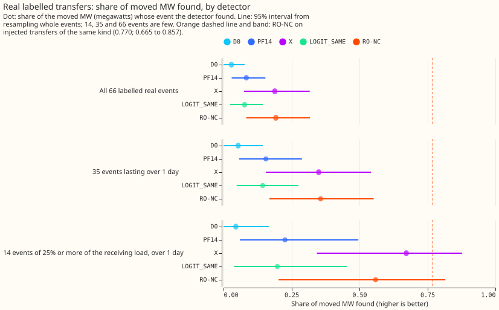
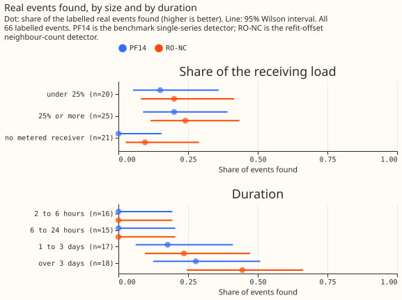
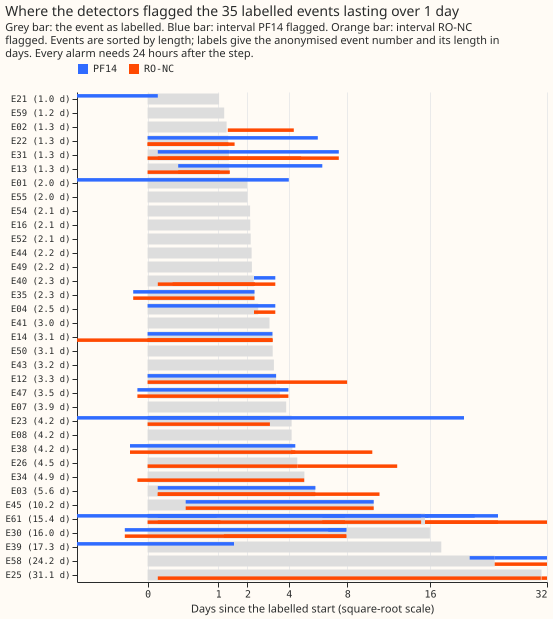
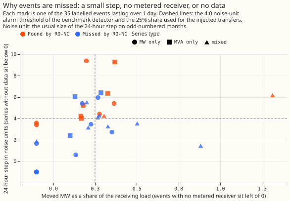

# Experiment 101: how well does the refit-offset neighbour-count detector find real switching events?

**The refit-offset neighbour-count detector (RO-NC) finds about a third of the real load transfers
lasting over 1 day (12 of 35) and none of the 31 shorter ones. On injected transfers (synthetic
transfers that experiment 82 added to the real power readings) it finds 0.770 of the megawatts
(MW) moved. Part of the gap comes from the real transfers: 6 of the 35 sit where the detector's
residual panel holds no readings, and 12 have a step under 4 noise units.** A noise unit is the
usual size of the detector's 24-hour step on odd-numbered months, a period used to set the
detector's thresholds. A load transfer is a switching operation that moves part of one Primary
substation's demand onto neighbouring substations for hours or days. A detector finds a transfer
when it raises an alarm within 2 hours of the transfer's start and places the end within the
larger of 6 hours and 10% of the duration.

The 66 real transfers are those that a language model (Sonnet), checked by a second run and by
Opus on disagreements, judged visible in the power readings of 16 Primary substations since
January 2022 ([experiment 41](../00041-sw2-0a-labeller-gate/labelled-set.md)). Of the 66, 35 last
over 1 day, and 14 of those 35 move 25% or more of the receiving substations' load, the kind the
injected transfers represent. We scored five detectors from experiments 43 to 82. D0 is the
original single-series detector. PF14 is D0 with a better end rule. X takes the step from two
XGBoost residual models refitted half a month apart. LOGIT_SAME scores PF14's alarms by the
count of neighbouring substations that step the same way. RO-NC combines X and LOGIT_SAME. We
refitted nothing: the alarms come from the stored XGBoost models and thresholds of
[experiment 82](../00082-sw2-18-19-combined-refit-offset-and-same-sign-count/result.md). Of the
17 real transfers over 1 day with readings and a step of 4 noise units or more, RO-NC finds 10,
where injected transfers of the same step size, found at the rates measured in experiment 82,
predict about 14. The verdict is `partly supported`: the 14-transfer band is consistent with the
injected recall, but the expected number found across all 35 is not. Thirty-five events are few,
so every interval below is wide.

## Results

- **Found, by detector** (events found, with a 95% Wilson interval; MW-weighted recall with a 95%
  interval from resampling whole events). The 14-event band is transfers of 25% or more of the
  receiving load lasting over 1 day, the band the injected recall of 0.770 describes.

| Detector | All 66 found | Over 1 day, 35 found | Over 1 day, MW-weighted | Band of 14, MW-weighted |
|---|---|---|---|---|
| D0 | 2 (0.03; 0.01 to 0.10) | 2 (0.06; 0.02 to 0.19) | 0.054 (0.000 to 0.144) | 0.045 (0.000 to 0.167) |
| PF14 | 8 (0.12; 0.06 to 0.22) | 8 (0.23; 0.12 to 0.39) | 0.156 (0.058 to 0.289) | 0.226 (0.060 to 0.496) |
| X | 10 (0.15; 0.08 to 0.26) | 10 (0.29; 0.16 to 0.45) | 0.350 (0.156 to 0.543) | 0.672 (0.343 to 0.877) |
| LOGIT_SAME | 7 (0.11; 0.05 to 0.20) | 7 (0.20; 0.10 to 0.36) | 0.144 (0.048 to 0.276) | 0.198 (0.038 to 0.455) |
| RO-NC | 12 (0.18; 0.11 to 0.29) | 12 (0.34; 0.21 to 0.51) | 0.357 (0.169 to 0.553) | 0.559 (0.203 to 0.816) |

- **The ordering of the detectors matches experiment 82, but the intervals overlap.** RO-NC and X
  find the most. RO-NC finds all but one of PF14's eight events (E04) and five more. On the
  band of 14 events X (0.672) is above RO-NC (0.559), and the two intervals overlap almost
  completely. The 35 events cannot rank the two detectors.
- **The MW-weighted recall is 0.357 on the 35 real events over 1 day and 0.770 on injected ones.**
  On the 14 real events that match the injected band, RO-NC's 0.559 has an interval (0.203 to
  0.816) that includes 0.770, so that band alone cannot show a gap. The expected number found, if
  each real event were found as often as an injected transfer of the same step size and metering,
  is 10.5 of 14 and 18.8 of 35; the detector found 6 and 12.
- **By size.** Over 1 day, RO-NC finds 6 of 14 events of 25% or more of the receiving load, 4 of
  11 under 25%, and 2 of 10 with no metered receiver. The other four detectors find none of the 10
  with no metered receiver (figure 2).
- **By duration, all 66.** Every detector finds 0 of 16 events of 2 to 6 hours and 0 of 15 of 6 to
  24 hours. RO-NC finds 4 of 17 events of 1 to 3 days (0.24; 0.10 to 0.47) and 8 of 18 over 3 days
  (0.44; 0.25 to 0.66). Every detector needs the 24 hours after a step, so events under 1 day are
  outside what any of these detectors can find.
- **Time to detection.** Every alarm that starts an event does so at the labelled start (median
  error 0.0 hours), and every detector needs the following 24 hours to confirm the step, so the
  detection lag is 24 hours by construction. The end of an interval is known only after the first
  opposite step.
- **Half-hours flagged.** Of the 9,332 half-hours of the 35 events, RO-NC flags 5,042 (0.54), PF14
  3,497 (0.37), and D0 3,832 (0.41). Within the events a detector finds, it flags 0.99 or more. A
  half-hour counts as flagged if any alarm interval on the event's series covers it.
- **Unexplained alarms.** Over the whole history (2022-01 to 2026-06), at experiment 82's
  thresholds, RO-NC raised 286 alarms: 50 inside a labelled event, 89 within 24 hours of another
  logged closure, and 147 with no logged explanation. D0 and PF14 raised 297 (31, 106, and 160), X
  297 (37, 105, and 155), and LOGIT_SAME 267 (40, 86, and 141). The thresholds were set at 80
  unexplained alarms on odd months, so these counts are not matched on all months.

## Why the real recall is lower than the injected recall

- **Six events have no readings in the detector's data.** The residual panel holds no readings on
  P12 or P13 during the six events E44, E49, E50, E52, E54, and E59, which hold 11.5 of the
  42.7 MW. No detector can find them. Experiment 82's count of 12 found of 35 includes them as misses.
- **Twelve events have a step under 4 noise units.** The step is the largest 24-hour step in the
  stored residual within 2 hours of the labelled start, in noise units (the usual size of that step
  on odd-numbered months). These 12 hold 10.6 MW, 4 have no metered receiver, and RO-NC finds 2 of
  them. On injected transfers, recall at 2 to 4 noise units is 0.651 with a metered receiver and
  0.209 without, so injected transfers of these steps predict 4.4 found, against 2.
- **RO-NC finds 10 of the other 17 events.** Injected transfers of the same step size and
  metering predict about 14. Of the 7 missed, 3 have an alarm at the start but a wrong end (E13,
  E23, and E47) and 4 have no alarm at the start (E02, E04, E30, and E45). X finds E02.
- **Real events differ from injected ones in more than step size.** The injected transfers add a
  clean shape to a quiet window, and their labelled start and end are exact. Real starts and ends
  were placed by a labeller, who put the start within 1 hour in 77 of 78 injected cases but may be
  further off on real events.
- **The sample is small.** The expected count over the 35 events has a standard error of 2.0 events
  if each event were found independently at its predicted rate, so 12 against 18.8 is a gap of
  about 3.4 standard errors, and the 14-event band alone (6 against 10.5) is not enough to show it.

## What share of NGED's logged switching half-hours lie inside labelled transfers

**A small share: 2.6% of logged half-hours lie inside labelled transfers of 25% or more of the
receiving load, and 4.4% inside any labelled transfer.** Most logged half-hours are in closures
that the labels do not cover, so the reading that most logged closures move little load is
supported only for closures of 2 hours to 60 days.

- **Experiment 91's 19,099 logged half-hours** (rows in the lag windows of its 292 origins, July
  2025 to June 2026; 3,443 distinct half-hours): 42 (0.2%) lie inside a labelled transfer of 25% or
  more of the receiving load, and 1,950 (10.2%) inside any of the 66 labelled transfers.
- **Whole history, 16 series, 381,830 logged half-hours:** 9,868 (2.6%) lie inside a labelled
  transfer of 25% or more of the receiving load, 7,045 (1.8%) inside another labelled transfer,
  307,266 (80.5%) in closures over 60 days, 1,254 (0.3%) in closures under 2 hours, and 56,397
  (14.8%) in 2-hour-to-60-day closures where no transfer was seen.
- **Closures of 2 hours to 60 days only** (69,792 logged half-hours): 9,063 (13.0%) lie inside a
  transfer of 25% or more of the receiving load, and 13,395 (19.2%) inside any labelled transfer.
  The other 80.8% show no transfer the labeller could see, which means no large transfer: the
  labeller finds transfers under 25% of the receiving load or under 24 hours with a recall under
  0.80 (experiment 41).

## Caveats

- **The 66 labels come from a language model.** A transfer the labeller missed is not here, so the
  recall above is a recall against visible, hand-filtered transfers only.
- **The residual panel is the stored one of experiment 37.** It holds no readings on P12 and P13
  in the six events above. Why the labeller saw a transfer there is not checked here.
- **The share of the receiving load is blank for 21 events** with no metered receiver, 10 of them
  over 1 day, and the labelled MW comes from the labeller's median estimate.
- **Lab shortcuts.** The residual uses ERA5 weather and hindsight ends of up to 14 days, so the
  numbers describe the detector as a training-time tool, as in experiment 82.

## What a next experiment could test

One option is to test whether a detector can find the 12 events with a step under 4 noise units,
which hold 10.6 MW. Experiment 82 suggested a longer averaging window and a check that the
receivers' combined step balances the donor's. Another option is to restore the readings of P12 and
P13 in the residual panel, so that the 6 events there can be scored. The research plan owns the
choice.

The event-by-event table is on the [events page](events.md). Code:
`ml-experiments/00101-ro-nc-detector-on-real-hand-filtered-switching-events/`; every number above
is printed by `e00101_real.py` and `e00101_report.py`.
