# Experiment 102: SIMP1, which parts of the BG2 best guess can be removed before production

**Take-home message: the three recent-power inputs are the one part of the best guess that cannot be
removed at Primary substations and supply points, and two of the 16 Primary substations account for
most of that cost.** A Primary substation steps 33 kV or 66 kV down to 11 kV, and a supply point is a
bulk supply point (BSP) or grid supply point (GSP), where the transmission network feeds the
distribution network. BG2 is the best-guess forecast of experiment 87. The score is the quantile
score in points of capacity, where one point is 1% of a series' capacity and lower is better. The
simplest Primary forecast, a single weekly-refitted XGBoost model without the power inputs, the solar
offset, the 14-day correction, or the blend, scores 6.066 against BG2's 5.260. The loss is 0.806
points (99% interval 0.367 to 1.569), far above the 0.15 that would count as safe, and the forecast is
no better than `manual_heuristic`, NGED's rule of thumb, at 6.182. The lag result is driven by two
series: without Primary K and Primary M, the loss falls to 0.173 points (0.081 to 0.295). The verdict
is `partly supported`: 2 of the 5 pre-registered contrasts hold.

We asked which parts of BG2 earn their place in production. We removed each part in turn from the
best guess (the blend of five models, the three recent-power inputs, the solar offset, the 14-day
correction, the spread factor of 1.15), scored each result against BG2 on the same 292 daily
forecast runs, and also scored the solar offset on midday summer rows. The blend, offset,
correction, and spread factor each cost 0.1 points or less when removed, and a blend of weekly,
analogue, and frozen models matches BG2's five models. At the farms the power inputs make no
measurable difference: -0.059 points at wind farms and +0.010 at solar farms.

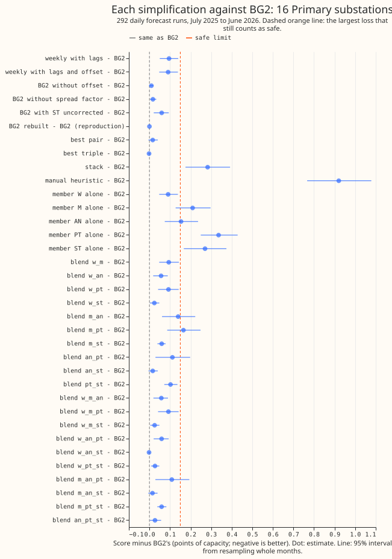

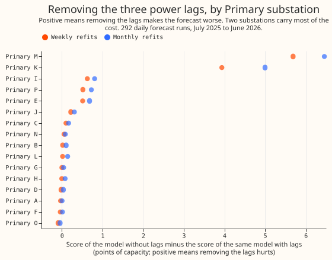

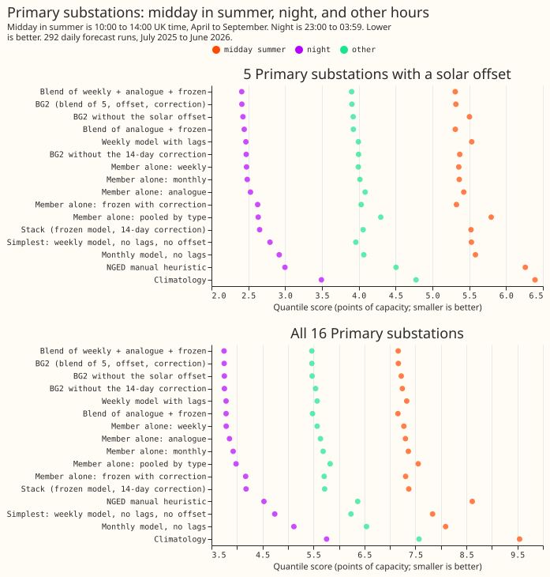

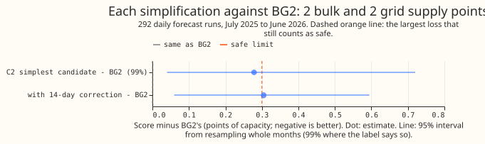

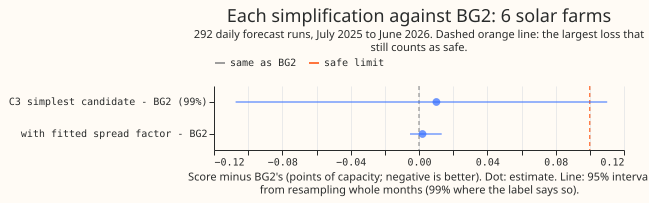

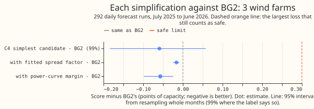

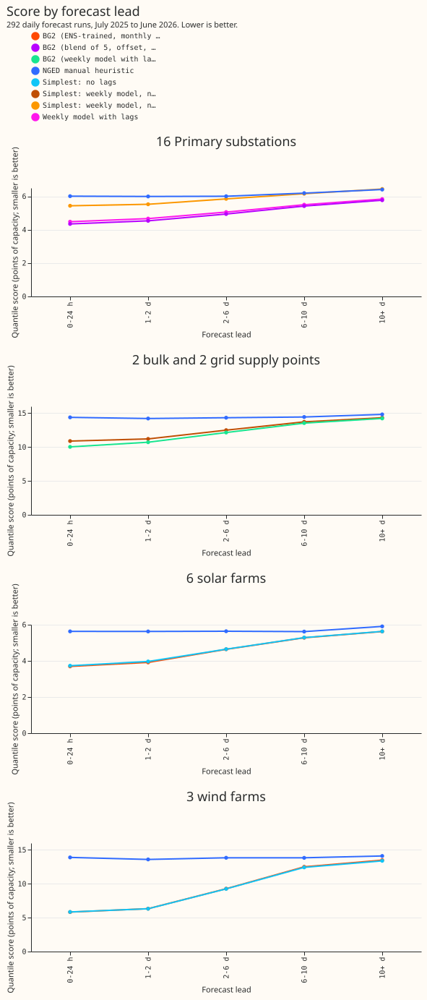

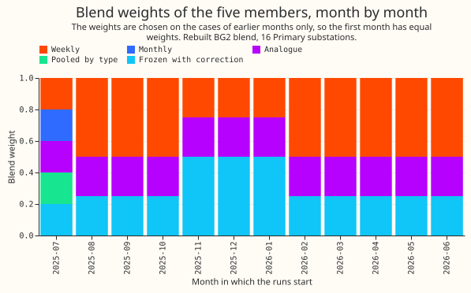

**Example forecasts.** Each figure shows BG2, the simplifications, and `manual_heuristic` for one
series in the week with the highest mean power in summer, the week with the highest mean power in
winter, and the week with the largest error. The series are Primary G, Solar farm A, Wind farm A,
and one supply point.

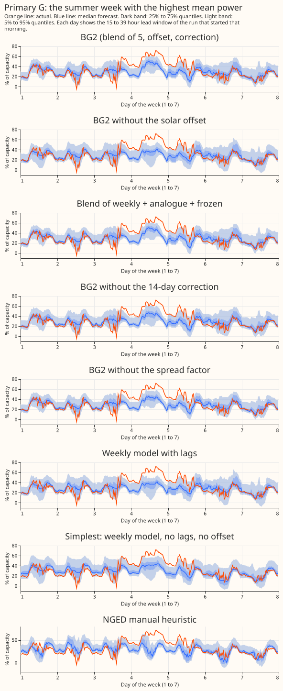

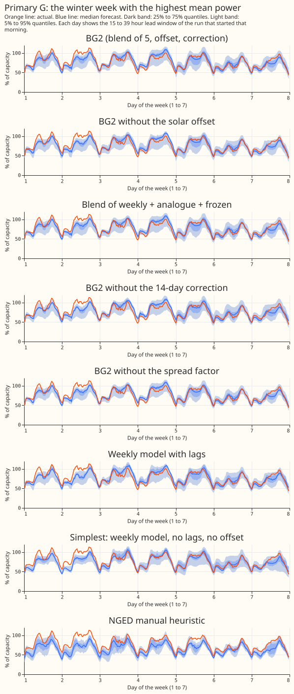

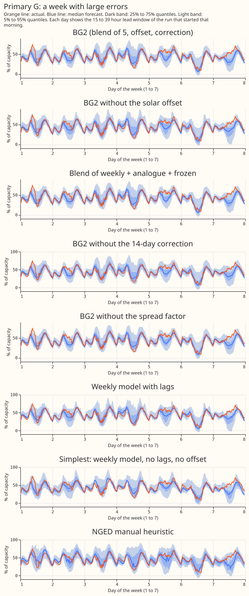

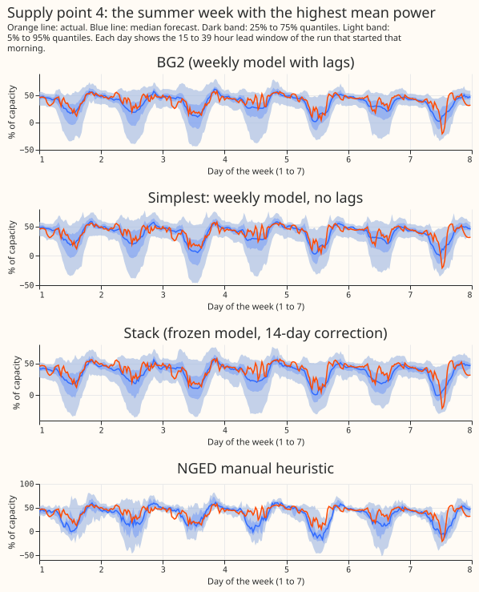

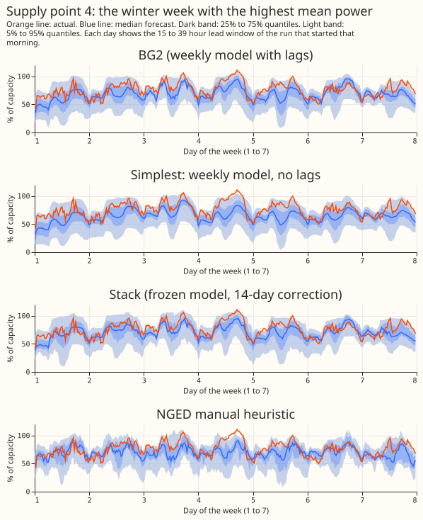

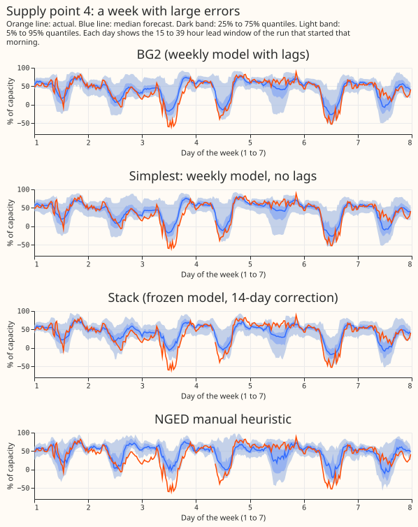

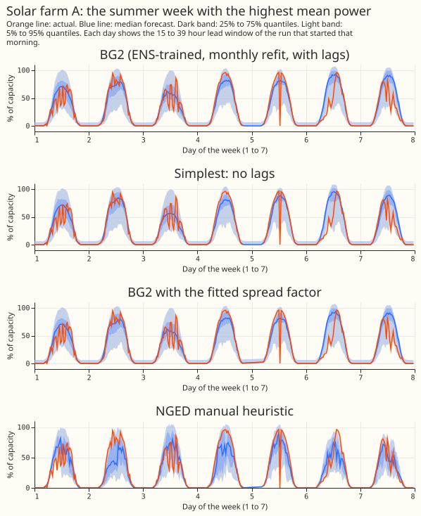

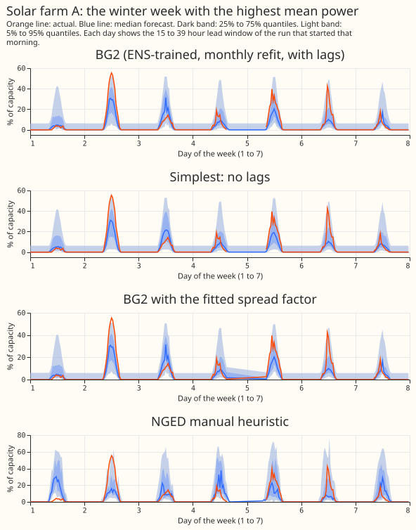

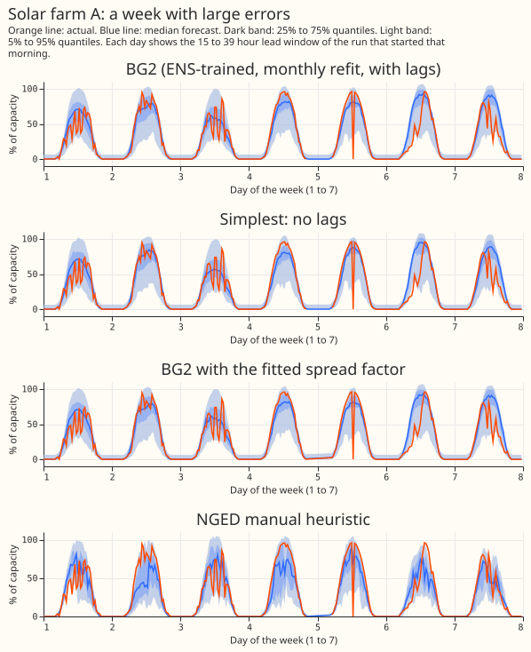

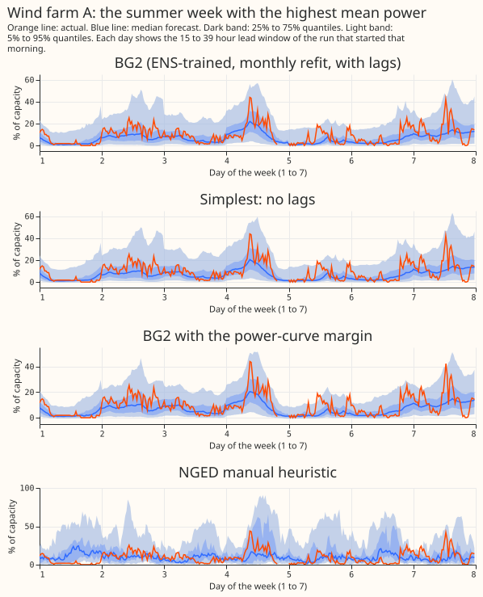

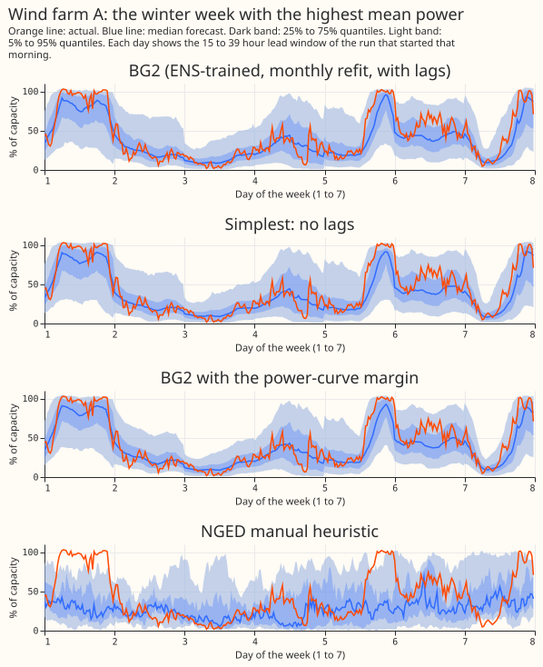

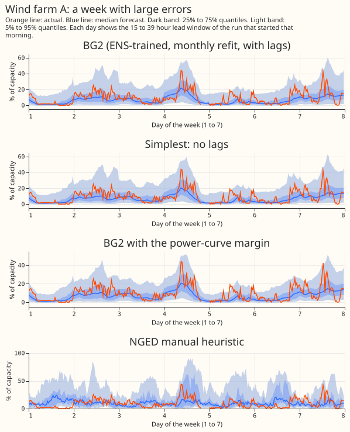

**The five blend members.** Each figure shows the median forecast of the weekly, monthly, analogue,
pooled-by-type, and frozen-with-correction members, with the blend and the actual, at one Primary
substation. The same three weeks are drawn for Primary G and Primary K in this folder
(`figure_5_members_g_*` and `figure_5_members_k_*`).

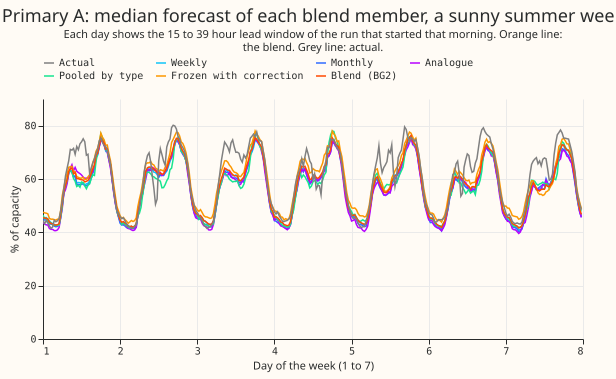

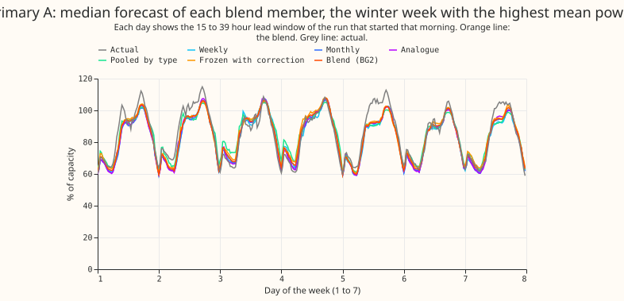

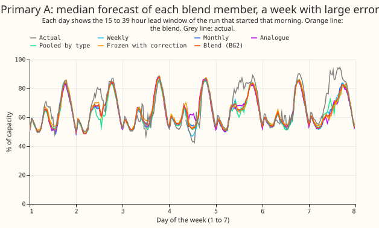

## Results

- **Architecture and arms.** Every arm is BG2 (experiment 87) with one part removed. The removal
  arms are the five blend members alone, every blend of two or three members, BG2 with the frozen
  member uncorrected, BG2 without the offset, BG2 without the spread factor (the last two stored in
  experiment 87), and the single XGBoost model without the three power inputs. The weekly model
  without lags is the Primary and supply point simplest candidate; the monthly model without lags
  is the farm candidate and the monthly contrast at Primaries. Every no-lag model is BG2's model
  with the three lag columns removed (same rows, weights, 500 rounds, seed 0).
- **Row set and schedule.** The 292 runs of `fold_a_daily_gap_v1`. Primary and supply point
  contrasts C1 and C2 use weekly refits, as BG2 does. The farm contrasts and the monthly lag contrast
  use monthly refits, as BG2's farm arms do. The lag cost has the same sign and a similar size under
  both schedules (0.903 points monthly and 0.710 weekly, at Primaries). GPU use was 13.0 hours of
  wall time.
- **Lag weather.** The lags are the observed power of the series, not weather, so no past-weather
  source enters the lag columns, and every lag is at least 3.5 hours older than the forecast
  origin.
- **The five verdict contrasts, each at 99%.** Primary C1: +0.806 (0.367 to 1.569), not safe
  against 0.15. Supply points C2: +0.278 (0.040 to 0.720), not shown safe against 0.30. Solar farms
  C3: +0.010 (-0.107 to +0.110), not shown safe against 0.10, because the upper end exceeds the limit
  by 0.010. Wind farms C4: -0.059 (-0.184 to +0.058), safe against 0.30. Solar offset C5, midday in
  summer at the 5 offset Primaries: -0.184 (-0.297 to -0.103), the offset helps.
- **The lag cost sits in two Primary substations.** Weekly refits, no-lag minus with-lag, per
  substation: Primary M +5.69 and Primary K +3.94; Primary I +0.63, Primary P +0.52, Primary E +0.51;
  the other 11 range from -0.09 to +0.22. Leaving out Primary K and Primary M, the lag cost is
  +0.136 points (99% interval 0.055 to 0.232) and C1 is +0.173 (0.081 to 0.295). With all 16, C1 is
  +0.806. Both of those two substations lose in the same direction under weekly and monthly refits
  (figure 7).
- **Where each simplification lands, Primary.** Differences from BG2 (5.260), 95% intervals:
  weekly model with lags +0.095 (0.050 to 0.140); blend of weekly, analogue, and frozen -0.002
  (-0.006 to 0.000); analogue and frozen pair +0.016 (-0.005 to +0.041); without the 14-day
  correction +0.060 (0.021 to 0.094); without the spread factor +0.017 (0.003 to 0.033); without the
  offset +0.010 (0.000 to 0.019); each member alone +0.091 (weekly), +0.154 (analogue), +0.210
  (monthly), +0.270 (frozen), +0.336 (pooled). Against the stack (5.543) the simplest candidate is
  +0.523 (0.124 to 1.071) worse; against `manual_heuristic` it is -0.115 (-0.433 to +0.430), no
  difference.
- **Supply points.** Weekly without lags 13.203, monthly without lags 13.379, against BG2 12.925. The
  simplest candidate beats `manual_heuristic` by 1.300 points (0.784 to 1.803) and the stack by 0.356
  (0.118 to 0.677).
- **Farms.** Solar farms: BG2 5.012, without lags 5.022; `manual_heuristic` 5.718. The fitted
  spread factor changes the score by +0.002 (-0.005 to +0.013). Wind farms: BG2 11.032, without lags
  10.973; the power-curve margin changes the score by -0.057 (-0.098 to -0.024); `manual_heuristic`
  13.906. The no-lag farm forecasts beat `manual_heuristic` by 0.693 (solar) and 2.930 (wind) points.
- **Midday in summer, night, and other hours (offset effect, BG2 minus BG2 without the offset).** At
  the 5 offset Primaries: midday in summer -0.184 (-0.297 to -0.103), night -0.014 (-0.044 to +0.019),
  other hours -0.017 (-0.056 to +0.021), all rows -0.031 (-0.071 to +0.011). At all 16 Primaries:
  midday in summer -0.058 (-0.093 to -0.032), all rows -0.010 (-0.022 to +0.003). The score at the 5
  offset Primaries at midday in summer is 5.319 with the offset and 5.503 without it. Midday in
  summer is the half-hours that start from 10:00 to 13:30 UK time in April to September, and night is
  the half-hours that start from 23:00 to 03:30.
- **Lead time.** The simplest Primary candidate loses at every lead band, and the loss shrinks with
  lead: +1.085 at 0 to 24 hours, +0.993 at 1 to 2 days, +0.906 at 2 to 6 days, +0.743 at 6 to 10 days,
  and +0.670 at 10 days and beyond (all 99% intervals exclude zero).
- **Blend weights.** After the first month (equal weights), the blend gives the monthly and the
  pooled-by-type members zero weight in every month. The weekly member takes 0.25 to 0.50, the
  analogue member 0.25 in every month, and the frozen member with correction 0.25 to 0.50. This
  matches the best three-model blend.

| Tail check, 292 runs | Quantile | Primary BG2 | Primary simplest | Wind BG2 | Wind simplest |
|---|---|---|---|---|---|
| Share of actuals below the quantile | 0.01 | 0.007 | 0.004 | 0.003 | 0.002 |
| | 0.05 | 0.042 | 0.035 | 0.037 | 0.029 |
| | 0.95 | 0.937 | 0.935 | 0.951 | 0.957 |
| | 0.99 | 0.986 | 0.991 | 0.987 | 0.989 |
| Pinball loss | 0.01 / 0.05 | 0.280 / 0.901 | 0.317 / 1.071 | 0.269 / 1.265 | 0.269 / 1.261 |
| | 0.95 / 0.99 | 1.208 / 0.415 | 1.419 / 0.447 | 2.708 / 0.697 | 2.692 / 0.694 |

The tails of the lag-free forecasts stay close to nominal at the farms and at Primaries. Primary
loses most at the 0.05 and 0.95 pinball loss (+0.170 and +0.211).

| Class and limit | Simplest recipe within the limit | Cost against BG2 |
|---|---|---|
| Primary substations, 0.15 | A single weekly model with lags | +0.095 (0.050 to 0.140) |
| Primary substations, 0.15 | Blend of weekly, analogue, and frozen | -0.002 (-0.006 to 0.000) |
| Supply points, 0.30 | None found; without lags | +0.278 (0.040 to 0.720) |
| Solar farms, 0.10 | Without lags (borderline) | +0.010 (-0.107 to +0.110) |
| Wind farms, 0.30 | Without lags | -0.059 (-0.184 to +0.058) |

## Checks

- **Median forecast minus mean forecast, per site, in points of capacity.** BG2 at Primaries ranges
  from -3.01 (Primary K) to +0.09, with all but Primary K and Primary I (-1.96) within -0.9 to +0.1.
  The simplest candidate ranges from -3.99 to +0.46. `manual_heuristic` has the same shape (-3.11 at
  Primary K). At farms the gap is -1.4 to -2.2 at solar and -5.4 to -7.6 at wind for both BG2 and the
  lag-free forecast, so removing the lags shifts it by less than 0.6 points. The supply points range
  from -5.9 to +3.9 for BG2 and `manual_heuristic` alike.
- **Error of the mean forecast beside each score contrast.** C1 +1.084 (0.648 to 1.717), C2 +0.241
  (0.030 to 0.494), C3 +0.041 (-0.043 to +0.121), C4 -0.055 (-0.165 to +0.050), all 95%. The error of
  the median forecast agrees in sign with the score contrast for every contrast except two spread-factor
  contrasts, whose median is unchanged by construction. For C5 at the offset Primaries at midday in
  summer, the median error changes by -0.246 (-0.362 to -0.148).
- **Triggers fired.** Trigger 2 (a result contradicts its prediction): the lag cost of 0.806 is
  above the predicted 0.05 to 0.30; the per-substation table above is the tested explanation.
  Trigger 4 (leaving a site out flips a planned contrast): leaving out solar farm E turns C3 from
  not safe into safe (-0.024 to +0.018 at 99%). Trigger 5 (a nested arm beats the arm that contains
  it): wind farms without lags score 0.059 points lower than with lags, within the interval.
  Triggers 1, 3, 6, and 7 did not fire. The audit is pending; its findings and triage will be
  recorded here.

## Caveats and what to try next

- **The two-substation result needs a reason.** Primary K and Primary M lose 3.9 to 6.5 points
  without lags. The lags may carry a level shift, such as a new connection, that the weather and
  calendar inputs cannot see. This experiment does not test that cause.
- **The best pair and best triple are exploratory.** They were chosen on the 73 runs of
  `fold_a_every5d_v1`, which interleave in time with the 292 runs scored, so their numbers decide no
  verdict.
- **Not run.** The curtailment-cost metric (it needs the private node table), a no-lag blend,
  and an offset on no-lag models. The offset contrast C5 compares blends that each choose their own
  monthly weights, so it includes a small weights effect.
- **Selection bias.** The BG2 recipe was tuned on the same validation year, so every simplification
  is judged against an optimistic reference.
- **Next.** Find out what the lags carry at Primary K and Primary M; test the three-model blend and
  the farm models without lags on a second year; give the supply points a lag-free alternative only
  if a level input can replace the lags.
