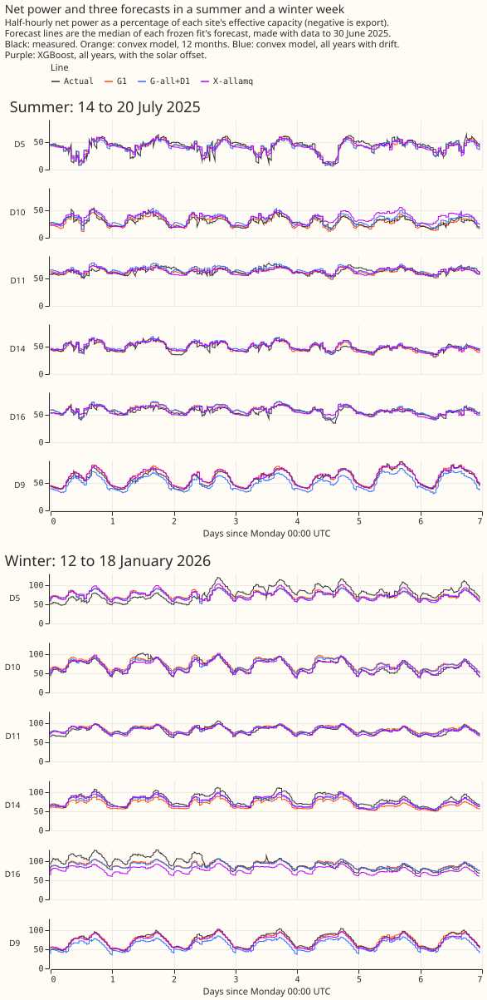
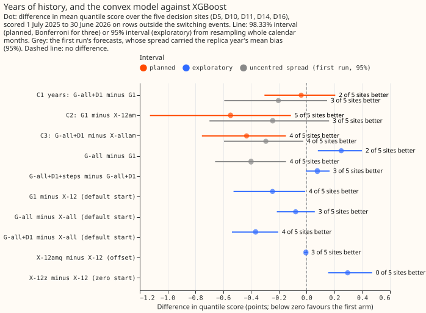
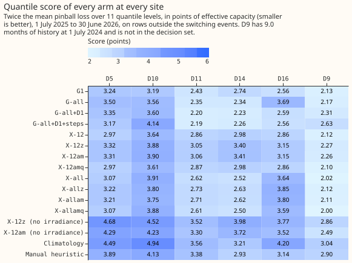
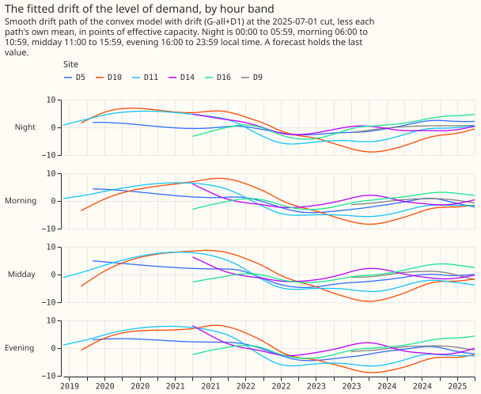
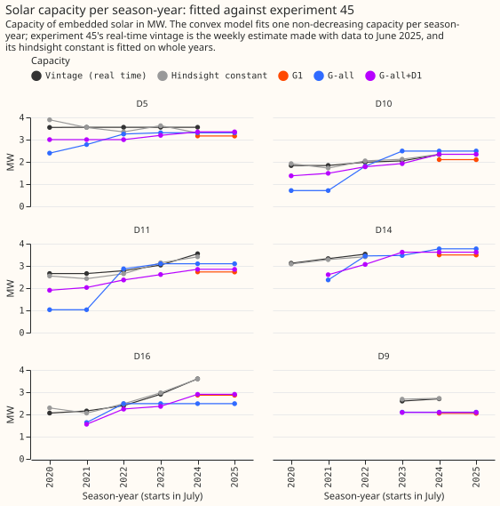
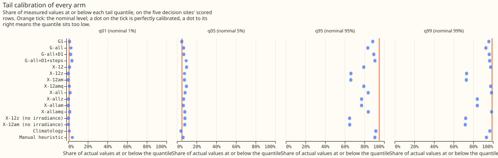
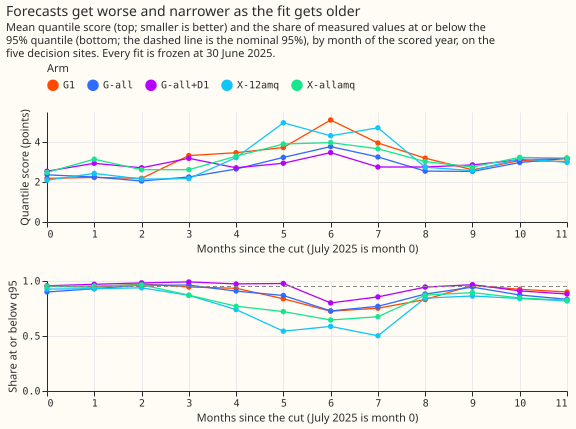
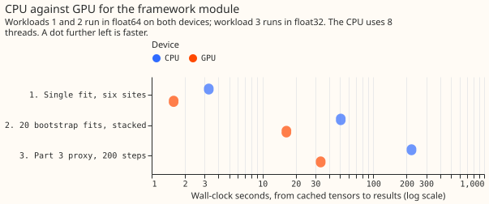

# Differentiable physics, part 2: a simple structural model of demand and solar

**A simple model of demand minus solar forecasts better than lagless XGBoost on the same inputs, but
more years of history do not clearly help it.** This is part 2 of a six-part series on models built
from physical terms (a daily profile, holidays, heating, and solar output) and fitted by
gradient-based optimisation; part 3 pools the model across substations. Trained on 12 months, the
model scored 0.25 points better than the best lagless XGBoost (a lower score is better). Trained on
all usable years with no drift it scored 0.25 points worse than on 12 months, and a drift term
recovered that, so the planned comparison, all years with drift against 12 months, gave 0.04 points
better with an interval from 0.30 better to 0.21 worse, and 2 of the 5 decision substations
improved. The verdict is `inconclusive`: the planned comparison's interval spans zero, and the
zero-start and solar-offset positive controls still fail. On the comparison alone, the merged rule
for the first scoring pass would give `partly supported`.

The result narrows the long-history question to "all years need a drift to be level with 12
months, and the data cannot yet say whether they gain". By substation the planned comparison is
mixed: D14 (-0.51) and D11 (-0.22) improve, and D10 (+0.41), D5 (+0.11), and D16 (+0.03) worsen.

We fitted the model, one convex optimisation (a problem with a single best answer) per Primary
substation, on data to 30 June 2025, held it fixed, and scored it on every half-hour from 1 July
2025 to 30 June 2026. The score is twice the mean pinball loss (an error measure for quantile
forecasts) over 11 quantile levels, in points of effective capacity (1% of the substation's
effective capacity, the scale every experiment divides power by). The five decision substations
are D5, D10, D11, D14, and D16; D9 has 9.0 months of history at 2024-07-01 and is reported beside
them. ERA5 (a reanalysis) and CAMS (a satellite-based irradiance product) supply temperature and
irradiance; both are estimates of past weather.

## Correction (2026-10-19)

**The first version of this page reported the opposite sign for the years contrasts, because the
forecast spread carried last year's mean bias into the scored year.** An audit found no bug in the
fits. The fault was in the design of the spread: each quantile was the fitted mean plus the raw
quantiles of the residuals of a replica fitted 12 months earlier, and the raw quantiles carry that
replica year's mean bias, which shifted every quantile of the scored year by the same amount. The
shift of the median forecast from the mean forecast ranged from -7.5 points (D9, G-all+D1) to +3.6
points (D11, G-all+D1), and fully explains D9's former scores of 6.39 and 15.67. The spread is now
centred: each (hour band, calendar quarter) group's median is subtracted from its quantiles
(`ResidualSpread.fit(centre=True)`, with a test that fails if the quantiles are not centred). The
fits, the penalties, and the XGBoost arms are unchanged. The first run's sets stay in the store
under their original names (`g1`, `g_all`, and so on) as the uncentred arm; the corrected sets are
`g1_centred` and so on. `report_uncentred_first_run.txt` holds the first run's report, and
`E104_SPREAD=uncentred` makes `e00104_report.py` reproduce it.

| Quantity (five decision substations) | First run (uncentred) | Corrected (centred) |
|---|---|---|
| G-all minus G1 | -0.40 (-0.66 to -0.15) | +0.25 (+0.08 to +0.40) |
| C1: G-all+D1 minus G1 (98.33%) | -0.20 (-0.68 to +0.22) | -0.04 (-0.30 to +0.21) |
| G-all+D1 minus G-all | +0.20 (-0.05 to +0.43) | -0.29 (-0.37 to -0.21) |
| C2: G1 minus X-12am (98.33%) | -0.24 (-0.80 to +0.24) | -0.55 (-1.13 to -0.11) |
| C3: G-all+D1 minus X-allam (98.33%) | -0.29 (-0.67 to +0.03) | -0.43 (-0.75 to -0.15) |
| G-all minus X-12 | -0.34 (-0.66 to -0.07) | +0.00 (-0.40 to +0.34) |
| Absolute: G1, G-all, G-all+D1 | 3.13, 2.73, 2.92 | 2.82, 3.07, 2.78 |
| D9, G-all+D1 and G-all+D1+steps | 6.39, 15.67 | 2.31, 2.63 |

- **What changed in the conclusions.** More years without drift now hurt, as the pre-registered
  positive control predicted, where the first run said they helped by 0.40. Drift now helps the
  score in every month of the scored year (-0.07 to -0.51), where the first run said it lost most
  in August to October. The convex model's lead over XGBoost with the zero-start benchmarks is
  larger (C2 -0.55, C3 -0.43), and G-all is level with the best XGBoost, not 0.34 better.
- **The bias as its own result.** Uncentred minus centred, five-site score: G1 +0.30, G-all -0.35,
  G-all+D1 +0.14, G-all+D1+steps +0.13 (report section 12). The replica year's bias helped one arm
  and hurt three, and the sign differed between substations, so it was a shift by chance, not a
  usable correction. Whether the replica year's bias predicts the scored year's bias was not tested
  beyond these four arms.
- **What did not change.** The zero-start result (+0.30), the solar offset with irradiance
  (+0.006), the lagged reference, the cold block, the capacities, and the GPU benchmark are
  unaffected, because they do not use the spread. The tails are not fixed by centring: G-all+D1
  covers 2.5%, 6.9%, 89.5%, and 96.2% at the 1%, 5%, 95%, and 99% quantiles, and pooled coverage
  hides opposite errors between substations.
- **D10's unlabelled jumps.** The audit reported 15 to 20 point jumps in D10's power from about
  8 November 2024 and about 1 November 2025, probably unlabelled switching. We found the first on
  8 November 2024 (the night-time floor rises from 25 to 45 points and stays high to about 1
  December), inside the training data, which this correction does not remove from any fit. We found
  the second as a rise of 15 to 20 points in D10's residuals from 17 November to 14 December 2025,
  not on 1 November. With those 28 days dropped at D10 only (1,344 of 17,401 rows), D10's scores
  fall by 0.15 to 0.54 (G1 3.19 to 3.04, G-all+D1 3.60 to 3.44, X-12am 3.90 to 3.37), and the
  five-site contrasts move by under 0.08 (report section 13): G-all minus G1 +0.24, C1 -0.05,
  G-all+D1 minus G-all -0.29, C2 -0.47, C3 -0.41, G-all minus X-12 +0.05. No conclusion changes.

## Figures

## Results

- **Arms.** Convex model (G): `G1` (12 months, no drift), `G-all` (all years, no drift),
  `G-all+D1` (all years, a drift level per hour band), `G-all+D1+steps` (D1 plus sparse steps).
  XGBoost (X) without power lags, same weather inputs, named by window (`12` months or `all` years)
  and suffix: no suffix is XGBoost's default start, `z` a zero start, `am` a zero start plus
  experiment 64's solar offset, `amq` (post hoc) each quantile starting at its training quantile
  plus the offset, and `ng` (post hoc) no irradiance input. References: climatology and
  `manual_heuristic`. Penalties were tuned on 2024-07 to 2025-06 by mean absolute error (ridge
  0.1, drift step 3,000, step penalty 300). Every fit is frozen at 30 June 2025 with no refits, and
  uses one seed (the screening tier of the series). The convex arms' quantiles are the fitted mean
  plus the centred residual quantiles of a replica fit (see Correction); every number below is
  from the centred sets unless it says "first run".
- **Absolute scores (points, five decision sites; figure 3 has every site).** G1 2.82, G-all 3.07,
  G-all+D1 2.78, G-all+D1+steps 2.86; X-12 3.07, X-all 3.15, X-12amq 3.06; climatology 4.07,
  `manual_heuristic` 3.49. D9, which holds 21 months at the final cut, scores 2.31 (G-all+D1) and
  2.63 (steps); its former 6.39 and 15.67 were the uncentred spread's shift.
- **C1 (the verdict contrast): G-all+D1 minus G1 is -0.04** (98.33% interval, which corrects for
  three planned contrasts by the Bonferroni method: -0.30 to +0.21; 2 of 5 better). Per site: D14
  -0.51, D11 -0.22, D16 +0.03, D5 +0.11, D10 +0.41. With D9 (six sites) it is 0.00 (-0.21 to
  +0.21).
- **C2 and C3 (labels under the merged rule, not a claim of a DP gain).** C2, G1 minus X-12am:
  -0.55 (-1.13 to -0.11; 5 of 5 better; `supported`). C3, G-all+D1 minus X-allam: -0.43 (-0.75 to
  -0.15; 4 of 5 better, D5 worse; `supported`). Both compare against zero-start arms, which failed
  their own control and are the weaker XGBoost benchmark.
- **Against XGBoost's default start (post hoc, 95%, decision sites).** G1 minus X-12: -0.25 (-0.53
  to -0.01; 4 of 5 better). G-all minus X-12: +0.00 (-0.40 to +0.34; 3 of 5 better). G-all+D1 minus
  X-12: -0.28 (-0.74 to +0.09). G-all minus X-all: -0.08 (-0.21 to +0.06). G-all+D1 minus X-all:
  -0.37 (-0.54 to -0.20; 4 of 5 better). X-all is the weaker benchmark: it is 0.78 worse than X-12
  at D16.
- **Exploratory (95%).** G-all minus G1 +0.25 (+0.08 to +0.40; 2 of 5 better). G-all+D1 minus G-all
  -0.29 (-0.37 to -0.21; 4 of 5 better). Steps minus D1 +0.08 (-0.01 to +0.17). X-12z minus X-12
  +0.30 (+0.16 to +0.47). X-12am minus X-12z +0.01 (-0.01 to +0.02): with irradiance as an input
  the offset adds nothing and the fitted weights `w` are -0.02 to -0.34, not -1. Without irradiance
  X-12am-ng minus X-12z-ng is -0.28 (-0.48 to -0.08), with `w` from -0.53 to -0.71. Coastal D5 and
  D9: C1 is +0.15 (+0.03 to +0.26, both worse).
- **Drift by month since the end of the training data.** G-all+D1 minus G-all, July 2025 onward:
  -0.14, -0.09, -0.07, -0.40, -0.46, -0.51, -0.28, -0.44, -0.35, -0.13, -0.33, -0.32 (months 0 to
  11). The drift arm is better in every month, and gains most from October to December.
  The drift step still sits at the edge of its grid (3,000), and D10's residuals rise at the end of
  the training data, so the last drift knot may still follow the final months of training.
- **Lagged reference (descriptive).** XGBoost with three power lags minus the same model without:
  -0.58 (-0.97 to -0.28) at leads of 24.5 to 48 hours and -0.32 (-0.56 to -0.15) at 144.5 to 168
  hours, 5 of 5 sites better in both. The lagged model scores 2.49 and 2.75 against 3.07, and so
  beats G-all (2.73) at the shorter lead.
- **Tails (coverage at the 1%, 5%, 95%, 99% quantiles, five sites).** G1 1.4/4.9/88.4/95.8%;
  G-all 2.9/6.7/83.4/92.8%; G-all+D1 2.5/6.9/89.5/96.2%; X-12 1.4/9.7/79.3/97.7%; X-12z 0.2/7.6/
  66.2/73.1%; `manual_heuristic` 4.2/6.1/90.6/93.3%. Pinball loss at the same levels: G1 0.177,
  0.642, 0.819, 0.256; G-all+D1 0.195, 0.669, 0.772, 0.235; X-12 0.261, 0.716, 1.078, 0.338. The
  95% quantile is too low for every arm from November to February, and pooled coverage
  hides opposite errors between substations (figure 7). No curtailment-cost saving is reported:
  that metric needs a node with generators, and this experiment scores Primary demand only.
- **Predictions that held:** the framework tests pass; steps within 0.1 points of D1 (+0.08); run
  time (every arm under 10 minutes); old years without drift hurt (+0.25 with an interval above
  zero, but below the predicted +0.3 to +0.8).
- **Predictions that failed:** solar offset with irradiance (no gain); zero start within -0.10 to
  +0.02 (+0.30); C1 in 0.0 to +0.4 (-0.04); C2 in 0.1 to 0.5 and C3 in 0.0 to 0.5 (-0.55 and -0.43,
  in the direction that favours the convex model); tails within 1 and 2 points of nominal (no arm);
  baselines worse than every arm at every site (14 arm-site pairs fail, listed in `report.txt`).
  The post-hoc no-irradiance offset gain is in range, but `w` is outside -1.3 to -0.6 at three
  sites. Capacities within 20% of the vintages: held at D10, mixed at D11 and D16, and D14 is not
  comparable.
- **Capacity.** The real-time `frozen` vintage (the weekly capacity estimate of experiment 45 made
  with data to each origin date) is not its hindsight season-year constant; the two differ in every
  shared week. See [data processing](../data-processing.md). No training row needed a growth-prior
  scaling, and the cold block has no real-time capacity before 2023-08, so it has no `am` arm.
- **Cold block (November 2022 to February 2023, a cold winter scored by fits trained to 31 October
  2022; descriptive).** Mean absolute error of the central forecast, five sites: G-all+D1 4.15,
  G-all 6.41, G1 7.66, X-12 7.31 points. The drift term helps most here, probably because it
  follows the 2022 fall in demand.
- **Scarce-data rows (no interval).** Bank holidays (1,728 rows): G-all+D1 2.65, G-all 2.97,
  `manual_heuristic` 6.05. Days below 0 °C (576 rows): G-all+D1 3.37, G-all 3.40. Christmas run
  (1,009 rows): X-allam 2.46, G-all+D1 2.68.
- **GPU benchmark.** The pooled proxy ran 6.6 times faster on the GPU (221 s to 33.5 s); 20 stacked
  bootstrap fits 3.1 times (50.8 s to 16.4 s); one fit on six sites 2.1 times (3.3 s to 1.6 s).
  CPU and GPU predictions agree to 2e-9 points, and peak GPU memory was 0.87 GB. The two convex
  workloads run in float64, because the normal equations are too badly conditioned for float32.
  CPU timings ran while other jobs used the machine.
- **Handed on.** Part 4's default drift by the plan's rule is D1 plus steps, because steps lowered
  the tuning year's error by 0.22 points (over 0.1); in the scored year steps were 0.08 worse than
  D1, and on the tuning year G-all with no drift (5.03) already beat every drift step (5.08 at
  best). The spread model is the centred replica residual quantiles. The strongest XGBoost
  benchmark is the default start (`X-12`, `X-all`), and `X-12amq` is the matching solar-offset arm.
  Part 3's reference for pooling to beat is G-all+D1 (2.78), and a pooled model should be compared
  with G1 (2.82) as well, since more years are not yet shown to help.

## Caveats

- ERA5 and CAMS are estimates of past weather and flatter the solar term; a production forecast
  uses forecast weather.
- The hand-filtered switching masks are hindsight labels shared by every arm. All-rows scores
  (`report.txt`) rank the arms the same way.
- Each fit is held fixed for 12 months, so it is staler than a production model, which is refitted
  weekly. The spread is fitted on the year before the end of the training data, a year tuning also
  used, so it is slightly optimistic. The spread's centring assumes the replica year's mean bias
  does not carry into the scored year; the uncentred arm shows no systematic benefit from keeping
  it.
- The decision set is five substations and 12 months, so intervals are wide.
- The spread model changed after a first look at the results and an Opus code review (a replica
  fit instead of quarter-by-quarter fits), so C1 to C3 here use a different spread from the one
  pre-registered, and this experiment did not compute them under the pre-registered spread. The
  centring was added after an audit of the first results (see Correction). The
  post-hoc arms (`amq`, `ng`, `X-all`, `X-12amq`) were also added after that look. The verdict rule
  is unchanged.
- Penalties were tuned on one year; the drift step sits at the edge of its grid.
- Effective capacity is the project-wide constant per series used by every experiment.

## What the next experiment should answer

Part 3 pools the model across substations on the GPU. A drift that re-estimates its level from
recent data, for example by assimilating the latest observed demand, is one option for a later part.
The corrected drift-by-month table says the existing drift helps in every scored month, so the next
question about drift is whether its level can be re-estimated, not whether to keep it. Whether all
years with drift beat 12 months remains open, and needs more substations or years than five
substations and one scored year.
