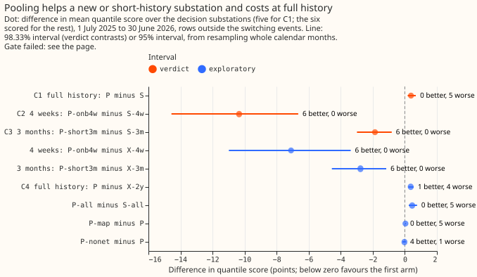
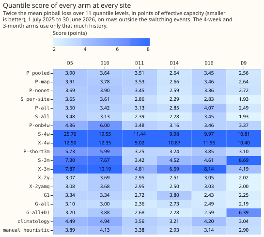
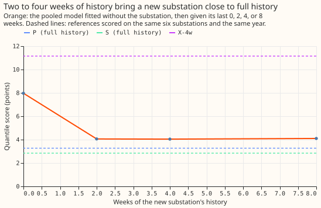
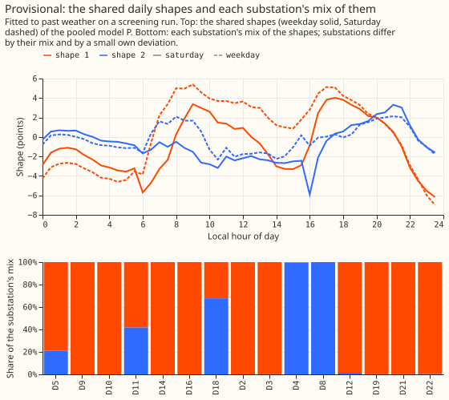
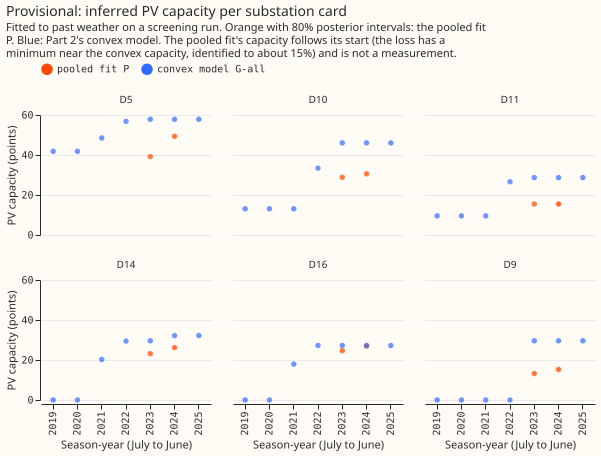
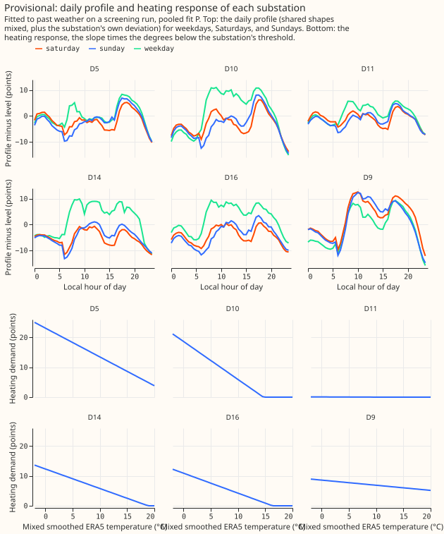
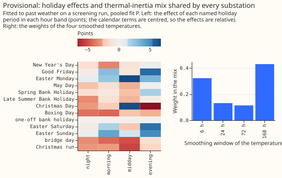
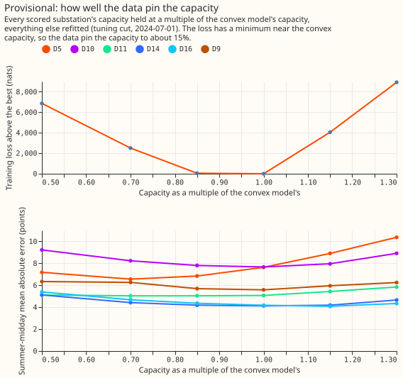

**A pooled neural-network model of substation demand and solar output, fitted across 15 Primary
substations, forecasts a brand-new substation well from 2 to 4 weeks of its own readings, and
forecasts a substation with 2 years of history worse than a model fitted to that substation
alone.** By the series' pre-registered success rule (C2 or C3 supported, and C1 passing), pooling is
**not yet a success**, because C1 is refuted. The practical finding beside it, chosen after seeing
the results, is that the pooled model is much better than every per-site model fitted to the same 4
weeks or 3 months, a per-site convex model included, and worse at full history. The page is
provisional: it is a first screening run on past weather, and one of the four known-answer checks
(gate test 2, the injected-farm recovery) failed, which caps the verdict at `inconclusive`.

We asked whether one model for many substations (the "pooled" model) forecasts a substation as well
as a model fitted to that substation alone (the "per-site" model), and forecasts a new or
short-history substation clearly better. Every model predicts a substation's demand minus its
embedded solar output from the calendar, the temperature, and the sun, and is fitted by gradient
descent (differentiable physics, "DP"). We scored each arm on the 12 months from 1 July 2025, with
one frozen fit and no refits, on the five Primary substations with 2 years of history (D5, D10, D11,
D14, and D16, the "decision substations") and on D9, which holds 21 months of that window. A lower
quantile score is better. Pooling is judged by the forecast scores, not by the inferred solar
capacity.

**Terms used below.**

- **C1** asks whether the pooled model is no worse than the per-site model, by more than 0.10
  points, at the 5 decision substations with 2 years of history.
- **C2** asks whether the pooled model beats the per-site model for a substation with only 4 weeks
  of history, and **C3** asks the same for 3 months. "Onboarding" a new substation means fitting
  only its own settings (its daily profile, heating slope, and PV capacity) to its first weeks of
  readings, with everything the other substations share held fixed.
- **Centred spread:** the forecast interval is fitted from past forecast errors with their mean
  removed, so the interval sits around the mean forecast.
- **K** is the number of shared daily shapes in the pooled model; **nats** are the unit of the
  training loss; **the interaction network** is the small neural network that lets the calendar
  and weather inputs interact; **vintages** are experiment 45's weekly estimates of each
  substation's PV capacity; **coverage** at a quantile is the share of readings below it.
- **Gate** means four known-answer tests on synthetic or injected data whose right answer is
  known (section "Known-answer gate").

## Figures

**Pooling is worse by 0.385 at full history and better by about 10 points at 4 weeks.**

**A per-site model fitted to only 4 weeks scores about 14 or worse; the pooled onboarding arm scores
about 4.** The five decision substations plus D9, in the order of the tables below.

**Two to four weeks of history put a new substation within 0.8 points of full history.**

**The pooled model uses two shared daily shapes, and most substations sit wholly on one of them.**

**The pooled fit's capacities are lower than the convex model's at five of the six scored
substations.**

**Each substation has its own daily profile and heating response.**

**The holiday effects and the mix of smoothed temperatures are shared by every substation.**

**Fixing the capacities near the convex values gives the lowest training loss.**

## Results

**Arms with 2 years of history, mean quantile score on the five decision substations (six with
D9).**

| Arm | What it is | Five | Six |
|---|---|---|---|
| P | pooled model, 15 substations, 2 years | 3.420 | 3.272 |
| P-map | P with spreads fixed by tuning (maximum a posteriori fit) | 3.459 | 3.317 |
| P-nonet | P without the interaction network | 3.395 | 3.279 |
| S | the same model fitted to one substation at a time | 3.035 | 2.844 |
| P-all | P fitted on every usable year | 3.387 | 3.233 |
| S-all | S fitted on every usable year | 2.928 | 2.755 |
| X-2y | lagless XGBoost on the same inputs | 3.056 | 2.877 |
| X-2yamq | X-2y with a solar-output offset | 3.048 | 2.868 |
| G-all, G-all+D1, G1 | Part 2's convex models (spread centred): all years, with drift, 12 months | 3.072, 2.784, 2.822 | 2.917, 2.701, 2.703 |
| climatology, manual heuristic | reference forecasts | 4.068, 3.488 | 3.890, 3.387 |

**Arms with short histories (5 = five decision substations, 6 = with D9).**

| Arm | What it is | Five | Six |
|---|---|---|---|
| P-onb4w | P fitted without the substation, then given its last 4 weeks | 4.18 | 4.04 |
| S-4w | per-site model on the same 4 weeks | 15.13 | 14.38 |
| X-4w | lagless XGBoost on the same 4 weeks (untuned) | 11.30 | 11.15 |
| P-short3m | P fitted with the substation holding only its last 3 months | 4.38 | 4.16 |
| S-3m | per-site model on the same 3 months | 5.47 | 6.03 |
| X-3m | lagless XGBoost on the same 3 months (untuned) | 7.50 | 6.93 |

- **C1, pooling on all rows (non-inferiority, margin +0.10): refuted.** P minus S is +0.385 (98.33%
  interval +0.178 to +0.689); P is worse at 5 of 5 substations (D10 only +0.03), more in winter
  (+0.66) than in summer (+0.21). Leaving out any one substation leaves the estimate between +0.31
  and +0.48, with the interval above zero. The error of the mean forecast says the same (+0.61).
- **C2, onboarding with 4 weeks: supported.** The pre-registered contrast P-onb4w minus S-4w is
  −10.95 (98.33% interval −15.12 to −7.28) on the five decision substations, better at 5 of 5, and
  −10.34 (−14.57 to −6.65) with D9, better at 6 of 6. A per-site model fitted to only 4 weeks
  scores poorly everywhere, so S-4w is a weak comparator. The comparisons below are descriptive:
  X-4w is untuned and uses XGBoost's own quantiles, a departure from the plan, so it is a weak
  comparator too; P-onb4w minus X-4w is −7.10 (95% interval −10.98 to −3.38), better at 6 of 6.
  The onboarding curve on the six substations is 7.97 at 0 weeks, 4.06 at 2, 4.04 at 4, and 4.10
  at 8; full-history P scores 3.27 on the same six, and P-onb4w minus P is +0.76 (0.32 to 1.20) on
  the five. **P-onb4w only ties climatology fitted on the substation's full history** (+0.12,
  −0.33 to +0.57) and is worse than the manual heuristic (+0.70, +0.23 to +1.19).
- **C3, short history of 3 months: supported.** P-short3m minus S-3m is −1.09 (98.33% interval
  −2.01 to −0.34) on the five, better at 5 of 5, and −1.86 (−2.99 to −0.82) with D9, better at 6
  of 6; D9 contributes −5.59 of the six-substation figure. Against X-3m it is −2.77 (−4.56 to
  −1.16), descriptive. P-short3m ties climatology on full history (+0.32, −0.46 to +1.21).
- **D18, with 4 months of history at the cut** (descriptive, in no count): P 5.08, S 5.84, X-2y
  8.44, P-all 5.32, S-all 5.93.
- **C4, the pooled model against lagless XGBoost** (labelled, outside the verdict): P minus X-2y is
  +0.36 (+0.21 to +0.55), worse at 4 of 5 substations; the tuning-year winner among the XGBoost
  arms was not computed, so the contrast is shown against each (+0.36 for X-2y and X-2yq, +0.37
  for X-2yamq). The per-site model S ties XGBoost (S minus X-2yq −0.02, −0.13 to +0.08).
- **C5, the pooled model on all years against Part 2's convex models** (descriptive): P-all minus
  G-all+D1 +0.60 (+0.22 to +1.06), minus G1 +0.57 (+0.31 to +0.89), minus G-all +0.32 (−0.02 to
  +0.72). P-all minus S-all is +0.46 (+0.24 to +0.76), worse at 5 of 5. The pooled model does not
  clear Part 2's bar.
- **Ablations.** P-map minus P +0.04 (+0.01 to +0.07); P-nonet minus P −0.03 (−0.14 to +0.07), so
  the interaction network adds nothing measurable. The solar offset adds nothing (X-2yamq minus
  X-2yq −0.01).
- **Tails** (coverage at q01, q05, q95, q99; nominal 0.01, 0.05, 0.95, 0.99; five substations): P
  0.015, 0.038, 0.798, 0.903; S 0.012, 0.035, 0.836, 0.927; P-onb4w 0.052, 0.104, 0.946, 0.982;
  P-short3m 0.031, 0.074, 0.891, 0.958; X-2y 0.015, 0.071, 0.788, 0.979; G1 0.014, 0.049, 0.884,
  0.958; G-all+D1 0.025, 0.069, 0.895, 0.962. The pooled and per-site forecasts are too low in the
  upper tail (the 95% quantile covers 80% to 84%), which matters most for curtailment. Pinball
  losses at the four levels are in the stored report under `data/ml-experiments/00105-*/`.
- **Not run, for lack of time on a shared GPU:** the cold block (a Nov 2022 to Feb 2023 test of
  heating extrapolation); the tuning-year replicate of the contrasts (the tuning year's mean
  scores point the same way for C1: P 3.197 against S 2.993 on 2024-25, without an interval); the
  scarce-data rows (bank holidays, the Christmas run, days below 0 °C); G-2y (the convex model on
  the same 2 years); X-pool-onb4w (one XGBoost fitted to the other substations plus the 4 weeks);
  a report of the lagged XGBoost arms; the coastal split; the score by month since the cut; the
  usable-row counts of each short history; the sunny-hour residual against temperature; a
  second-seed point of the capacity profile; the tuning-year winner of the XGBoost arms; the cards
  of the held-out onboarding substations; and the curtailment-cost metric.

### Predictions held and failed

- **Held:** P-map within ±0.1 of P (+0.04); P-nonet within ±0.15 of P (−0.03); the solar offset
  within ±0.05 (−0.01); P's q01 within 1 point of nominal (+0.5) and q05 within 2 points (−1.2);
  the signs of C2 and C3.
- **Failed:** C1 within ±0.15 and spanning zero (+0.385); C2 of −0.5 to −2.0 (−10.95 on the five,
  −10.34 with D9; larger); C3 of −0.2 to −1.0 (−1.09 on the five, −1.86 with D9; larger); C4 of 0.0
  to 0.4 better (0.36 worse); C5 within ±0.3 (+0.60 against G-all+D1) and P-all minus G1 of −0.3 to
  0.0 (+0.57); onboarding within 0.5 of P (+0.76); P-all minus S-all within ±0.15 (+0.46); P's q95
  and q99 within 2 and 1 points (0.798, 0.903); the onboarding and short-history tails; P's
  capacities within ±20% of the vintages' season-year mean at D10, D11, and D16 (season-year 2024:
  30.6, 15.5, and 27.0 points against 43.2, 32.9, and 39.5: −29%, −53%, −32%); every arm under 10
  minutes (S 10.6 minutes, S-all 17.4) and the whole screening under 2 hours (it took many hours
  on a shared GPU, with the gate re-run).

## Known-answer gate

**Gate: failed (test 2).** The plan made each test blocking and capped the verdict at
`inconclusive` if one stayed failed, so the verdict carries the gate failure and no other number on
the page is labelled. All gate tests ran with K = 4 shared shapes, before tuning chose K = 2, and
test 1 runs P with the interaction network off.

- **Test 1, synthetic pooled recovery: passed**, after four post hoc changes to the test (the model
  was not changed; the fitting settings were): 1200 optimiser steps at rate 0.15 (800 steps at rate
  0.05 recovered the threshold within 7 degrees only), the true capacity placed in each
  substation's first trained season-year (the first version put it where no rows existed), the
  daily profile compared as the shape mix plus the per-site deviation after subtracting the mean
  profile (the plan said "loadings", which are not identified one by one), and D9 left out (its
  rows cover 9 months of the tuning window, giving a profile correlation of 0.85 against 0.91 to
  0.99 for the others). The pass: threshold within 0.01 degrees, slopes within 0.3%, capacities
  within 1.2%, profile correlation at least 0.91, and the onboarded substation's slope within 1.2%
  where a per-site fit on the same 4 midsummer weeks missed it by 79%.
- **Test 2, injected-farm recovery: failed, narrowly.** Real output of a solar farm is added to a
  substation's demand at the rows where the farm has a reading (about 30% of rows, night rows
  included), and the fit must recover it without moving other substations or the shared terms. The
  median recovered capacity ratio is 0.78 (limit 0.75 to 1.25); other substations' capacities move
  2.0% to 5.2% (limit 5%; D10 breaches it); and the shared midday output moves 0.06, 0.07, 0.10,
  and 0.11 points at D10, D11, D14, and D16 (limit 0.1). The modules that move differ by
  substation (lighting at D10, the holiday effects at D14, the network at D16). **A noise floor for
  this statistic was not measured.** Refitting the base model with another seed changed the
  network, harmonic, and lighting outputs by 0.3 to 1.9 points (the holiday and tent outputs by
  0.07 and 0.02), which suggests the 0.1 limit sits below the fit-to-fit noise, but that compares
  fits of different seeds, not the paired same-seed fits the test compares. The first version of
  the test, which filled missing farm rows with zeros, recovered 0.70 and moved the shared output
  0.30 to 0.44 points. The weaker capacity prior planned for a retest was not run, because the
  prior does not bind (below).
- **Test 3, placebo twin: passed** for three draws. The fit uses the same site's irradiance from 1,
  2, and 3 years earlier in place of the real irradiance; the summer-midday error is worse and the
  fitted capacity falls at all 6 substations.
- **Test 4, shuffled capacity: passed**, rebuilt as the series brief's Part 3 plan defines it (the
  plan page defined the prior-swap refit below; both definitions existed): swapping the fitted
  capacity paths in MW among the six substations worsens the summer-midday error at 6 of 6 (+0.8 to
  +11.4 points). The first version (swap the capacity prior and refit) was a different test and
  failed (2 of 4); it is kept as a diagnostic: the prior is a few nats against about 340,000 rows,
  so it cannot move a capacity that the data determine.
- **The free fit does not find the capacity that fits best.** Capacity in points, season-year 2023,
  from the K = 4 diagnostic fit at the tuning cut (not the K = 2 decision arm), against Part 2's
  convex model and the vintage mean: D5 50.1, 58.9, 66.0; D10 34.6, 49.2, 39.5; D11 13.5, 31.3,
  28.8; D14 24.7, 30.6, none; D16 24.1, 25.5, 32.9; D9 12.1, 30.4, none. A second seed moves a
  capacity by 0.2 to 2.7 points, starting at the convex capacities lands elsewhere (D5 29.7, D16
  18.7, D9 22.9), with the network off D11 is 20.6 and D9 17.6, and a vintage-anchored prior with
  scale 5 changes nothing. The capacity profile (the last figure) fixes every substation's
  capacity at 0.5 to 1.3 times the convex capacity and refits the rest: the training loss is
  774,009 nats at 0.5, 769,644 at 0.7, 767,187 at 0.85, 767,141 at 1.0, 771,197 at 1.15, and
  776,076 at 1.3, a clear minimum near the convex capacity, flat within 46 nats between 0.85 and
  1.0. **The free fit's loss is 771,694 nats, 4,553 above the loss with the capacities pinned at
  the convex values (767,141).** The data therefore carry information about capacity, between
  about −15% and +10% of the convex value (the profile is flat on the low side), and the free fit
  did not find the best capacity.
- **Why the free fit misses it is only partly tested.** The pinned and free fits differ in their
  posterior sampling and in the Kullback-Leibler term. Three post hoc variants (screening tier,
  tuning cut, K = 4; the primary P is unchanged) were fitted: (a) hides the temperature from the
  interaction network by day, (c) starts the capacities at the convex path, and (a+c) does both.
  Training loss in nats: free fit 771,694, network off 777,200, (a) 768,292, (c) 777,050, (a+c)
  774,771, against 767,141 with the capacities pinned. Variant (a) closed 3,402 of the 4,553 nats;
  the combined variant (a+c) did not, so the evidence is mixed. The variants' capacities are in
  `work/diagnostics.json` and the losses in `work/variant_losses.json`. **None of the variants
  clears the leak test (gate test 2).** (a) recovers 0.78 of the injected capacity and moves other
  substations' capacities by at most 3.2%, so it passes those two limits, and fails only the
  midday limit, with shared midday output moves of 0.07, 0.14, 0.16, and 0.18 points at D10, D11,
  D14, and D16. (c) recovers 0.53 (fails) and moves the midday output by 0.50, 0.20, 0.09, and 0.24
  (fails), with other capacities moving by at most 3.5%. (a+c) recovers 0.54 (fails), moves other
  capacities by up to 6.7% (fails the 5% limit; the only variant to do so), and moves the midday
  output by 0.21, 0.22, 0.10, and 0.83 (fails), so it fails all three. Hiding temperature from the
  network therefore does not remove the leak, and starting at the convex capacities lowers the
  recovered capacity.

## Post hoc comparison with per-site convex and fleet-profile baselines on the same short history

- **Mean absolute error of the mean forecast over the six scored substations** (descriptive; the
  convex model's ridge tuned on the tuning year; no quantiles built): with 4 weeks, the pooled
  P-onb4w 6.88, a per-site convex model (Part 2's, no drift) 12.79, XGBoost's median 13.97, a
  fleet-profile baseline (the other substations' mean daily profile shifted to the substation's
  own 4-week level) 16.24, and the per-site neural model S-4w 20.06. With 3 months: P-short3m 7.07,
  per-site convex 8.46, XGBoost's median 8.99, S-3m 9.55, fleet profile 15.08.
- **Pooling therefore beats a per-site convex model fitted to the same history, not only the
  per-site neural model**, by 5.9 points at 4 weeks and 1.4 at 3 months; the fleet-profile shift is
  worse than both. The neural pooled model is the only pooled model tested here; a pooled convex
  model, planned separately, would show whether the gain comes from pooling or from the neural
  form.

## Equivalence check

- **The per-site neural model, configured like the convex model, does not reproduce its score.**
  With no interaction network, no shared shapes, a weak penalty on the deviation, and the capacity
  pinned to the convex path, it scores 3.326 on all years against Part 2's G-all at 3.072 (+0.25,
  0.12 to 0.41), worse at 5 of 5 substations, mostly D10 (+0.90; the others +0.05 to +0.12). The
  error of the mean forecast, which the spread does not touch, gives +0.60 (+0.43 to +0.78). The
  setup left the daily profile (48 half-hours by 4 day types) nearly unpenalised where G has a
  tuned ridge, so the gap is regularisation and optimisation, not a bug we found. S-all, with its
  shared shapes and network, scores 2.928, better than this setup.
- **Why P loses to S in C1 is therefore only partly explained:** P-nonet minus P is −0.03, so the
  interaction network is not the cause, and the per-site model set up like G is 0.25 worse than G,
  mostly at D10.

## Tuning

- Tuned on 2024-25 by quantile score (a fit before 2024-07-01 and a replica fit before 2023-07-01
  for the spread): K = 2 shared shapes scored 3.197 against 3.255 for K = 4 and 3.207 for K = 6;
  the maximum a posteriori model's deviation scale 1.0 (3.235 against 3.319 and 3.280); the
  per-site model's 1.0 (2.993, 3.001, 2.993); the short-history per-site model's 1.0, by the error
  of the mean forecast. The short-history per-site models score about 14 points on the tuning year
  whatever the penalty.

## Checks

- **No leakage in the onboarding arms, by construction.** Every fit (the final leave-one-out fits,
  the replica fits, the short-history fits) is trained only on rows ending at or before its cut,
  for every substation in the pool, and the pooled batch builder raises if a row ends after the
  cut. The final fits cut at 2025-07-01 and score from that instant; the replica fits cut at
  2024-07-01 and their residuals cover only 2024-07-01 to 2025-07-01, so a held-out substation's
  scored rows never reach any fit's training rows. The caveat on the spread stays: the replica fits
  contain the other held-out substations' own rows before 2024-07-01.
- **Median forecast minus mean forecast, per site** (points; P): D5 0.01, D9 −0.38, D10 −1.70, D11
  0.81, D14 0.24, D16 0.16, D18 0.95. Every arm's spread is centred on the mean, so these gaps are
  skew, not shift (P-onb4w shows −0.42 to +0.14). D10's gap (−1.7) comes from its unlabelled
  switching windows.
- **Error of the mean forecast beside every contrast:** C1 +0.61 (same direction), C2 −13.18 on the
  six (−13.86 on the five), C3 −2.48 on the six (−1.74 on the five), C4 worse, C5 worse. No
  contrast points the other way.
- **Audit triggers** (the `ml-experiment` skill's list): fired for a failed control (gate test 2),
  for a result that contradicts its prediction (C1, whose explanation is only partly tested above),
  and for later designs that depend on this result (Part 4 and the pooled convex experiment). Not
  fired for a quantile-score contrast that disagrees with its mean-error contrast, for a contrast
  that flips sign when one substation is left out (P-all minus G1 is +0.33 without D16), for a
  nested arm beating the arm that contains it, or for an interval much wider or narrower than a
  sister experiment's.
- **Leave-one-out and season splits** for every contrast, D10 with its 2025-11-17 to 2025-12-14 jump
  masked, and the error of the mean forecast are in the stored report; none flips C1, C2, or C3.

## Substation cards

**Provisional: fitted to past weather on a screening run.** Figures 5 to 7 are the cards of the
decision arm P: capacity per season-year (pooled fit with 80% posterior intervals, next to Part 2's
convex model), the mix of shared shapes and the resulting daily profile per day type, the heating
response (slope and threshold), and the holiday and thermal-inertia effects. Drift is absent from P.
The vintage capacities of season-year 2024 are D5 62.1, D10 43.2, D11 32.9, and D16 39.5 points,
against the pooled fit's 49.3, 30.6, 15.5, and 27.0. Three reading notes: the pooled neural fit's
capacity follows its start (the loss has a minimum near the convex value, so the data pin it to
between about −15% and +10%) and is not a measurement; the posterior intervals are far too narrow
(the variational posterior stayed near its starting spread of 0.05, so they do not show the real
uncertainty); and the shape mixes are close to 0 or 1 (K = 2 acts as two clusters: D4 and D8, two
substations of the pool of 15, sit wholly on the second shape, D18 mostly, and D5 and D11
partly). The cards of the held-out onboarding substations were not drawn in this run.

## What the next experiment should answer

- **Use the pooled model for onboarding and a per-site model for mature substations** (a post hoc
  design reading, untested): the pooled neural model beats the per-site models fitted to the same
  4 weeks or 3 months (mean absolute error 6.88 against 12.79 for a per-site convex model at 4
  weeks, 7.07 against 8.46 at 3 months), and is worse at full history (C1 +0.385).
- **Fit the optimiser properly before drawing more from the equivalence gap (+0.25) and the
  capacity profile (4,553 nats above the pinned fit).** A variable-projection fit, which solves all
  linear coefficients exactly with the bounded convex solver at each step and takes gradient steps
  only for the heating threshold, the thermal-inertia mix, the shape loadings, and the network
  weights, is planned separately and is the recommended next step.
- **Where does the pooled model lose at full history?** C1 and P-nonet say the interaction network
  is not the cause. Test whether per-site heating and calendar terms on top of a shared fleet mean
  (the pooled convex model, planned separately) keep the onboarding gain without the full-history
  loss.
- **Can a new substation start from a pooled model and move to a per-site model as history grows?**
  On the five decision substations, the onboarding curve is flat from 2 to 8 weeks at 4.1 to 4.3,
  against 3.0 for a per-site model with 2 years.
- **Fix the capacity fit before Part 5:** the data pin the capacity to between about −15% and +10%
  and the free fit misses it, so profile the capacity out or fit it by a second-order method.

## Caveats

- ERA5 temperature and CAMS irradiance (the weather and sunshine estimates of past weather) flatter
  the solar term; the switching masks are hindsight labels; a frozen fit is staler than a
  production model, which is refitted weekly; five decision substations and one year give wide
  intervals.
- The spread for a new substation uses the other substations' replica residuals, from fits that saw
  the new substation's rows before the replica cut (a new substation would not have them). The
  hyperparameters were tuned on a year that includes the held-out substation's history.
- Both onboarding histories (April to June) are summer histories; a winter onboarding is untested.
- Run time and memory: P 256 s (0.44 GB) including its replica fit; S 636 s; P-all 463 s (0.86 GB);
  S-all 1,045 s. The GPU was shared throughout.
